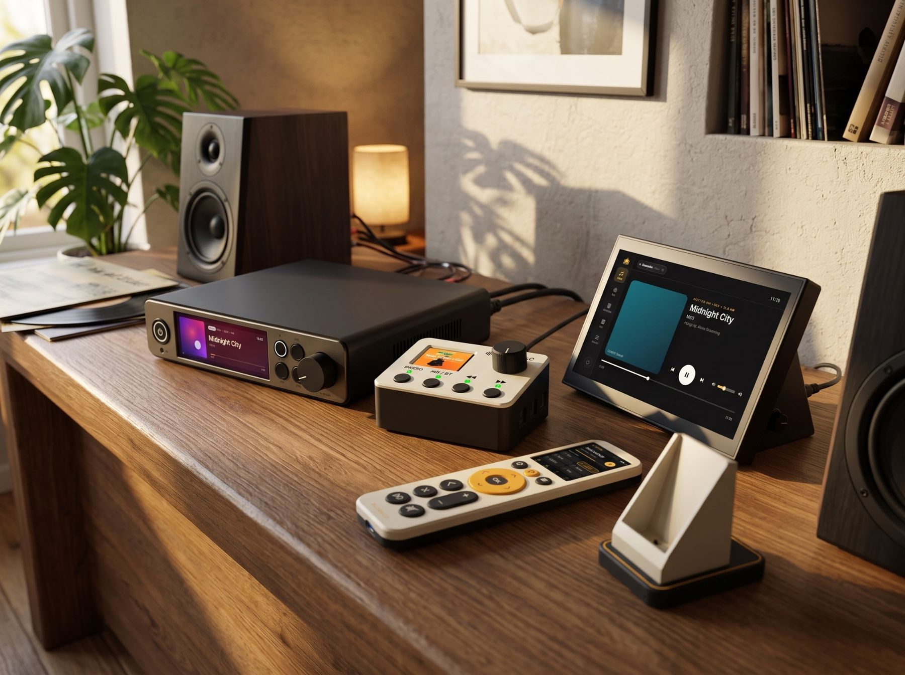

<p align="center"></p>

<h1 align="center">Skjold</h1>

<p align="center"><b>Musikk i alle rom.</b><br>
Forsterkere, spillere og høyttalere som spiller sammen, styrt fra én app.<br>
Åpen programvare. Tegnet og bygget i Norge av Skjold Lab.</p>

<p align="center">
<a href="https://skjold.smarthjemexperten.no/">Nettside</a> ·
<a href="https://github.com/SebastianKristo/pult-forsterker/releases/latest">Last ned</a> ·
<a href="docs/TOTALINSTRUKS.md">Kom i gang</a> ·
<a href="docs/api/intro.md">API</a>
</p>

---

Skjold er et lydsystem du kan bygge selv. Hver enhet er en Raspberry Pi eller ESP32 med Skjold-programvaren, og alle
dukker opp i samme app. Spill det samme i hele huset, eller noe forskjellig i hvert rom.

## Produktene

| | Hva | Bygget på |
|---|---|---|
| **[Skjold S1](https://skjold.smarthjemexperten.no/s1/)** | Streamingforsterker for skrivebordet. 2 × 50 W, 4,58″ skjerm, USB-bryter for to PC-er. | Raspberry Pi 4, TPA3116D2 |
| **[Skjold Node](https://skjold.smarthjemexperten.no/node/)** | Liten nettverksspiller for rom som allerede har forsterker. | Raspberry Pi 4 eller 3B |
| **[Skjold Touch](https://skjold.smarthjemexperten.no/touch/)** | Spiller med 7″ berøringsskjerm. | Raspberry Pi 4, PCM5122 |
| **[Skjold Røst](https://skjold.smarthjemexperten.no/rost/)** | Aktiv høyttaler med grill hele veien rundt, skjerm og volumknott. | ESP32-S3 |
| **[Skjold Stav](https://skjold.smarthjemexperten.no/stav/)** | Fjernkontroll med 2,8″ berøringsskjerm, IR og ladedokk. | ESP32 (ESPHome) |
| **[Skjold Core](https://skjold.smarthjemexperten.no/core/)** | Bare programvaren, på en Raspberry Pi du allerede har. | Raspberry Pi 4 eller 3B |
| **Kassett, Hjul, Radio, Sans** | NFC-kassettspiller, dreieknapp-fjernkontroll, kjøkkenradio og romsensor. | ESP32 / Raspberry Pi |

## Dette kan den

- **Kilder:** AirPlay 2, Spotify Connect, Blåtann, internettradio, AUX og USB-lyd fra PC.
- **Bibliotek:** Navidrome, Plex, YouTube Music og Lyrion Music Server.
- **Flere rom:** synkron avspilling og grupper, med volum per rom.
- **Lyd:** equalizer per kilde, loudness og romkorreksjon med mikrofonen i telefonen.
- **Smarthus:** Home Assistant, Homey, Apple Hjem, Matter og MQTT. Enhetene finnes automatisk på nettverket.
- **Styring:** app for iPhone og Android, nettleser, knappene på enheten, fjernkontroll eller API.

## Kom i gang

1. **Last ned [Skjold Flasher](https://github.com/SebastianKristo/pult-forsterker/releases/latest)** for Mac, Windows eller Linux.
2. **Velg enhet** (S1, Touch, Node eller Core), skriv inn Wi-Fi og navn, og skriv SD-kortet.
3. **Sett kortet i Raspberry Pi-en.** Første oppstart installerer Skjold. Det tar 15–20 minutter.
4. **Åpne appen** eller `http://<navn>.local:8765` i nettleseren.

Hele veien fra SD-kort til smarthus står i [docs/TOTALINSTRUKS.md](docs/TOTALINSTRUKS.md).

Vil du installere for hånd på en ferdig Raspberry Pi OS?

```bash
git clone https://github.com/SebastianKristo/pult-forsterker.git && cd pult-forsterker
```

```bash
KI_AMP_BOARD=node bash pi/install.sh
```

Bytt `node` med `main` (S1), `touch` eller bruk `KI_AMP_CORE=1` for Core. Alle valgene står øverst i [`pi/install.sh`](pi/install.sh).

## Last ned

Alt ligger samlet i [siste utgivelse](https://github.com/SebastianKristo/pult-forsterker/releases/latest):

- **Skjold Flasher** (`.dmg`, `.exe`, `.AppImage`)
- **Android-appen** (`.apk`) og **iOS-appen** (usignert `.ipa`)
- **Filer til 3D-printer** for alle produktene, ferdig satt opp for Creality K2 (`.3mf`), pluss STL og OpenSCAD
- **Bruksanvisning** (PDF) og **fastvare** for Røst

## Hva som ligger hvor

| Mappe | Innhold |
|---|---|
| [`pi/`](pi/) | Forsterkerprogrammet (`ki_amp_daemon.py`), installasjon, oppdatering og tester |
| [`skjold/app/`](skjold/app/) | Web-appen (Preact) og skjermbildet til Touch |
| [`skjold/ios/`](skjold/ios/), [`skjold/android/`](skjold/android/) | Appene for iPhone (SwiftUI) og Android (Compose) |
| [`skjold/flasher/`](skjold/flasher/) | Skjold Flasher (Electron) |
| [`skjold/os/`](skjold/os/) | Skjermprogrammet på S1 og Node |
| [`skjold/nettside/`](skjold/nettside/) | Nettsiden |
| [`kabinett/`](kabinett/) | 3D-modeller og utskriftsfiler. Hvert produkt har sin `LES_MEG.md` |
| [`pcb/`](pcb/), [`esphome/`](esphome/) | Kretskort og ESPHome-oppsett |
| [`custom_components/skjold/`](custom_components/skjold/), [`ha-kort/`](ha-kort/) | Home Assistant-integrasjonen og kortet (HACS) |
| [`homey/`](homey/) | Homey-appen |
| [`docs/`](docs/) | Veiledninger og [API-dokumentasjon](docs/api/intro.md) |

Flere veiledninger: [Skjold Touch](docs/SKJOLD_TOUCH.md) · [Flere rom](docs/MULTIROOM.md) · [Skjold-hjem](docs/SKJOLD_HJEM.md) ·
[Fjernstyring](docs/FJERNSTYRING.md) · [Plugins](docs/PLUGINS.md) · [Proxmox og vanlig PC](docs/PROXMOX.md) ·
[Den første pultforsterkeren](docs/PULTFORSTERKER.md)

## Utvikling

```bash
cd pi && python3 -m pytest -q tests
```

```bash
cd skjold/app && npm ci && npm run dev
```

Web-appen kan kjøres mot en falsk enhet: `python3 skjold/ios/ci/mock_skjold.py 8765`, og åpne
`http://localhost:5173/?host=http://127.0.0.1:8765`.

## Status

Skjold er et byggeprosjekt og er ikke til salgs. Programvaren er i daglig bruk, men ikke alt er testet på alle
kombinasjoner av maskinvare. Finner du en feil, [meld den her](https://github.com/SebastianKristo/pult-forsterker/issues).

## Lisens

- **Programvare** (`pi/`, `skjold/app`, `skjold/os`, `skjold/flasher`, integrasjonene): MIT. Se [LICENSE](LICENSE).
- **Maskinvare, design og dokumentasjon** (`pcb/`, `kabinett/`, `skjold/design/` m.m.): CC BY-NC-SA 4.0. Du kan bygge
  selv, men ikke for salg. Se [LISENS-MASKINVARE.md](LISENS-MASKINVARE.md).
- **Nettsiden** (`skjold/nettside/`): alle rettigheter forbeholdt.

Full oversikt står i [LISENS.md](LISENS.md). Kommersiell lisens: jemtlands@proton.me
