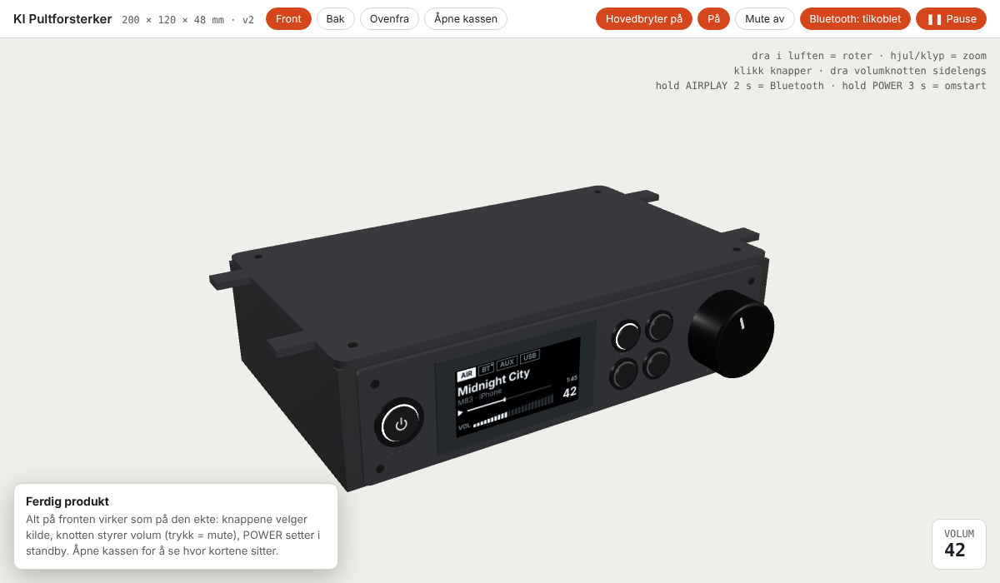
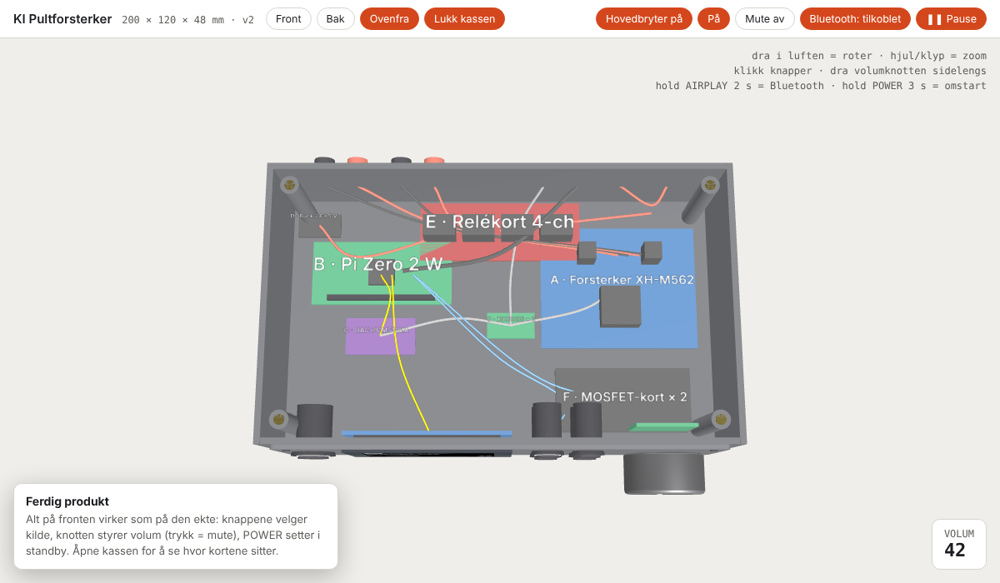

# KI Pultforsterker

DIY stereoforsterker (2 × 50 W) som henger under pulten. AirPlay 2, Bluetooth, AUX og USB-lyd fra PC/Mac, OLED-skjerm, fem LED-knapper og volumknott. Styres også fra **Home Assistant** og **Homey**.



| | |
|---|---|
| **Kabinett** | 3D-printet, 200 × 120 × 48 mm, tre deler (kasse, lokk, frontplate) |
| **Hjerne** | Raspberry Pi Zero 2 W + PCM5102A I2S-DAC |
| **Forsterker** | XH-M562 (TPA3116D2) 2 × 50 W, 24 V |
| **Innganger** | AirPlay 2 (Shairport Sync), Bluetooth A2DP (bluealsa), AUX 3,5 mm (relé), USB-C (Pi som UAC2-lydkort) |
| **Volum** | 2 × X9C103S digitalpot i lydveien, styrt av KY-040 encoder |
| **Skjerm** | 2,42" SSD1309 OLED 128 × 64, I2C |
| **Integrasjoner** | Home Assistant custom-integrasjon (mDNS-oppdagelse) · Homey SDK3-app |

## Innhold i repoet

```
pi/                 Programvare til Raspberry Pi (daemon, OLED, install.sh, systemd, ALSA)
homeassistant/      custom_components/ki_pultforsterker + eksempel-package
homey/              Homey-app no.kristo.ki-pultforsterker
kabinett/           OpenSCAD-kilde, ferdige STL-er, verktøy for render og veiledninger
docs/               Byggeveiledning (PDF + markdown), bildeveiledning (PDF), alle renders
3d-visning/         Interaktiv 3D-modell av ferdig produkt (three.js, én HTML-fil)
design-referanse/   Opprinnelig designpakke (front, OLED-layout, oppførsel, farger)
```

## Kom i gang

1. **Deler** – se delelisten i [docs/byggeveiledning.md](docs/byggeveiledning.md) og `docs/KI_Pultforsterker_Bildeveiledning.pdf`.
2. **Print** `kabinett/stl/v2_frontplate.stl` først (prøv knappene i den), så `v2_body.stl` og `v2_lid.stl`. Parametrene står i `kabinett/scad/pultforsterker_v2.scad`.
3. **Pi:** Raspberry Pi OS Lite 64-bit, vertsnavn `pultamp`, SSH + Wi-Fi på. Kopier `pi/` til Pi-en og kjør `bash install.sh` (20–30 min), deretter `sudo reboot`.
4. **Bygg** etter [bildeveiledningen](docs/KI_Pultforsterker_Bildeveiledning.pdf) (LEGO-stil, steg 0–16) – tabellene står i [byggeveiledningen](docs/KI_Pultforsterker_Byggeveiledning.pdf).
5. **Home Assistant:** kopier `homeassistant/custom_components/ki_pultforsterker` til `config/custom_components/`, start HA på nytt – forsterkeren dukker opp under *Oppdagede enheter*. Valgfritt: `pi/ki_pultforsterker_package.yaml` i `packages/`.
6. **Homey:** `cd homey/no.kristo.ki-pultforsterker && npm i && homey app install`.

## Programvare på Pi-en

| Fil | Gjør |
|---|---|
| `ki_amp_daemon.py` | Hoveddaemon: knapper, encoder, LED-ringer, reléer, X9C-volum, HTTP-API (port 8765), mDNS `_kipultamp._tcp`, tilstand i `/var/lib/ki-amp/state.json` |
| `oled_display.py` | Tegner OLED-grensesnittet (luma.oled, SSD1309) etter `design-referanse/DESIGN.md` |
| `install.sh` | Setter opp config.txt (hifiberry-dac, I2C, dwc2, serial av), bygger Shairport Sync + NQPTP, bluealsa, USB-gadget-lyd, systemd-tjenester |
| `asound.conf` | ALSA dmix – deler DAC-en mellom AirPlay, Bluetooth og USB |
| `shairport-sync.conf` | AirPlay 2, metadata-pipe til OLED |
| `ki-amp.env` | Navn, port, relé-polaritet (kopieres til `/etc/ki-amp.env`) |
| `*.service` | systemd: `ki-amp`, `oled-display`, `ki-usb-audio`, `bluealsa-aplay` |

### HTTP-API

```
GET  /api/status            {"power":true,"input":"airplay","volume":42,"mute":false,"playing":true,"title":...,"artist":...,"bt":"connected"}
POST /api/power   {"on":true}
POST /api/toggle
POST /api/input   {"input":"airplay|bt|aux|usb"}
POST /api/volume  {"volume":0-100}
POST /api/mute    {"mute":true}
POST /api/bt      {"pairing":true}
```

### GPIO (BCM)

| Funksjon | GPIO | | Funksjon | GPIO |
|---|---|---|---|---|
| I2C SDA / SCL (OLED) | 2 / 3 | | LED-ring AIRPLAY / BT / AUX / USB | 7 / 8 / 9 / 10 |
| OLED RES | 4 | | LED-ring POWER (PWM) | 11 |
| I2S BCK / LCK / DIN (DAC) | 18 / 19 / 21 | | Relé AUX-valg (1+2) | 22 |
| Knapp AIRPLAY / BT / AUX / USB | 5 / 6 / 12 / 13 | | Relé forsterker-strøm (3) | 27 |
| Knapp POWER | 16 | | X9C INC / U/D / CS | 26 / 14 / 15 |
| Encoder CLK / DT / SW | 23 / 24 / 25 | | | |

Serial console må være av (GPIO 14/15 brukes av X9C) – `install.sh` gjør det.

## Bruk

| Handling | Gjør |
|---|---|
| Velg kilde | trykk AIRPLAY / BT / AUX / USB |
| Volum / mute | vri knotten / trykk den |
| Standby / på | kort trykk POWER |
| Omstart | hold POWER 3 s |
| Bluetooth-parring | hold AIRPLAY 2 s (synlig som «Pultforsterker») |
| USB-lyd | koble PC til USB-C bak, velg lydenheten «UAC2 Gadget» |

## Interaktiv 3D-modell

`3d-visning/index.html` er en selvstendig side (three.js fra CDN). Åpne den i en nettleser: roter, åpne kassen, trykk på knappene, dra i volumknotten – skjermen tegnes 1:1 etter designet.



## Bygge dokumentasjonen selv

Se [kabinett/tools/README.md](kabinett/tools/README.md): STL fra SCAD-parametrene (manifold3d), 2D-planer (matplotlib), LEGO-steg (three.js + Playwright) og PDF-ene.

## Farger

| Del | Farge |
|---|---|
| Kasse og lokk (matt PLA – «Charcoal», «Anthracite», «Dark Grey») | `#2C2D30` |
| Frontplate (samme filament; lysere i modellen pga. lyset) | `#37383C` |
| Inngangsknapper og POWER (svartoksidert metall, hvit LED-ring) | `#1D1D20` |
| Volumknott (svart anodisert aluminium) | `#18181A` |
| OLED-vindu (røykfarget/grå akryl) | `#060708` |
| Etiketter front/bak | `#A3A29D` |
| OLED tekst / dempet / spor / bakgrunn | `#EEF6FF` / `#7D8A94` / `#2A3036` / `#000000` |
| LED-ringer | hvit; POWER dimmet til ca. 10 % i standby |
| Høyttalerterminaler + / − | `#A3261D` / `#141415` |

Renderne i `docs/` bruker disse fargene med noe sterkere lys så antrasitten leses på papir.

## Lisens

MIT – se [LICENSE](LICENSE).
