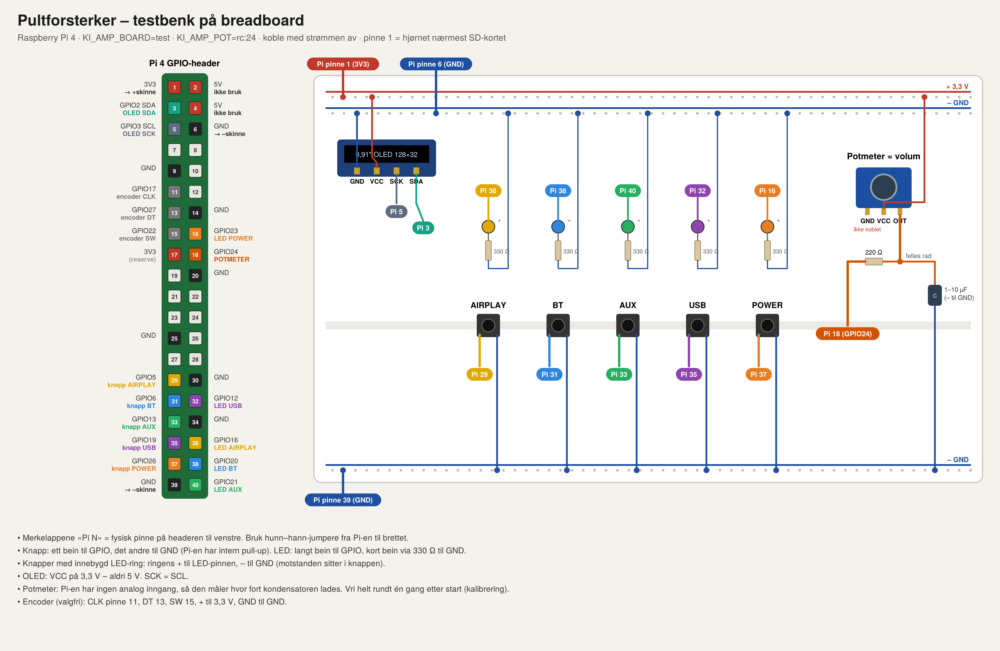
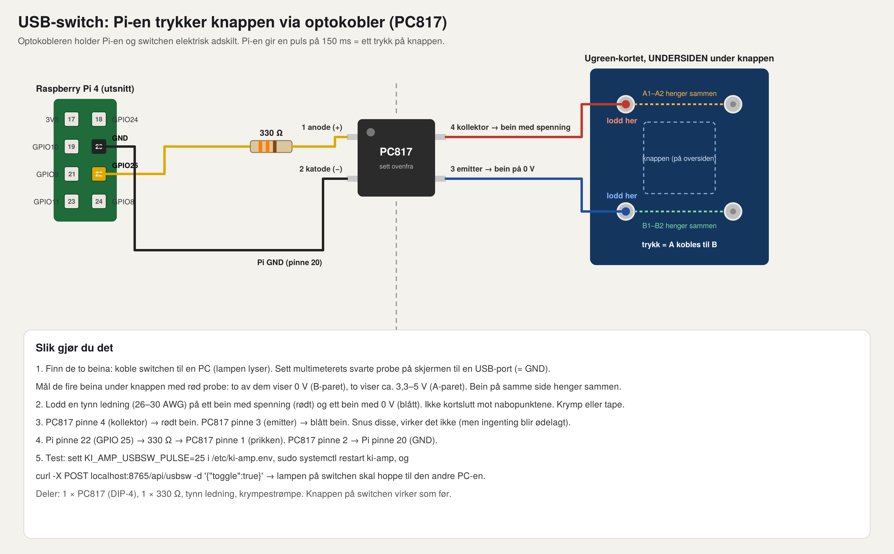

# Pultforsterker – totalinstruks

Alt fra tomt SD-kort til ferdig forsterker styrt fra Home Assistant og Homey. Følg kapitlene i rekkefølge; hvert kapittel ender med en sjekk som må være grønn før du går videre. Kommandoer merket **PC** kjøres på Mac/PC, resten på Pi-en over SSH.

Rekkefølgen er lagt opp slik at du kan **teste hele programvaren på Pi 4 før hovedkortet kommer** (kapittel 1–8, lyd ut på Pi-ens 3,5 mm), og så bare bytte til hovedkortet (kapittel 9) uten å installere på nytt.

---

## 0. Du trenger

| | |
|---|---|
| Raspberry Pi 4 B (4 GB) + microSD 16 GB eller mer (A1/A2-klasse) | har |
| USB-C strømforsyning 5 V 3 A til testing (senere 5 V fra hovedkortet) | |
| Nettverkskabel til ruteren (Wi-Fi går også) | |
| PC/Mac med [Raspberry Pi Imager](https://www.raspberrypi.com/software/) | |
| 3,5 mm-kabel til aktiv høyttaler (kun for test før hovedkortet) | |
| Resten av delene: `pcb/DELELISTE_MED_PCB.md` | |

---

## 1. SD-kort (PC)

1. Åpne **Raspberry Pi Imager** → *Choose device*: Raspberry Pi 4 → *Choose OS*: **Raspberry Pi OS Lite (64-bit)** (under «Raspberry Pi OS (other)») → *Choose storage*: SD-kortet.
2. Trykk **Next → Edit settings** og fyll inn:
   - **General**: Hostname `pultamp` · Username `sebastian` + passord · Wireless LAN (bare hvis du ikke bruker kabel) · Locale `Europe/Oslo`, keyboard `no`.
   - **Services**: ✅ *Enable SSH* → *Use password authentication* (eller lim inn din offentlige nøkkel).
   - **Options**: ✅ *Eject media when finished*.
3. **Save → Yes → Yes**. Vent til «Write successful». Sett kortet i Pi-en.

> Tips: ligger `~/.ssh/id_ed25519.pub` på Mac-en, velg *public-key authentication* – da slipper du passord på alle `ssh`/`scp`.

---

## 2. Første oppstart

Koble nettverkskabel og strøm. Første oppstart tar ~1 min (den utvider filsystemet og starter på nytt én gang).

```bash
# PC
ssh sebastian@pultamp.local
# Finner den ikke navnet: se Pi-ens IP i UniFi (klient «pultamp») og bruk ssh sebastian@<ip>
```

Svar `yes` på fingeravtrykket. Når du er inne:

```bash
sudo apt-get update && sudo apt-get -y full-upgrade && sudo reboot
```

Logg inn igjen etter omstart og sjekk:

```bash
cat /proc/device-tree/model      # Raspberry Pi 4 Model B Rev 1.x
hostname -I                       # IP-adressen – noter den
```

**Sjekk:** SSH virker og modellen er Pi 4. ✅

Valgfritt, men lurt: gi Pi-en fast IP i UniFi (Clients → pultamp → Settings → Fixed IP) så HA/Homey alltid finner den.

---

## 3. Hent prosjektet

```bash
sudo apt-get -y install git
git clone https://github.com/SebastianKristo/pult-forsterker.git
cd pult-forsterker/pi
```

Senere oppdateringer: `cd ~/pult-forsterker && git pull && bash pi/update.sh` (raskt, beholder innstillingene dine).

---

## 4. Installer programvaren

Skriptet gjør alt: config.txt (I2S/I2C/SPI/USB-gadget), ALSA-loopback, CamillaDSP, bygger NQPTP + Shairport Sync (AirPlay 2), bluealsa (Bluetooth), USB-lydkort-gadget, OLED-tjeneste og KI-daemonen. Det tar **20–30 min** (mesteparten er kompilering av Shairport Sync).

**A – test uten hovedkort (nå):** lyd ut på Pi-ens 3,5 mm-kontakt.

```bash
KI_AMP_OUT=headphones bash install.sh
```

**B – ferdig forsterker (når hovedkortet er på plass):**

```bash
bash install.sh
sudo sed -i 's/^#\?KI_AMP_BOARD=.*/KI_AMP_BOARD=main/' /etc/ki-amp.env
```

Etter skriptet:

```bash
sudo reboot
```

**Sjekk etter omstart:**

```bash
systemctl is-active camilladsp nqptp shairport-sync bluealsa bluealsa-aplay ki-amp oled-display ki-usb-audio
#  → alle "active" (oled-display kan være "activating"/feile til OLED-en er koblet – det er greit)
aplay -l             # A: "Headphones"   B: "sndrpihifiberry"  – pluss "Loopback"
curl -s http://localhost:8765/api/status ; echo
#  → {"power": true, "input": "airplay", "volume": 30, ...}
```

Testmodus A: sett jack-volumet én gang: `amixer -c Headphones sset PCM 100%`. ✅

---

## 5. Test lyden

Koble 3,5 mm (A) eller høyttalerne (B).

```bash
speaker-test -c 2 -t wav -l 1          # «Front left / Front right» gjennom hele kjeden (dmix → loopback → CamillaDSP)
```

**AirPlay 2:** på iPhone/Mac – Kontrollsenter → lyd → velg **Pultforsterker**. Spill noe.

**Bluetooth:** sett Pi-en i parringsmodus (2 min synlig):

```bash
curl -X POST localhost:8765/api/bt -d '{"pairing":true}'
```

Telefon → Bluetooth → **Pultforsterker** → koble til → spill. Bytt kilde på forsterkeren: `curl -X POST localhost:8765/api/input -d '{"input":"bt"}'`.

**USB-lyd fra PC:** koble PC-en til Pi-ens **USB-C**-port (på Pi 4 er det OTG-porten; i testmodus må da Pi-en få strøm derfra – en USB 3-port på PC-en holder – eller via 5 V på header pinne 2/6). PC-en ser lydkortet **«Pultforsterker»**. `curl -X POST localhost:8765/api/input -d '{"input":"usb"}'`.

**Volum, mute, loudness:**

```bash
curl -X POST localhost:8765/api/volume   -d '{"volume":40}'
curl -X POST localhost:8765/api/volume   -d '{"delta":-5}'
curl -X POST localhost:8765/api/mute     -d '{"mute":true}'
curl -X POST localhost:8765/api/loudness -d '{"on":true,"level":6}'
curl -X POST localhost:8765/api/power    -d '{"on":false}'      # standby
curl -X POST localhost:8765/api/toggle
curl -X POST localhost:8765/api/transport -d '{"action":"next"}'   # play | pause | playpause | next | previous | stop (AirPlay/Bluetooth)
```

Logg mens du tester: `journalctl -u ki-amp -f` (Ctrl-C for å avslutte).

**Sjekk:** lyd fra AirPlay, Bluetooth og USB, volum virker fra `curl`. ✅

> AUX-*inngangen* kan ikke testes før hovedkortet er på plass (reléet og den analoge veien sitter der).

---

## 6. Knapper, encoder og OLED (valgfritt før hovedkortet)

Alt kan kobles rett på Pi-ens header med Dupont-ledninger og testes nå. BCM-nummer; pinnenummer i parentes.

| Del | Hovedkort-kart (`KI_AMP_BOARD=main`) | Modul-kart (standard) |
|---|---|---|
| AIRPLAY-knapp | GPIO 5 (29) | GPIO 5 |
| BT-knapp | GPIO 6 (31) | GPIO 6 |
| AUX-knapp | GPIO 14 (8) | GPIO 12 |
| USB-knapp | GPIO 15 (10) | GPIO 13 |
| POWER-knapp | GPIO 16 (36) | GPIO 16 |
| Encoder CLK / DT / SW | GPIO 23 / 24 / 25 (16 / 18 / 22) | samme |
| OLED SDA / SCL / RES | GPIO 2 / 3 / 4 (3 / 5 / 7), VCC 3,3 V (1), GND (6) | samme |
| LED-ringer AIR / BT / AUX / USB / POWER | GPIO 7 / 9 / 17 / 20 / 12 | 7 / 8 / 9 / 10 / 11 |

Knappene kobles mellom GPIO og GND (intern pull-up). LED-ringene trenger driver (MOSFET på hovedkortet) – ikke koble LED rett på GPIO.

```bash
sudo sed -i 's/^#\?KI_AMP_BOARD=.*/KI_AMP_BOARD=main/' /etc/ki-amp.env   # bruk hovedkort-kartet
sudo systemctl restart ki-amp oled-display
i2cdetect -y 1          # OLED svarer på 3c
journalctl -u ki-amp -f # trykk på knappene – du skal se "input airplay", "volume 31" osv.
```

---

### Testbenk: knapper, LED, OLED og lyd på en løs Pi 4

`KI_AMP_BOARD=test` (settes automatisk av `KI_AMP_OUT=headphones bash install.sh`) bruker pinner som ikke krasjer med I2C, SPI eller UART. Knappene kobles mellom GPIO og GND (intern pull-up). 12 mm-knappenes LED-ring (3–6 V) kan gå rett fra GPIO til GND for testing – den lyser svakere på 3,3 V, men viser at alt virker.

| Funksjon | GPIO | Fysisk pinne | Andre bein |
|---|---|---|---|
| AIRPLAY-knapp (trykk = AirPlay, trykk igjen = Radio, hold 2 s = BT-parring) | 5 | 29 | GND 30 |
| BT-knapp | 6 | 31 | GND 34 |
| AUX-knapp | 13 | 33 | GND 34 |
| USB-knapp | 19 | 35 | GND 39 |
| POWER-knapp (trykk = standby, hold 3 s = omstart) | 26 | 37 | GND 39 |
| LED AIRPLAY / BT / AUX / USB (+) | 16 / 20 / 21 / 12 | 36 / 38 / 40 / 32 | LED − til GND |
| LED POWER (+) | 23 | 16 | LED − til GND 14 |
| Encoder CLK / DT / SW (valgfritt) | 17 / 27 / 22 | 11 / 13 / 15 | + til 3,3 V (17), GND (20) |
| OLED 0,91" GND / VCC / SCK / SDA | – / – / 3 / 2 | 6 / 1 / 5 / 3 | |

**Koble alltid med strømmen av.** VCC på OLED-en skal på pinne 1 (3,3 V).

```bash
sudo sed -i 's/^KI_AMP_BOARD=.*/KI_AMP_BOARD=test/' /etc/ki-amp.env
sudo systemctl restart ki-amp
journalctl -u ki-amp -n 20 --no-pager | grep -E "Knapper|GPIO"   # «Knapper klare (test): …»
journalctl -u ki-amp -f                                           # trykk på knappene og se at kilden bytter
```

**Lyd ut:** 3,5 mm-jacken på Pi-en → aktiv høyttaler.
**Lyd inn via USB-C:** Mac → USB-C på Pi-en (Mac-en gir også strøm, trekk ut laderen). Mac: Systeminnstillinger → Lyd → Utdata → *Pultforsterker*. Trykk USB-knappen.
**AirPlay / Bluetooth / Radio:** som før; hold AIRPLAY 2 s for parring.
**AUX:** knappen bytter kilde og skjermbilde, men Pi-en har ingen analog inngang – lyd på AUX krever hovedkortet (eller et USB-lydkort med linjeinngang).



### Volum med et lite potmeter (Arduino-modul)

Pi-en har ingen analog inngang, så daemonen måler hvor lang tid det tar å lade en kondensator gjennom potmeteret (RC-måling). Det holder fint for testing. Skal det være helt stødig, bruk en ADS1115 eller encoderen.

| Potmeter-modul | Kobles til |
|---|---|
| VCC | 3,3 V-skinnen (Pi pinne 1) |
| OUT | en felles rad på brettet |
| GND | **ikke koblet** |
| Felles rad → kondensator 1–10 µF (− til GND) | GND-skinnen. 100 nF går også, men gir mer støy. |
| Felles rad → 220 Ω | Pi pinne 18 (GPIO 24) |

```bash
grep -q '^KI_AMP_POT' /etc/ki-amp.env || echo KI_AMP_POT= | sudo tee -a /etc/ki-amp.env
sudo sed -i 's/^KI_AMP_POT=.*/KI_AMP_POT=rc:24/' /etc/ki-amp.env
sudo systemctl restart ki-amp
journalctl -u ki-amp -f        # «Potensiometer på GPIO 24 (RC) …»
```
Vri potmeteret helt fra min til maks én gang etter hver oppstart, så lærer den ytterpunktene. Går volumet feil vei: `KI_AMP_POT=rc:24:inv`. Skru av igjen med `KI_AMP_POT=`.

### Testskjerm 0,91" OLED (128 × 32, SSD1306)

Alle skjermbildene fra prosjektet finnes også i en utgave for den lille 0,91"-skjermen: hovedbilde med kilde, play/pause, tid, rullende tittel, artist, volum og fremdrift; nivåmeter for AUX/USB; radio med kanal; overlegg for volum, mute, kildebytte, Bluetooth-parring og -tilkobling; kanalmeny og oppstart.

| Skjerm | Pi-pinne (fysisk) | GPIO |
|---|---|---|
| GND | 6 | – |
| VCC | 1 (3,3 V) | – |
| SCL | 5 | GPIO 3 |
| SDA | 3 | GPIO 2 |

```bash
sudo sed -i 's/^KI_AMP_OLED=.*/KI_AMP_OLED=ssd1306_128x32/' /etc/ki-amp.env
grep -q '^KI_AMP_OLED' /etc/ki-amp.env || echo KI_AMP_OLED=ssd1306_128x32 | sudo tee -a /etc/ki-amp.env
i2cdetect -y 1                                   # skal vise 3c
sudo systemctl stop oled-display
sudo KI_AMP_OLED=ssd1306_128x32 python3 /usr/local/bin/oled_display.py --demo   # alle skjermbilder etter tur (Ctrl-C)
sudo systemctl start oled-display                # ekte visning fra AirPlay/BT/radio
```
Viser `i2cdetect` `3d` i stedet for `3c`, legg til `KI_AMP_OLED_ADDR=0x3D` i `/etc/ki-amp.env`.

---

## 7. Home Assistant

1. Installer integrasjonen.

   **Med HACS (anbefalt – får oppdateringer automatisk):**
   HACS → ⋮ → *Custom repositories* → `https://github.com/SebastianKristo/pult-forsterker`, type **Integration** → *Add*. Søk «Pultforsterker» → *Download* → start HA på nytt.
   
   **Uten HACS:** kopier `custom_components/ki_pultforsterker` (i roten av repoet) til `<config>/custom_components/`.
2. Legg pakken i `packages/` (du bruker allerede packages-oppsett):
   ```bash
   scp pi/ki_pultforsterker_package.yaml root@homeassistant.local:/config/packages/ki_pultforsterker.yaml
   ```
3. Start HA på nytt. **Innstillinger → Enheter og tjenester → Oppdaget → Pultforsterker → Konfigurer** (mDNS `_kipultamp._tcp`). Dukker den ikke opp: *+ Legg til integrasjon → Pultforsterker* og skriv IP + port 8765.
4. Entiteter: `media_player.ki_pultforsterker` (kilde, volum, mute, på/av), `switch.ki_pultforsterker_strom`, `switch.ki_pultforsterker_loudness`, `number.ki_pultforsterker_loudness_styrke`, `sensor.ki_pultforsterker_kilde/tittel/artist`, `binary_sensor.ki_pultforsterker_spiller`, `button.ki_pultforsterker_start_bluetooth_parring`. Pakken gir `input_boolean.ki_pultforsterker_auto_av`, `input_number.ki_pultforsterker_av_etter_min`, automasjonene «Pultforsterker – på ved AirPlay» / «– av etter stillhet» og TTS-skriptet.
5. Kort til dashbordet – eksempel med vanlig `media-control` (legg stil som per-kort override, ikke i button_card_templates):
   ```yaml
   type: media-control
   entity: media_player.ki_pultforsterker
   ```

**Sjekk:** media_player viser kilde og volum, og volumslideren i HA flytter tallet i `curl …/api/status`. ✅

---

## 7b. Radio med Lyrion

**I Lyrion** (web-UI, port 9000):
1. *Innstillinger → Plugins*: slå på **Radio Browser** (eller TuneIn) og gjerne **Material Skin**. Start Lyrion på nytt.
2. Finn kanalene (Radio → Radio Browser → søk «NRK P1» osv.), og legg hver til i **Favoritter** (★ / «Legg til i favoritter»). De seks første radiofavorittene blir kanal 1–6 på forsterkeren.
3. Brannmur/VLAN: Pi-en må nå Lyrion på TCP 3483 (lyd), UDP 3483 (oppdagelse) og TCP 9000 (styring).

**På Pi-en:**
```bash
sudo sed -i 's/^KI_AMP_LMS_SERVER=.*/KI_AMP_LMS_SERVER=10.69.1.x/' /etc/ki-amp.env   # IP til Lyrion
sudo systemctl restart ki-squeezelite ki-amp
journalctl -u ki-amp -n 20 | grep -i lyrion        # «Lyrion tilkoblet» + «Radiokanaler hentet …»
curl -s localhost:8765/api/presets; echo
```
Spilleren **Pultforsterker** dukker opp i Lyrion. Under *Innstillinger → Spiller → Pultforsterker → Lyd* kan volumkontroll stå som den er – forsterkeren holder Lyrion på 100 og styrer volumet selv.

**Fra forsterkeren (OLED + knapper):**
| Gjør | Resultat |
|---|---|
| Trykk **AIRPLAY** når AirPlay er valgt | Bytter til **Radio** (trykk igjen = tilbake til AirPlay) |
| **Hold volumknotten 1 s** | Kanalmenyen åpnes på skjermen (kanal 1–6) |
| Vri i menyen | Velg kanal |
| Trykk i menyen | Spill kanalen |
| Hold i menyen 1 s | Lagre stasjonen som spiller nå på valgt plass |
| Ingenting i 6 s | Menyen lukkes |
| Utenfor menyen | Vri = volum, trykk = mute (som før) |

Hovedskjermen viser stasjonen som tittel, låt/artist under og kanal 1–6 med den aktive fylt.

**Fra API / HA / Homey:**
```bash
curl -s -X POST localhost:8765/api/preset -d '{"n":1}'; echo              # spill kanal 1
curl -s -X POST localhost:8765/api/preset -d '{"n":4,"save":true}'; echo  # lagre det som spiller som kanal 4
curl -s -X POST localhost:8765/api/presets -d '{"import":true}'; echo     # hent favorittene på nytt
curl -s -X POST localhost:8765/api/transport -d '{"action":"next"}'; echo # neste kanal
```

---

## 8. Homey

```bash
# PC
npm install -g homey
homey login
cd homey/no.kristo.ki-pultforsterker
npm install
homey app install            # eller: homey app run  (live-logg i terminalen)
```

Homey-appen → *Enheter → + → Pultforsterker* → forsterkeren finnes via mDNS (ellers skriv IP i enhetsinnstillingene). Flytkort: *på/av*, *velg kilde*, *sett volum*, *loudness* (`ki_set_loudness`), *start Bluetooth-parring*, og triggere på kilde/avspilling.

**Sjekk:** «Sett volum 20» i en flyt endrer volumet. ✅

---

## 9. Bytte til hovedkortet (rev B)

Når kortet er montert i kassen (platemetall fra PCBWay: `kabinett/skjold-s1/`, se `LES_MEG_PULTFORSTERKER.md` der; den
printede `kabinett/stl/v2_body_revb.stl` er reserve. Kontaktene står i `pcb/README.md`):

1. Pi 4 skrus fast under hovedkortet med fire 20 mm M2,5-avstandsstykker i hullene H5–H8 (portene mot høyre, SD-kortet mot
   venstre – det er en luke i gulvet). Hovedkortet 25 mm over gulvet på stolpene, flush mot venstre vegg så USB-A-portene stikker ut. 40-pin flatkabel (10 cm) J5 → Pi (rød stripe mot pinne 1 begge steder), 5 V fra **J6** til Pi header pinne 2 (5 V)
   og 6 (GND) med 18 AWG. **Ikke** USB-C-strøm i Pi-en samtidig.
2. JST: J7 knapper, J10 LED-ringer, J8 encoder, J9 OLED (eller J13 TFT med 14-pinners flatkabel), J4 AUX 1, J20 AUX 2, J21 strømknapp
   bak, J23 hodetelefonjack i fronten (PJ392 under POWER-knappen: L, R, GND og DET = jackens bryterkontakt for L),
   J19 ← USB-A-kabel fra en av Pi-ens USB-porter (AUX 2-kodeken). USB-C-panelkabler: J11 → «PC 1», J12 → «PC 2» bak.
   Skruterminaler: J1 24 V (via KCD1 fra DC-099), J2/J3 høyttalere. RJ45- og USB-C-forlengere fra Pi-en til bakveggen.
3. Kjøleribbe 20 × 20 mm på toppen av TPA3116 (termisk tape).
4. På Pi-en:
   ```bash
   cd ~/pult-forsterker && git pull
   KI_AMP_BOARD=main bash pi/install.sh                 # I2S-overlay (Pi som slave), spi=on, AUX-tjenester
   # med 2,8" TFT i stedet for OLED:
   KI_AMP_BOARD=main KI_AMP_DISPLAY=tft KI_AMP_TFT=ili9341 bash pi/install.sh     # eller KI_AMP_TFT=st7789v
   sudo reboot
   ```
5. Sjekk:
   ```bash
   aplay -l; arecord -l       # pultamp (DAC + ADC), «USB Audio CODEC» (AUX 2)
   i2cdetect -y 1             # 20 (MCP23017) og 3c (OLED)
   journalctl -u ki-amp -n 30 # «MCP23017 på 0x20 klar», «Knapper klare (main)»
   amixer -c Loopback         # «KI AirPlay», «KI AUX1» … (nivå per kilde)
   speaker-test -c 2 -t wav -l 1   # start lavt: curl -X POST localhost:8765/api/volume -d '{"volume":15}'
   ```

**Smart relé:** av/på-bryteren i Home Assistant/Homey, POWER-knappen foran og knappen bak kutter 24 V til forsterkeren og 5 V til
LED-ringer, skjerm, volumkrets og ADC (GPIO 27). Pi-en, USB-switchen og nettverket har strøm hele tiden, så den våkner fra
HA/Homey/AirPlay. **Miks:** med «Miks digitale kilder» på spiller AUX 1, AUX 2, USB, AirPlay, Bluetooth og radio samtidig, hvert
med eget nivå («Nivå AUX 1» osv. i HA/Homey, `POST /api/level`). **TFT-touch:** faner øverst = kilde, nederst = forrige/spill/neste
og volum −/+. Treffer trykkene feil, juster `KI_AMP_TOUCH_CAL=xmin,xmax,ymin,ymax[,swap]` i `/etc/ki-amp.env`.
**Knappene foran (aluminiumsfronten):** oppe «BT» og «RADIO», nede «AUX» og «USB». BT-knappen velger trådløst (sist brukte av
AirPlay/Bluetooth), trykk igjen veksler AirPlay ↔ Bluetooth når en BT-enhet er tilkoblet, hold 2 s = BT-parring. RADIO velger
radio, neste trykk går til neste favoritt, hold åpner kanalmenyen. AUX veksler AUX 1/AUX 2. LED-ringen på BT lyser for AirPlay og
Bluetooth, RADIO-ringen for radio.
**Hodetelefoner:** 3,5 mm-jacken under POWER-knappen drives av en egen hodetelefonforsterker (TPA6132A2) etter volumkretsen, så
volumknotten og HA/Homey-volumet gjelder også der. Plugger du i, dempes høyttalerne automatisk og stemmen sier «Headphones»;
plugg ut gir høyttalerne tilbake. Auto-dempingen kan slås av («Auto-demping ved hodetelefoner» i HA/Homey eller
`KI_AMP_HP_AUTOMUTE=0`) hvis du vil ha begge samtidig. «Hodetelefoner tilkoblet» finnes som sensor og flytkort. Oppfører
deteksjonen seg motsatt (sier hodetelefoner når ingen står i), sett `KI_AMP_HP_DET_INV=1`.

Første gang: mål 5 V på J6 og at kortet trekker < 0,2 A i standby på 24 V før du kobler høyttalerne.

---

## 10. Daglig bruk og vedlikehold

| | |
|---|---|
| Innstillinger | `/etc/ki-amp.env` (navn, port, GPIO-kart `KI_AMP_BOARD`, `KI_AMP_MAX_TAP`, DSP-enheter). `sudo systemctl restart ki-amp` etterpå. |
| Tilstand | `/var/lib/ki-amp/state.json` (volum, kilde, loudness) – overlever omstart |
| Loudness-kurve | `/etc/camilladsp/config.yml` (`reference_level`, `high_boost`, `low_boost`), `sudo systemctl restart camilladsp` |
| AirPlay-navn | `/etc/shairport-sync.conf` → `name` |
| Oppdatere | `cd ~/pult-forsterker && git pull && bash pi/install.sh` |
| Logger | `journalctl -u ki-amp -f`, `-u shairport-sync`, `-u camilladsp`, `-u bluealsa-aplay`, `-u oled-display` |
| Status | `curl -s pultamp.local:8765/api/status` |

---

## 11. Feilsøking

| Symptom | Sjekk |
|---|---|
| `ssh pultamp.local` finner ikke host | Bruk IP fra UniFi; mDNS kan være blokkert mellom VLAN. |
| Ingen lyd, alt «active» | `aplay -l` – finnes riktig kort? `speaker-test -D hw:Headphones` (A) / `-D hw:sndrpihifiberry` (B) rett på kortet; så `-D default` gjennom kjeden. `journalctl -u camilladsp -n 50` – «Capture device … busy» betyr at snd-aloop mangler: `lsmod \| grep aloop`. |
| AirPlay vises ikke | `systemctl status nqptp shairport-sync`; Pi og telefon på samme nett/VLAN (mDNS). |
| Bluetooth kobler ikke | `bluetoothctl show` – *Discoverable: yes* mens parring er aktiv; `systemctl status bluealsa bluealsa-aplay`. Glem enheten på telefonen og prøv igjen. |
| USB-lydkort vises ikke på PC | `ls /sys/kernel/config/usb_gadget/` skal vise `pultamp`; `journalctl -u ki-usb-audio`. På Pi 4 må kabelen stå i **USB-C**, ikke USB-A. Full speed er med vilje (USB-isolatoren). |
| OLED svart | `i2cdetect -y 1` → `3c`; sjekk at `dtparam=i2c_arm=on` står i `/boot/firmware/config.txt`; `journalctl -u oled-display`. |
| Knapper virker ikke | `journalctl -u ki-amp -f` og trykk; feil GPIO-kart → `KI_AMP_BOARD`. Testmodus: seriell konsoll må være av for GPIO 14/15 (`sudo raspi-config nonint do_serial_hw 1`). |
| HA finner ikke forsterkeren | Legg til manuelt med IP:8765. `curl pultamp.local:8765/api/status` fra HA-maskinen. |
| Pi 4 starter på nytt under test med USB-C fra PC | For lite strøm fra PC-porten – bruk USB 3-port eller egen strømforsyning på header pinne 2/6 (aldri begge USB-C og header samtidig). |

---

## 12. Hvis du vil endre koden

| Hva | Hvor | Deploy |
|---|---|---|
| Knapper, volum, API, loudness-logikk | `pi/ki_amp_daemon.py` | `sudo install -m755 ki_amp_daemon.py /usr/local/bin/ && sudo systemctl restart ki-amp` |
| Skjermbildene på OLED | `pi/oled_display.py` | `sudo install -m755 oled_display.py /usr/local/bin/ && sudo systemctl restart oled-display` |
| HA-integrasjon | `custom_components/ki_pultforsterker/` | kopier, restart HA |
| Homey-app | `homey/no.kristo.ki-pultforsterker/` | `homey app install` |
| Kabinett | `kabinett/tools/build_stl.py` (`VARIANT=pcb python3 build_stl.py`) | print STL fra `kabinett/stl/` |
| Hovedkort | `pcb/build_board.py` → `pcb/export.py` | Gerber/BOM/CPL i `pcb/produksjon/` |

Daemonen kjører også på en vanlig PC uten GPIO (`python3 ki_amp_daemon.py` → «Kjører uten GPIO») for å teste API og integrasjoner.

## Talemeldinger og volum

- **Talemeldinger** («Bluetooth pairing», «AirPlay», «Preset three» …) er ferdiginnspilt med en engelsk AI-stemme (Kokoro, *af_heart*) og ligger i `pi/sounds/`. De installeres til `/usr/local/share/ki-amp/sounds`. Norsk Piper-stemme i stedet: `KI_AMP_VOICE_LANG=no` i `/etc/ki-amp.env`. Nye meldinger lages på en PC med `python3 pi/make_sounds.py <mappe med kokoro-v1.0.onnx og voices-v1.0.bin>`.
- **Stemmeprofiler:** `en` (ferdiginnspilt engelsk AI-stemme), `no` (norsk Piper, bokmål) og `trondersk` (samme norske mannsstemme, replikkene på trøndersk: «Hei hei! No e æ klar, du.»). Velg i Home Assistant («Talestemme»), Homey («Talestemme») eller `curl -X POST localhost:8765/api/voice -d '{"profile":"trondersk"}'`. Standard ved oppstart: `KI_AMP_VOICE_PROFILE` i `/etc/ki-amp.env`. Norsk og trøndersk lages av Piper på Pi-en første gang (noen sekunder) og caches.
- **AirPlay-volum:** volumet på iPhone/Mac blir forsterkerens volum (Shairport sender fullt nivå, `ignore_volume_control = "yes"`).
- **Lyrion-volum:** spilleren settes til «fast utnivå 100 %», og glideren i Lyrion speiler forsterkerens volum begge veier.

## USB-switch (Ugreen 2 PC → 4 USB)

Pi-en trykker knappen på switchen via en PC817 og kan lese hvilken PC som er valgt fra PC 1-lampen via en PC817 til.



```bash
sudo sed -i 's/^KI_AMP_USBSW_PULSE=.*/KI_AMP_USBSW_PULSE=25/' /etc/ki-amp.env      # knappen (pinne 22)
sudo sed -i 's/^KI_AMP_USBSW_SENSE=.*/KI_AMP_USBSW_SENSE=4/' /etc/ki-amp.env       # PC 1-lampen (pinne 7), valgfri
sudo sed -i 's/^KI_AMP_USBSW_SENSE_PC1=.*/KI_AMP_USBSW_SENSE_PC1=low/' /etc/ki-amp.env   # low eller high: hvilket nivå er PC 1
sudo sed -i 's/^KI_AMP_USBSW_NAMES=.*/KI_AMP_USBSW_NAMES=MacBook,Jobb-PC/' /etc/ki-amp.env
sudo systemctl restart ki-amp
curl -X POST localhost:8765/api/usbsw -d '{"toggle":true}'
```
Ved hvert bytte viser skjermen «USB → <navn>» i 2 s og stemmen sier «USB switched to computer one/two». Med `KI_AMP_USBSW_FRONT=1` blir AIRPLAY-knappen «PC 1/2» (kort trykk bytter PC) og BT-knappen «AIRPLAY/BT» (kort trykk AirPlay → BT → Radio, hold 2 s = BT-parring).
Viser HA/Homey feil PC, bytt `KI_AMP_USBSW_SENSE_PC1` mellom `low` og `high`. I Home Assistant heter velgeren «USB-switch», i Homey dukker «USB-switch» og flytkortet «Bytt USB-switch til …» opp når `KI_AMP_USBSW_PULSE` er satt.
