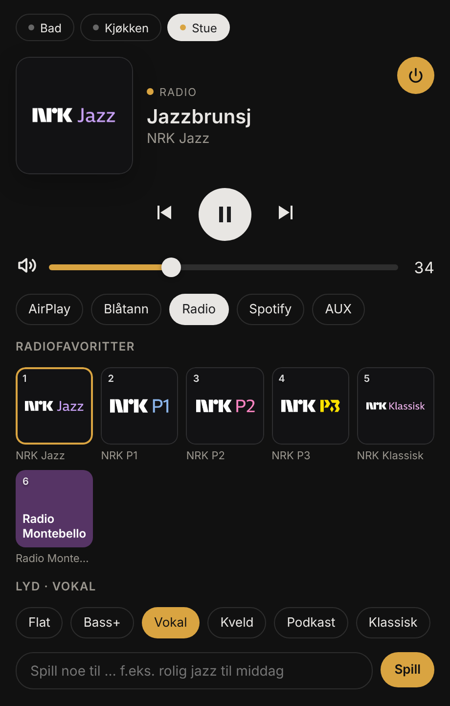
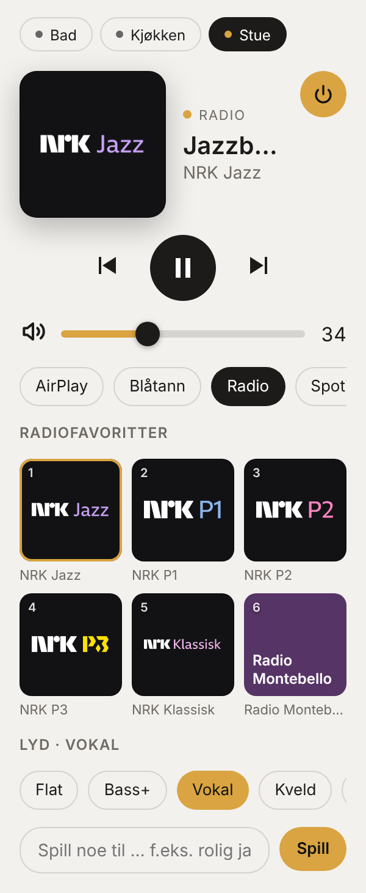

# Skjold-kort for Home Assistant

Et ferdig dashbordkort for Skjold, ikke bare standard mediaspiller.

| Mørkt tema | Lyst tema, smal kolonne |
|---|---|
|  |  |

**Innhold:** cover (eller kanallogo når radio spiller), romvelger for alle Skjold-enheter, spill/pause/forrige/neste, av/på, volum og demping, kilder, radiofavoritter med logoer, lydprofil (Flat, Bass+, Vokal, Kveld …) og «Spill noe til …». Kortet følger HA-temaet (lyst/mørkt) og tilpasser seg smale kolonner.

## Installasjon

**Med Skjold-integrasjonen (anbefalt):** ingenting å gjøre. Integrasjonen (`custom_components/skjold`) laster kortet automatisk. Legg til kort i dashbordet → søk etter «Skjold – Spiller».

**Uten integrasjonen / egen kopi:** last ned `skjold-card.js` fra siste release (eller `ha-kort/dist/skjold-card.js`), kopier den til `/config/www/`, og legg til ressursen under *Innstillinger → Dashbord → ⋮ → Ressurser*: `/local/skjold-card.js` (JavaScript-modul). Kortet trenger likevel Skjold-integrasjonen for favoritter, logoer, lydprofil og «Spill noe til …».

HACS: `hacs.json` her beskriver kortet som en «plugin», men HACS forventer ett repo per plugin. Inntil kortet får eget repo, bruk metoden over.

## Oppsett

Kortet kan settes opp i den grafiske editoren. YAML:

```yaml
type: custom:skjold-card
entity: media_player.stue
rom: true          # romvelger med alle Skjold-enheter
kilder: true
favoritter: true
antall: 6          # antall favoritter (1–12)
eq: true           # lydprofil
spor: true         # «Spill noe til …»
```

`custom:skjold-rom-card` viser alle rom med spill/pause og volum per rom.

## Tjenester som kortet bruker

- `media_player.*` (avspilling, volum, kilde, `play_media` med type `preset` for favoritter)
- `skjold.set_eq_profile` – `entity_id`, `profile` (f.eks. «Kveld»), valgfri `source` (air, bt, radio, aux, usb, hp)
- `skjold.ask` – `entity_id`, `text` («rolig jazz til middag»)

Kanallogoer hentes via Home Assistant (`/api/skjold_logo/<entry_id>?k=…`), så de virker også over https og utenfra.

## Utvikling

```bash
cd ha-kort
npm ci
npm run typecheck
npm run build      # lager dist/skjold-card.js og kopierer til custom_components/skjold/www/skjold-cards.js
```
