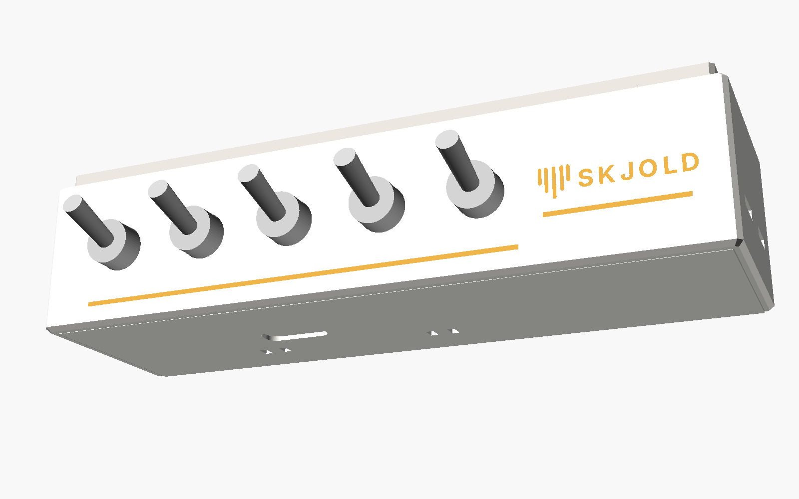

# Skjold Bryter

En boks som henger **under pulten**, med **fem vippebrytere** som peker mot deg. Et eget **feste** skrus opp under
bordplata; boksen skyves inn i festet forfra og klikker på plass, og kan tas ut igjen uten verktøy. Selve boksen har
ingen skruer, og festet synes ikke: det er mindre enn toppen av boksen, og to svalehaletunger under det går inn i
spor i toppen. Bunnplata (med bakveggen) klikkes i. Fronten har Skjold-merket og SKJOLD innfelt i gull. Inni sitter en **ESP32 D1 mini**
(MH-ET LIVE MiniKit o.l.) eller en **Wemos D1 mini** med ESPHome. Hver bryter blir en egen bryter i Home Assistant
(«Bryter 1» … «Bryter 5»), som du kan bruke til å slå av og på lys, forsterker, skjermer, scener eller hva du vil.
USB-kabelen går ut bak, inn under pulten.

Bilder: [forfra, lys](render/01_forfra_under_lys.png) · [forfra, mørk](render/02_forfra_under_mork.png) ·
[inni](render/03_inni.png) · [eksplodert](render/04_eksplodert.png) · [bakfra](render/05_bakfra.png) ·
[halvveis ut av festet](render/06_uttrukket.png)

Status: **ikke printet, bygget eller testet på maskinvare.** Modellen er sjekket med `lag_bryter.py`: alle delene er
tette, ingenting kolliderer (feste, brytere, kort og USB-plugg er med i sjekken), boksen henger i festet og bunnplata i
klipsene, boksen glir inn i festet uten å kollidere, kortet ligger fast, ingen overheng trenger støtte, og alt får plass på K2. ESPHome-filene validerer med `esphome config`. Mål bryterne og kortet ditt før du printer.

## Mål

| | |
|---|---|
| Boksen | 182 × 55 × 41 mm (b × d × h) |
| Festet | 176 × 49 × 4 mm, skjult over boksen; boksen henger 4 mm under bordplata |
| Bryterne | 5 stk med 25 mm mellomrom, hull Ø12,2 mm, front 3 mm |
| Plass bak fronten | 50 mm (bryteren er ca. 29 mm lang med skrueklemmene) |
| Feste | 4 treskruer 4 × 16 mm med senkehode gjennom festet, opp i bordplata |

## Deler

| Del | Antall | Merk |
|---|---|---|
| Vippebryter KN3C-101 (eller E-TEN1021 o.l., 2 pinner, av/på, M12-gjenge) | 5 | Med gummihette (21 mm) eller ytre mutter |
| ESP32 D1 mini (MH-ET LIVE MiniKit, 39 × 31,4 mm) **eller** Wemos D1 mini (34,2 × 25,6 mm) | 1 | Velg STL/3MF for kortet ditt |
| Ledning 22–26 AWG | ca. 1,5 m | 5 signalledninger og én felles GND |
| Treskrue 4 × 16 mm, senkehode | 4 | Til bordplata |
| USB-kabel (micro-USB for MiniKit, USB-C eller micro for D1 mini) og 5 V-lader | 1 | |
| Buntebånd 2,5 mm | 2 | Valgfritt, sporene i bunnplata |

Bryterne tåler 15 A / 250 V, men her går det bare 3,3 V og noen mikroampere gjennom dem. De styrer **ingenting
direkte**: ESP-en sier fra til Home Assistant, som slår på det du har valgt.

## Kobling

Hver bryter har to skrueklemmer. Den ene går til en GPIO, den andre til GND. Ring GND fra bryter til bryter med én
ledning, og før den til G/GND på kortet. Pinnene har intern pull-up, så du trenger ingen motstander.

| Bryter | ESP32 D1 mini (`skjold-bryter.yaml`) | Wemos D1 mini (`skjold-bryter-d1mini.yaml`) |
|---|---|---|
| 1 (lengst til venstre) | D1 = IO22 | D1 = GPIO5 |
| 2 | D2 = IO21 | D2 = GPIO4 |
| 3 | D5 = IO18 | D5 = GPIO14 |
| 4 | D6 = IO19 | D6 = GPIO12 |
| 5 | D7 = IO23 | D7 = GPIO13 |
| Felles | GND | G |

På ESP32 D1 mini står D-navnene på den indre pinneraden, samme sted som på en Wemos D1 mini. Bruk ikke D3, D4 eller D8
på Wemos D1 mini: de bestemmer oppstarten, og en bryter som står på kan hindre kortet i å starte.

Lodd ledningene rett i hullene på kortet (ikke stiftlister). Da ligger kortet flatt i holderen.

## I Home Assistant og andre steder

- **Bryter 1 … Bryter 5**: på/av, i samme stilling som spaken (opp = på).
- **Vippet**: en hendelse for hver gang en bryter vippes (`1_pa`, `1_av`, … `5_av`). Den er nyttig hvis du vil at en
  bryter skal *veksle* noe i stedet for å følge stillingen.
- **Status-LED**: den blå LED-en på kortet blinker når boksen mangler Wi-Fi. Slå den av her hvis du ikke vil ha det.
- **Diagnostikk**: IP-adresse, MAC-adresse, Wi-Fi-nett, Wi-Fi-signal, oppetid, ESPHome-versjon (og brikketemperatur på
  ESP32).

Flash første gang fra **https://skjold-lab.com/flasher/bryter/** (Chrome eller Edge), eller med web.esphome.io og
`.bin`-fila fra releasen. Wi-Fi settes rett etterpå. Home Assistant finner boksen selv (ESPHome).

## Print

| Del | Plassering | Merk |
|---|---|---|
| `kasse.stl` | **fronten ned** | Ingen støtte. Glatt front; gullisten, merket og SKJOLD er en egen del i de første lagene (filament 2) |
| `bunn.stl` | flat | Bakveggen, kortholderen og klipsene opp |
| `feste.stl` | bordsiden ned | Ingen støtte (svalehaletungene har 45° skuldre) |
| `gull.stl` | sammen med kassa | Ligger allerede riktig i 3MF-fila |

Ferdige plater for Creality K2: `skjold-bryter-esp32d1-k2.3mf` og `skjold-bryter-d1mini-k2.3mf`, med alle tre
delene på én plate. **PETG** anbefales: klipsene og fjærtungene i toppen skal bøye seg mange ganger, og PLA blir
sprøtt. 0,2 mm lag, 3 vegger, 20 % fyll. Kassa har faser i stedet for runde hjørner, så kantene mot plata blir rene.

## Montering

1. **Bryterne:** skru den indre mutteren et stykke inn på gjengen. Stikk bryteren gjennom hullet innenfra med
   skrueklemmene bakover og spaken opp/ned (ON-merket opp). Juster den indre mutteren til 6–7 mm gjenge stikker ut
   foran. Skru på gummihetta eller den ytre mutteren og stram.
2. **Kortet:** legg USB-enden ned mot bakveggen med kontakten i USB-hullet, og trykk resten av kortet ned mellom
   sidelistene. Tre smale **klemribber** på hver side går 0,25 mm inn i kortkantene og holder kortet fast hele tiden,
   også når toppen er av. Ingenting ligger over kortet, så pinner, lodding og modul går fri. Kortet hviler på en list
   foran og to puter ved USB-enden, og to finner i toppen holder USB-enden nede når boksen er lukket. Ta kortet ut
   ved å lirke det opp i USB-enden.
   - **Kortet ditt har andre mål?** Mål bredde og lengde og bygg holderen for det:
     `openscad -D 'kort="d1mini"' -D kortB=26.2 -D kortL=34.8 -D 'part="bunn"' -o bunn.stl skjold_bryter.scad`.
3. **Ledningene:** lodd ledningene til kortet, og skru dem i bryterne etter tabellen over. Bunt dem langs bakveggen.
   Flash fastvaren nå, før du lukker boksen.
4. **Lukk:** sett bunnplata med bakveggen inn nedenfra og bakfra, og trykk den opp til de fire klipsene klikker ut i
   vinduene i sideveggene. Overkanten av bakveggen går inn bak en skrå list under toppen.
   *Åpne:* trykk mothakene inn gjennom vinduene (en liten skrutrekker eller en negl), side for side, og dra plata ned
   i fingergrepet.
5. **Festet under pulten:** hold festet opp under bordplata med tungene ned og den lukkede enden av tungene mot
   deg. Forkanten av festet skal ligge 1–2 cm innenfor forkanten av bordet (boksen stikker 3 mm lenger fram). Skru det fast med 4 treskruer 4 × 16 mm (senkehodene må ligge i flukt, ellers stopper de
   boksen). Har du en tynn plate (under 18 mm), bruk kortere skruer.
6. **Heng i boksen:** hold boksen opp under festet, sett de åpne endene av sporene bak i toppen inn på tungene, og
   skyv boksen innover til den klikker. Sporene er lukket foran, så boksen stopper av seg selv; de to knottene i
   festet går da i hullene i fjærtungene i toppen.
   *Ta ut:* dra boksen bestemt mot deg; knottene presser tungene ned og slipper.
7. Koble til USB og en 5 V-lader.

## Bygg selv

    python3 lag_bryter.py            STL-er, kontroll og 3MF
    python3 lag_bryter.py bilder     også bildene i render/

Mål i toppen av `skjold_bryter.scad`: `N` (antall brytere), `P` (avstanden mellom dem), `kort` (`esp32d1` eller
`d1mini`), `Hi`/`Di` (innvendig høyde/dybde), `hullD` (bryterhullet), `c` (klaringen i sporene: øk til 0,4 hvis
boksen går tungt inn) og `knottH` (hvor hardt boksen klikker). Med flere eller færre brytere må du også legge
til eller fjerne brytere i ESPHome-fila. Merket ved siden av SKJOLD er Skjold-merket fra
`branding/skjold/skjold_merke.svg` (`merkeH` = høyden).
