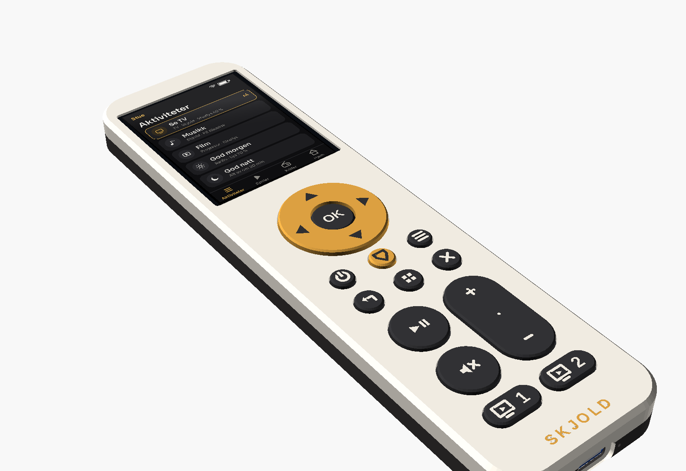
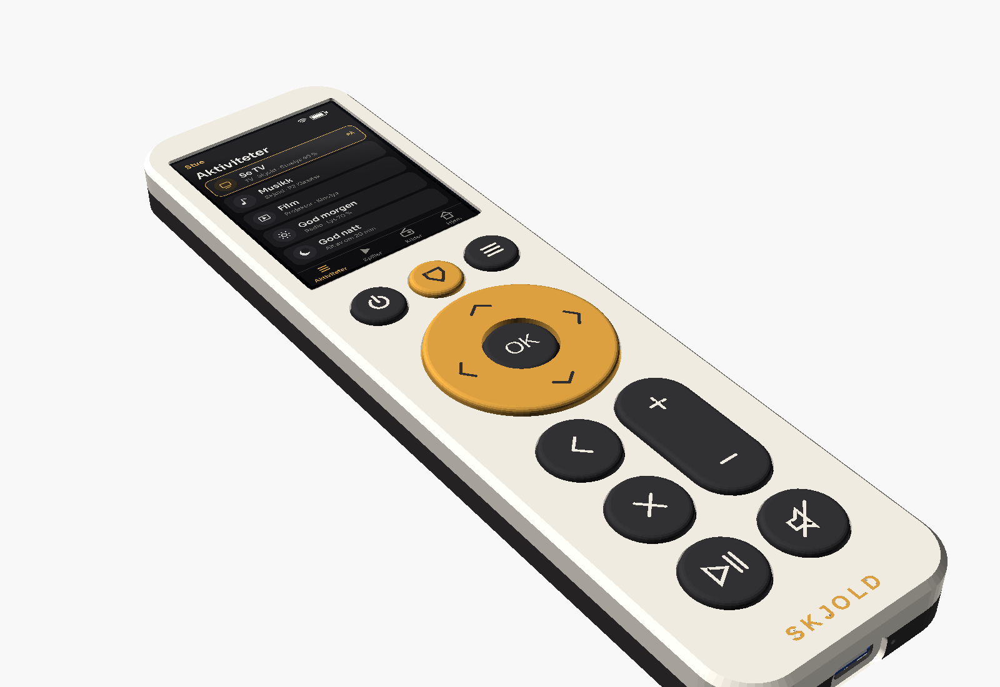
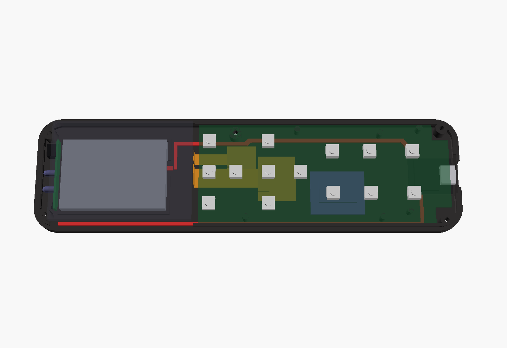
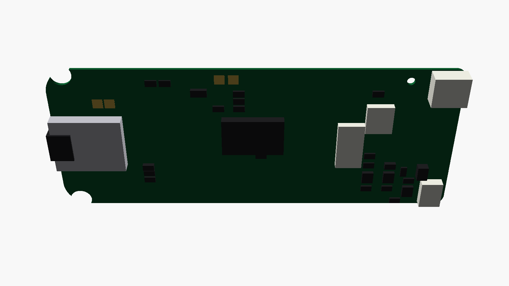
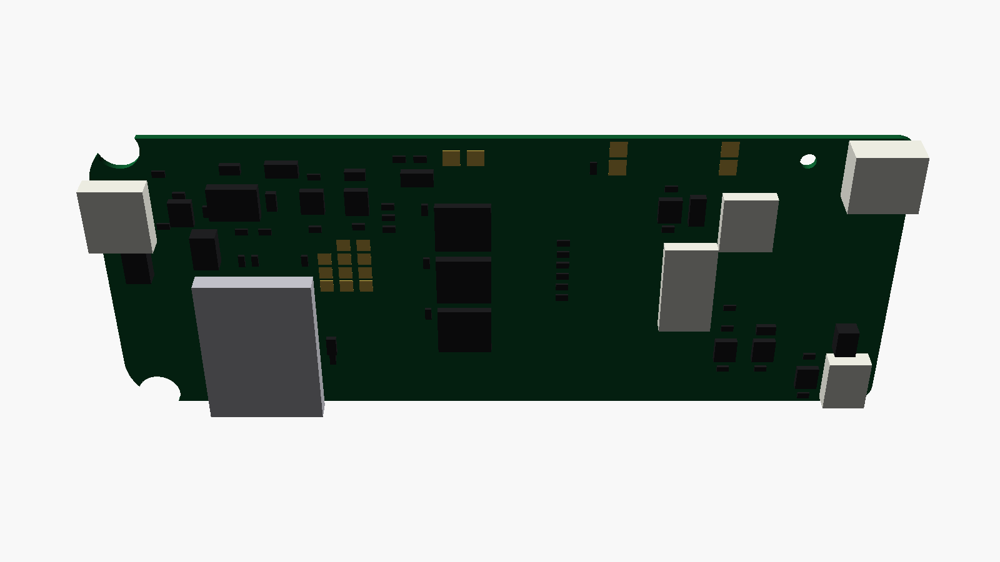
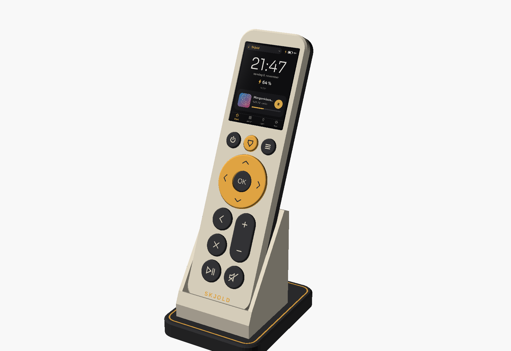
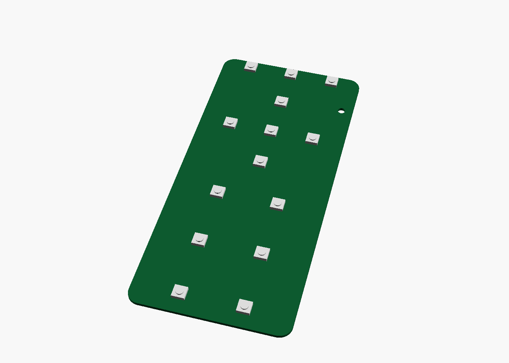
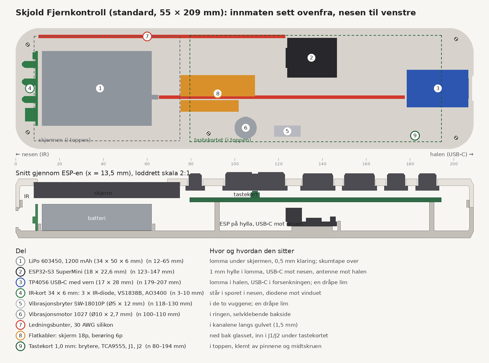
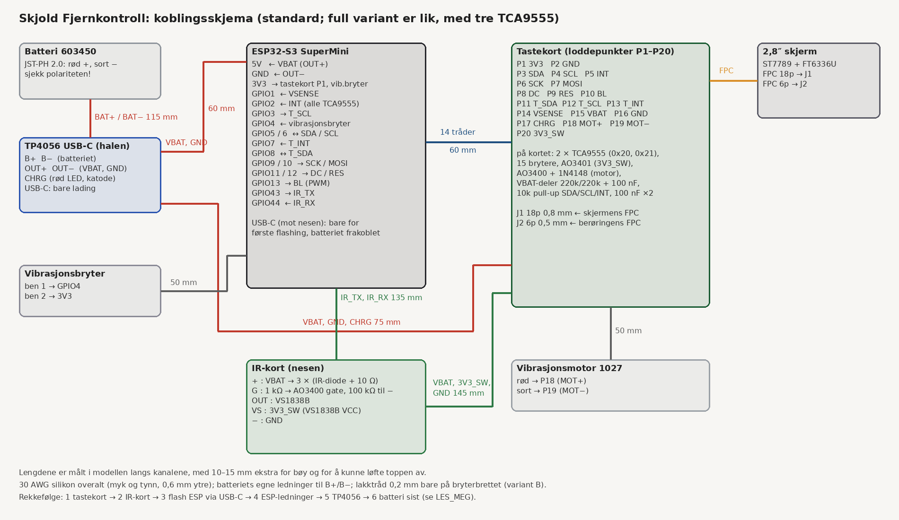
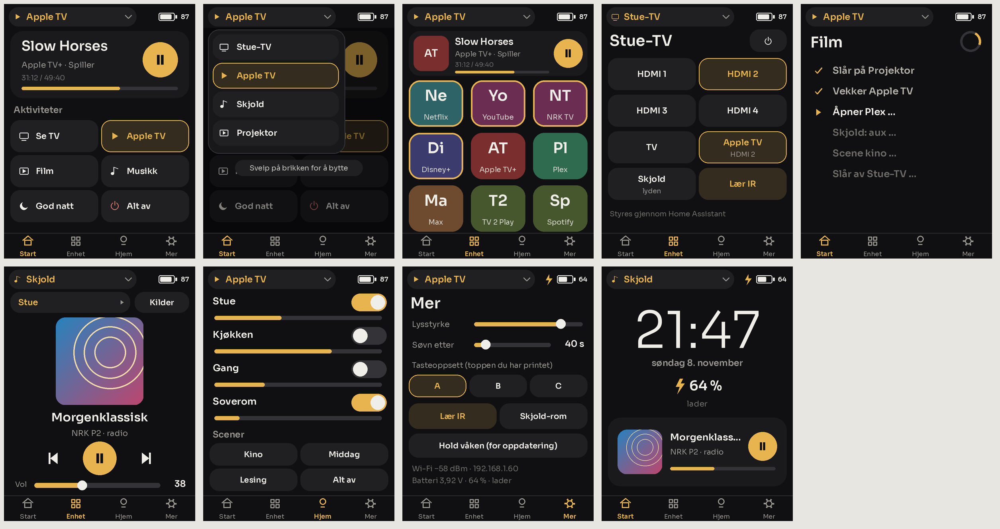

# Skjold Fjernkontroll

En universell fjernkontroll for hele stua: 2,8″ fargeberøringsskjerm øverst, nesten fra kant til kant, 14 taster under, IR foran og Wi-Fi inni. Den styrer Skjold direkte (volum, spill/pause, favoritter, kilder og rom), sender og lærer IR-koder til TV, projektor og annet, og kjører aktiviteter som «Se TV» og «God natt» som setter i gang IR, Skjold og Home Assistant i én operasjon. Alle tastene sendes også til Home Assistant, så du kan bruke hvilken som helst tast til hva du vil.

Den er laget for å bygges hjemme. Kabinettet printes på en Creality K2, delene kommer fra AliExpress, og fastvaren er ESPHome.



Bilder: [skrått, lys](render/01_skra_lys.png) · [ovenfra, lys](render/02_ovenfra_lys.png) · [eksplodert, lys](render/03_eksplodert_lys.png) · [skrått, mørk](render/04_skra_mork.png) · [ovenfra, mørk](render/05_ovenfra_mork.png) · [eksplodert, mørk](render/06_eksplodert_mork.png) · [fra siden](render/07_side_lys.png) · [nær, skjermen og D-paden](render/08_naer_lys.png) · [halen med USB-C](render/09_hale_lys.png).
Inni: [innmaten ovenfra](render/10_inni_ovenfra.png) · [skrått](render/11_inni_skra.png) · [montering, eksplodert](render/12_montering.png) · [merket oppsett](render/13_oppsett.png) · [koblingsskjema](render/14_koblinger.png). Se [Slik er det inni](#slik-er-det-inni).
I Bone White matt PLA med mørk matt PETG-bunn: [skrått](render/21_skra_bone.png) · [ovenfra](render/22_ovenfra_bone.png) · [fra siden](render/23_side_bone.png) · [nær](render/24_naer_bone.png) · [med grå PETG-bunn](render/25_skra_bone_gra.png). Se [Filament](#filament).
Skjermen i bildene viser Start-siden slik fastvaren tegner den. Skjermbildene er laget med `lag_skjermbilder.py` (se [Skjermen og appene](#skjermen-og-appene)).

**Mål: 55 × 202,5 mm, 13,5 mm tykk** (full variant med talltaster: 55 × 245,5 mm). Tastene står 1,2 mm opp (14,7 mm), og gullringen rundt OK står 1,5 mm opp (**15,0 mm på det tykkeste**). Den veier ca. 105–115 g med batteri (beregnet, ikke veid).

Første utgave hadde en 2,0″-skjerm i en 54 × 208 mm kropp, med mye tom ramme på hver side av skjermen. Nå sitter en 2,8″-skjerm der: kroppen er 1 mm bredere og 22 mm lengre, og alt under skjermen (taster, form og farger) er det samme som før.

Hvorfor 2,8″ og ikke 2,4″:
- **Kroppen må være ca. 54 mm bred uansett.** Det krever D-paden med hjørnetastene og avspillingsraden (og talltastene i full variant).
- **2,4″ fyller ikke bredden.** Glasset er bare 43–44 mm bredt, så det ville fortsatt blitt nesten 7 mm tom ramme på hver side.
- **2,8″ fyller bredden.** Glasset er 47,8 mm bredt og fyller fronten med ca. 5 mm ramme, mot 11 mm før.
- **Lengden øker mer med 2,8″,** fordi panelet er 69 mm langt.
- **Brede stavskjermer** (2,25″ og liknende) er for lave til lister og cover.

**Elektronikken finnes i fire utgaver:** [enkel](#enkel-utgave-anbefalt) med en ferdig XIAO ESP32S3 og MCP23017 på et lite bærekort (anbefalt), [hullkort](#hullkort-utgave-uten-kretskort) uten noe kretskort (XIAO, MCP23017-modul og 6 × 6-brytere på stripekort, 16,0 mm tykk), et ferdig [hovedkort](#hovedkort) med alt på ett kort (avansert), eller [håndkoblet](#alternativ-håndkoblet) med SuperMini, TP4056-modul og tastekort.

**Status: ikke bygget og ikke testet.** Modellen er kontrollert med `sjekk_modell.py`, og ESPHome-fila er validert med `esphome config` (ESPHome 2026.10.2). Fastvaren er ikke kompilert her: kompileringen trenger ESP-IDF-filer fra dl.espressif.com og komponentregisteret til Espressif, og de var blokkert i byggemiljøet. Se [Begrensninger](#begrensninger-og-hva-som-ikke-er-testet).

## Standard og full variant

Standard er fjernkontrollen **uten talltaster**, som vist i bildene over. **Full variant (valgfri)** har i tillegg talltastene (1–9, −, 0, ↵) og smarthus-raden (lys, stikk, −, +).

| | **Standard** | **Full variant (valgfri)** |
|---|---|---|
| Mål | **55 × 202,5 mm** | 55 × 245,5 mm |
| Tykkelse | 13,5 mm (15,0 mm med gullringen) | samme |
| Taster | **14 brytere, 10 hetter** | 30 brytere, 26 hetter |
| TCA9555 | **3** (0x20–0x22); vibrator, skjermstrøm og lader på brikke C, P1_4–P1_6 | 4 (0x20–0x23); de tre styrepinnene på brikke D |
| Tastekort | 48,6 × 110 mm (`tastekort/`) | 48,6 × 155 mm (`tastekort_full/`) |
| ESPHome | `esphome/skjold-fjernkontroll.yaml` | `esphome/skjold-fjernkontroll-full.yaml` |
| 3MF | `skjold-fjernkontroll-k2*.3mf` | `skjold-fjernkontroll-full-k2*.3mf` |
| STL | `stl/` | `stl_full/` |
| Pris | **ca. 630 kr** | ca. 640 kr |

Begge har samme skjerm, samme bredde og samme formspråk. Begge har samme øverste rad, D-pad, tilbake/avslutt og medieblokk; full variant har talltastene og smarthus-raden under medieblokken. Det er ingen fargetaster og ingen spoletaster.

**Smarthus-funksjonene på standardvarianten.** Lys, stikk og ± ligger på skjermen (Hjem-siden). Det er ingen egne taster for dem, og de er ikke lagt på langt trykk på andre taster. Langt trykk på Skjold-tasten velger fortsatt rom, og langt trykk på av/på er «alt av». Vil du ha en fysisk tast til lyset, kan du koble hvilken som helst tast til det i Home Assistant (se [Home Assistant](#home-assistant)). Hver tast sendes som en hendelse, også langt trykk.

**Hvor mange TCA9555?** Tastekortet har 8 faste brytere (av/på, Skjold, meny, fire under D-paden og OK) og 35 i rutenettet under tasteblokken. Med vibratoren, skjermstrømmen og ladestatusen blir det 46 pinner, så standardvarianten har tre TCA9555 (48 pinner, 2 ledige). Full variant har 16 talltaster og smarthus-taster i tillegg: 62 pinner på fire brikker. SuperMini-en har ingen ledige pinner (GPIO 1–13, 43 og 44 er brukt til skjerm, berøring, IR, vekking og batteri).

**Plassering inni.** ESP-en ligger til venstre under rutenettet og spill/pause (standard n = 124–147 mm, full n = 166–189 mm), med USB-C mot nesen. Se [Slik er det inni](#slik-er-det-inni).

**Pris.** Forskjellen er liten: delene som utgår er billige, og TCA9555 og bryterne kjøpes i pakker uansett. Det er ca. 10 kr i filament og kortflate.

**Velge variant.** Bruk `variant = "kort"` (standard) eller `"full"` i `skjold_fjernkontroll.scad`, eller `-D 'variant="full"'`. `lag_stl.sh` lager begge.

Bilder av full variant: [skrått, lys](render/01_skra_lys_full.png) · [ovenfra, lys](render/02_ovenfra_lys_full.png) · [eksplodert](render/03_eksplodert_lys_full.png) · [skrått, mørk](render/04_skra_mork_full.png) · [ovenfra, mørk](render/05_ovenfra_mork_full.png) · [fra siden](render/07_side_lys_full.png).

## Designet

Fjernkontrollen er en rett, flat plate. Den har myke R11-hjørner sett ovenfra og en 45°-fas på 1,4 mm rundt topp- og bunnkanten. Sidene går rett, uten innsnevring på midten. Toppen er lys og bunnen mørk, delt i en rett skjøt 7 mm opp på siden. Den mørke varianten har mørk topp og lys bunn.

Fra toppen og ned:
- **Skjermen** ligger øverst, rett bak IR-nesen. Vinduet (45,0 × 59,4 mm) går 0,9 mm utenfor det aktive området rundt, så litt av den sorte glasskanten synes. Toppen holder glasset med 1,4 mm leppe på sidene og 1,5 mm oppe; nede dekker den 5,6 mm, slik at den brede glasskanten ved flatkabelen (6,47 mm) ligger skjult.
- **Øverste rad**, mellom skjermen og gullringen: av/på, **Skjold-tasten i gull** (aktiviteter, hold for rom) og **meny** (☰; kort trykk = meny, langt trykk = guide). Alle tre er Ø 11,5 mm og står 14,5 mm fra hverandre, så raden er like bred som ringen under.
- **D-paden**: en stor gullring (Ø 39 mm, før 32) med fire tydelige retningspiler (sorte trekanter 6,0 × 4,3 mm felt inn i gullet) og en mørk OK (Ø 15 mm) i midten, der tommelen hviler. Ringen er så stor som bredden tillater, med over 4 mm til sideveggene.
- **Tasteblokken** under ringen finnes i tre oppsett (se [Tasteoppsett](#tasteoppsett-a-b-og-c)). Standardoppsettet A er et rent rutenett i to kolonner: fire like store runde taster (Ø 16 mm) og volumpillen, med 3,25 mm mellomrom både på tvers og på langs. Venstre kolonne: tilbake ‹, avslutt ✕ og spill/pause. Høyre kolonne: volumpillen øverst, nøyaktig én tast bred og to taster pluss mellomrommet høy (16 × 35,25 mm), i flukt med tilbake og avslutt, og demp nederst ved siden av spill/pause. Blokken er 35,25 mm bred.
- **Symbolene** er strektegnet med jevn strek (0,65 mm) og ca. 38 % av tastens diameter: en tynn vinkel for tilbake, ✕, ▷‖, en høyttaler med skråstrek, tynne + og − på pillen (uten prikk), av/på-ring, meny-streker og Skjold-omrisset. Pilene på gullringen er tynne vinkler og OK er skrevet med vanlig (ikke fet) skrift. De er felt inn som lyse innlegg i de mørke tastene.
- **Tastetoppene** har en myk R 1,0-kant i stedet for fas. De printes fortsatt med flensen ned og toppen opp, uten støtte. Toppen er flat, så innleggene blir jevnt 0,4 mm dype.
- *Full variant:* **talltastene** 1–9 står i tre kolonner, med −, 0 og ↵ i fjerde rad. **Smarthus-raden** nederst har fire lyse taster: lys, stikkontakt, − og +.
- **SKJOLD** er felt inn i gull nederst.

Designet er Skjolds eget. Det følger samme formspråk som Radio, Røst og Hjul S: myke hjørner, fas i stedet for avrundet «såpe», to toner, gull på det du bruker mest og SKJOLD i gull. Funksjonene er de samme som på andre universalfjernkontroller med skjerm, men formen og plasseringen er bevisst annerledes:
- Siden er rett, ikke innsnevret, og overflaten er matt og printet, ikke en blank, sort plate.
- De tre mest brukte systemtastene står samlet over ringen, og tilbake/avslutt og medieblokken er ett rutenett med like store taster under den.
- Volum er én høy pille i medieblokken, ved siden av to store runde taster, uten kanalvippe. 
- Det er ingen pilleknapper for «aktiviteter» og «enheter» ved skjermen. Det gjør den ene gull-tasten med Skjold-skjoldet.

Hver tast er en egen hette med flens under toppen. Den trykker rett på en lavprofil SMD-bryter (4 × 4 × 1,5 mm) på et 1,0 mm tastekort. Hettene står 0,1 mm over bryteren, så de ikke slarker og ikke trykker på forhånd. Symbolene er felt 0,4 mm inn og printet i kontrastfarge (lyse på mørke taster, mørke på lyse). Med CFS blir symbolene en del av samme utskrift.

## Tasteoppsett (A, B og C)



Tasteblokken under D-paden finnes i tre oppsett. **Tastekortet og fastvaren er de samme**; du velger oppsett ved å printe toppen og hettene for det, og velge det samme i Home Assistant. Det er ingen egen frontplate eller søm: toppen er hel. Bilder: [A «Rutenett»](render/31_oppsett_A.png) · [B «Vannrett»](render/32_oppsett_B.png) · [C «Stor»](render/33_oppsett_C.png) · i Bone White: [A](render/34_oppsett_A_bone.png) · [B](render/35_oppsett_B_bone.png) · [C](render/36_oppsett_C_bone.png).

**Rutenettet på tastekortet.** Under tasteblokken har tastekortet 35 brytere i et fast rutenett, 7 kolonner × 5 rader:
- kolonnene står 17,25 / 9,625 / 4,8125 / 0 mm til hver side for midten, og radene 9,625 mm fra hverandre (n = 140,3 … 178,8 mm fra nesen);
- bryterne heter `g00`–`g34`, rad for rad fra venstre;
- alle hettene i de tre oppsettene står midt over (eller innen 1 mm fra) bryteren sin.

**Én aktuator per funksjon.** Hver hette har én aktuator (Ø 2,6 × 0,6 mm) rett over plungeren til sin bryter, og volumpillene har to (+ og −).
- Resten av undersiden og flensen står 0,7 mm over alle andre brytere. En stor hette dekker gjerne flere ubrukte brytere, men bare aktuatoren når en plunger. Det er derfor helt i orden mekanisk.
- Det er ingen støtteknotter. Hetta styres av hullet (1,6 mm vegg, 0,35 mm klaring) og flensen.
- Flensen ligger i en 0,6 mm forsenkning under toppen. Toppen er 1,0 mm der og 1,6 mm ellers.
- Sjekken kontrollerer for hvert oppsett og hver hette:
  - at bare den tildelte bryteren er innen rekkevidde (0,1 mm over plungeren; vandring 0,25 mm + 0,1 mm margin);
  - at alle andre brytere under hetta har minst 0,5 mm luft (målt: 0,70 mm);
  - at ingenting forspenner noe i hvile.
- Hettene til oppsettene printes **med forsiden ned**. Flensens overside er 45° skrå, så det går uten støtte, og symbolene blir de første lagene.

**Oppsettene.**
- **A «Rutenett»** (standard): to kolonner med like store runde taster (Ø 16, 3,25 mm mellomrom). Til venstre tilbake, avslutt og spill/pause; til høyre volumpillen (16 × 35,25 mm) og demp.
- **B «Vannrett»**: en vannrett volumpille over hele bredden (35,75 × 14 mm, − til venstre og + til høyre) og under den en rad med fire runde taster (Ø 8,6): tilbake, spill/pause, demp og avslutt.
- **C «Stor»**: en stor spill/pause (Ø 22) i midten, fire små taster (Ø 9) i hjørnene (tilbake, avslutt, volum − og +) og demp (Ø 10,8) under.

**Print.** For hvert oppsett finnes to plater:
- `skjold-fjernkontroll-k2-topp-A.3mf` (eller `-B`, `-C`): hele toppen med SKJOLD.
- `skjold-fjernkontroll-k2-taster-A.3mf`: oppsettets hetter med symbolene.

De faste tastene (av/på, Skjold, meny, D-pad og OK) ligger på `skjold-fjernkontroll-k2-taster.3mf`, og bunnen på `skjold-fjernkontroll-k2.3mf`. `skjold-fjernkontroll-k2.3mf` har også topp A. For full variant heter platene `-full-k2-…`. **Bytte oppsett** = print ny topp og nye hetter, flytt de faste hettene over og velg oppsettet i Home Assistant.

**Fastvaren.** Rutenettbryterne har ingen fast funksjon. Fastvaren slår opp funksjonen i et kart for oppsettet som er valgt:
- `substitutions: oppsett: rutenett` (eller `vannrett`, `stor`) velger oppsettet første gang.
- Select-entiteten **«Tasteoppsett»** i Home Assistant bytter oppsett uten ny flashing. Valget lagres.
- Brytere som ikke brukes, blir ignorert. Volum gjentas når du holder inne, de andre har langt trykk.

Kartet (lages av `taster.py`):

| Funksjon | A «Rutenett» | B «Vannrett» | C «Stor» |
|---|---|---|---|
| `tilbake` | `g01` (rad 0, kolonne 1) | `g21` (rad 3, kolonne 0) | `g00` (rad 0, kolonne 0) |
| `avslutt` | `g15` (rad 2, kolonne 1) | `g27` (rad 3, kolonne 6) | `g06` (rad 0, kolonne 6) |
| `spill_pause` | `g29` (rad 4, kolonne 1) | `g23` (rad 3, kolonne 2) | `g17` (rad 2, kolonne 3) |
| `demp` | `g33` (rad 4, kolonne 5) | `g25` (rad 3, kolonne 4) | `g31` (rad 4, kolonne 3) |
| `vol_opp` | `g05` (rad 0, kolonne 5) | `g13` (rad 1, kolonne 6) | `g34` (rad 4, kolonne 6) |
| `vol_ned` | `g19` (rad 2, kolonne 5) | `g07` (rad 1, kolonne 0) | `g28` (rad 4, kolonne 0) |

**Lage ditt eget oppsett.** Legg til en linje i `OPPSETT` i `taster.py`, med hettene og hvilken rutenettbryter (`g(kolonne, rad)`) hver funksjon bruker. Kjør så `python3 taster.py` og `./lag_stl.sh`. Da lages:
- toppen med hullene og forsenkningene;
- hettene med aktuatorer;
- kartet i ESPHome-fila;
- 3MF-platene.

Sjekken kontrollerer kollisjoner og at hver aktuator treffer sin bryter og ingen andre.

## Hullkort-utgave (uten kretskort)



Denne utgaven har **ingen kretskort å bestille** og **ingen fin lodding**. Den passer hvis du ikke stoler på et kretskort du ikke kan rette opp selv. Alt kjøpes ferdig:

- en Seeed XIAO ESP32S3,
- en ferdig MCP23017-modul,
- 14 vanlige 6 × 6 mm-brytere på et stykke stripekort (2,54 mm),
- skjermen på to FPC-adaptere til 2,54 mm.

Pinnene på XIAO-en og MCP23017-en er de samme som i [den enkle utgaven](#enkel-utgave-anbefalt). Fastvaren er nesten lik.

**Ulempene, ærlig sagt:**
- **Den er 16,0 mm tykk, 2,5 mm mer.** 6 × 6-bryterne er 4,3 mm høye, stripekortet (bakelitt) er 1,5 mm, og under kortet ligger MCP-modulen og XIAO-en på gulvet med bryterbeina over seg.
- **Rundt 60 ledninger** skal kuttes, avisoleres og loddes.
- **Dokka passer ikke uten endring.** Bruk den høyere vugga (`dokk/stl_hu/`, `-D FH=16.0`).
- **Du må lodde én liten ting:** AO3400A i SOT-23 på to små SOT-23-til-DIP-adaptere. Alt annet har 2,54 mm deling eller er ferdige moduler.
- **Ingen skjermbryter.** Skjermen står på 3,3 V og går i dvale (SLPIN) når ESP-en sover. IR-mottakeren får strøm fra en MCP-pinne.

**Status: tegnet og kontrollert i modellen, ikke bygget.** Følgende er kontrollert: tegningen, koblingene mot fastvaren og kabinettet (`sjekk_modell.py asm_hu hullkort`: ALT OK).

| | |
|---|---|
| Tykkelse | **16,0 mm** kropp, 17,2 mm med taster, 17,5 mm ved gullringen (de andre: 13,5 / 14,7 / 15,0) |
| Bryterne | 14 × **6 × 6 × 4,3 mm THT** (søk «6x6x4.3 tactile switch DIP 4 pin»), beina i et 2 × 3-rutenett (5,08 × 7,62 mm) |
| Hullkortet | stripekort 2,54 mm i bakelitt, 1,5 mm, **19 × 47 hull** (48,3 × 119,4 mm), **stripene langs fjernkontrollen** (se under); hjørnene ved halen kuttes 3 × 3 hull for skruetårnene, ett Ø2,4-hull for midtskruen |
| Under kortet (på gulvet, på tynn tape) | XIAO ESP32S3 i halen (USB-C ut, 0,90 mm fra den støpte delen av pluggen), MCP23017-modulen (26 × 21 mm), FPC 18 p-adapteren og FPC 6 p-adapteren |
| Klaring | minst 0,55 mm fra delene på gulvet opp til hullkortet og bryterbeina (beina klippes til 0,8 mm under kortet) |
| Skjermen | HP28030 på en **FPC 18 p 0,5 mm → 2,54 mm-adapter** (kjøp den med kontakten påloddet) og berøringen på en **FPC 6 p-adapter** |
| IR | IR-kortet i nesen som i den håndkoblede utgaven: 2 × IR-diode i serie, R15 6,8 Ω fra batteriet, AO3400A, 100 µF, VS1838B |
| Batteri | LiPo 603450 1200 mAh på XIAO-ens BAT-puter, ladet av XIAO-en (ca. 100 mA) |
| Dokken | pogo-kontakten i bunnen som før; 1N5819 til XIAO-ens 5V, 68 kΩ / 100 kΩ til GPB7 |
| Fastvare | `esphome/skjold-fjernkontroll-hullkort.yaml` (laget av `taster.py`, validert med `esphome config`) |

### Stripekortet: stripene langs fjernkontrollen

Tegningen er laget for et vanlig stripekort i bakelitt, «Single Side 6.4x14.4cm Stripboard Veroboard». Det har 2,54 mm deling, 1,0 mm hull, er 1,5 mm tykt, og har **24 striper à 56 hull langs den lange siden**.

- **Stripene skal gå langs fjernkontrollen**, fra nesen mot halen. Det er den eneste måten å få 19 × 47 hull ut av et 24 × 56-kort.
- **Slik skjærer du ut biten:**
  - **Bredden:** ta 19 striper og fjern 5 striper på den ene langsiden. Skjær i hullraden mellom stripe 19 og 20, så kanten går midt gjennom hullene.
  - **Lengden:** ta 47 hull og fjern 9 hull i den ene enden.
  - **Hjørnene:** kutt bort 3 × 3 hull i begge hjørnene i halen.
- **Bakelitt er sprøtt.** Ikke sag fort, og ikke klipp med tang.
  - Ripe flere ganger langs hullraden med en skarp kniv og linjal, på begge sider.
  - Legg ripa over en bordkant og knekk biten rolig av.
  - Puss kanten med en fil.
- **Midtskruen:** bor Ø2,4 mm sakte med et lite bor først, så hullet ikke sprekker.
- **Kuttene i stripene:** vri et 3,5 mm bor for hånd. Det er bare 9 kutt, fordi alle GND-bein står på tre striper og tastene på fem.

### Bryterne på 2,54 mm

Hver bryter er flyttet til nærmeste hullposisjon. Kolonnene står symmetrisk om midten, og radene er valgt så det største avviket blir minst mulig. Toppen og hettene er de samme. Aktuatorene under tasteoppsettets hetter er flyttet over de flyttede bryterne, og sjekken bekrefter at hver hette står 0,10 mm over knappen.

| Tast | Avvik | Tast | Avvik |
|---|---|---|---|
| av / meny | 0,76 mm | tilbake / vol + | 1,03 mm |
| Skjold | 0,16 mm | avslutt / vol − | 0,80 mm |
| opp / ned / venstre / høyre | **1,24 mm** (under gullringen, som er 11 mm bred) | ⏯ / demp | 0,72 mm |
| OK | 0,00 mm | | |

### Deler fra AliExpress (hullkort-utgaven)

Prisene er anslag fra november 2026, med frakt.

| Del | Søk etter | Pris |
|---|---|---|
| Seeed XIAO ESP32S3 (ikke «Sense») med antenne | «Seeed Studio XIAO ESP32S3» | 80–100 kr |
| MCP23017-modul (CJMCU-2317, ca. 26 × 21 mm – **sjekk**; har 10 kΩ pull-up på SDA/SCL/RESET og 10 kΩ ned på A0–A2) | «CJMCU-2317 MCP23017 module» | 25 kr |
| 6 × 6 × 4,3 mm THT-brytere, 4 bein | «6x6x4.3 tactile switch DIP 4 pin» (100 stk) | 15 kr |
| Stripekort 2,54 mm i bakelitt, 6,4 × 14,4 cm (24 striper à 56 hull) | «Single Side 6.4x14.4cm Stripboard Veroboard» | 20 kr |
| FPC-adapter 18 p 0,5 mm → 2,54 mm, med kontakten påloddet | «FPC 18P 0.5mm to 2.54mm adapter board» | 15 kr |
| FPC-adapter 6 p 0,5 mm → 2,54 mm | «FPC 6P 0.5mm adapter board» | 10 kr |
| 2,8″ IPS HP28030-DCT ([1005006755555414](https://www.aliexpress.com/item/1005006755555414.html)) | | 66 kr |
| LiPo 603450 1200 mAh med JST-PH 2,0 | «603450 1200mAh lipo PH2.0» | 60 kr |
| AO3400A × 2 + SOT-23-til-DIP-adapter × 2 | «AO3400 SOT-23», «SOT23 to DIP adapter» | 15 kr |
| Motstander 1/4 W og 1N5819, 100 nF, 100 µF 6,3 V | sett | 30 kr |
| IR-diode 940 nm × 2, VS1838B, en stripe hullkort | | 25 kr |
| 30 AWG wire-wrap-ledning (Kynar) i 8 farger + 26 AWG silikon (rød/svart) | «30AWG wire wrap wire 8 colors» | 55 kr |
| JST-PH 2,0 2 p plugg med ledning | | 10 kr |
| Pogo-kontakt 2 pinner 2,80 mm med ører (dokken) | | 9 kr |
| M2 × 10-skruer, tynn dobbeltsidig tape, krympestrømpe | | 30 kr |
| Filament ca. 55 g | | 25 kr |
| **Sum** | | **ca. 520–600 kr** |

Verktøy: loddebolt med fin spiss, 3,5 mm bor (kuttene i stripene), avbitertang, avisoleringstang og multimeter.

### Tegningen (1:1) og koblingene

- [**hullkort/tegning.pdf**](hullkort/tegning.pdf) har 2 sider A4, som skrives ut i 100 %. Linjalen på arket skal være 50 mm.
  - Side 1 viser hullkortet sett ovenfra, med bryterne og hvilke hull beina går i, kolonne A–S og rad 1–47.
  - Side 1 viser også kobbersiden speilvendt: hvilke stripehull som skal kuttes (rødt ×, 9 stk), GND-lenkene (svart) og hvor hver tasteledning loddes (fargen og MCP-pinnen står ved hullet). Under står tabellen over alle ledningene med farge og lengde.
  - Side 2 viser delene i bunnen: XIAO, MCP-modulen, adapterne og ledningsbuntene.
  - Det finnes også PNG-er i 300 dpi: [oppsiden](hullkort/tegning-oppside.png) og [kobbersiden](hullkort/tegning-kobberside.png).
- [**hullkort/skjema.pdf**](hullkort/skjema.pdf) er koblingsskjemaet på 2 sider (schemdraw): XIAO ↔ MCP-modulen ↔ tastene ↔ batteri og dokk, og skjermadapterne ↔ baklys ↔ IR-kortet. Ledningsfargen står ved hvert nett.
- [**hullkort/koblinger.csv**](hullkort/koblinger.csv) lister alle 46 ledningene: nett, farge, fra, til og lengde.

To og to bein langs stripa er koblet inni bryteren, så hver bryter har én GND-stripe og én tastestripe. Bryterne er snudd så GND-siden ligger på stripe E, I eller O (sort bein på tegningen), og tastens side på stripe C, G, K, M eller Q (gult bein). Tastene har ingen motstander, fordi MCP23017 har interne pull-ups som fastvaren slår på (`pullup: true`). Pull-ups på I²C (10 kΩ) sitter på modulen. Har modulen din ikke det, lodd 2 × 4,7 kΩ fra SDA og SCL til VCC.

Småkomponentene loddes på pinnene der de hører hjemme, med krympestrømpe over:

| Del | Hvor | Hvordan |
|---|---|---|
| R3 10 kΩ | MCP-modulen | VCC → INTA (vekkelinja) |
| R16 1 MΩ | 6 p-adapteren | pinne 1 (VDD) → 6 (RST), holder RST høy i dyp søvn |
| R8 10 Ω | 18 p-adapteren | pinne 10 (VDD) → 11 (LED-A) |
| Q2 AO3400A + R6 100 Ω + R7 100 kΩ | ved 18 p-adapteren | G ← R6 ← D9, R7 G–S, S = GND, D → pinne 12–15 (LED-K) |
| R9 1 MΩ, R10 1 MΩ, C3 100 nF | XIAO-en | BAT+ → R9 → D0 → R10 og C3 → GND |
| D1 1N5819 | XIAO-en | anode til POGO+-ledningen, katode (stripen) til 5V-puten |
| R11 68 kΩ, R12 100 kΩ | MCP-modulen | POGO+ → R11 → GPB7 → R12 → GND |

### Byggerekkefølge

Ledningslengdene står i `koblinger.csv`. Lengdene der regner med 15 mm til lodding og slakk; kutt heller 1 cm for langt.

1. **Skriv ut** `stl_hu/topp.stl` og `stl_hu/bunn.stl` (eller `bunn_dokk.stl`), hettene og IR-vinduet som før. Dokka for denne utgaven er `dokk/skjold-dokk-hullkort-k2.3mf` (`FH = 16.0`).
2. **Skjær stripekortet** til 19 × 47 hull (kanten midt i en hullrad), og kutt bort 3 × 3 hull i begge hjørnene ved halen. Bor Ø2,4 mm for midtskruen der tegningen viser det.
3. **Kutt stripene** etter tegningen (side 1, kobbersiden): 9 hull med et 3,5 mm bor, vridd for hånd (ikke drill). Mål at ingen stripe henger sammen over et kutt.
4. **Lodd de 14 bryterne** på oppsiden. Klipp beina til 0,8 mm under kortet.
5. **GND:** bryterne står slik at alle GND-beina havner på tre striper (E, I og O). Lodd to korte svarte lenker mellom dem på kobbersiden og én videre til MCP GND (ca. 40 mm).
6. **Tasteledningene:** 14 stk, 30–120 mm, én farge per MCP-pinne (fargekoden 1–8). Lodd dem i hullet tegningen viser, og la dem henge.
7. **XIAO-en:** lodd BAT-ledningene (rød/svart silikon, 150 mm), R9/R10/C3 og D1 på baksiden *før* den limes. Lodd så D0–D10, 3V3, GND og 5V med 30 AWG i fargene fra tabellen.
8. **MCP-modulen:** R3, R11 og R12 på pinnene. Lodd tasteledningene etter navn (GPA0–GPB5), så VCC, GND, SDA, SCL, INTA, GPB6 (IR-strøm) og GPB7.
9. **Adapterne:** R8, R16 og Q2 (med R6/R7) som i tabellen. Lodd ledningene til XIAO-en og MCP-en.
10. **IR-kortet** som i den håndkoblede utgaven: 2 dioder i serie, R15, C4, Q3 med R13/R14, og VS1838B med 5 ledninger (200 mm) langs venstre side.
11. **I bunnen:** IR-kortet i sporet, batteriet i lomma, og XIAO-en (USB-C i åpningen), MCP-modulen og adapterne på tynn tape der side 2 viser. Legg ledningene langs sidene.
12. **Gjennomgangstest** (under), *før* batteriet kobles til.
13. **Skjermen** i lomma i toppen. Flatkablene går ned bak glasset og inn i adapterne, med kontaktene ned.
14. **Hullkortet** på stolpene, med pinnene fra toppen. Legg på toppen og skru inn 5 × M2 × 10 fra undersiden.
15. **Flash** gjennom USB-C (`esphome run esphome/skjold-fjernkontroll-hullkort.yaml`). Koble til batteriet. Sjekk polariteten først!

### Gjennomgangstest før strøm

Med multimeteret på pipetone, batteriet frakoblet og USB-C ute:

- [ ] **3V3 – GND, 5V – GND og BAT+ – BAT− piper ikke.** Ingen kortslutning.
- [ ] Hver tast: trykk tasten og mål fra MCP-pinnen (GPA0 … GPB5) til GND. Det skal pipe bare når tasten er nede, og bare på riktig pinne. Slipp tasten og mål mot nabopinnene: ingen pip.
- [ ] Hver bryter: GND-siden piper mot MCP GND.
- [ ] XIAO D4 – MCP SDA, D5 – SCL og D1 – INTA piper. D4 – D5 piper ikke.
- [ ] XIAO D2/D3/D8/D10 – 18 p-adapterens pinne 4/2/3/6 piper. D3 – 6 p-adapterens pinne 6 piper.
- [ ] 18 p-adapterens pinne 9/10 – 3V3 og 1/5/8/16/18 – GND piper.
- [ ] Q2: D – pinne 12–15 piper. G – D9 viser ca. 100 Ω, og G – GND ca. 100 kΩ.
- [ ] IR: D6 – R13 piper, D7 – VS1838B OUT piper, og MCP GPB6 – VS1838B VCC piper.
- [ ] D1 leder bare fra POGO+ til XIAO 5V (diodetest ca. 0,2–0,3 V).
- [ ] D0 – GND viser ca. 1 MΩ, og D0 – BAT+ ca. 1 MΩ.
- [ ] Ingen bar ledning eller loddeklatt rører en nabostripe. Se over kobbersiden med lupe.

### Batteritid (hullkort-utgaven)

Overslag: søvn ca. 50–90 µA. Det er XIAO-en (15–30 µA), berøringen i dvale (ca. 25 µA), skjermen i SLPIN (5–30 µA), MCP-en (1 µA) og deleren (2 µA). Det gir ca. **4 måneder** ved lite bruk, **4 uker** ved vanlig bruk og ca. 6 dager med 2 timer skjerm om dagen. Har MCP-modulen en strøm-LED, fjern den (1–2 mA).

### Filer i `hullkort/`

| Fil | Hva |
|---|---|
| `hullkort.py` | **Kilden**: bryterne snappet til 2,54 mm, hullkortet, kuttene, delene på gulvet, nettene og ledningene |
| `lag_hullkort.py` | Lager `hullkort_data.scad` (kabinettet), `hullkort.json` (3D-siden), `koblinger.csv` og tegningen |
| `tegning.py` | `tegning.pdf` og PNG-ene i 1:1 |
| `lag_skjema_hu.py` | `skjema.pdf` (koblingsskjemaet, 2 sider) |
| `render_3d.png`, `render_inni.png` | Hullkortet sett fra undersiden, og innmaten |

```bash
python3 hullkort/lag_hullkort.py      # data, koblinger.csv og tegningen
python3 hullkort/lag_skjema_hu.py     # skjema.pdf
xvfb-run -a sh lag_hu.sh              # kabinettet (stl_hu/), sjekk og bilder
```

## Enkel utgave (anbefalt)



Den enkle utgaven er den letteste å bygge. Et lite bærekort (48,6 × 119,8 mm, 2 lag) har en **ferdig Seeed XIAO ESP32S3** i halen, en **MCP23017** for de 14 tastene, de to flatkabelkontaktene til skjermen og noen få transistorer og motstander. XIAO-en har allerede USB-C, lader og 3,3 V-regulator, så bærekortet har ingen USB-kontakt, ingen lader og ingen LDO. Det er ingen små QFN-brikker og ingen ESP-modul å lodde.

[Hovedkortet](#hovedkort) er fortsatt det avanserte valget (egen ESP32-S3-modul, lader og USB på kortet, 43 brytere for alle tasteoppsettene). [Den håndkoblede utgaven](#alternativ-håndkoblet) trenger ikke noe kretskort i det hele tatt, men har mange ledninger.

**Status: tegnet og kontrollert, ikke bestilt og ikke testet.** Se [sjekklisten](#før-du-bestiller-enkel-utgave) før du bestiller.

| | |
|---|---|
| Mål | **48,6 × 119,8 mm**, 1,0 mm FR4, **2 lag**, samme omriss og skruehull som hovedkortet (n 79,5–199,3), med et vindu på 11 × 12 mm under XIAO-en |
| Hjernen | **Seeed XIAO ESP32S3** (8 MB flash, 8 MB PSRAM) loddet flatt på kantputene (castellated) på undersiden, **USB-C ut gjennom halen** (samme åpning som hovedkortet). Flashing og logg går rett i USB-C |
| Taster | **MCP23017-E/SO** (SOIC-28, I²C 0x20) og **14 brytere 4 × 4 × 1,5 mm** (SMD) på oppsiden, nøyaktig der `taster.py` har tasteoppsett A. Tastene går mot GND, med MCP-ens interne pull-ups. GPB6 styrer skjermstrømmen og GPB7 leser dokken |
| Skjerm | HP28030 2,8″ (ST7789 + FT6336U): FPC 18 p (J2) og FPC 6 p (J3), 0,5 mm, Hirose FH12 |
| Skjermstrøm | AO3401A (Q1) slår av 3V3_SW (skjerm og IR-mottaker) når den sover. 100 kΩ gate til 3V3: av ved oppstart |
| Baklys | AO3400A (Q2) på LED-katoden, PWM fra D9, 10 Ω fra 3V3_SW |
| IR | 2 × IR-diode 940 nm i serie på IR-kortet i nesen, drevet av **AO3400A (Q3)** med **6,8 Ω** fra batteriet (ca. 0,15 A topp), **100 µF** (C4) ved driveren. VS1838B som mottaker. IR-kortet kobles med JST-SH 5 p (J4) |
| Batteri | **LiPo 603450, 1200 mAh** med beskyttelseskrets, i **JST-PH 2 p** (J1, pinne 1 = +) → to puter (BAT+ / BAT−) → to korte ledninger gjennom vinduet til XIAO-ens BAT-puter på baksiden. XIAO-en lader det (ca. 100 mA) |
| Dokken | pogo-puter POGO+ / POGO− på baksiden, **B5819W (D1) til XIAO-ens 5V-pute** (lader i dokken), og 68 kΩ / 100 kΩ til GPB7 (høy = i dokken) |
| Batterimåling | 1 MΩ / 1 MΩ + 100 nF til D0 (ca. 2 µA) |
| Komponenter | 48: 29 på undersiden som JLC kan montere (19 linjer i BOM-en), XIAO-en og de 14 bryterne loddes for hånd, 4 loddeputer |

Bilder: [kobber oppside](enkel/skjold-enkel-oppside.png) · [kobber underside](enkel/skjold-enkel-underside.png) · [3D, undersiden](enkel/render_3d.png) · [innmaten](enkel/render_inni.png) · [koblingsskjema (PDF, 3 sider)](enkel/skjema.pdf) · [skjema side 1 (PNG)](enkel/skjema-side1.png).

**Kabinett:** `stl_en/topp.stl`, `stl_en/bunn.stl` og `stl_en/bunn_dokk.stl` (laget av `lag_en.sh`, `elektronikk = "enkel"`). Samme form som de andre; åpningen i halen passer XIAO-ens USB-C.

### Pinnene på XIAO-en

Fra `enkel/pinner.csv` (laget av `sjekk_enkel.py`). ESPHome-fila er `esphome/skjold-fjernkontroll-enkel.yaml`.

| Pute | GPIO | Nett | Til |
|---|---|---|---|
| D0 | 1 | VBAT_ADC | batterispenning, 1 MΩ / 1 MΩ og 100 nF |
| D1 | 2 | INT | MCP23017 INTA (åpen drain, 10 kΩ til 3V3), vekker fra dyp søvn |
| D2 | 3 | LCD_DC | skjerm D/C |
| D3 | 4 | LCD_RES | skjerm RESET og berøringens RST, 1 MΩ til 3V3 (R16) |
| D4 / D5 | 5 / 6 | SDA / SCL | MCP23017 (0x20) og berøringen (0x38), 4,7 kΩ til 3V3 |
| D6 | 43 | IR_TX | 100 Ω → AO3400A (Q3) → IR-diodene |
| D7 | 44 | IR_RX | VS1838B (aktiv lav) |
| D8 | 7 | LCD_SCK | skjerm SPI |
| D9 | 8 | LCD_BL | 100 Ω → AO3400A (Q2) → baklysets katode |
| D10 | 9 | LCD_MOSI | skjerm SPI |
| 3V3 | – | 3V3 | MCP23017, pull-ups, berøringen, Q1 |
| GND | – | GND | jord |
| 5V | – | VBUS | 5 V fra dokken gjennom D1 |
| BAT+ / BAT− (bak) | – | VBAT / GND | batteriet, via J1 og to korte ledninger |

MCP23017: GPA0–GPA7 = av, Skjold, meny, opp, ned, venstre, høyre, OK; GPB0–GPB5 = tilbake, avslutt, ⏯, demp, volum +, volum −; GPB6 = skjermstrøm (lav = på); GPB7 = dokken. A0–A2 til GND (0x20), RESET med 10 kΩ til 3V3. Pinne 11 og 14 er NC, og INTB (19) brukes ikke.

Alle XIAO-putene er brukt. Pinnetabellen følger Seeeds pinout (D0 = GPIO1 … D10 = GPIO9, D6/D7 = GPIO43/44); **sjekk den mot Seeeds wiki** før du bestiller.

### Deler fra AliExpress (enkel utgave)

Prisene er anslag fra november 2026, med frakt, ikke tilbud.

| Del | Søk etter | Antall | Pris |
|---|---|---|---|
| **Seeed XIAO ESP32S3** (ikke «Sense»), med antennen som følger med | «Seeed Studio XIAO ESP32S3» | 1 | 80–100 kr |
| 2,8″ IPS-skjerm med berøring, **HP28030-DCT IPS** ([AliExpress 1005006755555414](https://www.aliexpress.com/item/1005006755555414.html)) | «2.8 inch IPS capacitive 18PIN ST7789 HP28030-DCT» | 1 | 66 kr |
| LiPo **603450, 1200 mAh**, med beskyttelseskrets og JST-PH 2,0-plugg | «603450 1200mAh lipo PH2.0» | 1 | 60 kr |
| Bærekort fra JLCPCB (5 stk, uten montering) | – | 5 | ca. 150–250 kr |
| *eller* bærekort med JLC Economic PCBA (2 monterte av 5) | – | 5 | ca. 650–850 kr |
| MCP23017-E/SO (SOIC-28) – bare uten JLC-montering | «MCP23017-E/SO SOIC28» | 1 (5-pakning) | 30 kr |
| SMD-bryter 4 × 4 × 1,5 mm | «4x4x1.5 SMD tactile switch» | 14 (100-pakning) | 30 kr |
| FPC-kontakt 0,5 mm, 18 p og 6 p, liggende, kontakt nede – bare uten JLC-montering | «FPC 0.5mm 18P» / «FPC 0.5mm 6P» | 1 + 1 (10-pakninger) | 25 kr |
| AO3400A × 2, AO3401A × 1, B5819W × 1, motstander og kondensatorer 0805, 100 µF 1210 – bare uten JLC-montering | sett | | 40 kr |
| IR-diode 940 nm × 2, VS1838B × 1, liten hullkortbit | «IR LED 940nm 5mm», «VS1838B» | 2 + 1 | 25 kr |
| JST-SH 1,0 mm 5 p kabel og JST-PH 2,0 mm 2 p kontakt (SMD) | «JST SH 1.0 5P cable» | 1 | 20 kr |
| Pogo-kontakt, 2 pinner, 2,80 mm, med ører (til dokken) | «pogo pin connector 2pin 2.8mm magnetic» | 1 sett | 9 kr |
| M2 × 10-skruer, skumtape, tråd | småtterier | | 40 kr |
| Filament ca. 50 g | | | 20 kr |
| **Sum, lodder selv** | | | **ca. 600–700 kr** |
| **Sum, med JLC-montering** | | | **ca. 1050–1250 kr** (men da har du 2 monterte kort) |

Det er ingen vibrasjonsmotor, vibrasjonsbryter, TP4056 eller tastekort i denne utgaven.

### Kobling

Det meste er på kortet. Det du kobler selv:

1. **Batteriet** i J1 (JST-PH, pinne 1 = +, merket «+»). **Mål polariteten på pluggen først**: AliExpress-batterier har ofte pinnene i motsatt rekkefølge. Bytt pinnene i pluggen om nødvendig.
2. **BAT+ / BAT−**: to korte, tynne ledninger (ca. 30 mm, 0,2 mm², silikon) fra putene BAT+ og BAT− ved J1 (TP1/TP2, x 40,5 mm) gjennom vinduet under XIAO-en til XIAO-ens BAT-puter på baksiden. **Rødt på BAT+.** Lodd dem på XIAO-en *før* du lodder XIAO-en på kortet.
3. **XIAO-antennen** i U.FL-kontakten på XIAO-en. Klistre antennen på innsiden av bunnen ved halen, så langt fra batteriet som mulig.
4. **IR-kortet** i nesen: JST-SH 5 p fra J4. På IR-kortet: pinne 1 (IR_A) → IR-diode 1 anode, katode → IR-diode 2 anode, katode → pinne 2 (IR_K). VS1838B: OUT → pinne 3, VCC → pinne 4 (3V3_SW), GND → pinne 5.
5. **Pogo-kontakten** (hunndelen i bunnen): + til POGO+ (TP3), − til POGO− (TP4).
6. **Flatkablene**: skjermen i J2 (18 p), berøringen i J3 (6 p), kontaktene ned.

### Lodding, steg for steg

1. **Uten JLC-montering (dra-lodding):** start med MCP23017 og de to FPC-kontaktene på undersiden. Fluks på putene, tinn på loddebolten, dra langs pinnene, og fjern bro med loddefletting. Sjekk med lupe at ingen pinner henger sammen. Så transistorene, D1 (streken mot «VBUS»/XIAO-en), motstandene, kondensatorene (C4 med + mot VBAT), J1 og J4.
2. **Tastene** (oppsiden): de 14 4 × 4-bryterne. Lodd én pute, rett opp bryteren, lodd resten.
3. **XIAO-en:** lodd BAT-ledningene på baksiden av XIAO-en først (steg 2 under Kobling). Tre ledningene gjennom vinduet, legg XIAO-en på putene på undersiden med **USB-C mot halen** (pinne-1-prikken og «XIAO … HER» står på silketrykket), lodd to hjørner, sjekk at USB-C står rett ut over kanten, og lodd alle 14 kantputene. Lodd BAT-ledningene på BAT+ / BAT−.
4. **Test før skjermen:** USB-C i XIAO-en. Mål 3V3 (3,25–3,35 V). Flash fastvaren (`esphome run esphome/skjold-fjernkontroll-enkel.yaml`). Loggen skal finne 0x20 (MCP23017), og hver tast skal gi en hendelse.
5. Batteriet, IR-kortet, flatkablene, og skru kortet fast i toppen.

### Bestille fra JLCPCB (enkel utgave)

1. Last opp `enkel/skjold-enkel-gerber.zip`.
2. **Layers 2**, **Thickness 1.0 mm**, FR-4, 49 × 120 mm, LeadFree HASL (ENIG gir jevnere FPC-puter), valgfri maskefarge, kvantum 5.
3. **Med montering:** PCB Assembly, **Economic**, **Assembly side: Bottom side**, kvantum 2 eller 5. Last opp `enkel/bom-jlc.csv` og `enkel/cpl-jlc.csv`. XIAO-en og bryterne er ikke i BOM-en (`enkel/dnp-handlodding.csv`). Bekreft hvert LCSC-nummer og sjekk rotasjon og pinne 1 i forhåndsvisningen.
4. **Uten montering:** bare kortet (ca. 150–250 kr med frakt og mva); delene fra lista over, og dra-lodding.

**Pris med montering (anslag, ikke hentet fra JLC):** kort ca. 10 USD, oppsett 8 + sjablong 1,5 USD, ca. 7 «extended» deler (MCP23017, FH12-18, FH12-6, SM05B, S2B-PH, 100 µF, AO3401A) × 3 USD, komponenter ca. 5 USD for 2 sett, frakt 10–20 USD: **ca. 55–75 USD, ca. 650–850 kr** med mva.

### Før du bestiller (enkel utgave)

- [ ] **XIAO-pinnene.** `kretser_en.py` følger Seeeds pinout for XIAO ESP32S3 (D0–D10 = GPIO1–6, 43, 44, 7, 8, 9; 5V, GND og 3V3 på den andre siden). Sjekk mot Seeeds wiki, og at kantputene i `fotavtrykk.pretty/Seeed_XIAO_ESP32S3_SMD.kicad_mod` (2,54 mm, 17,5 × 21 mm) stemmer med Seeeds KiCad-fotavtrykk.
- [ ] **XIAO-antennen** (U.FL og FPC-antenne) er ikke tegnet inn i kabinettet. Sjekk at den får plass på innsiden av bunnen ved halen.
- [ ] **FPC-pinnene på skjermen (J2) og berøringen (J3) er antatt**, som på hovedkortet (pinne 1 GND, 2 RES, 3 SCK, 4 DC, 5 CS til GND, 6 MOSI, 9–10 VCC, 11 LED-A, 12–15 LED-K; berøring VCC, GND, SDA, SCL, INT, RST). Sjekk mot selgerens tegning og rett opp i `kretser_en.py`.
- [ ] **Batteripolaritet** (J1 pinne 1 = +).
- [ ] **LCSC-numrene** i `enkel/bom-jlc.csv` er fra hukommelsen og merket «sjekk».
- [ ] **4 × 4-bryternes fotavtrykk** er tegnet etter TS-1088-stilen (fire puter, to og to koblet). Sjekk mot databladet til bryterne du kjøper.
- [ ] **Rotasjon i CPL** (SOT-23, SOIC-28 og kontaktene) i JLCs forhåndsvisning.
- [ ] **Baklysmotstanden** R8 (10 Ω) – sjekk panelets LED-spesifikasjon.
- [ ] **IR-motstanden** R15 (6,8 Ω, 0805): to dioder i serie gir ca. (3,8 − 2,8 V) / 6,8 Ω ≈ 0,15 A i korte pulser. Fullt batteri (4,2 V) gir ca. 0,2 A. Ok for 5 mm IR-dioder (1 A puls), men 0805-motstanden tåler det bare fordi pulsene er korte.

### Hvorfor disse valgene

- **XIAO ESP32S3:** ferdig modul med lader, regulator og USB-C, og den er liten nok (17,5 × 21 mm) til å ligge flatt i halen med USB-C ut i den eksisterende åpningen. Ingen USB, lader eller LDO på bærekortet.
- **MCP23017 i SOIC-28:** stor nok til å dra-lodde, 16 pinner = 14 taster + skjermstrøm + dokk, og interne pull-ups. Ett I²C-nett for både tastene og berøringen (derfor er berøringen på 3V3 og ikke på den avslåtte 3V3_SW: en berøringsbrikke uten strøm ville holdt I²C-linjene lave).
- **AO3400A som IR-driver:** logikknivå-MOSFET som er helt på ved 2,5 V gate (R_DS(on) ca. 50 mΩ ved 2,5 V), mens en 2N7000 trenger 4–5 V for å lede skikkelig og ville gitt svak IR fra en 3,3 V-pinne. SOT-23, JLC «basic».
- **To dioder i serie fra batteriet:** dobbel lysmengde for samme strøm, og ingen belastning på XIAO-ens 3,3 V-regulator.
- **JST-PH 2 p til XIAO-ens BAT-puter:** XIAO-en lader og beskytter selv; bærekortet bare fører batteriet frem.
- **Dokken via Schottky til 5V-puten:** XIAO-en lader fra dokken som fra USB, og dioden hindrer at USB-C mater pogo-pinnene.
- **Spor:** 0,3 mm signal, 0,5 mm der strømmen går (VBAT, IR, 5 V fra dokken). 3V3, 3V3_SW og LED-nettene er 0,3 mm fordi de ender på FPC-pinner med 0,5 mm deling; de bærer under 150 mA. Klaring 0,15 mm (de 0,5 mm FPC-pinnene har bare 0,2 mm mellomrom).

### Batteritid (enkel utgave)

Overslag, ikke målt. **I søvn ca. 40–70 µA:**

| Hva | Strøm |
|---|---|
| XIAO ESP32S3 i dyp søvn (Seeed oppgir ca. 14 µA), med laderen og regulatoren | 15–30 µA |
| Berøringen (FT6336U) i dvale (fastvaren legger den i dvale før søvn; den har strøm fra 3V3 hele tiden) | ca. 25 µA |
| MCP23017 | ca. 1 µA |
| Batterideleren (2 × 1 MΩ) | 2 µA |
| R16 (1 MΩ) inn i skjermens RESET-pinne mens skjermen er uten strøm | under 3 µA |
| Skjerm, baklys og IR-mottaker | 0 (3V3_SW er av) |

| Bruk | Per døgn | 1200 mAh (85 % brukbart) |
|---|---|---|
| Lite: 10 løft à 30 s | ca. 8 mAh | **ca. 4 måneder** |
| Vanlig: 30 løft à 45 s | ca. 33 mAh | **ca. 4–5 uker** |
| Mye: 2 timer med skjermen på | ca. 170 mAh | ca. 6 dager |

RST-linjen til berøringen (D3) flyter når ESP-en sover, så R16 (1 MΩ til 3V3) holder den høy og berøringen i dvale. Hvis berøringen likevel ikke går i dvale, trekker den ca. 1–2 mA i overvåkingsmodus, og «lite bruk» faller til 3–4 uker. **Mål søvnstrømmen** første gang (mellom batteriet og J1); over 0,1 mA betyr at noe er våkent.

Lading: XIAO-en lader med ca. 100 mA, så et tomt batteri bruker 12–14 timer i dokken. Det er ingen ladestatus i fastvaren (XIAO-ens ladelys er bare på modulen).

### Filer i `enkel/`

| Fil | Hva |
|---|---|
| `kretser_en.py` | **Kilden**: komponentliste med plassering og nettliste |
| `lag_enkel.py` | KiCad-kortet: plassering, Freerouting, jordflater, regelområder (ingen viaer under delene), DRC, gerber, BOM/CPL, bilder og `enkel_data.scad` (bruker `hovedkort/lag_hovedkort.py`) |
| `sjekk_enkel.py` | Nettlistesjekken: strømpinner, MCP-adresse og ubrukte pinner, hver tast på sin pinne, XIAO-pinnene mot fastvaren, pull-ups, delere, diodens retning, avkobling, tastene mot `taster.py`, kortet mot nettlista og at alt er rutet. Skriver `pinner.csv` |
| `lag_skjema_en.py` | `skjema.pdf` (3 sider, tegnet med schemdraw fra nettlista) og `skjema-side1.png` |
| `skjold-enkel.kicad_pcb` / `.kicad_pro` / `.ses` | KiCad 7-prosjektet og rutingen |
| `skjold-enkel-gerber.zip`, `bom-jlc.csv`, `cpl-jlc.csv`, `dnp-handlodding.csv` | Til JLCPCB |
| `skjold-enkel-drc.rpt` | DRC-rapporten |
| `fotavtrykk.pretty/` | XIAO ESP32S3 (kantputer) og 4 × 4 × 1,5-bryteren |
| `enkel_data.scad` | Omriss, vindu, hull og komponentbokser til kabinettet (`elektronikk = "enkel"`) |

```bash
python3 enkel/lag_enkel.py            # kort, DRC, gerber, BOM/CPL, bilder (--ruting: rut på nytt med Freerouting, FREEROUTING=sti/til/freerouting.jar)
python3 enkel/sjekk_enkel.py          # nettlistesjekken og pinner.csv
python3 enkel/lag_skjema_en.py        # skjema.pdf
xvfb-run -a sh lag_en.sh              # kabinettet (stl_en/), sjekk og bilder
```

### Hva er kontrollert (enkel utgave)

- **DRC (KiCad 7): 0 feil og 0 ukoblede.** Advarslene er bare silketrykk og bibliotek (48 × `lib_footprint_issues`, 8 × `silk_overlap`, 8 × `silk_over_copper`, 13 × `silk_edge_clearance`).
- **Rutingen:** Freerouting 2.0.1, 2 lag, 565 spor og 66 viaer (0,7/0,35 mm og 0,8/0,4 mm), ingenting urutet, jordflate på begge lag, ingen viaer under delene.
- **Nettlistesjekken** (`sjekk_enkel.py`): alt OK.
- **Kabinettet** (`lag_en.sh` → `sjekk_modell.py asm_en enkel`): ingen kollisjoner, USB-C går inn (0,90 mm), minst 1,6 mm under komponentene, skruetårnene klar av delene, dokk-kontakten klar.
- **Fastvaren** (`esphome/skjold-fjernkontroll-enkel.yaml`) er validert med `esphome config` (ESPHome 2026.10.2).

Ikke kontrollert: ingenting er bestilt, bygget eller målt; XIAO-pinnene, FPC-pinnene og LCSC-numrene er ikke bekreftet; antennen er ikke tegnet inn.

## Hovedkort



Hovedkortet samler alt på ett kretskort: ESP32-S3, USB-C med lader, batterikontakt, skjerm- og berøringskontakt, de tre TCA9555 og de 43 tastene. Det erstatter SuperMini-en, TP4056-modulen, tastekortet og nesten alle ledningene i [den håndkoblede utgaven](#alternativ-håndkoblet). Bare IR-kortet i nesen, vibrasjonsmotoren og vibrasjonsbryteren er fortsatt egne deler, og de kobles med en kort SH-kabel eller to korte ledninger.

**Status: tegnet og kontrollert, ikke bestilt og ikke testet.** Se [Hva er kontrollert](#hva-er-kontrollert-og-hva-er-ikke) før du bestiller.

| | |
|---|---|
| Mål | **48,6 × 119,8 mm**, 1,0 mm FR4, **2 lag**, samme omriss og skruehull som tastekortet (n 79,5–199,3) |
| Komponenter | **124**: 64 på undersiden (30 linjer i BOM-en, JLC monterer dem), 43 taster KMR221G på oppsiden (loddes for hånd, eller JLC-montering på begge sider) og 17 testpunkter/loddeputer |
| MCU | **ESP32-S3-WROOM-1-N4R2** (4 MB flash, 2 MB PSRAM, samme som SuperMini-en). Antennen stikker 0,9 mm ut over venstre kortkant ved halen, uten kobber under (antennesone på begge lag) |
| USB-C | HRO TYPE-C-31-M-12 i halen, 5,1 kΩ på CC1/CC2 (vanlige USB-C-ladere gir strøm), USBLC6-2SC6 mot ESD. **Innebygd USB** (GPIO19/20): flashing og logg rett i ladeporten, ingen USB-seriebrikke |
| Lading | TP4056, 2,4 kΩ PROG = ca. 500 mA. Lastdeling: VBUS → B5819W → VSYS, batteriet → AO3401 → VSYS (av når USB står i) |
| 3,3 V | RT9080-33 (2 µA hvilestrøm, 600 mA) |
| Batteri | JST-PH 2,0 (S2B-PH-SM4-TB), **pinne 1 = +**, merket «+» på silketrykket. Batteriet må ha egen beskyttelseskrets (603450-cellene har det) |
| Batterimåling | 1 MΩ / 1 MΩ + 100 nF til GPIO1 (ca. 2 µA) |
| Skjerm | FH12-18S-0.5SH (18 p, 0,5 mm), baklys med AO3400 (PWM, GPIO21) og 10 Ω fra 3V3_SW |
| Berøring | FH12-6S-0.5SH (6 p, 0,5 mm) på **egen I²C-buss** (GPIO18/38) med pull-up til 3V3_SW |
| Skjermstrøm | AO3401 slår av 3V3_SW (skjerm, berøring, IR-mottaker) i søvn |
| IR | SH 5 p (SM05B-SRSS-TB) til IR-kortet i nesen: VSYS, IR-katode (AO3400 på hovedkortet), mottaker, 3V3_SW og GND. 100 µF ved kontakten for IR-pulsene |
| Motor og bryter | AO3400 + B5819W for motoren (to loddeputer MOT+ / MOT−), to loddeputer for vibrasjonsbryteren (1 MΩ ned) |
| Taster | 3 × TCA9555 (0x20, 0x21, 0x22), samme bryter-til-pinne-kart som den håndkoblede utgaven, så fastvaren for tastene er lik |
| Testpunkter | 3V3, VBAT, VSYS, VBUS, GND, EN, BOOT, TX, RX, SDA, SCL, pluss RESET- og BOOT-knapp |
| Dokken | loddeputer POGO+ / POGO− (TP16/TP17) for hunndelen av pogo-kontakten, B5819W (D3) til VBUS, og 68 kΩ / 100 kΩ (R26/R27) til GPIO40 (se [Dokk](#dokk)) |

Bilder: [kobber oppside](hovedkort/skjold-hovedkort-oppside.png) · [kobber underside](hovedkort/skjold-hovedkort-underside.png) · [3D, undersiden](hovedkort/render_3d.png) · [innmaten med hovedkortet](hovedkort/render_inni.png) · [koblingsskjema (PDF)](hovedkort/skjema.pdf).

**Montering med hovedkortet:** print `stl_hk/topp.stl` og `stl_hk/bunn.stl` (laget av `lag_hk.sh`, samme form som standard, men med USB-C-åpning for kortets kontakt og uten lommer for SuperMini og lader). Lodd tastene på oppsiden, koble IR-kortet (SH 5 p), motoren (MOT+/MOT−) og vibrasjonsbryteren (VIB/VIB 3V3) til putene, sett flatkablene i J3 og J4, og plugg batteriet i J2. Kortet ligger i toppen der tastekortet lå, med komponentene ned, og skrus fast på samme måte.

### Pinnene på ESP32-S3

Fra `hovedkort/pinner.csv` (laget av `lag_skjema.py`). ESPHome-fila for hovedkortet er `esphome/skjold-fjernkontroll-hovedkort.yaml`.

| GPIO | Nett | Til |
|---|---|---|
| 0 | BOOT | BOOT-knapp, 10 kΩ til 3V3 (strappinne) |
| 1 | VBAT_ADC | batterispenning, 1 MΩ / 1 MΩ |
| 2 | T_RST | berøring RST |
| 4 | IR_TX | 100 Ω → AO3400 (Q4) → IR-diodene |
| 5 | IR_RX | VS1838B (aktiv lav) |
| 6 | VIB_SW | vibrasjonsbryter (vekking, ext1) |
| 7 | TCA_INT | INT fra alle tre TCA9555, 10 kΩ til 3V3 (vekking, ext0) |
| 8 / 9 | SDA / SCL | TCA9555, 4,7 kΩ til 3V3 |
| 10 | T_INT | berøring INT, 10 kΩ til 3V3_SW |
| 11 / 12 | LCD_MOSI / LCD_SCK | skjerm SPI |
| 13 / 14 | LCD_DC / LCD_RES | skjerm |
| 15 | SKJ_PA | AO3401 (Q2) for 3V3_SW, lav = på, 100 kΩ til 3V3 |
| 16 | MOTOR | 1 kΩ → AO3400 (Q5) → motoren |
| 17 | CHRG | TP4056 CHRG, 10 kΩ til 3V3 (lav = lader) |
| 18 / 38 | T_SDA / T_SCL | berøring, 4,7 kΩ til 3V3_SW |
| 19 / 20 | USB D− / D+ | USB-C (via USBLC6) |
| 21 | LCD_BL | 100 Ω → AO3400 (Q3) → baklysets katode |
| 43 / 44 | U0TXD / U0RXD | testpunkter |
| 3, 45, 46 | – | strappinner, står åpne (interne verdier) |
| 40 | DOKK | dokken: POGO+ via 68 kΩ / 100 kΩ (høy = i dokken) |
| 35–37, 39, 41, 42, 47, 48 | – | ledige |

### Filer i `hovedkort/`

| Fil | Hva |
|---|---|
| `kretser.py` | **Kilden**: komponentliste med plassering og nettliste (det finnes ikke noe tegnet skjema) |
| `lag_hovedkort.py` | Lager KiCad-kortet fra `kretser.py`, plasserer, ruter (Freerouting), legger jordflater, kjører DRC og lager gerber, BOM, CPL og bilder |
| `sjekk_netliste.py` | Nettlistesjekk (KiCad 7 har ikke ERC på kommandolinja): forsyningspinner, nett med én pinne, kortslutninger, ukoblede IC-pinner, strappinner, pull-ups, avkobling innen 6 mm, kortet mot nettlista og at alt er rutet |
| `lag_skjema.py` | `skjema.pdf` (alle komponentene med nett på hver pinne, i fem blokker) og `pinner.csv` |
| `skjold-hovedkort.kicad_pcb` / `.kicad_pro` | KiCad 7-prosjektet (kan åpnes og endres i KiCad) |
| `skjold-hovedkort-gerber.zip` | Gerber og borefiler for JLCPCB |
| `bom-jlc.csv`, `cpl-jlc.csv` | Stykkliste og plassering i JLC-format (undersiden) |
| `dnp-handlodding.csv` | Tastene på oppsiden, som du lodder selv |
| `skjold-hovedkort-drc.rpt` | DRC-rapporten |
| `hovedkort_data.scad` | Omriss, hull og komponentbokser til kabinettmodellen (`elektronikk = "hovedkort"`) |

Alt lages på nytt med:

```bash
python3 hovedkort/lag_hovedkort.py           # kort, ruting, DRC, gerber, BOM/CPL, bilder (Freerouting: FREEROUTING=sti/til/freerouting.jar)
python3 hovedkort/sjekk_netliste.py          # nettlistesjekken
python3 hovedkort/lag_skjema.py              # skjema.pdf og pinner.csv
xvfb-run -a sh lag_hk.sh                     # kabinettet for hovedkortet (stl_hk/), sjekk og bilder
```

### Bestille fra JLCPCB

1. Last opp `hovedkort/skjold-hovedkort-gerber.zip` på jlcpcb.com.
2. Velg:
   - **Layers 2**, **Thickness 1.0 mm** (viktig: kabinettet er tegnet for 1,0 mm), FR-4, 49 × 120 mm (leses fra filene)
   - Surface finish: **LeadFree HASL** (eller ENIG for jevnere puter under FPC-kontaktene og modulen)
   - Solder mask: valgfri farge (svart eller grønn)
   - Remove order number: «Specify a location» er ikke tegnet inn; velg «Yes» (koster litt) eller godta nummeret
   - Kvantum: 5
3. **PCB Assembly:** slå på, **Economic**, **Assembly side: Bottom side**, kvantum 2 eller 5. Last opp `bom-jlc.csv` og `cpl-jlc.csv`.
4. I deloversikten: finn eller bekreft hvert LCSC-nummer (se [Før du bestiller](#før-du-bestiller)). Tastene står ikke i BOM-en.
5. Sjekk plasseringen i JLCs forhåndsvisning (rotasjon og pinne 1, se under), og bestill.

**Pris (anslag, ikke hentet fra JLC):**

| | USD | NOK (ca. 11 kr/USD, med 25 % mva) |
|---|---|---|
| 5 kort, 2 lag, 1,0 mm, 49 × 120 mm | ca. 8–12 | |
| Montering, 5 kort: oppsett 8 + sjablong 1,5 + ca. 10 «extended» deler × 3 + lodding | ca. 45 | |
| Komponenter, 5 sett (ESP32-S3-WROOM-1 ca. 3,5, 3 × TCA9555 ca. 1,5, resten ca. 3) | ca. 40 | |
| Frakt (billigste) | ca. 10–20 | |
| **Sum, 5 monterte kort** | **ca. 105–120** | **ca. 1450–1650 kr** |
| Sum med bare 2 monterte (de 3 andre uten deler) | ca. 75–85 | ca. 1050–1150 kr |

Taster (KMR221G, 43 per kort) kjøpes separat, eller monteres av JLC med «Standard» PCBA på begge sider (dyrere, ca. +25 USD i oppsett). JLC krever i dag mva gjennom VOEC, så prisen i kassen er inkludert mva.

### Før du bestiller

- [ ] **FPC-pinnene på skjermen (J3).** Rekkefølgen i `kretser.py` er **antatt** (pinne 1 GND, 2 RES, 3 SCK, 4 DC, 5 CS til GND, 6 MOSI, 9–10 VCC, 11 LED-A, 12–15 LED-K). Sjekk mot selgerens tegning for HP28030-DCT og rett opp `J3` i `kretser.py`, kjør `lag_hovedkort.py` på nytt.
- [ ] **FPC-pinnene på berøringen (J4)** er også antatt (VCC, GND, SDA, SCL, INT, RST). Sjekk.
- [ ] **Kontaktsiden på FPC-kontaktene.** FH12 har kontakter på undersiden; sjekk at flatkabelen kommer inn med kontaktene riktig vei når den bøyes ned bak glasset.
- [ ] **Batteripolaritet.** J2 pinne 1 = +. AliExpress-batterier har ofte motsatt rekkefølge i JST-PH-pluggen. Mål med multimeter og bytt pinnene i pluggen om nødvendig. Feil vei ødelegger laderen.
- [ ] **Rotasjon i CPL.** JLC og KiCad har ulik nullrotasjon for noen fotavtrykk (særlig SOT-23, SOT-23-5/6, ESOP-8 og kontaktene). Sjekk pinne 1 og retningen på hver del i JLCs forhåndsvisning, og juster rotasjonen der.
- [ ] **LCSC-numrene** i `bom-jlc.csv` er fra hukommelsen og merket «(sjekk)» eller «sjekk: søk …». Bekreft hvert nummer (og at delen er på lager) i JLCs deloversikt.
- [ ] **DFM:** kjør JLCs DFM-sjekk (eller last opp i deres viewer) og se etter advarsler om kobber mot kant ved USB-C og antennen.
- [ ] **Antennen:** ingen kobber eller komponenter under antennen (venstre kortkant ved n 165–189). Kabinettet har bare 0,3 mm plast der. Ikke legg metall, batteri eller skrue der.
- [ ] **Baklysmotstanden** (R14, 10 Ω) passer for 3 hvite LED-er i parallell (ca. 3,0 V, ca. 30 mA). Sjekk panelets LED-spesifikasjon.

### Første oppstart / feilsøking

1. **Før batteriet:** sett i USB-C. Mål 3V3-testpunktet (3,25–3,35 V) og VSYS (ca. 4,7 V med USB). Ingen 3,3 V: sjekk VBUS-testpunktet, D1 og U4.
2. **Flash:** PC-en skal se en «USB JTAG/serial debug unit». Hvis ikke: hold BOOT, trykk RESET, slipp BOOT. Så `esphome run esphome/skjold-fjernkontroll-hovedkort.yaml`.
3. **Batteri:** koble til (sjekk polariteten først). Med USB skal ⚡ vises og CHRG være lav. Uten USB skal VSYS følge batteriet.
4. **Tastene:** se loggen (`esphome logs …`). Hver tast gir en hendelse. Ingen taster: sjekk SDA/SCL-testpunktene (4,7 kΩ til 3V3) og at loggen finner 0x20–0x22.
5. **Skjermen:** svart skjerm, men baklys: sjekk FPC-pinnene (punktet over). Ikke noe baklys: mål LED-A (ca. 3,3 V) og GPIO21.
6. **Berøringen:** egen buss, GPIO18/38. Den har bare strøm når skjermen er på.
7. **Søvn:** strømmen fra batteriet i dyp søvn skal være ca. 15–25 µA (ESP ca. 8 µA, RT9080 2 µA, 3 × TCA9555 ca. 3 µA, deleren 2 µA). Mye mer: sjekk at 3V3_SW er av (Q2) og at ingen tast henger.
8. **IR:** se med mobilkamera på diodene mens du trykker en tast i TV-modus.

### Hva er kontrollert og hva er ikke

Kontrollert her (med skriptene i `hovedkort/`):
- **DRC (KiCad 7, `pcbnew.WriteDRCReport`): 0 feil og 0 ukoblede.** Advarslene (`skjold-hovedkort-drc.rpt`) er bare silketrykk og bibliotek: 124 × `lib_footprint_issues` (fotavtrykkene er hentet fra KiCads bibliotek, men biblioteket står ikke i prosjektets bibliotekstabell), 25 × `silk_overlap` og 13 × `silk_over_copper` (referansebetegnelser som overlapper hverandre eller puter; JLC klipper silketrykket mot putene) og 5 × `silk_edge_clearance` (betegnelser nær kortkanten).
- **Rutingen**: Freerouting 2.0.1 uten grafikk, 2 lag, 0,2 mm spor, 0,15 mm klaring, 0,6/0,3 mm via: 1965 spor og 218 viaer, ingenting urutet. Jordflater på begge lag, ingen kobber i antennesonen.
- **Nettlistesjekken** (`sjekk_netliste.py`): alle punktene over er OK, også at nettene på kortet er de samme som i `kretser.py` og at **ingenting er urutet**.
- Kabinettet med hovedkortet (`lag_hk.sh` → `sjekk_modell.py asm_hk hovedkort`): ingen kollisjoner, USB-C går inn, minst 0,6 mm under komponentene, skruetårn klar av delene.
- ESPHome-fila for hovedkortet er validert med `esphome config`.

Ikke kontrollert:
- **Ingenting er bestilt, bygget eller målt.**
- **FPC-pinnene** til skjerm og berøring er antatt (se over).
- **LCSC-numrene og prisene** er ikke slått opp (jlcpcb.com og lcsc.com var ikke tilgjengelige herfra).
- **Ingen ERC eller tegnet skjema:** KiCad 7 har ikke ERC på kommandolinja, og nettlista er skrevet direkte i `kretser.py`. `sjekk_netliste.py` dekker de viktigste reglene, men ikke alt en ERC fanger.
- **Antennen** følger Espressifs anbefaling (modulen ved kanten, ingen kobber under), men rekkevidden er ikke målt.
- Modulen er WROOM-1 i stedet for MINI-1: KiCad 7-biblioteket har ikke fotavtrykket for MINI-1, og WROOM-1 har Espressifs eget.

## Dokk



**Skjold Dokk** er en ladestasjon: fjernkontrollen står i 65° med baksiden mot ryggen og halen på en hylle, og lader gjennom en magnetisk pogo-kontakt. Mens den står der viser skjermen en stor klokke, datoen, ladingen og det som spilles, og den sover aldri. Om natta (22–07) dempes skjermen.

Bilder (skjermen er lagt inn med `skjerm_i_render.py`, som i de andre bildene): [i dokken](dokk/render/00_hero.png) · [dokka, Bone White](dokk/render/01_dokk_bone.png) · [mørk](dokk/render/02_dokk_mork.png) · [bakfra med USB-C](dokk/render/03_dokk_bak.png) · [med fjernkontrollen, Bone](dokk/render/04_med_fjernkontroll_bone.png) · [med fjernkontrollen, mørk](dokk/render/05_med_fjernkontroll_mork.png) · [fra siden, full variant](dokk/render/06_side_full.png).

**Vugga finnes i tre stiler** (`stil` i `dokk/skjold_dokk.scad`), og begge passer på samme sokkel:
- **Klem (standard):** en avrundet skål med rund rygg som klemmer om sidene på fjernkontrollen 11 mm opp (under forsiden, så tastene er fri) et godt stykke oppover, og glir mykt inn i ryggen øverst. Under står puta foran og to ribber. [Bilde](dokk/render/10_klem.png) · [bakfra](dokk/render/11_klem_bak.png) · [med fjernkontrollen](dokk/render/12_klem_med_fjernkontroll.png).
- **Tvilling:** en lav pute foran holder halen, og to slanke ribber bak bærer fjernkontrollen, med luft imellom. Pogo-kontakten sitter i den høyre ribba. [Bilde](dokk/render/07_tvilling.png) · [bakfra](dokk/render/08_tvilling_bak.png) · [med fjernkontrollen](dokk/render/09_tvilling_med_fjernkontroll.png).
- **Skål:** den første utgaven, med skål foran og én bred finne bak.

Har du printet sokkelen, trenger du bare `dokk/skjold-dokk-k2-vugge.3mf` (eller `skjold-dokk-hullkort-k2-vugge.3mf`).

**Mål:** sokkel 80 × 100 × 12 mm, vugge 62 mm bred og 92 mm høy over bordet, vinkel **65°**. Dokka passer både standard og full variant og alle tre tasteoppsettene (sjekket): bare halen og baksiden berører den, og leppa foran er 4 mm, så SKJOLD-logoen synes.

### Deler

| Del | Søkeord | Antall | Ca. pris |
|---|---|---|---|
| **Magnetisk pogo-kontakt, 2 pinner, 2,80 mm, med ører** (han + hun, 2 A) | «DC Magnetic Pogo Pin Connector 2Pin with ear 2.80mm», variant **1set** | 1 sett per fjernkontroll og dokk | 9 kr |
| USB-C-brikke, 6 pinner, med 5,1 kΩ på CC (så vanlige C-til-C-ladere gir strøm) | «Type-C 6pin female breakout 5.1k» | 1 | 5 kr |
| Schottky-diode SS14 eller 1N5819 (bare håndkoblet; hovedkortet har D3) | «SS14» | 1 | 1 kr |
| Motstander 68 kΩ og 100 kΩ (bare håndkoblet; hovedkortet har R26/R27) | | 1 + 1 | – |
| M1,6 × 4 selvgjengende skruer (ørene på pogo-kontakten) | «M1.6x4 self tapping» | 4 | 10 kr |
| Stålkuler, blyfrie fiskesøkker eller M8-skiver til vektlomma (ca. 70 g) | | | 15 kr |
| Gummiføtter Ø 10 × 1 mm | «10mm rubber feet» | 4 | 10 kr |
| Lysdiode 3 mm + 4,7 kΩ (valgfri, viser at dokka har strøm) | | 1 | 2 kr |
| Silikontråd 26 AWG, rød og svart | | 20 cm | – |
| Filament, ca. 75 g (Bone White PLA, mørk PLA/PETG, litt gull) | | | 15 kr |

**Kjøp et sett med begge halvdelene.** Pogo-kontakten selges både som sett (han + hun) og som enkeltdeler. Velg varianten «1set» i annonsen. Dokka er tegnet for utgaven med ører og 2,80 mm deling. Utgaven uten ører passer også (`POGO_ORE = false` i begge scad-filene); den limes i en trang lomme. **Mål din kontakt** og juster `POGO_*` øverst i `skjold_fjernkontroll.scad` og `dokk/skjold_dokk.scad` (lengde med ører, bredde, høyde på hver halvdel, hullavstand og pinnedeling).

### Slik virker den

- **I fjernkontrollen:** hunndelen (flate puter) sitter i flukt med bunnen, 40 mm fra venstre kant og 33–54 mm fra halen, til høyre for laderen og USB-C. Den går klar av alt inni i alle tre utgavene (sjekket: minst 0,5 mm). Print bunnen fra `stl/bunn_dokk.stl` (`stl_full/`, `stl_hk/`) i stedet for den vanlige. Den har lomma og en ramme som ørene skrus i.
- **I dokka:** handelen (fjærpinner) sitter i ryggen, og pinnene presses **0,9 mm** når fjernkontrollen står i dokka (sjekket, krav 0,5–1,0). Magnetene trekker de to halvdelene sammen.
- **Bare én vei:** to knotter i ryggen går inn i de to skruehodene i halen. Pogo-kontakten sitter til siden, og magnetene er polvendt, så den kan ikke settes inn feil.
- **Strøm:** USB-C bak i dokka → pogo + og − → i fjernkontrollen gjennom en Schottky-diode til laderens inngang (VBUS). Dioden hindrer at USB-C i halen og dokka mater hverandre. Dokken merkes med 68 kΩ / 100 kΩ fra pogo + (5 V → 3,0 V) til en ledig inngang:
  - **Håndkoblet:** P1_7 på TCA9555 med vibrator og ladestatus (`ekstra_hub`, pinne 15).
  - **Hovedkort:** GPIO40, med D3 (B5819W), R26 og R27 og loddeputene POGO+ / POGO− på kortet (TP16 og TP17, rett over hunndelen).

### Kobling

| Fra | Til |
|---|---|
| Dokka: USB-C-brikke VBUS | handelen + (pinnen nærmest hylla, se under) |
| Dokka: USB-C-brikke GND | handelen − |
| Dokka: VBUS → 4,7 kΩ → lysdiode → GND | (valgfri) |
| Fjernkontrollen, håndkoblet: hunndelen + | SS14 anode; katoden til TP4056 IN+ (VBUS-puta ved USB-C) |
| Fjernkontrollen, håndkoblet: hunndelen − | TP4056 IN− |
| Fjernkontrollen, håndkoblet: hunndelen + | 68 kΩ → TCA9555 (ekstra_hub) P1_7, og 100 kΩ derfra til GND |
| Fjernkontrollen, hovedkort: hunndelen + / − | POGO+ / POGO− (TP16 / TP17) |

**Polariteten:** sett de to halvdelene sammen før du monterer dem (magnetene bestemmer hvordan de passer), og merk den ene enden på begge med en tusj. Monter handelen med merket ned mot hylla og hunndelen med merket mot halen, og koble + til den merkede pinnen på begge. Mål med multimeter (5 V på hunndelens puter når fjernkontrollen er tatt ut av dokka og USB står i dokka; riktig vei) før du lukker fjernkontrollen.

### Print og montering

- `dokk/skjold-dokk-k2.3mf` (Creality K2): vugga i Bone White (filament 1), sokkelen mørk (2) med gullstripa (3) felt inn, og lokket til vektlomma (2). **Ingen støtte:** vugga står på bunnen og ryggen heller 25° bakover. Sokkelen står på bunnen; vektlomma og fotsporene er åpne nedover, og taket over vektlomma er en bro på 30 mm. Sjekket med `dokk/sjekk_dokk.py`.
- 0,2 mm lag, 4 vegger, 15 % fyll.
1. Lodd ledninger på handelen, trekk dem ned gjennom hullet bak pogo-lomma og bakover i sokkelens kanal til USB-C-brikken. Skru handelen fast fra lomma (M1,6, fra forsiden før ledningene strammes).
2. Legg USB-C-brikken i lomma bak (kontakten i forsenkningen) med en dråpe lim, og lodd VBUS og GND. Lysdioden kan gå i hullet foran til høyre.
3. Fyll vektlomma (ca. 70 g), lim lokket over, og sett på gummiføttene.
4. Sett vugga på tappene på sokkelen med lim.
5. I fjernkontrollen: skru hunndelen inn i lomma i `bunn_dokk` med flaten ut, og koble den som i tabellen over.

### Fastvaren i dokken

- **Dokk-skjermen** ([bilde](render/skjerm-9-dokk.png)): stor klokke (fra Home Assistant), datoen, batteriet og «lader / fulladet», og nå-kortet for valgt enhet med coveret fra Skjold (eller en flis med initialene til appen på Apple TV) og spill/pause. Trykk på kortet for å gå til enhetens side. Etter «Søvn etter» uten bruk går den tilbake til dokk-skjermen i stedet for å sove.
- **Wi-Fi er på hele tiden** i dokken, så skjermen er oppdatert når du tar den ut. Om natta (22–07) dempes skjermen til 6 % etter 20 s uten bruk. Et trykk vekker den.
- **Tatt ut:** Start-siden, og vanlig søvn igjen.
- Entiteten **«I dokken»** finnes i Home Assistant (for eksempel for å la lysene slukke når du setter den fra deg).

## Alternativ: håndkoblet

Resten av elektronikkdelen beskriver den første utgaven, uten hovedkort: ESP32-S3 SuperMini, TP4056-modul og et tastekort (bestilt eller printet), koblet sammen med ledninger. Den trenger ingen bestilling av monterte kort, og alle delene kommer fra AliExpress. Modellen er den samme; sett `elektronikk = "handkoblet"` (standard) eller `"hovedkort"` i `skjold_fjernkontroll.scad`.

## Elektronikk – hva og hvorfor

*Gjelder den håndkoblede utgaven. Hovedkortet er beskrevet under [Hovedkort](#hovedkort).*

| Del | Hvorfor |
|---|---|
| **ESP32-S3 SuperMini** (ESP32-S3FH4R2, 4 MB flash, 2 MB PSRAM) | Det minste vanlige S3-kortet (22,5 × 18 mm). Det har Wi-Fi og nok minne til LVGL, pluss dyp søvn med vekking fra to pinner. Det koster rundt 45 kr. Det ligger under tastene, med antennen mot halen, der det bare er plast rundt. |
| **2,8″ IPS 240 × 320 med kapasitiv berøring** (ST7789 + FT6336U), naken FPC-modul med dekkglass, 47,80 × 66,50 × 3,56 mm (se også [Tre skjermvalg](#tre-skjermvalg)) | Den største skjermen som får plass i bredden. Glasset er 47,8 mm bredt, og skjermen fyller nesten hele fronten. Kroppen kunne vært 54 mm nå, men den er 55 mm for at D-paden (Ø 39) skal få plass med god kant. Aktivt område 43,2 × 57,6 mm, dobbelt så stort som 2,0″ (30,6 × 40,8 mm). Samme oppløsning, så fastvaren er den samme med litt større skrift. Begge brikkene har ferdige drivere i ESPHome (`ili9xxx`, `ft63x6`). En naken FPC-modul er tynnere enn de røde kortene med stiftlist. |
| **3 × TCA9555** (16-bits I²C-utvider, interne pull-ups; 4 i full variant) | Alle 43 brytere blir egne innganger, uten matrise, så det blir ingen spøkelsestrykk. Tre av de ledige pinnene brukes for vibrator, skjermstrøm og ladestatus. INT-utgangene går sammen til én pinne som vekker ESP-en. Brikkene trekker ca. 1 µA hver i ro. |
| **43 × SMD-taktbryter 4 × 4 × 1,5 mm** (59 i full variant; 35 av dem i rutenettet) | Lav profil gjør fjernkontrollen tynn: kort 1,0 + bryter 1,5 + hette over. De er billige i 100-pakker. |
| **3 × IR-diode 940 nm (3 mm) + AO3400** | Tre dioder i viften gir lang rekkevidde og bred spredning. AO3400 (logisk nivå) gir ca. 200 mA puls per diode fra batteriet. |
| **VS1838B** | IR-mottaker for å lære koder. Den har strøm bare når skjermen er på (trekker ca. 0,5 mA). |
| **LiPo 603450, 1200 mAh** | Flat (6,0 mm) og passer under skjermen. Gir 4–5 uker ved vanlig bruk (se [Batteritid](#batteritid)). |
| **TP4056 USB-C-modul med beskyttelse** (DW01 + FS8205) | Lader med USB-C i halen, med overladings-, utladings- og kortslutningsvern. Den viser rødt eller blått lys gjennom to små hull ved kontakten. CHRG-pinnen går til TCA9555, så skjermen viser ⚡ under lading. |
| **AO3401 (P-MOSFET)** | Slår av 3,3 V til skjerm, berøring og IR-mottaker i søvn, så de ikke trekker strøm. |
| **Vibrasjonsbryter SW-18010P** | Vekker fjernkontrollen når du løfter den, uten strøm og uten fastvare. Den er enklere og billigere enn et akselerometer (LIS3DH), og vekker like godt. |
| **Vibrasjonsmotor 1027** (myntcelle, valgfri) | Et kort «tikk» i fingeren på hvert tastetrykk. |

**Alternativ, færre deler:** Waveshare *ESP32-S3-Touch-LCD-2* har ESP32-S3, 2″-skjermen med berøring, lader og akselerometer på ett kort (ca. 300 kr). Kabinettet har plass til det, men pinnene er andre enn i oppsettet her. Bytt pinnene i ESPHome-fila etter Waveshares wiki.

### Tastekort A (bare knapper)



Et enkelt tastekort for den håndkoblede utgaven når du bare vil ha **tasteoppsett A** (av/på, Skjold, meny, D-pad med OK, tilbake, avslutt, volum + og −, spill/pause og demp: 14 taster). Det har ingen rutenett, bare de 14 bryterne, nøyaktig der `taster.py` setter tastene i oppsett A, så hettene treffer.

| | |
|---|---|
| Mål | **48,6 × 105,6 mm**, 1,0 mm FR4, 2 lag, samme omriss og skruehull som tastekortet i kabinettet (n 79,5–185,1) |
| Taster | 14 × SMD-taktbryter 4 × 4 × 1,5 mm på oppsiden (DNP: loddes for hånd). Fotavtrykket bruker to diagonale ben, så det virker uansett hvilke ben bryteren har koblet sammen inni |
| Undersiden | 1 × TCA9555 (0x20), 100 nF, 10 kΩ pull-up på SDA, SCL og INT, dokk-deler 68 kΩ / 100 kΩ, FPC 18 p (skjerm) og 6 p (berøring) som på det gamle tastekortet, og JST-SH 5 p (SM05B-SRSS-TB) til SuperMini-en |
| Loddeputer | 3V3, GND, SDA, SCL, INT (parallelt med JST-SH), SKJ (P1_6), POGO+, VCC (skjermens 3V3_SW), LCD_RES, LCD_SCK, LCD_DC, LCD_MOSI, LED_A, LED_K, T_SDA, T_SCL, T_INT, T_RST |
| Kontrollert | DRC 0 feil og 0 ukoblede (371 spor, 41 viaer), nettlistesjekken og kabinettet med `tastekort_a/sjekk_tastekort_a.py` (komponentene på undersiden går minst 1,96 mm klar av alt i bunnen) |

**Hva som er annerledes:** én TCA9555 har 16 pinner: 0–13 er tastene, P1_6 styrer skjermstrømmen (AO3401-gaten) og P1_7 er dokken. **Vibrasjonsmotoren og ladestatusen (CHRG) er tatt ut** i denne utgaven (fastvaren har dem som tomme). Fastvaren er `esphome/skjold-fjernkontroll-tastekort-a.yaml`, laget av `taster.py` og validert med `esphome config`.

**Kobling til SuperMini-en:**

| Tastekort A | SuperMini |
|---|---|
| J1 1 / pute 3V3 | 3V3 |
| J1 2 / pute GND | GND |
| J1 3 / pute SDA | GPIO5 |
| J1 4 / pute SCL | GPIO6 |
| J1 5 / pute INT | GPIO2 (vekking) |
| SKJ | AO3401-gaten (100 kΩ til 3V3); drain → pute VCC (skjerm og berøring) |
| LCD_SCK / LCD_MOSI / LCD_DC / LCD_RES | GPIO9 / GPIO10 / GPIO11 / GPIO12 |
| LED_A / LED_K | baklyset som før (GPIO13 via AO3400) |
| T_SDA / T_SCL / T_INT / T_RST | GPIO8 / GPIO3 / GPIO7 / GPIO12 |
| POGO+ | hunndelen av pogo-kontakten (+), hvis du har dokken |

Pinnetabellen står i `tastekort_a/pinner.csv`.

**Bestille fra JLCPCB:** last opp `tastekort_a/skjold-tastekort-a-gerber.zip`, 2 lag, **1,0 mm**, 5 stk. Slå på PCB Assembly, **Economic**, **Bottom side**, 2 eller 5 kort, og last opp `bom-jlc.csv` og `cpl-jlc.csv` (TCA9555, FPC-kontaktene, JST-SH og de passive; LCSC-numrene er merket «sjekk»). Bryterne står i `dnp-handlodding.csv` og loddes for hånd. Vil du ha bryterne montert også, må du velge «Standard» PCBA på begge sider (ca. +25 USD i oppsett).

| | USD (anslag) | NOK med mva (ca.) |
|---|---|---|
| 5 kort, 49 × 106 mm | 5–8 | |
| Montering av 2 kort: oppsett 8 + sjablong 1,5 + ca. 4 «extended» deler × 3 + deler og lodding ca. 5 | ca. 27 | |
| Frakt | 10–15 | |
| **5 kort, 2 monterte** | **ca. 45–50** | **ca. 600–700 kr** |
| 5 kort, 5 monterte | ca. 55–60 | ca. 750–850 kr |

### Tastekortet – to måter

**A. Bestilt kort fra JLCPCB (anbefalt).** 2-lags FR4, **1,0 mm** tykt, 48,6 × 110 mm (full variant: 48,6 × 155 mm, `tastekort_full/`). Mappa `tastekort/` har alt du trenger for å tegne det:
- `kort_omriss.dxf` er omrisset med hull og hakk for skruene (origo nede til venstre, halen ned).
- `plassering.csv` gir x/y for de 43 bryterne (oppside: 8 faste og rutenettet `g00`–`g34`) og de tre TCA9555 (underside).
- `koblinger.csv` viser hvilken bryter som går til hvilken brikke og pinne.
- `bom.csv` er stykklista i JLC-format.

Det er ingen ferdige gerber-filer. Kortet tegnes på ca. 1–2 timer i EasyEDA (gratis, i nettleseren):
1. Importer DXF-en som kortomriss.
2. Plasser bryterne etter `plassering.csv`.
3. Koble hver bryter mellom pinnen sin og GND, og la autorouteren legge sporene.
4. Legg jordflate på undersiden, men **ingen kobberfylling over antennen til SuperMini-en**: de venstre 21 mm av kortet, 37–41 mm fra kortets nedre kant (full variant: 45–49 mm).

Hver TCA9555 skal ha 100 nF ved VCC og adressepinner slik: U1 A0–A2 = 000 (0x20), U2 = 100 (0x21, A0 høy), og i full variant U3 = 010 (0x22, A1 høy). Kortet trenger også 10 kΩ pull-up på SDA, SCL og felles INT. Fem kort koster ca. 120 kr med billigste frakt. Med JLC-montering av de tre brikkene på undersiden blir det ca. 250 kr mer. Bryterne lodder du selv: fire store ben hver, så det går greit med vanlig loddebolt.

**B. Printet bryterbrett (uten kretskort).** `stl/bryterbrett.stl` har samme omriss som kortet, er 1,0 mm tykt og har to Ø 1,0 mm hull ved hver bryter.
- Lim bryterne på oppsiden med en dråpe superlim, med to ben ned i hullene.
- Lodd lakktråd (0,2 mm) fra ett ben på hver bryter til en felles jordtråd, og fra det andre til utvideren.
- Bruk tre ferdige **PCF8575-moduler** (eller TCA9555-moduler) uten stiftlister. De ligger i bunnen mellom batteriet og ESP-en.
- I ESPHome bytter du `tca9555:` med `pcf8574:` og `pcf8575: true`, og `tca9555:` med `pcf8574:` i pinnene.

Dette tar lengre tid, men er billigere og krever ingen bestilling.

## Deler fra AliExpress

Prisene er omtrentlige AliExpress-priser i november 2026, inkludert billigste frakt. Mange deler kommer i pakker med flere, så du får reservedeler.

| Del | Søkeord | Antall | Ca. pris |
|---|---|---|---|
| ESP32-S3 SuperMini | «ESP32-S3 SuperMini» | 1 | 45 kr |
| 2,8″ IPS 240 × 320 berøringsskjerm, ST7789 + kapasitiv berøring (GT911 eller FT6336U), naken FPC med dekkglass. **Valgt:** variant «HP28030-DCT IPS» fra [AliExpress 1005006755555414](https://www.aliexpress.com/item/1005006755555414.html) | «2.8 inch IPS capacitive 18PIN ST7789 HP28030-DCT» | 1 | 66 kr |
| LiPo 603450 1200 mAh med JST-PH 2.0 | «603450 lipo 1200mAh» | 1 | 60 kr |
| TP4056 USB-C med beskyttelse (5 stk) | «TP4056 type-c protection» | 1 pk | 25 kr |
| Tastekort fra JLCPCB, 1,0 mm, 5 stk (uten montering) | jlcpcb.com | 1 bestilling | 120 kr |
| TCA9555PWR TSSOP-24 (5 stk) | «TCA9555PWR» | 1 pk | 40 kr |
| SMD-taktbryter 4 × 4 × 1,5 mm (100 stk) | «4x4x1.5 SMD tactile switch» | 1 pk | 30 kr |
| IR-diode 940 nm, 3 mm (50 stk) | «IR LED 940nm 3mm» | 1 pk | 20 kr |
| VS1838B IR-mottaker (10 stk) | «VS1838B» | 1 pk | 15 kr |
| AO3400 og AO3401 SOT-23 (50 + 50) | «AO3400 SOT-23», «AO3401 SOT-23» | 2 pk | 25 kr |
| Motstander og kondensatorer 0603/0805 (sett) | «0805 resistor kit», «0805 capacitor kit» | 2 sett | 30 kr |
| Vibrasjonsbryter SW-18010P (10 stk) | «SW-18010P» | 1 pk | 15 kr |
| Vibrasjonsmotor 1027 (10 stk, valgfri) | «1027 coin vibration motor» | 1 pk | 30 kr |
| Hullkort, tynt (for IR-kortet i nesen) | «0.8mm perfboard» | 1 pk | 20 kr |
| Silikontråd 30 AWG og lakktråd 0,2 mm | «30AWG silicone wire», «0.2mm enameled copper wire» | 2 | 40 kr |
| M2 × 10 selvgjengende skruer, linsehode (5 stk brukes) | «M2x10 self tapping pan head» | 1 pk | 20 kr |
| Dobbeltsidig skumtape 1 mm | «1mm double sided foam tape» | 1 rull | 20 kr |
| Filament, ca. 50 g (PLA eller PETG) | | | 20 kr |
| **Sum** | | | **ca. 630 kr** (standard) · ca. 640 kr (full variant, mer filament og kortflate) |

Valgfritt:
- **IR-akryl, 1 mm** («IR transmitting acrylic sheet», ca. 35 kr) i stedet for printet IR-vindu.
- **JLC-montering** av TCA9555 (ca. +250 kr).
- **Variant B** med printet bryterbrett og to PCF8575-moduler (tre i full variant), ca. 40–60 kr i stedet for kortet og TCA9555: totalt **ca. 560 kr**.

## Slik er det inni



Alt står i bunnen, unntatt tastekortet og skjermen, som sitter i toppen. Bilder: [innmaten ovenfra](render/10_inni_ovenfra.png) · [skrått](render/11_inni_skra.png) · [montering, eksplodert](render/12_montering.png) · [full variant](render/13_oppsett_full.png) (n = avstand fra nesen).

| Del | Hvor | Hvordan |
|---|---|---|
| IR-kortet (34 × 6 mm hullkort) | i nesen, n 3–10 | står i et spor mellom to knaster og batteriribba, diodene peker ut gjennom IR-vinduet med 0,5 mm luft |
| Batteriet 603450 | under skjermen, n 12–62, midt på | lomme med 0,5 mm klaring rundt og 1,49 mm opp til skjermmodulen (1 mm skumtape); kabelen går ut bak, i midtkanalen |
| Vibrasjonsmotoren | til høyre, n 100–110 | i en ring (0,5 mm klaring) |
| Vibrasjonsbryteren | til høyre, n 118–130 | i to vugger |
| **ESP32-S3 SuperMini** | **til venstre under tilbake og spill/pause, n 124–147** (full variant: n 166–189) | på en 1 mm hylle i en lomme med 0,5 mm klaring; USB-C mot nesen, antennen mot halen. Det er 22 mm fri vei foran USB-C, så du kan koble til en vanlig kabel med bunnen åpen |
| TP4056-laderen | i halen, midt på, n 171–199 (full: n 214–242) | lomme med 0,5 mm klaring; USB-C sitter 0,95 mm bak en 1,2 mm forsenkning i halen, så vanlige kabler går helt inn |
| Tastekortet | i toppen, n 79–184 (full: n 79–234) | ligger på stolpene og klemmes av pinnene og midtskruen; TCA9555, J1 og J2 sitter på undersiden, minst 1,3 mm over alt i bunnen |
| Flatkablene | fra nedre kant av skjermen, bakover under tastekortet | skjermkabelen (9,5 mm, 42,58 mm) bøyes ned bak glasset og går til J1 ved n ≈ 112; berøringskabelen (5,2 mm, ca. 35 mm) til J2 ved n ≈ 105. Sjekken kontrollerer at de går klar av stolper, skruer og komponenter |

**Hva sjekken kontrollerer.** `sjekk_modell.py` laster referansedeler for alt som kjøpes (batteri, SuperMini, TP4056, IR-kort, bryter, motor, flatkabler og ledningsbunter) og sjekker at:
- ingen deler kolliderer;
- det er minst 0,5 mm til siden av hvert kort og batteriet, og minst 1,0 mm over loddepunkter og komponenter;
- batterilomma er minst 0,5 mm større enn batteriet;
- USB-C-pluggen går inn i laderen (metallet fritt gjennom hullet, den støpte delen ≤ 1,0 mm fra kontakten), og det er fri vei for en plugg til SuperMini-en (12,4 × 6,5 × 22 mm);
- skruetårnene, med 0,5 mm ekstra, ikke treffer noen komponent.

**Hva som er endret for å få plass.** Batteriet er flyttet 1 mm bakover og IR-kortet 0,6 mm, slik at diodene går klar av vinduet. Midtskruen er flyttet fra n 120 til høyre side ved D-paden (x 48, n 95), slik at den ikke står i veien for USB-pluggen og går klar av gullringen og meny-tasten. Klemmepinnene står ved sideveggene (x 5,5 og 49,5). Laderen har fått rett vegg bak seg og en forsenkning i halen. Den ene pinnen over laderen har ingen stolpe i bunnen. Kroppen har samme mål som før.

## Kobling og lodding



Alle tastene går til TCA9555-brikkene (tabellen under). Resten kobles slik til SuperMini-en:

| SuperMini | Til | Merknad |
|---|---|---|
| 5V | TP4056 OUT+ (batteriet, 3,0–4,2 V) | Går inn på LDO-en på kortet. **Koble aldri USB til SuperMini-en mens batteriet er tilkoblet** (bare for første flashing, se under). |
| GND | felles jord (TP4056 OUT−, tastekortet, skjermen, IR-kortet) | |
| 3V3 | TCA9555 VCC, pull-ups, AO3401 source, vibrasjonsbryteren | |
| GPIO1 | VBAT via 220 kΩ / 220 kΩ, 100 nF til GND | batterispenning (ADC) |
| GPIO2 | INT fra alle tre TCA9555 (sammenkoblet) + 10 kΩ til 3V3 | vekker ved tastetrykk |
| GPIO3 | berøring SCL | egen I²C-buss for berøringen |
| GPIO4 | vibrasjonsbryter til 3V3, 1 MΩ til GND | vekker når du løfter den |
| GPIO5 / GPIO6 | SDA / SCL til tastekortet | |
| GPIO7 | berøring INT | |
| GPIO8 | berøring SDA | |
| GPIO9 / GPIO10 | skjerm SCL (SCK) / SDA (MOSI) | SPI |
| GPIO11 | skjerm DC | |
| GPIO12 | skjerm RES og berøring RST | |
| GPIO13 | skjerm BL | baklys (PWM) |
| GPIO43 | 1 kΩ → AO3400 gate (100 kΩ gate–GND) | AO3400 drain → 3 × (IR-diode + 10 Ω) → VBAT |
| GPIO44 | VS1838B OUT | |
| — | skjerm CS → GND | eneste enhet på SPI |
| — | skjerm VCC, berøring VCC, VS1838B VCC → **3V3_SW** (AO3401 drain) | gate til TCA B P1_5 (C i full variant) + 100 kΩ til 3V3 |
| — | vibrasjonsmotor: VBAT → motor → AO3400 drain, gate fra TCA B P1_4 (C i full) (1 kΩ), 1N4148 over motoren | |
| — | TP4056 CHRG → TCA B P1_6 (C i full) | ladestatus |

### Tastene på TCA9555

Hver bryter kobles mellom pinnen sin og GND. TCA9555 har innebygde pull-ups, så ingen motstander trengs. Tabellen lages av `taster.py`, og den samme lista står i `tastekort/koblinger.csv` og i ESPHome-fila.

| Tast | Bryter-id | Brikke | Adresse | Pinne |
|---|---|---|---|---|
| Av-på | `av` | A | 0x20 | P0_0 |
| Skjold (aktiviteter) | `hjem` | A | 0x20 | P0_1 |
| Meny (hold: guide) | `meny` | A | 0x20 | P0_2 |
| Opp | `opp` | A | 0x20 | P0_3 |
| Ned | `ned` | A | 0x20 | P0_4 |
| Venstre | `venstre` | A | 0x20 | P0_5 |
| Høyre | `hoyre` | A | 0x20 | P0_6 |
| OK | `ok` | A | 0x20 | P0_7 |
| Rutenett r0 k0 | `g00` | A | 0x20 | P1_0 |
| Rutenett r0 k1 | `g01` | A | 0x20 | P1_1 |
| Rutenett r0 k2 | `g02` | A | 0x20 | P1_2 |
| Rutenett r0 k3 | `g03` | A | 0x20 | P1_3 |
| Rutenett r0 k4 | `g04` | A | 0x20 | P1_4 |
| Rutenett r0 k5 | `g05` | A | 0x20 | P1_5 |
| Rutenett r0 k6 | `g06` | A | 0x20 | P1_6 |
| Rutenett r1 k0 | `g07` | A | 0x20 | P1_7 |
| Rutenett r1 k1 | `g08` | B | 0x21 | P0_0 |
| Rutenett r1 k2 | `g09` | B | 0x21 | P0_1 |
| Rutenett r1 k3 | `g10` | B | 0x21 | P0_2 |
| Rutenett r1 k4 | `g11` | B | 0x21 | P0_3 |
| Rutenett r1 k5 | `g12` | B | 0x21 | P0_4 |
| Rutenett r1 k6 | `g13` | B | 0x21 | P0_5 |
| Rutenett r2 k0 | `g14` | B | 0x21 | P0_6 |
| Rutenett r2 k1 | `g15` | B | 0x21 | P0_7 |
| Rutenett r2 k2 | `g16` | B | 0x21 | P1_0 |
| Rutenett r2 k3 | `g17` | B | 0x21 | P1_1 |
| Rutenett r2 k4 | `g18` | B | 0x21 | P1_2 |
| Rutenett r2 k5 | `g19` | B | 0x21 | P1_3 |
| Rutenett r2 k6 | `g20` | B | 0x21 | P1_4 |
| Rutenett r3 k0 | `g21` | B | 0x21 | P1_5 |
| Rutenett r3 k1 | `g22` | B | 0x21 | P1_6 |
| Rutenett r3 k2 | `g23` | B | 0x21 | P1_7 |
| Rutenett r3 k3 | `g24` | C | 0x22 | P0_0 |
| Rutenett r3 k4 | `g25` | C | 0x22 | P0_1 |
| Rutenett r3 k5 | `g26` | C | 0x22 | P0_2 |
| Rutenett r3 k6 | `g27` | C | 0x22 | P0_3 |
| Rutenett r4 k0 | `g28` | C | 0x22 | P0_4 |
| Rutenett r4 k1 | `g29` | C | 0x22 | P0_5 |
| Rutenett r4 k2 | `g30` | C | 0x22 | P0_6 |
| Rutenett r4 k3 | `g31` | C | 0x22 | P0_7 |
| Rutenett r4 k4 | `g32` | C | 0x22 | P1_0 |
| Rutenett r4 k5 | `g33` | C | 0x22 | P1_1 |
| Rutenett r4 k6 | `g34` | C | 0x22 | P1_2 |
| utgang: vibrasjonsmotor (via AO3400) | `vibrator` | C | 0x22 | P1_4 |
| utgang: 3V3 til skjerm og IR-mottaker (lav = på, AO3401) | `strom_skjerm` | C | 0x22 | P1_5 |
| inngang: TP4056 CHRG (lav = lader) | `lader` | C | 0x22 | P1_6 |
| ledig | `ledig` | C | 0x22 | P1_7 |

Brikke C har P1_3 og P1_7 ledige. Rutenettbryterne `g00`–`g34` har ingen fast funksjon; se kartet under [Tasteoppsett](#tasteoppsett-a-b-og-c).

### Loddepunkter på tastekortet

Langs venstre kant av tastekortet, over ESP-en:

| Pute | Signal | Til |
|---|---|---|
| P1 / P2 | 3V3 / GND | SuperMini 3V3 / GND |
| P3 / P4 / P5 | SDA / SCL / INT | GPIO5 / GPIO6 / GPIO2 |
| P6 / P7 | SCK / MOSI (skjerm) | GPIO9 / GPIO10 |
| P8 / P9 / P10 | DC / RES / BL (skjerm) | GPIO11 / GPIO12 / GPIO13 |
| P11 / P12 / P13 | T_SDA / T_SCL / T_INT (berøring) | GPIO8 / GPIO3 / GPIO7 |
| P14 | VSENSE (220 k / 220 k på kortet) | GPIO1 |
| P15 / P16 | VBAT / GND | TP4056 OUT+ / OUT−, og videre til IR-kortet |
| P17 | CHRG | TP4056 CHRG |
| P18 / P19 | MOT+ / MOT− | vibrasjonsmotoren |
| P20 | 3V3_SW (fra AO3401) | IR-kortet VS (VS1838B VCC) |

### Ledninger og lengder

Alt er 30 AWG silikontråd (myk, 0,6 mm ytre), unntatt batteriets egne ledninger. Lengdene er målt i modellen langs kanalene og har 10–15 mm ekstra for bøy, og slik at toppen kan legges ved siden av bunnen mens du lodder.

| Fra | Til | Lengde | Tråd |
|---|---|---|---|
| Batteri + / − | TP4056 B+ / B− | 115 mm | batteriets egne ledninger, kuttet (midtkanalen) |
| TP4056 OUT+ / OUT− | SuperMini 5V / GND | 60 mm | 30 AWG, rød / sort |
| TP4056 OUT+ / OUT− / CHRG | tastekort P15 / P16 / P17 | 75 mm | 30 AWG |
| SuperMini (14 signaler) | tastekort P1–P14 | 60 mm hver | 30 AWG, gjerne flatkabel av silikontråd |
| SuperMini GPIO43 / GPIO44 | IR-kort G / OUT | 135 mm | 30 AWG, venstre kanal |
| tastekort P15 / P20 / P2 | IR-kort + / VS / − | 145 mm | 30 AWG, venstre kanal |
| SuperMini GPIO4 / 3V3 | vibrasjonsbryteren | 50 mm | 30 AWG (1 MΩ fra GPIO4 til GND ved ESP-en) |
| tastekort P18 / P19 | motoren | 50 mm | motorens egne ledninger |

Kanalene i bunnen er 1,5 mm brede: venstre kanal (x ≈ 3–4,5 mm) fra nesen til ESP-en, og midtkanalen (x ≈ 31 mm) fra batteriet til laderen. Legg trådene flatt og fest dem med en stripe kaptontape.

### Rekkefølge

1. **Tastekortet** (i toppen): bryterne, eller kontroller kortet fra JLC. Lodd de 20 ledningene til P1–P20 nå, mens kortet ligger løst. Mål hver tast mot GND.
2. **IR-kortet**: diodene liggende, VS1838B, AO3400, 3 × 10 Ω, 1 kΩ og 100 kΩ. Lodd de fem 135–145 mm lange ledningene og sett kortet i sporet i nesen.
3. **Flash ESP-en**: legg SuperMini-en i lomma og koble USB-C fra PC-en (fri vei mot nesen). Batteriet er ikke koblet til.
4. **ESP-ledningene**: IR (GPIO43/44), vibrasjonsbryteren (GPIO4, 3V3, 1 MΩ) og de 14 ledningene til tastekortet.
5. **TP4056**: OUT+/OUT− til ESP-en og tastekortet, CHRG til P17. Legg den i lomma i halen.
6. **Batteriet til sist**: sjekk polariteten (rød = +) før du lodder til B+/B−. Legg det i lomma og kabelen i midtkanalen.

## Print (Creality K2)

To ferdige plater for standardvarianten (`skjold-fjernkontroll-k2*.3mf`) og to for full variant (`skjold-fjernkontroll-full-k2*.3mf`, med smarthus-tastene). Begge variantene får plass rett på plata. I tillegg er det to plater per tasteoppsett (`-k2-topp-A/B/C.3mf` og `-k2-taster-A/B/C.3mf`), se [Tasteoppsett](#tasteoppsett-a-b-og-c).

| Plate | Innhold | Filament |
|---|---|---|
| `skjold-fjernkontroll-k2.3mf` | Toppen (forsiden ned), SKJOLD i gull felt inn i toppen, og bunnen | 1 = lys (topp), 2 = mørk (bunn), 3 = gull (logo) |
| `skjold-fjernkontroll-k2-taster.3mf` | Alle hettene (flensen ned) i samme mønster som de sitter, med symbolene felt inn, gullringen og Skjold-tasten, smarthus-tastene, og IR-vinduet | 1 = lys, 2 = mørk, 3 = gull, 4 = klar/natur PETG (IR-vinduet) |

**Museører:** topp-platene (standard, Hullkort og Enkel) har fem tynne skiver (Ø 14 × 0,4 mm) i hjørnene, mest ved halen med SKJOLD. Den smale, avrundede halen med fas mot plata er det som løfter seg først. Skivene holder den nede og vris eller skjæres av etter print. Full variant er for lang til skivene; bruk 5–8 mm brim i sliceren der. Halehjørnene har større og tykkere skiver (Ø 20 × 0,6 mm). Toppen ligger til høyre på plata, unna **sideviften (hjelpeviften) på K2**, som kjøler venstre side mer og får det hjørnet til å løfte seg: sett hjelpeviften til 0 % de første lagene, eller helt av for PETG. Løfter enden seg fortsatt: vask PEI-plata (oppvaskmiddel og isopropanol), 60–65 °C for PLA / 75–80 °C for PETG med lokket lukket, ingen vifte de første 3–4 lagene, og litt limstift ved halen.

**Innstillinger:**
- Topp og bunn: PLA eller PETG, 0,2 mm lag, 3 vegger, 25 % fyll.
- Hettene: 0,12 mm lag, så symbolene blir skarpe (de er 0,4 mm dype, dvs. 3–4 lag). Bruk 100 % fyll.
- Teksturert PEI gir matt topp, siden toppen printes med forsiden ned.

**Mørk variant:** bytt filament 1 og 2 i sliceren. Da blir toppen mørk, bunnen lys og smarthus-tastene mørke med lyse symboler.

### Filament

Anbefalt (`farge = "bone"` i modellen, bildene 21–24):
- **Topp: «Bone White» matt PLA**, en varm, grå-beige offwhite (f.eks. Bambu PLA Matte Bone White, ca. #CBC6B8). Den gir rolig, matt overflate uten fingermerker, og PLA printes skarpest, slik at tastehullene og fasen blir presise. Legg den som filament 1 i alle tre platene. Symbolene på de mørke tastene blir da i samme farge.
- **Bunn: mørk koksgrå matt PETG** (ca. #2B2B2D). Bunnen er delen som blir holdt i, mistet i gulvet og skrudd i. PETG er seigere og sprekker ikke så lett som PLA ved slag, og tåler skruene bedre. Matt PETG viser mindre riper og fett enn blank. Legg den som filament 2 på topp/bunn-plata.
- **Alternativ bunn:** natur eller grå matt PETG (`farge = "bone_gra"`, bilde 25) gir en lysere og mykere totonet look.

PLA og PETG på samme plate går fint med CFS, siden toppen og bunnen er hver sin del. Bruk 220 °C og 60 °C seng for PLA, og 240 °C og 75 °C for PETG. Creality Print velger temperaturen per filament. Gullet (filament 3) og tastene (filament 2 på tasteplata) kan være PLA.

**IR-vinduet** må slippe gjennom 940 nm. Klar eller natur PETG fungerer best. Sort PLA stopper ofte IR (sotpigment). Du kan teste med mobilkameraet: hold vinduet foran en IR-fjernkontroll og trykk, og se om lyset synes. Et 1 mm IR-akrylvindu (30 × 3,5 mm) kan limes inn i stedet.

**Med én farge (uten CFS):** print alt i én farge og slett symbol- og logodelene i sliceren. Symbolene og SKJOLD blir da felt inn 0,4–0,5 mm. Fyll dem med akrylmaling eller en tusj, og tørk av overflaten.

Bruk `lag_stl.sh` for å eksportere alt på nytt (STL, sjekk og 3MF) etter endringer, og `xvfb-run -a ./lag_render.sh` for bildene. Tastene flytter du i `taster.py`. Den oppdaterer modellen, tastekortdataene og ESPHome-fila samtidig.

## Montering

1. **Tastekortet:** lodd de 43 bryterne (59 i full variant) (variant A), eller lim dem på bryterbrettet og trå lakktråden (variant B). Mål med multimeter at hver tast kortslutter pinnen sin mot GND.
2. **IR-kortet:** lodd de tre IR-diodene liggende (de peker ut gjennom nesen), VS1838B og AO3400 på en 34 × 6 mm hullkortbit. Kortet står i sporet i nesen, med diodene mot vinduet.
3. **IR-vinduet:** trykk det inn i nesen fra innsiden (kragen inn) og fest med en dråpe lim.
4. **Lader og ESP:** legg TP4056 i lomma i halen med USB-C i forsenkningen. Legg SuperMini-en på hylla i lomma (USB-C mot nesen, antennen mot halen). Lodd ledningene etter [Kobling og lodding](#kobling-og-lodding), i den rekkefølgen som står der, og legg dem i kanalene.
5. **Batteriet:** legg det i lomma under skjermen, med kabelen bakover i midtkanalen, og koble til TP4056 B+/B−. **Flash fastvaren før dette** (se under).
6. **Skjermen:** legg en 1 mm skumtape på batteriet og legg skjermen med glasset ned i lomma i toppen (flatkabelen mot tastene). Lomma går nesten helt ut til sideveggene; leppa på bunnen er derfor kuttet langs skjermen.
7. **Hettene:** legg toppen med forsiden ned og sett alle hettene i hullene sine fra innsiden. OK settes inn i gullringen nedenfra før ringen legges i. Flensen holder dem på plass.
8. **Lukk:** legg tastekortet over hettene (bryterne ned mot hettene). Legg bunnen med all innmaten over, og skru sammen med 5 × M2 × 10 fra undersiden: fire i hjørnene og én i midten, som også klemmer tastekortet.
9. **Tasteoppsett:** hettene til oppsettet legges i toppen sammen med de faste hettene før du lukker (punkt 7). Velg samme oppsett i Home Assistant.

## Fastvare

`esphome/skjold-fjernkontroll.yaml` (håndkoblet) eller `esphome/skjold-fjernkontroll-hovedkort.yaml` (hovedkortet; samme fastvare med hovedkortets pinner, laget av `taster.py`). Med hovedkortet flasher du rett gjennom USB-C i halen, også med batteriet i (se [Første oppstart](#første-oppstart--feilsøking)). Gjør klar:
- Sett `skjold_host` til Skjold-enheten din.
- Sett Home Assistant-entitetene og scenene under `substitutions`.
- Legg inn `wifi_ssid`, `wifi_password` og `skjold_fjernkontroll_api_key` i `secrets.yaml`.

**Første gang**, før batteriet er koblet til, kobler du SuperMini-en til PC-en med USB-C:

```bash
esphome run esphome/skjold-fjernkontroll.yaml
```

Etter det oppdateres den trådløst. Slå på «Hold våken (for oppdatering)» i Home Assistant, ellers sovner den midt i oppdateringen.

**Ladeporten** i halen er TP4056-en. Den lader bare, den har ingen data.

### Hva fastvaren gjør

- **Skjermen** (LVGL): se [Skjermen og appene](#skjermen-og-appene) under.
- **Skjold** styres med det vanlige API-et på port 8765, det samme som appen bruker:
  - `/api/status` hvert 3. sekund når Skjold er valgt eller spilleren vises
  - `/api/volume` (`delta` eller `volume`)
  - `/api/mute`
  - `/api/transport` (`playpause`, `next`, `previous`, `stop`, `pause`)
  - `/api/preset` (`n`)
  - `/api/presets`
  - `/api/input`
  - `/api/power`
  - `/api/rom`
  - `/api/cover`

  Det er ingen nye endepunkter i Skjold.
- **Tastene virker på enheten i «Styrer»-brikken:**
  - *Apple TV:* D-pad, OK, tilbake (`menu`), avslutt (`home`), spill/pause går som `remote.send_command` til `atv_remote`. Hold tilbake = `top_menu`, hold avslutt = appveksleren (`home_hold`).
  - *Stue-TV* og *projektor:* lærte IR-koder (egen blokk for hver). Mangler koden, sier skjermen fra.
  - *Skjold:* opp/ned = volum, venstre/høyre = forrige/neste, OK og spill/pause = spill/pause, tall 1–9 = favoritt 1–9.
  - *Volum og demp* går til Skjold når `lyd: skjold` (standard, TV-lyden går gjennom Skjold), ellers til TV-en (Home Assistant eller IR). Volumvinduet viser nivået.
  - *Smarthus-raden* (full variant) går alltid til Home Assistant: lys veksler `ha_lys`, stikk veksler `ha_stikk`, − og + demper 10 %.
  - *Skjold-tasten:* kort = Start, hold eller dobbelttrykk = velg enhet. *Meny:* kort = enhetens side, hold = Skjold-spilleren. *Av/på:* kort = den valgte enheten av/på, hold = **alt av**.
- **Kort, langt og dobbelt trykk uten forsinkelse** (`Tastatur` i `esphome/skjold_ui.h`):
  - D-pad, OK, volum, spill/pause og demp virker i det du trykker. Piler, volum og ± gjentas når du holder dem (etter 400 ms, så hvert 120 ms).
  - Bare tastene som har et langt trykk (av/på, Skjold, meny, tilbake, avslutt, lys, stikk) venter på at du slipper, eller sender «lang» etter 0,6 s. Av/på, Skjold, meny, lys og stikk venter i tillegg 0,25 s på et dobbelttrykk.
- **IR-læring:** Mer → «Lær IR» (eller «Lær IR» på inngangssiden).
  1. Velg Stue-TV eller Projektor øverst.
  2. Trykk tasten som skal lære, eller velg På, Av, TV eller HDMI 1–4.
  3. Pek den gamle fjernkontrollen mot nesen og trykk. Trykk «Lagre».

  Kodene lagres i flash: 2 × 56 plasser (TV og projektor), én per tast pluss på, av, HDMI 1–4 og TV. Fjernkontrollen forstår NEC, Samsung, Sony, RC5 og LG. Det dekker de fleste TV-er og projektorer, men ikke for eksempel klimaanlegg.
- **Aktivitetene** (Se TV, Apple TV, Film, Musikk, God natt) står som steg i `substitutions` (`akt1_…` – `akt5_…`), se [Skjermen og appene](#skjermen-og-appene). Langt trykk på av/på kjører «Alt av».
- **Søvn:** én tidsstempel for siste aktivitet (tast, berøring, løft, handling fra HA). Etter «Søvn etter» (standard 40 s, endres under Mer) dimmes skjermen i 5 s, så slukker baklyset, skjermen og IR-mottakeren mister strømmen, og ESP-en går i dyp søvn. Den sover aldri mens den lader, lærer IR, kjører en aktivitet, holder en tast eller har «Hold våken» på. Den våkner av en tast (felles INT fra TCA9555) eller av at du løfter den (vibrasjonsbryteren).
- **Første trykk etter søvn:** rett etter oppstart leser fastvaren TCA9555-brikkene. Holdes tasten som vekket den fortsatt (ca. 0,3 s etter trykket), sendes den som første trykk. Loggen viser hva som vekket den («tast», «vibrasjonsbryteren» eller «strøm på»).
- **Våkner som den sovnet:** valgt enhet, favorittene og innstillingene ligger i flash. Siste kjente tilstand (appliste, hva som spilles på Apple TV og Skjold, TV-inngang) ligger i RTC-minnet og vises med en gang. Så oppdateres skjermen når Home Assistant og Skjold svarer (HA sender tilstanden med en gang API-et kobler til).

## Skjermen og appene



Skjermbilder (tegnet med `lag_skjermbilder.py`, samme mål og farger som fastvaren): [Start](render/skjerm-1-start.png) · [velg enhet](render/skjerm-2-velger.png) · [Apple TV-apper](render/skjerm-3-apper.png) · [TV-innganger](render/skjerm-4-innganger.png) · [aktivitet starter](render/skjerm-5-aktivitet.png) · [Skjold](render/skjerm-6-spiller.png) · [Hjem](render/skjerm-7-hjem.png) · [Mer](render/skjerm-8-mer.png) · [i dokken](render/skjerm-9-dokk.png). Prøv den i [3D-siden](https://claude.ai/artifact/DyuMF6ZqSQiiFxcNCRVYLs) («▶ Prøv den»).

**Øverst:** «Styrer»-brikken viser enheten tastene virker på: Stue-TV, Apple TV, Skjold eller Projektor. Trykk på den for å velge (eller hold Skjold-tasten), sveip på den for neste/forrige. Til høyre står batteriet (⚡ når den lader).

**Nederst** er fire faner:
- **Start:** nå-kortet for valgt enhet (tittel, app, framdrift og spill/pause; sveip på kortet bytter enhet) og de seks aktivitetene.
- **Enhet:** sida til valgt enhet.
  - *Apple TV:* minispiller (bilde fra HA, tittel, app, framdrift) og et rutenett med appene. Hver flis har initialer på en farge laget av navnet (ingen logoer). Trykk = åpne appen. Hold = **fest/løsne** som favoritt eller **flytt** den fram/bak. Favorittene står først med gullkant.
  - *Stue-TV og projektor:* av/på og innganger: HDMI 1–4, TV, **Apple TV** (bytter til HDMI `atv_hdmi` og vekker Apple TV) og **Skjold** (lyden gjennom Skjold). Inngangen TV-en står på har gullkant.
  - *Skjold:* cover, tittel, spill/pause, forrige/neste og volum. Rom og kilder (radio, AirPlay, Bluetooth, TV og radiofavoritt 1–6) øverst.
- **Hjem:** fire lys med av/på og lysstyrke, og fire scener.
- **Mer:** lysstyrke, søvntid, tasteoppsett A/B/C, Lær IR, Skjold-rom, «Hold våken», Wi-Fi og batteri.

**Over alt annet:** volumvinduet (1,3 s), korte meldinger nederst («Åpner Netflix», «Bytter til HDMI 2») og framdriften når en aktivitet starter («Slår på TV … Bytter til HDMI 2 … Åpner Plex»). Sidene skyves inn (200 ms) når du bytter enhet, og tones inn (160 ms) ellers.

### Det Home Assistant trenger

Fjernkontrollen leser alt med ESPHome sine `homeassistant`-sensorer, så du trenger ingen maler eller hjelpere i HA. Slå på **«Tillat enheten å utføre handlinger i Home Assistant»** i ESPHome-integrasjonen. Sett entitetene i `substitutions`:

| Substitution | Eksempel | Brukes til |
|---|---|---|
| `atv_entitet` | `media_player.apple_tv` | appene (`source_list`), nå spilles (`app_name`, `media_title`, `media_position`, `media_duration`, `entity_picture`), åpne app (`media_player.select_source`) |
| `atv_remote` | `remote.apple_tv` | piltaster, select, menu, home, play_pause (`remote.send_command`), vekke/dvale |
| `tv_entitet` | `media_player.tv` | av/på, innganger (`source`, `media_player.select_source`), volum. Finnes den ikke (eller er `unavailable`), brukes lærte IR-koder |
| `tv_inngang_1` … `_5` | `HDMI 1` … `TV` | TV-ens navn på inngangene (se `source_list` på TV-en i Utviklerverktøy → Tilstander) |
| `atv_hdmi` | `2` | inngangen Apple TV står i |
| `lyd` | `skjold` | hvor volumtastene går for TV/Apple TV (`skjold` eller `tv`) |
| `ha_url` | `http://homeassistant.local:8123` | bildet til det som spilles på Apple TV |
| `ha_rom_1` … `_4`, `ha_rom_1_navn` … | `light.stue`, `Stue` | lysene på Hjem-siden |
| `scene_…` | `scene.kino` | scenene |
| `atv_favoritter` | `Netflix\|YouTube\|NRK TV` | favorittene første gang (etterpå: tekst-entiteten **«Apple TV-favoritter»** i HA, eller hold en flis) |

Apple TV-integrasjonen (pyatv) og TV-integrasjonene for LG webOS, Samsung og Sony Bravia gir alle `source_list` og `select_source`. Eksempel for en LG-TV og en Apple TV i stua:

```yaml
substitutions:
  tv_entitet: media_player.lg_webos_tv_oled55
  tv_inngang_1: "HDMI 1"
  tv_inngang_2: "HDMI 2"
  tv_inngang_5: "Live TV"
  atv_entitet: media_player.stue_apple_tv
  atv_remote: remote.stue_apple_tv
  atv_hdmi: "2"
  lyd: skjold
```

### Aktivitetene

Hver aktivitet er en liste med steg i `substitutions`. Tomt felt = hopp over steget:

| Felt | Verdier | Steg |
|---|---|---|
| `aktN_tv` | `på`, `av` | TV på/av (HA eller IR); etter «på» venter den `tv_oppstart_ms` |
| `aktN_projektor` | `på`, `av` | projektor på/av (IR) |
| `aktN_inngang` | `0` = ikke bytt, `1`–`4` = HDMI, `5` = TV | TV-inngang |
| `aktN_atv` | `på`, `av` | vekk Apple TV / dvale |
| `aktN_app` | f.eks. `Plex` | åpne appen på Apple TV (vekker den først) |
| `aktN_skjold` | inngang (`aux`, `radio` …) eller `av` | Skjold |
| `aktN_scene` | `scene.kino` | HA-scene |
| `aktN_enhet` | `0`–`3` | enheten som er valgt etterpå |

Standard: **Se TV** (TV på, TV-tuner, Skjold aux, scene tv), **Apple TV** (TV på, HDMI 2, vekk Apple TV, Skjold aux), **Film** (projektor på, Apple TV + Plex, Skjold aux, scene kino, TV av), **Musikk** (Skjold radio) og **God natt** (alt av + scene god_natt). Fjernkontrollen sender også `esphome.skjold_fjernkontroll_aktivitet` med nummeret, så du kan legge mer til i en automasjon.

## Home Assistant

ESPHome-integrasjonen finner fjernkontrollen. Slå på **«Tillat enheten å utføre handlinger i Home Assistant»** i integrasjonsvalgene, ellers virker ikke lys, stikk og scener.

**Hver tast er en hendelse** (`esphome.skjold_fjernkontroll`), med samme form for alle taster:

```yaml
event_type: esphome.skjold_fjernkontroll
data:
  knapp: meny          # se lista under
  type: kort           # kort | lang | dobbel
  enhet: "1"           # 0 = TV, 1 = Apple TV, 2 = Skjold, 3 = projektor (valgt på skjermen)
  device_id: …         # legges til av HA
```

**Knappene** (`knapp`): `av`, `hjem` (Skjold-tasten), `meny`, `opp`, `ned`, `venstre`, `hoyre`, `ok`, `tilbake`, `avslutt`, `spill_pause`, `demp`, `vol_opp`, `vol_ned`, og i full variant `tall_1` … `tall_9`, `tall_0`, `strek`, `enter`, `lys`, `stikk`, `minus`, `pluss`. `lang` finnes for `av`, `hjem`, `meny`, `tilbake`, `avslutt`, `lys` og `stikk`; `dobbel` for `av`, `hjem`, `meny`, `lys` og `stikk`. Gjentak mens en tast holdes sendes ikke til HA.

**Blueprint:** `esphome/blueprints/skjold_fjernkontroll.yaml`. Importer den (Innstillinger → Automasjoner og scener → Blueprints → Importer, eller kopier fila til `config/blueprints/automation/skjold/`), lag en automasjon fra den, velg fjernkontrollen og fyll inn handlinger: lys og stikk (kort, langt, dobbelt), dobbelttrykk på av/på og meny, og tre frie plasser der du velger tast og trykktype selv.

**Event-entiteten `event.skjold_fjernkontroll_tast`** finnes fortsatt, med typene `<knapp>`, `<knapp>_lang` og `<knapp>_dobbel`. Den er lettest å bruke i automasjonsredigereren:

```yaml
automation:
  - alias: Langt trykk på tilbake tenner kjøkkenet
    triggers:
      - trigger: event
        event_type: esphome.skjold_fjernkontroll
        event_data: { knapp: tilbake, type: lang }
    actions:
      - action: light.toggle
        target: { entity_id: light.kjokken }
```

**Handlinger** (Utviklerverktøy → Handlinger):
- `esphome.skjold_fjernkontroll_send_ir` med `plass` 0–111 sender en lært kode (0–55 TV, 56–111 projektor; i hver blokk 0–43 tastene, 44 på, 45 av, 46–49 HDMI 1–4, 50 TV).
- `esphome.skjold_fjernkontroll_send_nec` med `adresse` og `kommando` sender en NEC-kode direkte.
- `esphome.skjold_fjernkontroll_slett_ir` sletter en plass.

**Entiteter:** Batteri (%), Batterispenning, Lader, Wi-Fi-signal, Skjermlys, «Hold våken», Tasteoppsett og «Apple TV-favoritter» (tekst, `a|b|c`).

## Batteritid

Dette er et overslag, ikke målt.

**I søvn** trekker den ca. 70–90 µA, eller ca. 2 mAh i døgnet:

| Hva | Strøm |
|---|---|
| ESP32-S3 i dyp søvn med to vekkepinner | ca. 10 µA |
| LDO-en på SuperMini | 40–60 µA (avhenger av kortet) |
| 3 × TCA9555 | ca. 3 µA |
| Batterideleren (2 × 220 kΩ) | 9,5 µA |
| TP4056/DW01 fra batteriet | 3–6 µA |
| Skjerm, berøring og IR-mottaker | 0 (strømmen er av) |

**Våken** trekker den ca. 85 mA i snitt: Wi-Fi med lett strømsparing ca. 45 mA, baklys ca. 30 mA (2,8″ har flere lysdioder enn 2,0″) og skjerm og resten ca. 10 mA. Det tar ca. 1,5 s å koble til Wi-Fi etter søvn.

| Bruk | Våken per døgn | Forbruk per døgn | 1200 mAh (85 % brukbart) |
|---|---|---|---|
| Lite: 10 løft à 30 s | 5 min | ca. 9 mAh | ca. 3–4 måneder |
| Vanlig: 30 løft à 45 s | 22 min | ca. 34 mAh | **ca. 4 uker** |
| Mye: 2 timer med skjermen på | 120 min | ca. 170 mAh | ca. 6 dager |

Du får mer ut av batteriet hvis du:
- setter fast IP (`manual_ip`), som gir raskere oppkobling;
- setter `sovn_etter` til 20 s;
- skrur ned baklyset;
- bytter LDO-en på SuperMini til en med lav hvilestrøm (f.eks. HT7833, 4 µA);
- bruker et større batteri. Under 2,8″-skjermen er det plass til et LiPo på 6 × 40 × 60 mm (604060, ca. 2000 mAh) hvis du justerer `bat` og ribbene i modellen.

## Begrensninger og hva som ikke er testet

- **Ingenting er bygget eller målt.** Modellen er sjekket for kollisjoner, veggtykkelse og tastehull. Fastvaren er validert med `esphome config`, men ikke kompilert eller kjørt. C++-koden i lambdaene (IR-sending, JSON og LVGL-kall) kan trenge småjusteringer ved første kompilering.
- **Mål skjermmodulen før du printer.** 2,8″-modulene på AliExpress varierer. Modellen følger selgerens måltegning for HP28030-DCT IPS (innplugg-versjonen): glass 47,80 × 66,50 mm, aktivt område 43,20 × 57,60 mm som begynner 2,43 mm fra overkanten og 2,30 mm fra sidene, og 3,56 mm tykt uten tape. Juster `modW`, `modH`, `modT`, `modN0`, `aktivTopp` og `scrAW`/`scrAH` i `skjold_fjernkontroll.scad` hvis din er annerledes. Det er 1,5 mm mellom modulen og batteriet, nok til 1 mm skumtape.
- **SuperMini-kortene varierer litt** (pinnerekkefølge, LDO). Sjekk at GPIO 1–13, 43 og 44 er ført ut på ditt kort.
- **4 MB flash er nok, men ikke romslig.** LVGL, tre skrifter og online_image tar plass, og OTA trenger to like store partisjoner. Blir bygget for stort, bruk færre glyfer, dropp `f_tittel` eller velg et S3-kort med 8–16 MB.
- **Det første trykket etter søvn** sendes hvis tasten fortsatt holdes når ESP-en har startet (ca. 0,3 s). TCA9555 husker ikke et trykk som er sluppet, så et veldig kort trykk vekker bare skjermen. Kommandoer til Skjold og HA sendes så snart Wi-Fi og API-et er oppe (ca. 1,5–2 s).
- **Dokka og tastekort A er ikke printet, bestilt eller testet.** Pogo-kontaktens mål er typiske verdier fra annonsene (mål din og juster `POGO_*`), og fotavtrykket til 4 × 4-bryterne er tegnet etter TS-1088-stilen (sjekk mot databladet).
- **Skjermen er ikke kjørt på maskinvare.** Fastvaren (LVGL 9, C++ i lambdaene og `skjold_ui.h`) er validert med `esphome config`, og tastaturet og hjelpefunksjonene i `skjold_ui.h` er testet på PC, men kompileringen er ikke kjørt (ESP-IDF kunne ikke lastes ned her). Regn med småfeil ved første kompilering.
- **IR-læring** fanger bare koder ESPHome kan tolke (NEC, Samsung, Sony, RC5, LG). Råkoder og klimaanlegg støttes ikke.
- **Kilder** som ikke finnes på din Skjold-modell (f.eks. Spotify) gir bare en feilmelding i loggen.
- **Ingen USB-data i ladeporten.** Første flashing skjer via USB-C på SuperMini-en, med batteriet frakoblet.
- **Tastekortet** (håndkoblet utgave) er levert som data (omriss, plassering, koblinger, stykkliste), ikke som gerber-filer. Hovedkortet har gerber-filer.
- **Hovedkortet** er DRC- og nettlistekontrollert, men FPC-pinnene og LCSC-numrene er ikke bekreftet. Se [Hva er kontrollert](#hva-er-kontrollert-og-hva-er-ikke).

## Filer

| Fil | Hva |
|---|---|
| `skjold_fjernkontroll.scad` | Modellen (parametrisk OpenSCAD) |
| `taster.py` → `taster.scad` | Tastene: plassering, form, symbol, farge og bryter. Oppdaterer også `tastekort/` og ESPHome-fila |
| `lag_stl.sh` | Eksporterer STL-er, kjører sjekken og lager 3MF |
| `sjekk_modell.py` | Kontroll: vanntett, ingen overlapp, vegger ≥ 1,6 mm, materiale mellom tastehullene, forvandring, tykkelse, og innmaten (klaring, batterilomme, USB-C-vei, skruer) |
| `lag_oppsett.py` | `render/13_oppsett.png` (innmaten, merket) og `render/14_koblinger.png` (koblingsskjema) |
| `lag_3mf.py` | 3MF-plater for K2 med filamentnumre |
| `lag_render.sh`, `skjerm_i_render.py`, `lag_skjermbilder.py` | Bildene i `render/`, med skjermbildet lagt inn |
| `../../esphome/skjold_ui.h` | Hjelpekode til fastvaren: tastaturet (kort/langt/dobbelt/gjentak), applista, initialer og farger, hurtigbuffer i RTC-minnet |
| `../../esphome/blueprints/skjold_fjernkontroll.yaml` | Blueprint for Home Assistant: handlinger per tast og trykktype |
| `tastekort/`, `tastekort_full/` | Omriss (DXF), plassering, koblinger og stykkliste for tastekortet, standard og full |
| `stl/`, `stl_full/` | Alle utskriftsdelene for standard og full variant, inkludert `bryterbrett.stl` |
| `hullkort/` | Hullkort-utgaven: tegningen i 1:1, koblingsskjema, koblinger.csv og skriptene (se [Hullkort-utgave](#hullkort-utgave-uten-kretskort)) |
| `lag_hu.sh`, `stl_hu/` | Toppen og bunnen for hullkort-utgaven (`elektronikk = "hullkort"`, 16,0 mm), sjekk og bilder |
| `../../esphome/skjold-fjernkontroll-hullkort.yaml` | Fastvaren for hullkort-utgaven (laget av `taster.py`) |
| `enkel/` | Enkel utgave: bærekortet for XIAO ESP32S3 og MCP23017, KiCad-kort, gerber, BOM/CPL, skjema og skriptene (se [Enkel utgave](#enkel-utgave-anbefalt)) |
| `lag_en.sh`, `stl_en/` | Toppen og bunnen for den enkle utgaven (`elektronikk = "enkel"`), sjekk og bilder |
| `../../esphome/skjold-fjernkontroll-enkel.yaml` | Fastvaren for den enkle utgaven (laget av `taster.py`) |
| `hovedkort/` | Hovedkortet: KiCad-kort, gerber, BOM/CPL, skjema og skriptene (se [Hovedkort](#hovedkort)) |
| `lag_hk.sh`, `stl_hk/` | Toppen og bunnen for hovedkortet (`elektronikk = "hovedkort"`), sjekk og bilder |
| `tastekort_a/` | Tastekort A (bare oppsett A): KiCad-kort, gerber, BOM/CPL, pinnetabell, bilder, `lag_tastekort_a.py` og `sjekk_tastekort_a.py` |
| `dokk/` | Skjold Dokk: `skjold_dokk.scad`, `lag_dokk.sh` (STL, sjekk, 3MF og bilder), `sjekk_dokk.py`, `skjold-dokk-k2.3mf` |
| `stl*/bunn_dokk.stl` | Bunnen med lomme for pogo-kontakten (til dokka) |

## Tre skjermvalg

| | **IPS med kapasitiv berøring** (standard) | **Budsjett-skjerm** (TN, resistiv) | **Waveshare ESP32-S3-Touch-LCD-2.8** |
|---|---|---|---|
| Hva | 2,8″ IPS, ST7789 + FT6336U, naken FPC | 2,8″ TN, ST7789V + 4-tråds resistiv berøring, 18-pinners FPC ([AliExpress 1005005780989629](https://www.aliexpress.com/item/1005005780989629.html)) | ESP32-S3, 2,8″ IPS og berøring på ett kort |
| Pris | ca. 150 kr | ca. 40 kr + XPT2046 og FPC-kontakt ca. 10 kr | ca. 280 kr (erstatter også SuperMini og TP4056) |
| Totalpris standard / full | ca. 630 / 640 kr | ca. 615 / 625 kr | ca. 785 kr, men ikke tegnet inn (se under) |
| Bilde | Godt fra alle vinkler | TN: farger og kontrast endrer seg når du vipper fjernkontrollen | IPS |
| Berøring | Lett trykk og sveip, som på en telefon | Må trykkes litt; sveip går dårligere; må kalibreres | Kapasitiv, men V2 har CST3530 uten ESPHome-driver |
| Passer i modellen | Ja | Med justering: større omriss (50 × 69,2 mm) og 0,8 mm FPC, se under | Ukjent: mål og pinner er ikke bekreftet |
| Ekstra deler | – | XPT2046 (TSSOP-16) + 1 µF på tastekortet | – |
| ESPHome | `skjold-fjernkontroll.yaml` (eller `-kort`) | `skjold-fjernkontroll-budsjett.yaml` (pakke over hovedfila) | egen fil måtte lages |

**Valgt skjerm: HP28030-DCT IPS** ([AliExpress 1005006755555414](https://www.aliexpress.com/item/1005006755555414.html), ca. 66 kr). IPS med full betraktningsvinkel, ST7789, 18-pinners FPC og kapasitiv berøring på egen liten flatkabel. Annonsen oppgir ikke berøringsbrikken: les merkingen på brikken på berøringskabelen, eller se hvilken adresse ESP-en finner på I²C-bus B i loggen. **0x38** = FT6336U → bruk `esphome/skjold-fjernkontroll.yaml` (eller `-kort`). **0x5D/0x14** = GT911 → bruk `esphome/skjold-fjernkontroll-gt911.yaml`. Velg «HP» (IPS), ikke «HC», og «-DCT» (med berøring), ikke «-D». Mål panelet når det kommer.

**Mål fra selgerens tegning (innplugg-versjonen med IPS og kapasitiv berøring), som modellen følger:**
- **Omriss** (glass/CTP): 47,80 × 66,50 mm (CTP 47,50 bred). Lomma er 48,4 × 67,1 mm (0,3 mm klaring rundt).
- **Aktivt område** 43,20 × 57,60 mm: 2,43 mm fra overkanten, 2,30 mm fra sidene, og 6,47 mm nede ved flatkabelen. Berøringsområdet er 44,00 × 58,40 mm (2,03 oppe, 1,90 på sidene). Vinduet følger det aktive området med 0,9 mm kant og skjuler den brede nedre kanten.
- **Tykkelse** 3,56 mm uten tape. Det er plass til 1 mm skumtape mot batteriet.
- **Styrepinner bak:** Ø 0,95 × 0,65 mm, 46,45 × 65,60 mm mellom senterne (0,68 mm inn fra kantene). De står i hjørnene, utenfor batteriet, og går fritt.
- **Skjermens flatkabel:** 18 pinner med **0,5 mm** deling (8,50 mm totalt, 0,30 mm fingre), 9,50 mm bred, 17,96 mm fra venstre glasskant, og ca. 42,58 mm lang med avstiver (0,30 mm). Den bøyes i bøyesonen rett ned bak glasset og går ca. 36 mm bakover under tastekortet til J1, en 18-pinners 0,5 mm bunnkontakt (FH12-18S-0.5SH-stil; LCSC-søk «FPC 0.5mm 18P bottom contact flip», sjekk at kontaktene vender riktig vei).
- **Berøringens flatkabel:** egen kabel med berøringsbrikken på, ca. 35,2 × 5,2 mm, 0,5 mm deling (3,50 mm fingre), til J2, en 6-pinners 0,5 mm bunnkontakt (FH12-6S-0.5SH-stil). **Pinnetallet er ikke lesbart på tegningen:** modellen antar 6 (VCC, GND, SDA, SCL, INT, RST). Tell fingrene og sjekk rekkefølgen før du bestiller kortet.
- **Pinnerekkefølgen på 18-pinners kabelen** står ikke på tegningen. Sjekk den mot selgerens pinnetabell før du kobler (se [Tastekortet](#tastekortet--to-måter)).

**IPS med GT911-berøring (også kapasitiv):** mange IPS-paneler selges med GT911 i stedet for FT6336U, f.eks. «IPS 2.8 inch RGB565 18PIN SPI TFT LCD Capacitive Screen ST7789V 6P GT911» (Ecyberspaces, ca. 100 kr + frakt, velg «IPS Screen with TP»). Skjermdelen er den samme (ST7789V, 18-pinners FPC). Berøringen har egen 6-pinners flatkabel (VCC, GND, SDA, SCL, INT, RST) som kobles til I²C-bus B, INT til GPIO7 og RST til GPIO12, akkurat som FT6336U. Bruk [`esphome/skjold-fjernkontroll-gt911.yaml`](../../esphome/skjold-fjernkontroll-gt911.yaml), som bytter `ft63x6` med `gt911`. Be selgeren om måltegningen og sammenlign med målene over før du printer.

**Anbefaling:** IPS med kapasitiv berøring er fortsatt standard, siden den har bedre bilde og føles bedre. Budsjett-skjermen er et godt valg hvis prisen betyr mest, og sparer ca. 100 kr.

**Budsjett-skjermen må justeres i modellen.** Den er større enn IPS-panelet. Sett `modW = 50.0`, `modH = 69.2`, `modT = 3.8` og `aktivTopp = 2.6` i `skjold_fjernkontroll.scad`, og bruk en 0,8 mm FPC-kontakt for J1. Tegningen gir:
- **Omriss:** 50,00 × 69,20 ± 0,2 mm, mot 47,80 × 66,50 for IPS-panelet.
- **Tykkelse:** 3,8 mm med berøring.
- **Aktivt område:** 43,2 × 57,6 mm, 2,6 mm fra overkanten.
- **Styrepinnene** bak (Ø 0,95 mm) trykkes ned i skumtapen på batteriet.
- **Flatkabelen** er 19,16 mm og kommer ut i nedre kant mot tastene. Den er kortere enn IPS-kabelen, så J1 må flyttes nærmere skjermen (`fpcN = modN0 + modH + 4.5`) og være en 0,8 mm kontakt.
- **Kortkoblinger:** fra kontakten går skjermsignalene til SuperMini som før (SCK 9, MOSI 10, DC 11, RES 12, BL 13, CS til GND).

XPT2046 sitter ved siden av FPC-kontakten og bruker samme SPI:
- MISO til GPIO8
- CS til GPIO3
- PENIRQ til GPIO7

Disse pinnene er ledige, fordi I²C-bussen for kapasitiv berøring ikke brukes. XL, XR, YU og YD fra panelet går til X+, X−, Y+ og Y− på XPT2046.

Begge kortvariantene (`tastekort/` og `tastekort_full/`) har FPC-kontakten (J1) og XPT2046 (U9, monteres bare for budsjett-skjermen) i plasseringen og stykklista. Den kapasitive IPS-modulen har ofte egen, liten flatkabel for berøringen. Den kobles med ledninger til I²C-bus B som før.

## Vurdert: Waveshare ESP32-S3-Touch-LCD-2.8 («alt i ett», ca. 280 kr)

Dette kortet har ESP32-S3, en 2,8″ IPS-skjerm (240 × 320, ST7789) og kapasitiv berøring på ett kort, i tillegg til høyttaler, lader og SD. Det kunne erstattet SuperMini, skjermpanelet og TP4056.

**Konklusjon: passer ikke som standard nå.** De vanlige delene er fortsatt standard.

Hvorfor:
- **Berøringen er byttet.** Ifølge Waveshare sendes kortet fra 5. juni 2026 i versjon 2, med CST3530 i stedet for CST328. ESPHome har driver for CST328 (`cst328`, med et eksempel for dette kortet: I²C på GPIO6/7, INT GPIO8, RST GPIO17), men ikke for CST3530. Med en ny V2 må berøringen skrives som egen komponent (external component). Det er hovedgrunnen.
- **Ukjente mål.** Jeg fikk ikke hentet målene, pinnetabellen og skjemaet fra Waveshare-wikien, fordi docs.waveshare.com og esphome.io var blokkert i byggemiljøet. Kortet er større enn glasset, og ESP-modul, høyttaler og kontakter sitter under skjermen. Totalt er det trolig 8–10 mm tykt. Da kan batteriet ikke ligge under skjermen, og lomma må tegnes etter målene. Det går ikke uten tegningen.
- **Få ledige pinner.** Det ser ut som det bare er en 12-pinners SH1.0-kontakt (I²C, UART og noen få GPIO). TCA9555-brikkene kan dele I²C med berøringen. IR inn, IR ut, tastevekking (INT) og vibrasjonsbryteren trenger fire pinner til, og det er usikkert om de finnes.
- **Høyere hvilestrøm.** Lader, LDO, lydforsterker, IMU og baklysdriver er alltid tilkoblet, og skjermstrømmen kan ikke slås av. Erfaringsmessig gir slike kort 0,5–3 mA i dyp søvn, mot ca. 0,08 mA her. Det gir dager til et par uker på 1200 mAh i stedet for ca. 4 uker.
- **Pris.** Ca. 280 kr, mot ca. 200 kr for SuperMini, panel og TP4056. Til gjengjeld blir det mindre lodding.
- **IMU-en (QMI8658) som løftevekker.** Bare 2.8B-utgaven er bekreftet å ha QMI8658. ESPHome leser den (`qmi8658`), men har ikke «wake on motion». Det måtte settes opp med registerskriving i en lambda, og INT-pinnen må gå til en RTC-GPIO. Det er ikke bekreftet.

Hvis du har et V1-kort (CST328, se merket bak) og målene fra Waveshare, er det mulig å bruke det. Lag i så fall en lomme for kortet i stedet for `modW`/`modH`, legg batteriet under tastene, og bytt pinnene i ESPHome etter wikien.

## Lisens

Kabinettet og tastekortdataene er lisensiert under **CC BY-NC-SA 4.0**, se [LISENS-MASKINVARE.md](../../LISENS-MASKINVARE.md). Fastvaren følger lisensen til resten av prosjektet, se [LISENS.md](../../LISENS.md).
