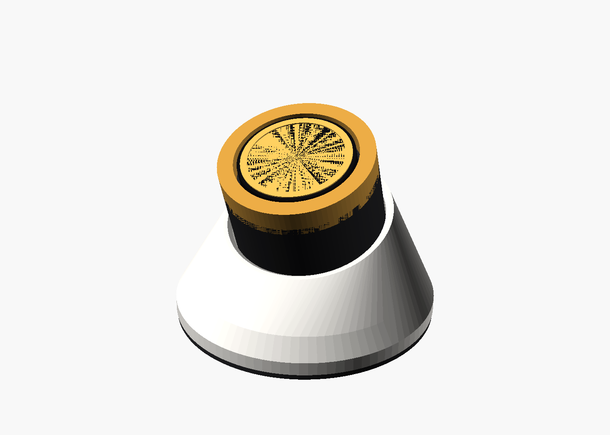

# Skjold Hjul S

Skjold Hjul med **rund skjerm**: dreieknapp med et 1,28″ fargedisplay i midten som viser cover eller kanallogo, tittel og
artist, og en volumring rundt kanten. Bygget på **M5Stack Dial** – en ferdig modul med ESP32-S3, rund GC9A01-skjerm
(240 × 240, berøring), dreiering med trykk, summer og batterikontakt. Du lodder ingenting; du printer et stativ og
flasher fastvaren.



Bilder: [stativ](render/01_hjul_s.png) · [eksplodert](render/02_eksplodert.png) · [siden](render/03_side.png)

Status: **ikke testet på maskinvare.** ESPHome-fila validerer (`esphome config`), men er ikke kompilert eller kjørt.
Pinnene er satt etter M5Dial v1.1 – sjekk mot M5Stack sin dokumentasjon.

## Bruk

| Handling | Hva skjer |
|---|---|
| Drei ringen | Volum opp/ned (vist i ringen rundt kanten) |
| Trykk på ringen / trykk på skjermen | Spill / pause |
| Dobbelttrykk | Neste |
| Hold inne | Bytt rom |
| Sveip høyre / venstre på skjermen | Neste / forrige favoritt (1–4) |

Hjul S bruker samme API som Skjold Hjul (`POST /api/hjul/event`), så favoritter, rom og oppsett er felles
(Innstillinger → Integrasjoner → Skjold Kassett → Skjold Hjul). Coveret hentes nedskalert fra `GET /api/cover?w=120`.

## Deler

| Del | Antall | Merknad |
|---|---|---|
| **M5Stack Dial** (ESP32-S3, 1,28″ rund skjerm) | 1 | ca. 350–450 kr (M5Stack, Elfa, AliExpress «M5Stack Dial») |
| LiPo 1S (valgfritt, f.eks. 503450 1000 mAh med JST) | 1 | for bruk uten kabel – plass i foten |
| USB-C-kabel og lader | 1 | |
| Magneter 10 × 2 mm (veggplate) | 2 | valgfritt |
| Gummiføtter Ø 10 mm | 4 | |

**Gjør det selv (alternativ):** ESP32-S3 + GC9A01 1,28″ (SPI) + EC11 med 3D-printet ring. Mer lodding og mekanikk – M5Dial
anbefales.

## Print (Creality K2)

`skjold-hjul-s-k2.3mf`: bordstativ (20° mot deg), bunnlokk og veggplate. PLA/PETG, 0,2 mm, 3 vegger, ingen støtte.
Mål M5Dial med skyvelære og juster `dialD`/`dialH` i `skjold_hjul_s.scad` hvis den ikke sitter godt.

## Fastvare

`esphome/skjold-hjul-s.yaml`. Sett `skjold_host`, Wi-Fi i `secrets.yaml`, koble M5Dial til med USB-C og flash:

```bash
esphome run esphome/skjold-hjul-s.yaml
```

## Lisens

Stativet er lisensiert under **CC BY-NC-SA 4.0**, se [LISENS-MASKINVARE.md](../../LISENS-MASKINVARE.md).
M5Stack Dial er et produkt fra M5Stack.
