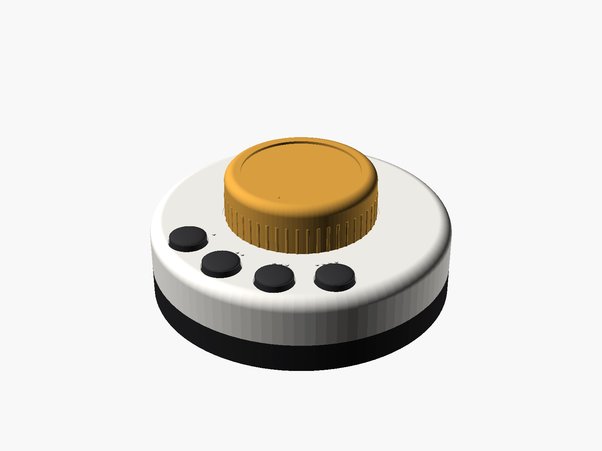

# Skjold Hjul

En liten, rund fjernkontroll på batteri. Den har en stor dreieknapp i midten og fire favorittknapper foran.



Bilder: [hjul](render/01_hjul.png) · [eksplodert](render/02_eksplodert.png) · [ovenfra](render/03_ovenfra.png) · [bunn](render/04_bunn.png)

## Bruk

| Handling | Hva skjer |
|---|---|
| Drei | Volum opp eller ned. Steg per hakk stilles inn i appen (standard 2). |
| Trykk | Spill eller pause |
| Dobbelttrykk | Neste låt, eller neste radiofavoritt |
| Hold inne (0,7 s) | Bytt rom. Lyset blinker blått. Rommene er «Dette rommet» pluss alle andre Skjold på nettet. |
| 1–4 | Starter favoritten. Du velger favorittene blant kassettene dine. |

Statuslyset:
- **Grønt:** OK.
- **Rødt:** feil, for eksempel en favoritt som ikke er satt opp, eller at Skjold ikke svarer.
- **Gult:** lysstyrken viser volumet mens du dreier.

Etter 45 sekunder uten bruk sover hjulet. En favorittknapp vekker det og blir utført med en gang. Dreiing eller trykk på hjulet vekker det bare. Det tar 1–3 sekunder før hjulet er på Wi-Fi igjen.

## Oppsett i appen

Gå til **Innstillinger → Integrasjoner → Skjold Kassett** i web-appen og velg fanen **Skjold Hjul**.
- Velg hvilken kassett hver av knappene 1–4 skal starte.
- Gi hjulet et navn og velg standardrom. Hjulet dukker opp i lista etter første trykk.
- Her ser du også batterinivå og når hjulet sist ble brukt.

## Deler

| Del | Antall | Merknad |
|---|---|---|
| ESP32-C3 SuperMini | 1 | Wi-Fi, deep sleep ~10 µA |
| EC11-dreieknapp med trykk, 20 mm aksel (D) | 1 | 20 detents |
| Taktbryter 12 × 12 mm, 4,3 mm høy | 4 | |
| WS2812B 5050 (enkelt-LED eller lite kort) | 1 | |
| LiPo 1S 1000 mAh (503450) | 1 | med beskyttelseskrets |
| TP4056-ladekort med USB-C | 1 | modell med beskyttelse (DW01) |
| BAT54C (dobbel Schottky, felles katode) | 1 | eller 2 × 1N4148 |
| Motstand 100 kΩ | 2 | spenningsdeler for batteri |
| Skyvebryter (valgfri) | 1 | av/på mellom TP4056 OUT+ og 5V |
| M2 × 16 skruer | 4 | bunn mot topp |
| Gummiføtter Ø 10 mm | 4 | |

## Kobling

| Fra | Til ESP32-C3 SuperMini |
|---|---|
| Favoritt 1 / 2 / 3 / 4 (andre bein til GND) | GPIO0 / GPIO1 / GPIO2 / GPIO4 |
| EC11 A / B (C til GND) | GPIO6 / GPIO7 |
| EC11 trykk (andre bein til GND) | GPIO10 |
| EC11 A og EC11 trykk → BAT54C anoder, felles katode | GPIO5 (WAKE) |
| WS2812 DIN (VCC til 3V3, GND til GND) | GPIO21 |
| Batteri+ → 100 kΩ → GPIO3 → 100 kΩ → GND | GPIO3 (ADC) |
| TP4056 OUT+ / OUT− | 5V / GND |

GPIO2 er en strapping-pinne, så ikke hold favoritt 3 inne mens hjulet starter. Alle knappene bruker intern pull-up og trekkes til GND.

## Utskrift

STL-filene ligger i `stl/`. Kilden er `skjold_hjul.scad` (parametrisk OpenSCAD), og hver del eksporteres med `-D 'part="topp"'` og så videre.

- **Materiale:** PETG eller PLA, 0,2 mm lag og 3 vegger.
- **`topp.stl`:** skrives med toppflaten ned, slik fila allerede ligger. Ingen støtte.
- **`bunn.stl`:** skrives flatsiden ned. Navnet er preget speilvendt i bunnen.
- **`knott.stl`:** gull eller sennep PETG. Den har D-hull for EC11-akselen. Juster `shaftFlat` om den sitter løst.
- **`knapp.stl`:** skriv ut 4 stykker, sorte.
- **`lysleder.stl`:** klar eller naturlig PETG.

## Montering

1. Lodd ledninger etter tabellen. Hold ledningene korte.
2. Skru EC11 fast i toppen med mutteren. Den firkantede lomma hindrer den i å vri seg.
3. Legg knappehettene i hullene, og lim taktbryterne på et lite hullkort under dem. Kortet hviler mot førerne.
4. Legg batteriet i lomma i bunnen og TP4056-kortet med USB-C mot hullet bak. Skru topp og bunn sammen.
5. Trykk knotten på akselen.

## Fastvare

Bruk `esphome/skjold-hjul.yaml`.
- Fyll inn Wi-Fi i `secrets.yaml`, og sett `skjold_host` til Skjold-en hjulet skal snakke med, for eksempel `skjold-stue.local`.
- For raskere oppvåkning: legg inn fast IP under `wifi: manual_ip`.

```bash
esphome run esphome/skjold-hjul.yaml
```

Hjulet sender `POST /api/hjul/event` til Skjold. Velger du et annet rom, videresender Skjold volum og spill/pause dit, og favorittene kjøres som rutinesteg i det rommet.

## Lisens

Maskinvaren i denne mappen er lisensiert under **CC BY-NC-SA 4.0**, se [LISENS-MASKINVARE.md](../../LISENS-MASKINVARE.md).
