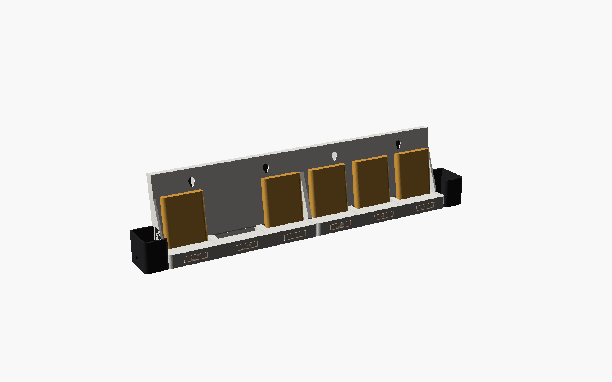

# Skjold Kassetthylle

En hylle for Skjold-kassettene der **den du tar ut, spilles**. Sett den tilbake, så stopper musikken. Lyset under hver
plass viser hva som skjer: gull som puster = denne spiller, svakt hvitt = kassett står inne, svakt blått = ukjent brikke,
mørkt = tom plass.



Bilder: [hylle](render/01_hylle.png) · [eksplodert](render/02_eksplodert.png) · [bak](render/03_bak.png)

Status: **konsept, ikke printet eller testet på maskinvare.** Modellen er sjekket (vanntette STL-er), ESPHome-fila
validerer (`esphome config`), og daemon-delen har tester.

## Slik virker det

- Hylla er bygget av **moduler med 3 plasser** som skrues sammen side om side, med et endestykke med ESP32-C3 i den
  ene enden og et blindt endestykke i den andre. Standardoppsettet er **2 moduler = 6 plasser**.
- Bak hver plass sitter en **RC522**-leser (billig, ca. 10–15 kr). Kassettens NFC-brikke ligger 1,2 mm fra baksiden og
  står rett foran leserens antenne gjennom 1,6 mm bakplate.
- Når en brikke forsvinner fra en plass (kassetten tas ut), sender hylla `POST /api/hylle/event` til Skjold, som spiller
  kassetten akkurat som om den ble satt i kassettspilleren: på den parede Skjold-enheten (Kassett → «Spilles på»),
  med album-oppslag (Navidrome → YouTube Music) og historikk/Kassett-Wrapped.
- Settes kassetten tilbake (på hvilken som helst plass), settes avspillingen på pause.
- Kassetter lages og kobles til innhold som før (Lag kassett i appen, eller læremodus). En ukjent brikke i hylla
  lyser blått og spiller ingenting.

Hvorfor RC522 og ikke PN532: PN532 koster 4–5 ganger mer, og med I²C trenger flere av dem en multiplekser (TCA9548A).
RC522 på delt SPI med egen CS per leser er billigst og enklest. Alternativ: hall-sensor per plass + én leser – billigere
per plass, men da må hylla lese brikken når kassetten settes inn, og plassen må kobles til kassetten.

## Deler (6 plasser)

| AliExpress-søk | Antall | Ca. pris |
|---|---|---|
| **ESP32-C3 SuperMini** | 1 | 30–50 kr |
| **RC522 RFID module 13.56MHz** (blått kort, 40 × 60 mm) | 6 | 10–15 kr stk. |
| **WS2812B 5050 single LED board** (eller kutt fra stripe) | 6 | 20–30 kr |
| **5V 2A USB-C** lader (eller USB-C fra en lader du har) | 1 | – |
| **Dupont / silikonledning 26–28 AWG**, **M3 × 12 skruer + muttere** (4 per skjøt), **M2 × 6 selvgjengende** (lokk) | | 50–80 kr |
| **Gummiføtter Ø 10 mm** | 4 | 20 kr |

Totalt ca. **250–400 kr** + filament (ca. 250 g PLA/PETG per modul).

## Kobling (ESP32-C3 SuperMini)

| RC522 | Til |
|---|---|
| SCK / MOSI / MISO (alle seks i parallell) | GPIO4 / GPIO6 / GPIO5 |
| SDA (= CS) plass 1 / 2 / 3 / 4 / 5 / 6 | GPIO7 / GPIO10 / GPIO20 / GPIO21 / GPIO0 / GPIO1 |
| 3.3V / GND (alle) | 3V3 / GND |
| RST, IRQ | ikke koblet |

| WS2812 | Til |
|---|---|
| DIN på LED 1 → DOUT videre til LED 2 … 6 | GPIO3 |
| 5V / GND | 5V / GND |

Ikke bruk GPIO2, GPIO8 eller GPIO9 (oppstartspinner). Flere enn 6 plasser: bruk ESP32-S3 (flere pinner) og legg til
lesere i `esphome/skjold-hylle.yaml`, og sett `plasser`.

## Print (Creality K2)

`skjold-hylle-k2.3mf`: én modul + begge endestykker + lokket. Print én plate per modul (endestykkene trenger du bare
én gang). `skjold-hylle-k2-klar.3mf`: lysledere i klar PETG (tre per modul, trykkes inn i vinduene foran).
PETG eller PLA, 0,2 mm lag, 3 vegger, 15 % fyll. Modulen printes stående (bakplata lener 8° bakover – ingen støtte).

## Montering

1. Lodd SPI-ledningene i en kjede bak (SCK, MOSI, MISO, 3V3, GND til alle lesere), og en egen CS-ledning per leser.
2. Legg leserne i lommene bak hver plass med antennen (spolen på kortet) **mot kassetten**, og skru på lokket.
3. Lim en WS2812 i lomma under hver plass (lyset peker fremover), og koble DIN → DOUT i rekkefølge fra plass 1.
4. Trekk ledningene i kanalen i sokkelen til endestykket med ESP32-C3. Skru modulene sammen med M3 × 12 + mutter.
5. Fest på veggen i nøkkelhullene, eller sett den på bordet på gummiføttene.

## Fastvare

`esphome/skjold-hylle.yaml` (ESPHome). Sett `skjold_host` til Skjold-enheten hylla skal snakke med, Wi-Fi i
`secrets.yaml`, og flash:

```bash
esphome run esphome/skjold-hylle.yaml
```

I web-appen: **Kassett → Kassetthylle** viser hyllene, plassene og hva som står hvor.

## Lisens

Maskinvaren i denne mappen er lisensiert under **CC BY-NC-SA 4.0**, se [LISENS-MASKINVARE.md](../../LISENS-MASKINVARE.md).
