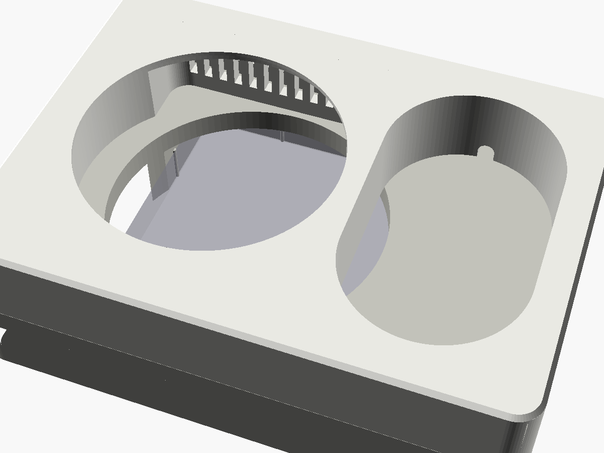
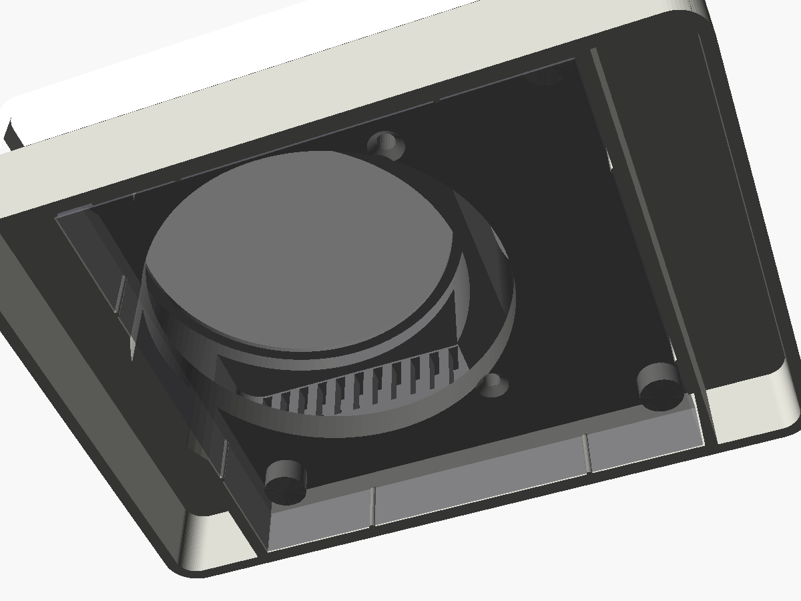

# IKEA BILRESA + TIMMERFLOTTE på Elko-ramme

En veggplate for to IKEA-ting: knappen BILRESA og temperatur- og fuktsensoren TIMMERFLOTTE. Plata tres over en norsk Elko-ramme (55 × 55-systemet) og dekker den.

Den bygger på [IKEA BILRESA & TIMMERFLOTTE Clipsal Wall Plate Mount](original/) av **thestockpot** (CC BY-NC-SA 4.0), som er laget for australske Clipsal-brytere. Endringene:

- **Større:** 124 × 90 mm i stedet for 116 × 75, så den dekker en Elko-ramme (ca. 84 × 84 mm).
- **Fronten** har fått en bredere kant rundt originalen, uten skjøt i toppflaten. Hullene, skruefestene og innsiden er de samme. Kanten har de samme luftespaltene i overkanten som originalen, så TIMMERFLOTTE fortsatt får luft.
- **Bakplata** er ny. Den er et lokk med en lomme som tres over rammen, med klemribber som holder den på plass. Den har samme sensorhull og skruehull som originalen.
- **Holderen for BILRESA** og **låseringen for TIMMERFLOTTE** er ikke endret. Print dem fra `original/`.

 

## Mål rammen din først

Standardmålene er en Elko Plus-ramme med ett hull: **84 × 84 mm**, som står **9,5 mm** ut fra veggen. Mål din, og endre øverst i `ikea_elko.scad` hvis den er annerledes:

```
ramme_b = 84.0;     // rammens bredde (mm)
ramme_h = 84.0;     // rammens høyde
ramme_d = 9.5;      // hvor langt rammen står ut fra veggen
```

Kjør så `xvfb-run -a sh lag_elko.sh`. Er rammen bredere enn ca. 115 mm eller høyere enn ca. 85 mm, må også `W` og `H` (platas mål) økes.

## Print

`ikea-elko-plate.3mf` har fronten (toppen ned) og bakplata (fronten ned) på én plate. Bruk PLA eller PETG, 0,2 mm lag og ingen støtte. Holderen og låseringen printes fra `original/bilresa_mount.3mf` og `original/timmerflotte_retainingring.3mf`.

## Montering

1. Sett BILRESA-holderen og TIMMERFLOTTE (med låseringen) i fronten, som i originalen.
2. Skru bakplata på fronten med **2 × M3 × 10 senkehodeskruer** fra baksiden, som i originalen.
3. Trykk plata over Elko-rammen. Klemribbene holder den. Vil du ha den helt fast, sett dobbeltsidig tape (3M VHB) på de fire små støttene inne i plata, som ligger mot rammens forside.

Den 55 × 55 mm store midtdelen i rammen (blindlokk eller bryter) kan sitte i, så lenge den ikke stikker mer enn ca. 4 mm ut foran rammen. Det er plass til omtrent 4,5 mm mellom rammen og bakplata.

## Lisens

Som originalen: **CC BY-NC-SA 4.0**. Navngi thestockpot (originalen) og Skjold Lab (tilpasningen), ikke selg den, og del endringer på samme vilkår.
