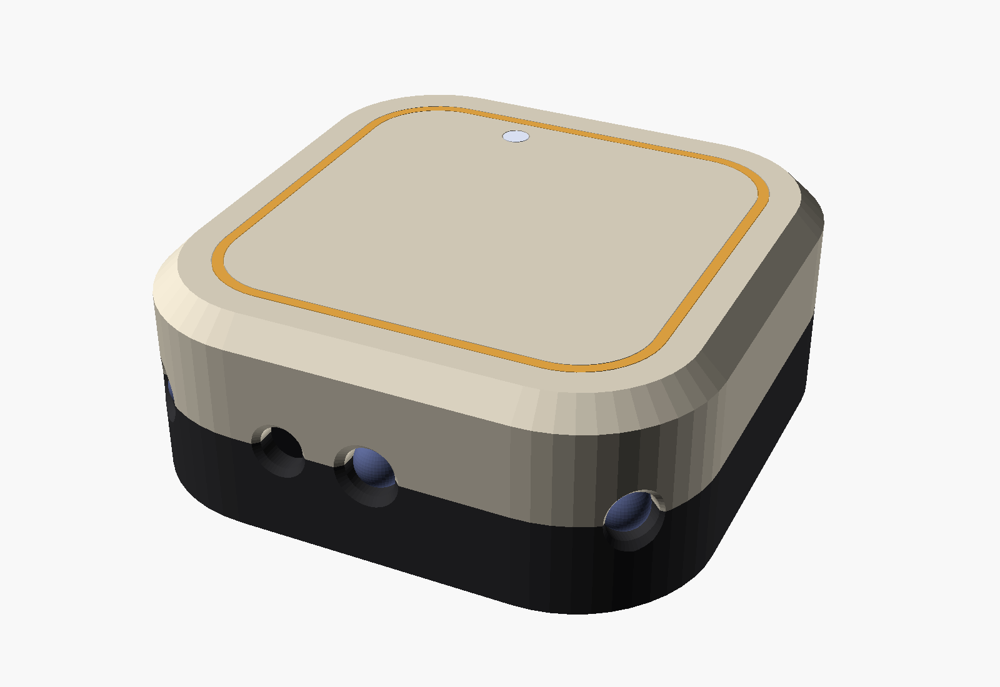

# Skjold IR

En liten IR-sender på Wi-Fi som står der fjernkontrollen ikke når fram, for eksempel inne i stereoskapet, bak TV-en eller i en hylle med lukkede dører. Skjold Stav, Home Assistant og Homey sender kommandoen over Wi-Fi, og Skjold IR sender den videre som IR til forsterkeren, TV-boksen eller spilleren som står der.



Bilder: [skrått, lys](render/01_skra_lys.png) · [ovenfra, lys](render/02_ovenfra_lys.png) · [eksplodert, lys](render/03_eksplodert_lys.png) · [skrått, mørk](render/04_skra_mork.png) · [ovenfra, mørk](render/05_ovenfra_mork.png) · [eksplodert, mørk](render/06_eksplodert_mork.png) · [inni](render/07_inni.png) · [forfra](render/08_forfra.png) · [inni, D1 mini](render/09_d1mini_inni.png) · [med lysdiode rett opp](render/10_opp.png) · [undersiden](render/11_undersiden.png)

**Status: ikke bygget eller testet.** Modellen er sjekket med `lag_ir.py` (tette deler, delene får plass, fri sikt, ingen støtte), men ingen har printet den, loddet den eller prøvd rekkevidden ennå. Mål de kjøpte delene dine før du printer (se «Mål» under).

## Slik virker den

- **Tre IR-lysdioder** peker ut fra fronten og de to fremre hjørnene (0° og ±45°). Med lysdiodenes egen kjegle (±17° for TSAL6200) dekker de ca. 125° foran. Inne i et skap spretter IR fra veggene, så den treffer som regel alt i skapet.
- **Valgfritt en fjerde lysdiode rett opp** (`skjold-ir-*-k2-opp.3mf`): den lyser mot taket i skapet og når utstyr som står bak eller ved siden av.
- **En VS1838B-mottaker** bak vinduet foran (til venstre for den midterste lysdioden) lærer koder rett fra den originale fjernkontrollen.
- **Statuslyset** er den blå lysdioden på kortet, som synes gjennom en lysleder i toppen. Den blinker når Skjold IR sender.
- **Strøm:** USB-C bak (5 V). Lysdiodene får 5 V gjennom en transistor, så de lyser sterkere enn de ville gjort rett fra en GPIO.

## Deler

| Del | Søkeord (AliExpress) | Antall | Ca. pris |
|---|---|---|---|
| ESP32-C3 SuperMini (22,5 × 18 mm, USB-C) | «ESP32-C3 SuperMini» | 1 | 25 kr |
| *eller* Wemos D1 mini (34,2 × 25,6 mm) | «D1 mini ESP8266» | 1 | 25 kr |
| IR-lysdiode 5 mm, 940 nm (TSAL6200 eller vanlig) | «940nm IR LED 5mm» | 3 (4 med lysdioden opp) | 10 kr (pose med 20) |
| IR-mottaker VS1838B, 3 bein (valgfri, for å lære koder) | «VS1838B» | 1 | 10 kr (pose med 10) |
| AO3400 N-MOSFET (SOT-23), eller S8050 / 2N2222 | «AO3400 SOT-23» | 1 | 10 kr (pose med 50) |
| Motstand 33 Ω (22–33 Ω), 1/4 W | | 1 per lysdiode | – |
| Motstand 1 kΩ (gate/base) og 10 kΩ (gate til GND, bare AO3400) | | 1 + 1 | – |
| Lite hullkort, ca. 12 × 7,5 mm (kuttes fra et større) | «perfboard» | 1 | 5 kr |
| Magneter Ø8 × 2 mm (valgfri) | «8x2mm neodymium magnet» | 4 | 15 kr (pose med 20) |
| Gummiføtter Ø10 × 1 mm | «10mm rubber feet» | 4 | 10 kr |
| M2 × 14 selvgjengende skruer | «M2x14 self tapping» | 4 | 10 kr |
| Silikontråd 28–30 AWG | | 50 cm | – |
| USB-C-kabel og en vanlig 5 V-lader | | 1 | – |
| Filament, ca. 30 g (Bone White, mørk, litt gull og klar PETG til lyslederen) | | | 6 kr |

Totalt rundt 100–130 kr når du har kabel og lader fra før. Prisene er omtrentlige og varierer.

## Kobling

| Fra | ESP32-C3 SuperMini | Wemos D1 mini |
|---|---|---|
| IR-driver: 1 kΩ → gate (AO3400) eller base (S8050) | GPIO4 | D2 (GPIO4) |
| VS1838B OUT | GPIO3 | D5 (GPIO14) |
| VS1838B VCC | 3V3 | 3V3 |
| Lysdiodenes anoder (+), via 33 Ω hver | 5V | 5V |
| AO3400 source, VS1838B GND | GND | GND |
| Statuslys (på kortet, ingenting å koble) | GPIO8 | D4 (GPIO2) |

**Skjema i ord:**

```
5V ──┬── 33 Ω ──▶|── LED 1 ──┐
     ├── 33 Ω ──▶|── LED 2 ──┤
     ├── 33 Ω ──▶|── LED 3 ──┤        (LED 4 rett opp: én til i parallell)
     │                       │
     │                     drain
GPIO4 ── 1 kΩ ──────── gate  AO3400
              └─ 10 kΩ ─ GND  source ── GND

3V3 ── VS1838B VCC     VS1838B OUT ── GPIO3 (D5 på D1 mini)     VS1838B GND ── GND
```

- Hver lysdiode har sin egen motstand. Med 33 Ω fra 5 V blir det ca. 100 mA i pulsene (IR sendes i korte pulser med 38 kHz, så snittet er lavt). 22 Ω gir ca. 150 mA og litt lengre rekkevidde.
- **AO3400** er best: den slår helt på med 3,3 V på gaten og tåler mye mer enn tre lysdioder. Med **S8050/2N2222** i stedet: base via 470 Ω–1 kΩ, emitter til GND. Det holder til tre lysdioder, men gir litt svakere pulser.
- **VS1838B skal ha 3,3 V, ikke 5 V.** Utgangen går rett inn i en GPIO, og ESP-en tåler ikke 5 V.
- Beinrekkefølgen på VS1838B varierer mellom produsenter (oftest OUT, GND, VCC sett forfra mot kuppelen). Sjekk annonsen.
- Lysdiodene: det lange beinet er anode (+). Det korte beinet og den flate kanten på flensen er katode (−), mot drain.

## Print

Filene er laget for Creality K2 (Creality Print eller OrcaSlicer) og har riktig filament på hver del:

| Fil | Innhold |
|---|---|
| `skjold-ir-c3-k2.3mf` | ESP32-C3 SuperMini, tre lysdioder |
| `skjold-ir-c3-k2-opp.3mf` | ESP32-C3 SuperMini, fire lysdioder (én rett opp) |
| `skjold-ir-d1mini-k2.3mf` | Wemos D1 mini, tre lysdioder |
| `skjold-ir-d1mini-k2-opp.3mf` | Wemos D1 mini, fire lysdioder |

Filament: 1 Bone White (toppen), 2 mørk (bunnen), 3 gull (ringen i toppen), 4 klar PETG (lyslederen). Mørk utgave: bytt filament 1 og 2.

- **Toppen** printes med toppflaten ned, så gullringen er første lag. **Bunnen** printes med undersiden ned. Lyslederen står med toppenden ned.
- **Ingen støtte.** Hullene til lysdiodene og mottakeren ligger i delingen, med halve hullet i hver del, så de printes som åpne renner. Den bredeste broen er taket over USB-åpningen (12,6 mm).
- 0,2 mm lag, 3 vegger, 15 % fyll. Lyslederen bør ha 100 % fyll.
- STL-ene ligger i `stl/c3/` og `stl/d1mini/`. Kilden er `skjold_ir.scad` (parametrisk OpenSCAD). `python3 lag_ir.py` lager STL-ene, sjekker dem og lager 3MF-filene. `python3 lag_ir.py bilder` lager også bildene.

**Mål:** 56 × 56 × 22 mm (bunnen 10 mm, toppen 12 mm). Lysdiodene sitter 10 mm over bordet, i delingen. Kuppelen ligger 0,3 mm inne i hullet, og flensen hviler mot blokka innvendig. Mål delene dine og juster øverst i `skjold_ir.scad`: `ir_l` (lysdiodens lengde fra flensen til tuppen, 8,6 mm for TSAL6200), `mott` (VS1838B: 7,0 × 5,6 × 9,0 mm) og `lys` (hvor den blå lysdioden sitter på kortet ditt).

## Montering

1. **Last inn fastvaren først** (se under) mens kortet ligger løst på bordet. Etterpå kan den oppdateres over Wi-Fi.
2. **Driveren:** lodd AO3400, 1 kΩ, 10 kΩ og motstandene til lysdiodene på det lille hullkortet. Det ligger flatt på gulvet foran kortet, til høyre for den midterste lysdioden.
3. **Lysdiodene:** legg dem i rennene i bunnen med kuppelen ut og flensen inntil blokka. Bøy beina ned og lodd dem til hullkortet. Den fjerde lysdioden (opp) trykkes inn i hullet i toppen nedenfra.
4. **VS1838B** står mellom de to ribbene foran til venstre, med kuppelen i vinduet.
5. **Kortet:** C3 SuperMini ligger flatt i de fire hjørnene med USB-C mot åpningen bak. D1 mini står på fire stolper med USB-pluggen under kortet. Har ditt D1 mini USB på oversiden, sett `stolpe = 0` og `usb_under = false`. Lodd ledningene etter tabellen. Hold dem korte, og ikke la noe ligge over antennen (enden av kortet som peker fram).
6. **Magnetene** (valgfri) trykkes inn i lommene i gulvet med en dråpe lim. Lommene er lukket under, så de synes ikke. Da kan Skjold IR sitte på en stålhylle eller en metallplate.
7. **Lyslederen** trykkes inn i hullet i toppen nedenfra, til kragen ligger an.
8. Legg toppen på, så den tres over leppa på bunnen. Skru sammen nedenfra med 4 × M2 × 14, og sett på gummiføttene. Vil du feste den, kan du bruke dobbeltsidig tape (3M VHB) på den flate undersiden mellom føttene.

## Fastvare

Bruk `esphome/skjold-ir.yaml` (ESP32-C3 SuperMini) eller `esphome/skjold-ir-d1mini.yaml` (Wemos D1 mini).

- Fyll inn Wi-Fi i `secrets.yaml`.
- **Sett `ir_navn`** til noe som sier hvor den står, for eksempel `skap`. Det er navnet Skjold Stav bruker for å nå denne senderen (små bokstaver, uten mellomrom). Har du flere, må hver ha sitt navn og sin `name`.

```bash
esphome run esphome/skjold-ir.yaml
```

Skjold IR tar imot kommandoer fra Skjold Stav og Homey over UDP (Skjold IR-protokollen, beskrevet øverst i yaml-fila) og fra Home Assistant gjennom ESPHome-integrasjonen. Med VS1838B kan den lære koder fra den originale fjernkontrollen.

Skjold Dokk kan også få den samme IR-senderen innebygd i sokkelen, se «IR i dokka» i [fjernkontrollens LES_MEG](../fjernkontroll/LES_MEG.md#ir-i-dokka).

## Lisens

Maskinvaren i denne mappen er lisensiert under **CC BY-NC-SA 4.0**, se [LISENS-MASKINVARE.md](../../LISENS-MASKINVARE.md).
