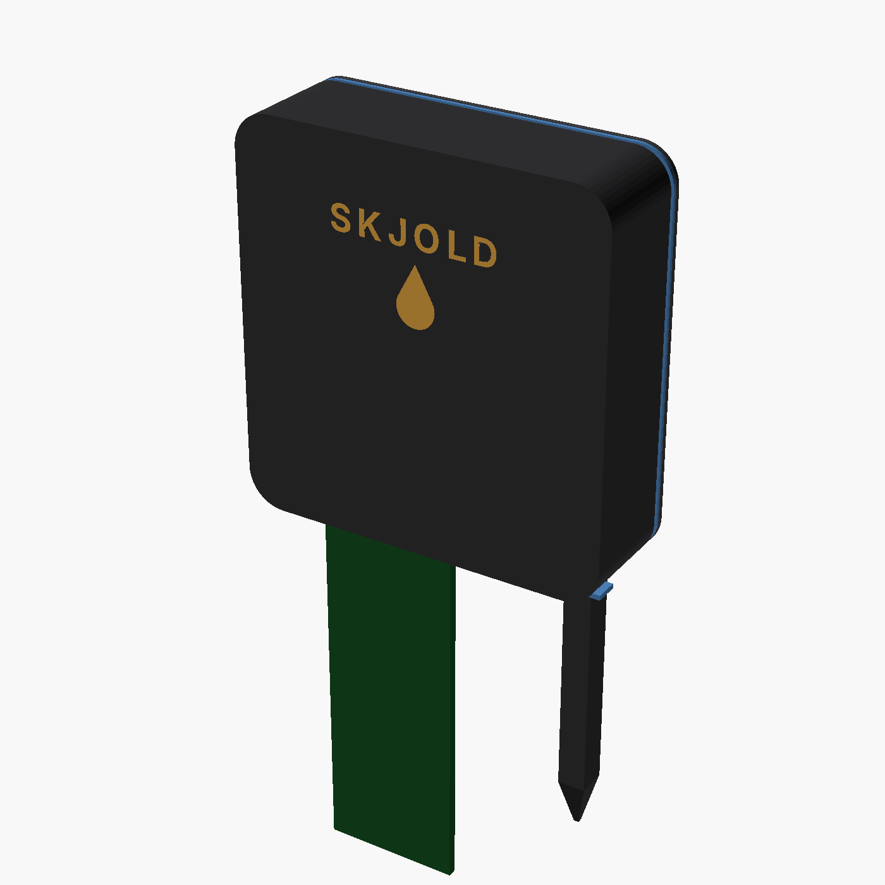
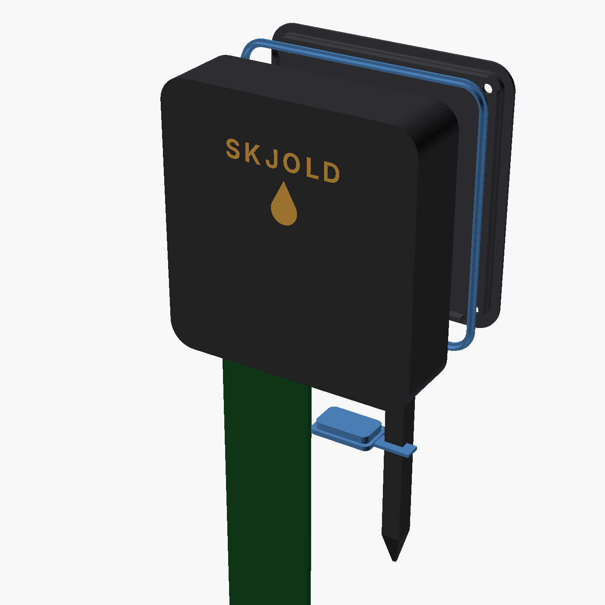
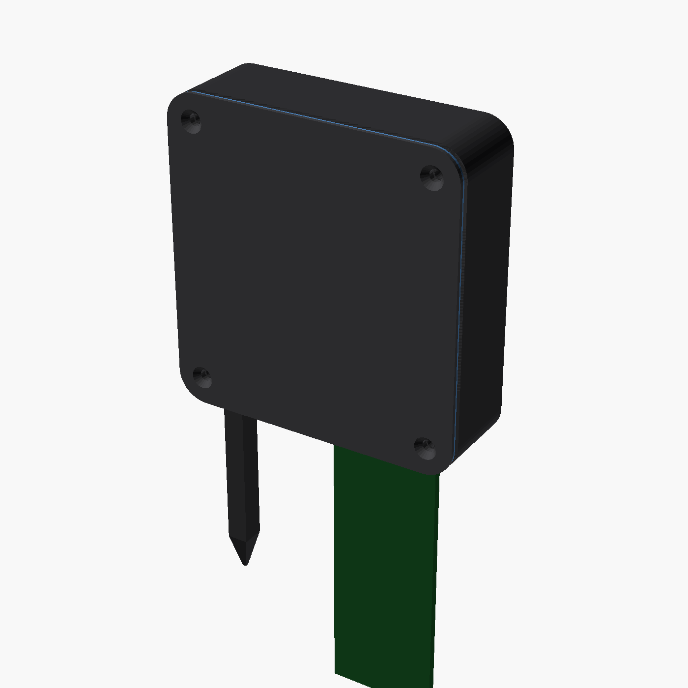

# Skjold Jord

Trådløs jordfuktsensor på batteri. Den står i blomsterbedet eller i potta, måler hvor fuktig jorda er hver time, og sender det til Home Assistant over Wi-Fi. Mellom målingene sover den, så batteriet varer i mange måneder. Den lades med USB-C.

  

**Mål:** 61 × 64 × 19 mm (huset), pluss sensoren og spydet under. Huset står over bakken. Sensoren går ca. 68 mm ned i jorda, og et spyd ved siden av holder huset stødig.

## Deler

| Del | Antall | Merknad |
|---|---|---|
| Kapasitiv jordfuktsensor v1.2 eller v2.0 (98 × 23 mm) | 1 | Den svarte med JST-PH 3 p. Se merknaden om 555-brikken under |
| Seeed XIAO ESP32C3 | 1 | Med den medfølgende Wi-Fi-antennen. Lader batteriet selv (BAT-putene bak) |
| LiPo 603450, 1200 mAh, med beskyttelseskrets | 1 | Samme som i Skjold Fjernkontroll |
| Motstand 1 MΩ | 2 | Spenningsdeler for batterimålingen |
| Kondensator 100 nF | 1 | Over den nedre motstanden (stabil måling) |
| Selvgjengende skrue M2 × 10 | 4 | Lokket |
| Litt dobbeltsidig skumtape | – | Batteriet og antennen |

**555-brikken på sensoren:** sensoren får 3,3 V fra XIAO-en. De fleste har en **TLC555** (eller «555» fra TI), som virker fra 2 V. Noen billige har en **NE555**, som trenger 5 V og gir feil verdier på 3,3 V. Se på brikken før du bygger: står det NE555, bytt sensor.

## Kobling

| Fra | Til |
|---|---|
| Sensor VCC (rød) | **D2** (GPIO4). XIAO-en slår sensoren på bare mens den måler (ca. 0,6 s) |
| Sensor GND (svart) | **GND** |
| Sensor AOUT (gul) | **D1** (GPIO3) |
| Batteri + (rød) | **BAT+** (pute bak på XIAO-en) |
| Batteri − (svart) | **BAT−** |
| BAT+ → 1 MΩ → **D0** (GPIO2) → 1 MΩ → GND | Batterimåling. 100 nF fra D0 til GND |

Den medfølgende antennen plugges i U.FL-kontakten på XIAO-en og tapes inn mot forsiden, øverst i huset (over sensoren). Uten antenne blir rekkevidden svært kort.

## Print (Bambu Lab P3C eller annen skriver)

`skjold-jord.3mf` har alt på én plate:

| Del | Filament |
|---|---|
| Kropp (forsiden ned) og lokk (yttersiden ned) | **PETG** (hode 1). Tåler sol, regn og fukt bedre enn PLA |
| SKJOLD og dråpen, felt inn i forsiden | **Gull PLA** (hode 3) |
| Pakning til lokket, mansjett rundt sensoren og USB-plugg | **TPU 95A** (hode 4) |

- 0,2 mm lag, 3 vegger, 25 % fyll. Pakningen, mansjetten og pluggen: 100 % fyll og sakte (20–30 mm/s).
- Kroppen har trestøtte fra plata (bare USB-C-åpningen trenger det), med PLA-grensesnitt mot PETG, så den slipper rent.
- Uten TPU: print alt i PETG, og tett lokket og sensoren med silikon i stedet for TPU-delene.

## Montering

1. **Lodd:** sensorledningen (eller klipp pluggen og lodd rett på), batterimålingen (1 MΩ + 1 MΩ + 100 nF) og batteriet på BAT-putene. Plugg i antennen.
2. **Flash fastvaren før du lukker** (se under). Koble til batteriet etterpå.
3. **Sensoren:** tre TPU-mansjetten på sensorkortet fra spissen og opp til streken under kretsene. Skyv sensoren opp gjennom åpningen i bunnen, med komponentene fram, til kortkantene går inn i skinnene. Trykk mansjetten ned i åpningen fra innsiden til kragen ligger an.
4. **XIAO-en** står til høyre, med USB-C ned mot åpningen i bunnen og brikken fram. Fest den med en dråpe varmlim eller tape.
5. **Batteriet** legges bak, på hylla, med en bit skumtape mot lokket.
6. **Lokket:** legg TPU-pakningen i sporet i lokket (foten ned, leppen ut). Skru lokket på med 4 × M2 × 10, jevnt og ikke for hardt. Leppen skal bøyes, ikke klemmes flat.
7. **USB-pluggen** trykkes inn i åpningen i bunnen. Dra i fliken for å lade.

Sett den i jorda med spydet og sensoren samtidig, til bunnen av huset står 1–2 cm over jorda. Jorda skal ikke nå opp til huset.

## Fastvare

`esphome/skjold-jord.yaml` (ESPHome). Ferdig fastvare installeres fra [skjold-lab.com/flasher/jord](https://skjold-lab.com/flasher/jord/) med USB-C. Wi-Fi settes opp rett etterpå (Improv), eller via tilgangspunktet **Skjold Jord**.

**Slik virker den:**
- Den våkner hvert **Måleintervall** (standard 60 min), slår på sensoren i 0,6 s, måler jordfukt og batteri, sender til Home Assistant og sovner igjen. Det tar vanligvis 3–5 sekunder.
- **Trykk RESET** på XIAO-en, eller sett i batteriet på nytt, så står den våken i 3 minutter. Da kan du oppdatere fastvaren, kalibrere og endre innstillinger. Måler hvert 10. sekund mens den er våken.
- **Hold våken** (bryter i Home Assistant): slå på mens den er våken, så sovner den ikke før du slår av igjen.
- Er Wi-Fi ikke satt opp, sover den ikke. Da kan du sette det opp når som helst.

**I Home Assistant:**

| Entitet | Hva |
|---|---|
| Jordfukt | 0–100 % (0 = tørr, 100 = som i vann) |
| Trenger vann | På under 25 % |
| Batteri | 0–100 %, ut fra batterispenningen |
| Batterispenning, Jordfukt (spenning), Wi-Fi-signal | Diagnostikk |
| Måleintervall, Kalibrering tørr, Kalibrering våt, Hold våken | Innstillinger |

Fastvaren sier fra til Home Assistant at den sover (ESPHome `deep_sleep`), så Home Assistant beholder siste verdi mellom målingene i stedet for å vise den som utilgjengelig. Lag automasjoner på «Trenger vann» eller «Jordfukt», med `not_from: [unavailable, unknown]` for sikkerhets skyld.

**Kalibrering** (én gang, med den våken etter RESET):
1. Tørk av sensoren og hold den i lufta. Les **Jordfukt (spenning)** og skriv tallet i **Kalibrering tørr** (typisk 2,2–2,6 V).
2. Sett sensoren i et glass vann til streken. Les spenningen igjen og skriv den i **Kalibrering våt** (typisk 0,9–1,3 V).

**Oppdatere fastvaren:** trykk RESET, og oppdater innen 3 minutter fra ESPHome i Home Assistant. Du kan også bruke kommandolinjen, som for Skjold Sensor, med `MAPPE=jord`, adressen til sensoren og port 3232 (ESP32-C3) i stedet for 8266. Den ferdige fastvaren sjekker ikke selv etter oppdateringer, fordi det ville brukt batteri hver gang den våkner.

## Batteritid

Beregnet, ikke målt:

| Måleintervall | Per døgn | 1200 mAh holder i |
|---|---|---|
| 60 min (standard) | ca. 3,5 mAh | ca. 10 måneder |
| 30 min | ca. 6 mAh | ca. 6 måneder |
| 15 min | ca. 11 mAh | ca. 3 måneder |

Det forutsetter ca. 45 µA i søvn (XIAO ESP32C3 og spenningsdeleren) og ca. 4 s våken med Wi-Fi per måling. Svakt Wi-Fi gir lengre tid våken og kortere batteritid. Fast IP-adresse i ruteren gjør oppkoblingen raskere. **Mål søvnstrømmen** første gang: over 0,2 mA betyr at noe står på, for eksempel en sensor som ikke slås av.

## Filer

| Fil | Hva |
|---|---|
| `skjold_jord.scad` | Modellen (OpenSCAD) |
| `lag_jord.sh` | Lager STL-ene, sjekker modellen, lager 3MF og bildene (`xvfb-run -a sh lag_jord.sh`) |
| `sjekk_jord.py` | Sjekker at delene ikke kolliderer og at de printes flatt |
| `lag_3mf_jord.py` | Lager `skjold-jord.3mf` |
| `stl/` | Utskriftsdelene |
| `esphome/skjold-jord.yaml` | Fastvaren |

## Ikke testet ennå

Huset, pakningene og fastvaren er tegnet og sjekket i modellen og i ESPHome, men ikke bygget. Print én kropp og prøv sensoren i skinnene og mansjetten før du printer flere. Batteritiden er beregnet.

## Lisens

CC BY-NC-SA 4.0 (se LISENS-MASKINVARE.md i roten). Fastvaren er MIT.
