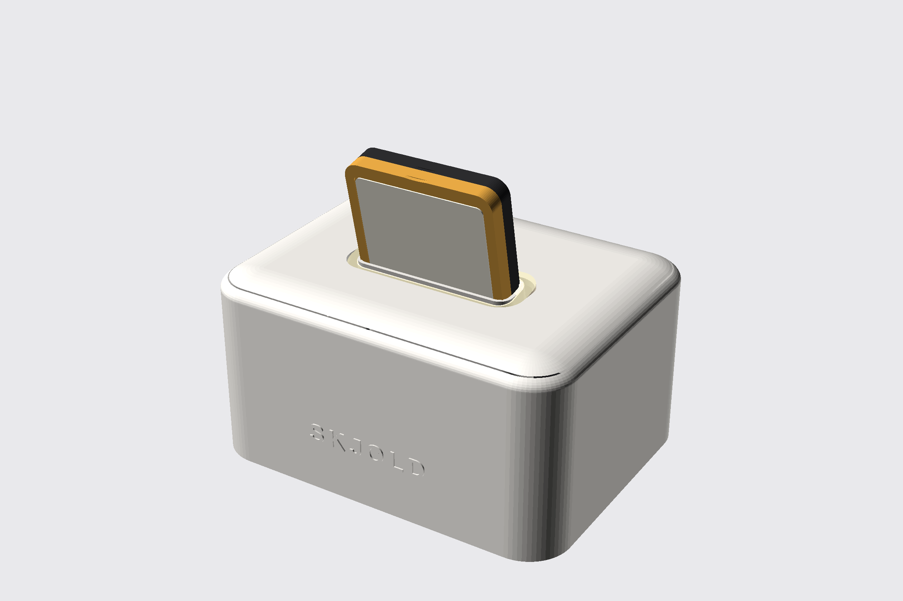

# Skjold Kassett

En liten spiller der du setter inn en «kassett» med en NFC-brikke. Skjold spiller det kassetten er koblet til:
en radiokanal, en NRK-serie, et Navidrome-album eller en spilleliste, noe fra Music Assistant eller en rutine.
Når du tar kassetten ut, pauses musikken (kan slås av per kassett).



Bilder: [spiller](render/01_spiller.png) · [med kassett](render/02_med_kassett.png) · [kassett](render/03_kassett.png) · [eksplodert](render/04_eksplodert.png)

## Deler

| Del | Antall | Merknad |
|---|---|---|
| Waveshare ESP32-S3 Zero | 1 | eller annen ESP32 med Wi-Fi |
| PN532 NFC-modul V3 (I²C) | 1 | sett DIP-bryterne til I²C (1=ON, 2=OFF) |
| WS2812-LED-stripe, 10 mm, 18 LED | 1 | lyslist i fronten |
| Passiv piezo-summer | 1 | valgfri, gir «pip» ved innsetting |
| NTAG215 NFC-klistremerker, 25 mm | 1 per kassett | NTAG213/216 virker også |
| Neodymmagneter 6×3 mm | 2 i spilleren + 2 per kassett | holder kassetten på plass – sjekk polaritet |
| USB-C-kabel og 5 V-lader | 1 | |
| M2×6-skruer | 4 | topp mot bunn |

## Kobling

| Fra | Til ESP32-S3 Zero |
|---|---|
| PN532 VCC / GND | 3V3 / GND |
| PN532 SDA | GPIO5 |
| PN532 SCL | GPIO6 |
| WS2812 DIN | GPIO4 (5 V og GND fra 5V-pinnen) |
| Piezo + | GPIO7 (– til GND) |

## Utskrift

Filene ligger i `stl/`. Kilde: `skjold_kassett.scad` (parametrisk, OpenSCAD).

- PETG eller PLA, 0,2 mm lag, 3 vegger, 15–20 % fyll.
- `spiller_topp.stl` og `spiller_bunn.stl`: ingen støtte nødvendig med flatsiden ned.
- `kassett_front.stl` og `kassett_bak.stl`: skriv kassettene i to farger om du vil – SKJOLD-pregingen står i fronten.
- `lysleder.stl`: klar/naturlig PETG gir best lys.
- Noen kanter i `spiller_topp`/`spiller_bunn` deles av sammenfallende flater fra OpenSCAD-unionen. Slicere
  (PrusaSlicer, Cura, Bambu Studio) reparerer dette uten videre; vil du ha helt rene filer, eksporter på nytt fra `.scad`.

## Montering

1. Lim magnetene inn i spillerbunnen og i kassetthalvdelene (riktig vei – test før limet tørker).
2. Fest PN532 i holderen under kassettsporet, antennen opp.
3. Legg LED-stripen bak lyslederen, og fest ESP32 med USB-C-porten mot hullet bak.
4. Lodd etter tabellen over, skru sammen topp og bunn.
5. Fest et NFC-klistremerke inni hver kassett før du klikker halvdelene sammen.

## Fastvare

`esphome/skjold-kassett.yaml`. Fyll inn Wi-Fi og adressen til Skjold (`skjold_host`), og flash:

```bash
esphome run esphome/skjold-kassett.yaml
```

Spilleren sender `POST /api/nfc/scan` og `/api/nfc/remove` til Skjold-daemonen.

## Koble kassetter

I Skjold-appen: **Innstillinger → Integrasjoner → Skjold Kassett**. Trykk «Koble ny kassett», velg hva som skal spilles
(eller «det som spiller nå»), rom og volum, og sett inn kassetten innen 60 sekunder. Under «Skriv ut etiketter»
får du et A4-ark med 44×52 mm-etiketter med omslag. Ferdige etikettmaler ligger også i `etiketter_a4.svg/pdf/dxf`.

## Kreditering og lisens

Idéen er inspirert av TheStockPots «ESPHome Cartridge Player» (CC BY-NC 4.0). Ingen geometri er kopiert –
kabinettet er tegnet på nytt fra bunnen i OpenSCAD.

Maskinvaren (denne mappen) er lisensiert under **CC BY-NC-SA 4.0**, se [LISENS-MASKINVARE.md](../../LISENS-MASKINVARE.md).
