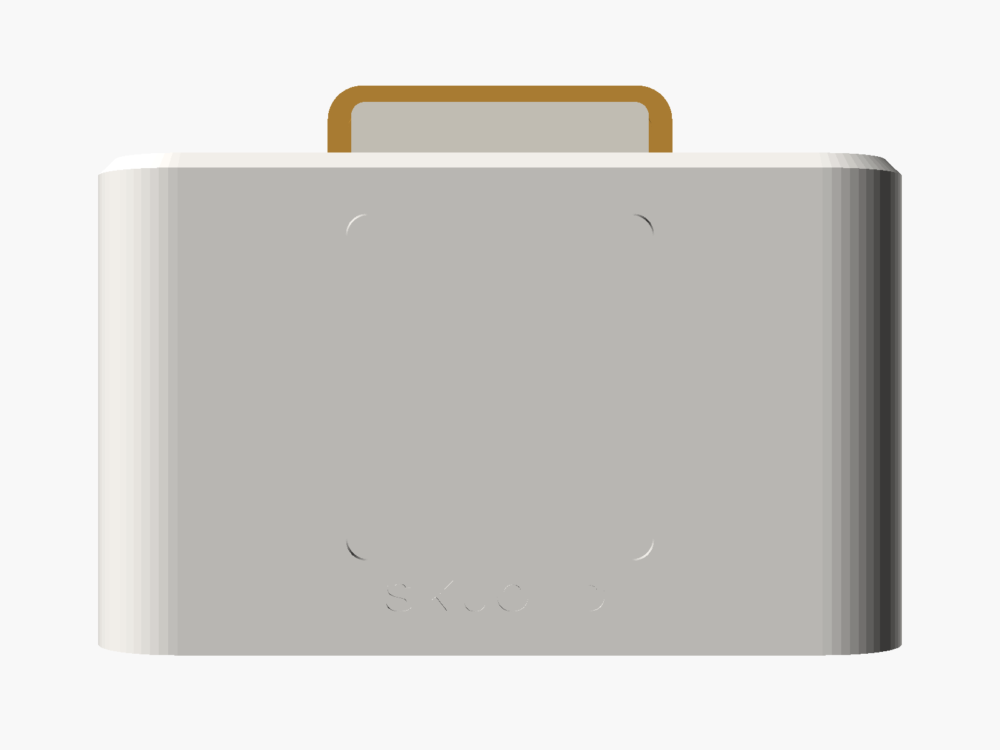
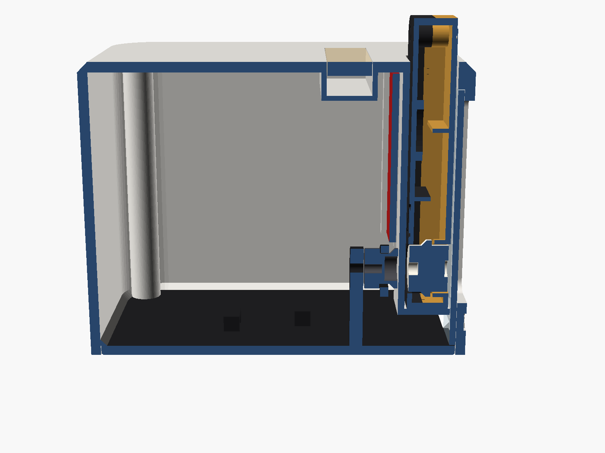

# Skjold Kassett

En liten spiller der du setter inn en «kassett» med en NFC-brikke. Skjold spiller det kassetten er koblet til:
en radiokanal, en NRK-serie, et Navidrome-album eller en spilleliste, noe fra Music Assistant eller en rutine.
Når du tar kassetten ut, pauses musikken (kan slås av per kassett).

Kassetten står bak et **vindu i fronten**, som på en kassettspiller fra 80-tallet, og **spolene går rundt** mens
musikken spiller: de står stille på pause, og spoler fort når du hopper i låten eller bytter låt.



Bilder: [forfra](render/07_forfra.png) · [med kassett](render/02_med_kassett.png) · [spiller](render/01_spiller.png) · [kassett](render/03_kassett.png) · [kassett bakfra](render/05_kassett_bak.png) · [eksplodert](render/04_eksplodert.png) · [snitt](render/06_snitt.png)

## Slik går spolene rundt

- Hver kassett har **to løse spoler** (printede, med en 3 × 2 mm diametral magnet i navet). De ligger fritt mellom
  kassetthalvdelene: navet stikker ut i spolevinduene på begge sider, og en flens inni (større enn vinduet) holder
  spolen på plass. Ingen aksel, ingen lim.
- Bak sporet sitter **to trinser** med 6 × 3 mm diametrale magneter, rett bak spolene (2,7 mm unna, gjennom
  lommeveggen). Når trinsene går rundt, drar magnetene spolene med seg. Kassetten trenger ingen kontakt eller tannhjul,
  og den kan settes inn i hvilken som helst stilling.
- Begge trinsene og motortrinsen ligger i **én O-ring (22 × 2 mm)**, så begge spolene går samme vei, som på en ekte
  kassett. Motoren er en **N20-girmotor (6 V, 200 o/min)** som går stille på 5 V, styrt med en **DRV8833** på 20 kHz
  (ingen pipelyd fra PWM).
- Magnetene sitter nederst, minst 20 mm fra PN532-antennen (som sitter øverst, rett bak NFC-brikken), så de
  forstyrrer ikke lesingen.
- Skjold forteller spilleren hva spolene skal gjøre (`GET /api/nfc/spoler`): spill ≈ 0,5 omdr/s, pause = stopp,
  hopp/ny låt = kort spoling (≈ 1,6 omdr/s, bakover ved hopp bakover). ESP-en ramper farten mykt. Fart, spolefart og
  «bare når en kassett står i» stilles under **Integrasjoner → Skjold Kassett** i appen.

## Deler

| Del | Antall | Merknad |
|---|---|---|
| Waveshare ESP32-S3 Zero | 1 | klikkes i vugga på bunnen, USB-C mot hullet bak |
| PN532 NFC-modul V3 (I²C), 42,7 × 40,5 mm | 1 | skyves inn i skinnene bak sporet, antennesiden mot sporet, antennen øverst. DIP: 1=ON, 2=OFF |
| N20-girmotor 6 V, 200 o/min, 3 mm D-aksel | 1 | ligger i vugga på bunnen |
| DRV8833 motordriver (lite kort) | 1 | VM til 5V, nSLEEP til 3V3 |
| O-ring NBR 22 × 2 mm | 1 | reim mellom motortrinse og trinser (20–24 mm ID virker) |
| Stålpinne Ø 2 × 10 mm (eller M2 × 10 skrue) | 2 | aksler for trinsene, presses inn i stolpene |
| Neodymmagnet 6 × 3 mm, **diametral** | 2 | i trinsene |
| Neodymmagnet 3 × 2 mm, **diametral** | 2 per kassett | i spolenavene |
| Neodymmagnet 6 × 3 mm (aksial) | 1 i spilleren + 1 per kassett | holder kassetten nede – sjekk polaritet før liming |
| NTAG215 NFC-klistremerke, 25 mm | 1 per kassett | NTAG213/216 virker også |
| WS2812B-stripe 10 mm, 60 LED/m | 5 LED (ca. 84 mm) | i lista bak sporet, under lyslederen |
| Passiv piezo-summer 12 mm | 1 | valgfri |
| Klar rute 49 × 62,9 × 1,0 mm | 1 | 1 mm klar akryl (klarest) – eller print i klar PETG. Sporet er tegnet for 1,0 mm (`paneT` i .scad) |
| M3 innpressmutter (heat-set), M3 × 5,7 mm, Ø ≤ 4,6 mm | 4 | hull Ø 4,0 × 6,5 mm i skruetårnene |
| M3 × 8 mm senkehodeskrue (DIN 7991) | 4 | fra undersiden |
| Selvklebende gummiføtter Ø 10 mm | 4 | |
| Tynn silikonledning (26–28 AWG), USB-C-kabel og 5 V-lader | | |

Diametrale magneter er magnetisert på tvers (nord på den ene halvdelen av sirkelen) – det er det som gjør at de kan
dra hverandre rundt. Vanlige (aksiale) magneter virker ikke til spolene.

## Cover til kassettene (A4, uten lim)

Coveret printes på **vanlig A4-papir** og ligger **inni kassetten**, bak et etikettvindu i fronten: rammen rundt vinduet
(2,4 mm) holder kantene, og en løs **bakplate** (egen printet del, `etikettplate`) presser papiret flatt når halvdelene
klikkes sammen. Papiret kan ikke falle ut (vinduet er mindre enn arket), og du trenger verken lim eller klistremerker.

1. Klipp ut coveret langs den grå linjen (44 × 49,6 mm, de øvre hjørnene er skrå – der står tappene).
2. Legg kassettfronten med forsiden ned, legg coveret med bildet ned i vinduet.
3. Legg bakplaten oppå (platen mot papiret, ribbene opp), og klikk bakhalvdelen på. Bytt cover: dra halvdelene fra hverandre.

Bakplatene ligger i `skjold-kassett-k2-kassetter.3mf` (4 komplette kassetter: bak, front, bakplate og spoler).

`lag_cover.py` henter albumcover og legger coverne ferdig på A4 (15 per side, 44 × 49,6 mm).

```bash
cd kabinett/kassett
pip install playwright && python3 -m playwright install chromium   # én gang, for PDF
python3 lag_cover.py album.txt
```

Skriv én linje per kassett i `album.txt` (lages fra `album-eksempel.txt` første gang, og følges ikke av Git – så `git pull` krasjer ikke med lista di): `Artist - Album`. Bruk `Artist - Album | /sti/cover.jpg` for eget bilde, eller
`Artist - Album | 2` for flere kopier. Coveret hentes fra iTunes-søket (MusicBrainz som reserve); finnes det ikke, lages
et fargefelt med albumnavnet. Resultatet er `kassett-cover.pdf`. Skriv ut i **100 % skala** (ikke «tilpass til side»),
på vanlig papir (80–120 g/m²; fotopapir er for tykt), og klipp langs den tynne grå linjen.

## Kobling

| Fra | Til ESP32-S3 Zero |
|---|---|
| PN532 VCC / GND | 3V3 / GND |
| PN532 SDA / SCL | GPIO5 / GPIO6 |
| WS2812 DIN | GPIO4 (5 V og GND fra 5V-pinnen) |
| Piezo + | GPIO7 (– til GND) |
| DRV8833 AIN1 / AIN2 | GPIO8 / GPIO9 |
| DRV8833 VM / GND / nSLEEP | 5V / GND / 3V3 |
| DRV8833 AOUT1 / AOUT2 | N20-motoren (bytt ledningene hvis spolene går feil vei) |

## Slik er spilleren bygd



- **Lokk og bunn skrus sammen** med fire M3-skruer fra undersiden inn i innpressmuttere i hjørnene. Bunnen ligger inne
  i lokket og presses mot en skrå hylle innvendig, så skjøten blir lystett uten synlig spalte.
- **Sporet** står loddrett rett bak frontveggen. Kassetten står 60 mm ned (10 mm stikker opp til å ta tak i) og hviler
  på en vannrett sporbunn. Klaring 0,6 mm rundt; 0,65 mm mellom kassetten og ruten.
- **Vinduet** er 44 × 52 mm. Ruten skyves opp i et spor innenfor frontveggen fra undersiden og står på bunnplata.
- **Holdemagneten** trykkes inn nedenfra i et tårn under sporbunnen (0,6 mm vegg mot kassettens magnet).
- **PN532** skyves inn nedenfra i to skinner bak sporet og stopper mot lokket (antennen øverst, foran NFC-brikken).
  En dråpe varmlim nederst holder den.
- **Drivverket** står på bunnplata: to stolper med aksler for trinsene og en vugge for N20-motoren. Når bunnen skrus
  på, havner trinsene rett bak spolene (0,2 mm fra lommeveggen, som også holder dem på akslene).
- **LED-lista** (5 LED) ligger i en kasse bak sporet, og en rett lysleder flukter med toppen.
- **ESP32-S3 Zero** klikkes ned i vugga **bak til høyre** (ved siden av N20-motoren); USB-C-hullet sitter i bakveggen
  til høyre og er stort nok til vanlige plugger. **Summeren** ligger bak til venstre.
- **Mål:** 120 × 62 × 72 mm (B × D × H). Spilleren er 30 mm grunnere enn før (var 92 mm): ESP-en og summeren ligger
  nå ved siden av drivverket i stedet for bak det. Vinduet, kassetten, PN532 og magnetene står der de sto.

Kontrollert i modellen med `sjekk_modell.py` (trimesh/manifold): alle STL-er er vanntette og én sammenhengende del, og
ingen deler overlapper i montert stilling – heller ikke spolene når de roteres rundt (sjekket hver 30°). Minste
klaring spole–kassett 0,18 mm (flens mot krage), trinse–lommevegg 0,2 mm, O-ring–PN532 0,8 mm.

## Utskrift (Creality K2 / K2 Pro / K2 Plus, 0,4 mm dyse)

- **`skjold-kassett-k2.3mf`**: én plate (≤ 250 × 250 mm) med lokk, bunn med drivverk, fire kassetter, åtte spoler og
  trinsene, ferdig orientert.
- **`skjold-kassett-k2-klar.3mf`**: ruten og lyslederen i klar PETG (egen plate).

`lag_3mf.py` lager begge fra STL-ene i `stl/`. Delene har hvert sitt filamentnummer, så med CFS printes en plate i én omgang:

| Filament | Deler | Forslag |
|---|---|---|
| 1 | Lokk og spoler | Lys PETG (eller PLA) |
| 2 | Bunn, kassettenes bakside, trinser | Sort PETG/PLA |
| 3 | Kassettenes forside | Sennep/gull PLA |
| 4 | Rute og lysleder | Klar PETG |

Hvis slicer-en ikke henter filamentnummeret fra fila, setter du det per objekt i lista.

| Innstilling | Verdi |
|---|---|
| Lag | 0,20 mm (0,16 mm for kassetter og spoler) |
| Vegger | 3 (lokket: 4) |
| Topp/bunn | 5 / 4 lag |
| Fyll | 15 % gyroid (ruten: 100 %, monotont, sakte – blir klarest) |
| Støtte | **av** – ingen deler trenger støtte |
| Søm | bak (aligned/back) |
| PLA | 210–220 °C, plate 55 °C |
| PETG | 235–245 °C, plate 70 °C, kjøling 40–60 % |
| Plate | teksturert PEI gir en matt, jevn toppflate på lokket |

- **Lokket printes med toppen ned.** Vinduskanten, sporbunnen og LED-kassens gulv er broer (maks ca. 12 mm). Toppkanten
  har 45°-fas.
- **Bunnen** printes flat. Akselhullene i stolpene er dråpeformet, så de printes uten støtte.
- **Spolene** printes med magnetsiden ned; flensen har en 45°-kjegle under.
- **Trinsene** printes med akselhullet ned og magnetlomma opp.
- **Kassetthalvdelene** printes med utsiden ned.

Ingen pause trengs: magnetene og NFC-brikken legges i etter print.

Vekt (fra STL-volum, 100 % fylt): lokk ≈ 135 g, bunn med drivverk ≈ 35 g, kassett med spoler ≈ 18 g, rute ≈ 6 g.

### Kassetten

Kassetten er formet som en gammel kompaktkassett: etikettfelt øverst, spolevinduer gjennom begge sider nederst
(med vinduskant foran), og bak trapes med SKJOLD og «skruer» i hjørnene. Den er bygd som to tynne skall (1,2 mm hud,
1,6 mm vegg) med ribber. Ytre mål 50 × 70 × 10 mm. NFC-brikken ligger i en ring innenfor bakhuden (øverst, foran
PN532-antennen) og holdemagneten i bunnkanten midt i skjøten. Coveret (44 × 49,6 mm) ligger inni kassetten bak
etikettvinduet og holdes av rammen og bakplaten – se «Cover til kassettene».

## Montering

1. Smelt de fire innpressmutterne inn i skruetårnene i lokket (loddebolt, rett ned, ikke for dypt).
2. Trykk holdemagneten inn i tårnet under sporbunnen. Sjekk polariteten mot en kassett først, og lim.
3. Lodd ledninger på LED-stripa, legg den i kassen bak sporet med lysene opp, trekk ledningene ned gjennom hullet, og
   trykk lyslederen ned i åpningen fra toppen.
4. Skyv PN532 inn i skinnene nedenfra, antennesiden mot sporet og antennen opp. Prikk varmlim nederst.
5. Skyv ruten opp i sporet innenfor vinduet fra undersiden (lokket ligger opp-ned).
6. Bunnen: press stålpinnene inn i stolpene, lim de 6 × 3 mm diametrale magnetene i trinsene (magnetene foran), og
   tre trinsene på pinnene. Klikk N20-motoren ned i vugga med akselen fremover, trykk motortrinsen på akselen, og legg
   O-ringen rundt alle tre. Klikk ESP32-S3 Zero ned i vugga bak, og lodd DRV8833 og resten etter tabellen.
7. Sett bunnen inn i lokket og skru fast med fire M3 × 8 senkeskruer. Fest gummiføttene.
8. Kassett: lim 3 × 2 mm diametrale magneter i spolene, legg NFC-brikken i ringen og holdemagneten i lomma i bakre
   halvdel, legg spolene i vinduene, og trykk forsiden på (tappene i hjørnene holder; en dråpe lim gjør den permanent).
   Spolene skal snurre fritt.

## Fastvare

`esphome/skjold-kassett.yaml`. Fyll inn Wi-Fi og adressen til Skjold (`skjold_host`), og flash:

```bash
esphome run esphome/skjold-kassett.yaml
```

Spilleren sender `POST /api/nfc/scan` og `/api/nfc/remove` til Skjold-daemonen, og spør `GET /api/nfc/spoler` om
hva spolene skal gjøre. `spole_max_rps` og `spole_min_duty` øverst i fila justerer motoren.

## Koble kassetter

I Skjold-appen: **Innstillinger → Integrasjoner → Skjold Kassett**. Trykk «Koble ny kassett», velg hva som skal spilles
(eller «det som spiller nå»), rom og volum, og sett inn kassetten innen 60 sekunder. Under «Skriv ut etiketter»
får du et A4-ark med 44×52 mm-etiketter med omslag. Ferdige etikettmaler ligger også i `etiketter_a4.svg/pdf/dxf`.

## Lag kassett med telefonen

Du trenger ikke spilleren for å koble kassetter:

1. Gå til **Innstillinger → Kassetter → Lag kassett** i Skjold-appen på mobilen.
2. Velg en radiofavoritt, en spilleliste eller en podkast.
3. Hold telefonen mot NFC-brikken. Appen leser UID-en og skriver lenken `skjold://kassett/<UID>` på brikken. Kassetten registreres på Skjold.
4. Du får en ferdig etikett som PDF med samme mål og kuttlinjer som `etiketter_a4.svg`.

Skjold lager etiketten selv på `GET /api/nfc/label?uids=…`. Coveret er bakt inn i arket, så det kan skrives ut uten nett.

På iPhone krever NFC-skriving en betalt Apple-utviklerkonto. Uten den bruker appen spilleren i læremodus, se `skjold/ios/Entitlements/Skjold-NFC.entitlements`. På Android virker det på alle telefoner med NFC.

## Kreditering og lisens

Idéen er inspirert av TheStockPots «ESPHome Cartridge Player» (CC BY-NC 4.0). Ingen geometri er kopiert –
kabinettet er tegnet på nytt fra bunnen i OpenSCAD.

Maskinvaren (denne mappen) er lisensiert under **CC BY-NC-SA 4.0**, se [LISENS-MASKINVARE.md](../../LISENS-MASKINVARE.md).
