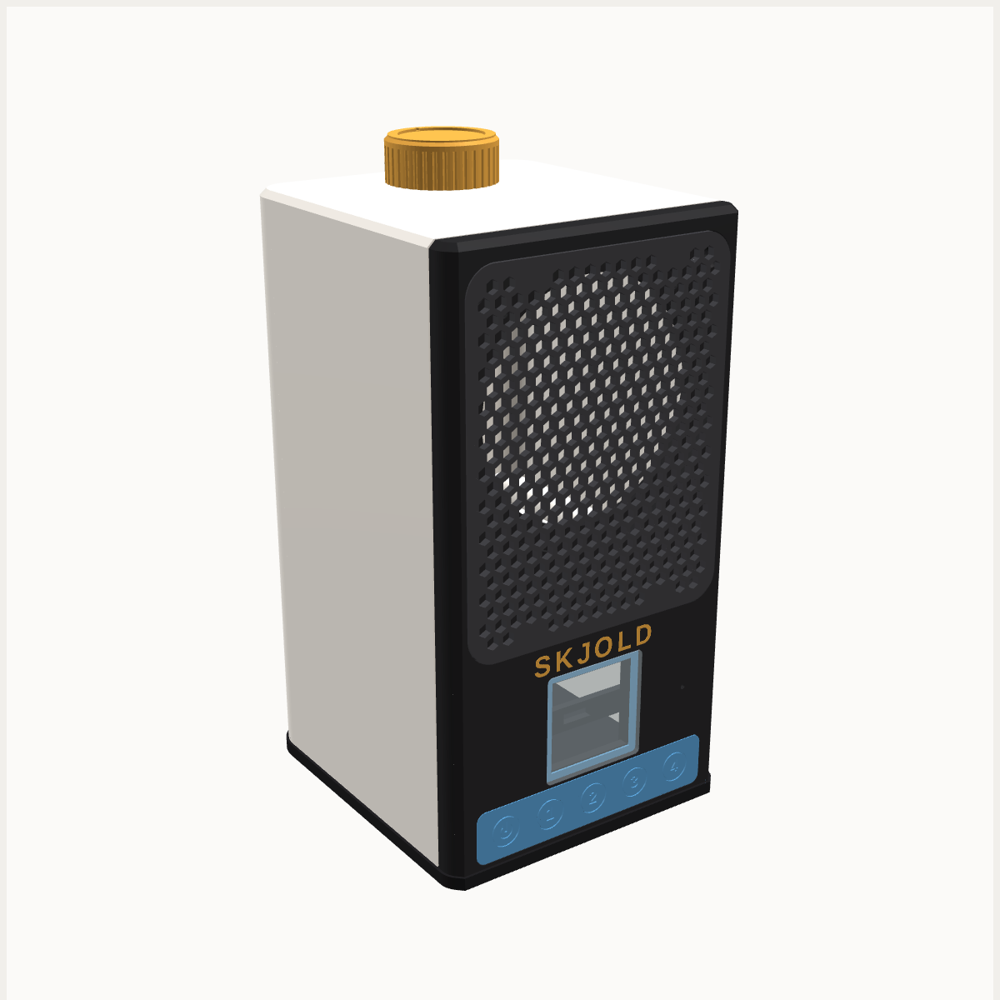

# Skjold Mini

En liten aktiv høyttaler for bad, kjøkken og barnerom. Den har et 3″ fullrange-element i et bassrefleks-kabinett, en ESP32-S3, en klasse D-forsterker, en liten fargeskjerm og knapper for av/på og fire radiofavoritter. Mini er en vanlig Squeezebox-spiller i Lyrion, så den spiller synkront med S1, Node og Touch.

Mini er laget for å tåle damp og sprut på badet (mål: omtrent IPX4). Den er **ikke vanntett** og skal ikke stå i dusjen. Se [På badet](#på-badet).

Bilder: [mini](render/01_mini.png) · [eksplodert](render/02_eksplodert.png) · [bak](render/03_bak.png) · [fra siden](render/04_side.png) · [skjøten](render/05_skjot.png) · [skjerm og knapper](render/06_knapper_skjerm.png)

Mål: 101,6 × 110,1 × 190 mm (B × D × H, med bunn og føtter, uten knott). Fastvare og oppsett: [`firmware/mini/`](../../firmware/mini/LES_MEG.md).

## Hvorfor disse komponentene

- **PCM5102A (DAC) + TPA3118D2 i mono (PBTL)** i stedet for MAX98357A. MAX98357A gir bare ca. 3 W fra 5 V og blir fort hard på et 3″-element. TPA3118 på 12 V gir ca. 15 W rent i 4 Ω.
- **ESP32-S3 N16R8:** PSRAM gir squeezelite-esp32 god buffer for strømming over Wi-Fi.
- **1,54″ IPS 240×240 med ST7789 (SPI):** squeezelite-esp32 har egen driver for ST7789 og kan vise kanal, låt, artist, volum og cover. En SH1106 1,3″ OLED (128×64) fungerer også, men er svart-hvitt og har plass til lite tekst.
- **Taktbrytere under én TPU-membran:** knappene tåler sprut, og membranen tetter hele knapperaden.
- **12 V / 2 A-adapter** med en MP1584-nedtrapper til 5 V for ESP-en. 12 V er ufarlig å ta på, og adapteren kan stå utenfor badet.

## Deler

| Del | Antall | Merknad |
|---|---|---|
| 3″ fullrange-element, 4 Ω (Dayton Audio RS75-4 anbefalt) | 1 | Utsparing Ø72 mm, ramme inntil Ø86 mm, 4 skruer på Ø82 mm hullsirkel. Sjekk ditt element og juster `drvCut`/`drvPCD`. |
| ESP32-S3-DevKitC-1 N16R8 | 1 | |
| PCM5102A I²S DAC-kort | 1 | SCK til GND, XSMT til 3V3, FMT/FLT/DEMP til GND |
| TPA3118D2 mono PBTL-forsterkerkort | 1 | 12–24 V inn. Sjekk at kortet er satt opp for PBTL (mono). |
| 1,54″ IPS 240×240 ST7789, 7-pinners SPI-modul | 1 | Kort ca. 31,8 × 40 mm, aktivt felt 27,7 × 27,7 mm. Mål din modul og juster `pcbW`/`pcbH`/`pcbOffZ`. |
| Taktbryter 6 × 6 × 5 mm | 5 | Loddes på et hullkort på ca. 84 × 18 mm, sentrert under knappene (16 mm mellom) |
| M2 × 6 mm avstandsstykke + 4 M2 × 4 skruer | 2 | Holder knappekortet 6 mm bak frontplaten |
| MP1584EN nedtrapper 12 V → 5 V | 1 | Still inn 5,0 V før du kobler til ESP-en |
| DC-kontakt 5,5/2,1 mm for panel (Ø8 mm) | 1 | Med mutter. TPU-skiven legges under flensen utvendig. |
| Strømadapter 12 V / 2 A | 1 | Skal stå utenfor badet (se under) |
| EC11 dreieknapp med trykk, 20 mm D-aksel | 1 | |
| INMP441 I²S-mikrofon | 1 | Valgfri |
| M3 innpressmutter (M3 × 5,7, Ø4,0 hull) | 8 | 4 i fronten av kroppen, 4 i tårnene under |
| M3 × 10 senkeskrue | 8 | |
| M3 × 10 selvgjengende (element) | 4 | |
| M2,5 × 8 selvgjengende (skjermklemme) | 2 | Rett i frontplaten |
| Akryl 1,5 mm, 34,6 × 34,6 mm, hjørneradius 1,5 | 1 | Rute foran skjermen. Kan også printes i klar PETG (`stl/rute.stl`), men akryl er klarere. |
| TPU 95A filament | ca. 10 g | Pakninger, knappemembran, krage, DC-skive og USB-propp |
| ePTFE trykkutjevningsventil M12 × 1,5 (med mutter) | 1 | Eller en selvklebende ePTFE-membran (Ø16 mm eller større) over hullet. Slipper ut damp og trykk, ikke vann. |
| ePTFE akustisk membran, selvklebende, Ø8–10 mm | 1 | Bare med mikrofon: limes over mikrofonhullet på innsiden |
| Vannavstøtende akustisk duk, ca. 95 × 115 mm | 1 | Polyester-/nylonduk for høyttalere (hydrofob). Ligger bak grillen. |
| Beskyttelseslakk (conformal coating) | – | Akryl- eller silikonlakk på alle kretskortene. Ikke på kontakter, skjermglass og mikrofon. |
| Silikon eller fleksibelt lim (f.eks. Sikaflex 11FC) | – | Membrankanten, ruta, kabelgjennomføringen og skruehodene i bunnen |
| Polyfill / dempeull | ca. 5 g | Løst i kammeret, ikke foran porten |

## Kobling (ESP32-S3)

| Fra | Til |
|---|---|
| PCM5102A BCK / LCK (WS) / DIN | GPIO4 / GPIO5 / GPIO6 |
| PCM5102A VIN / GND | 5V / GND |
| PCM5102A OUT L (eller L+R via 2 × 1 kΩ) | TPA3118 inn |
| TPA3118 SDZ (forsterker på) | GPIO7 |
| TPA3118 PVCC / GND | 12 V / GND (fra DC-kontakten) |
| TPA3118 ut + / − | Element + / − |
| Skjerm SDA (MOSI) / SCL (CLK) / DC | GPIO11 / GPIO12 / GPIO13 |
| Skjerm CS / RES / BLK (bakgrunnslys) | GPIO10 / GPIO14 / GPIO21 |
| Skjerm VCC / GND | 3V3 / GND |
| Knapp av/på / 1 / 2 / 3 / 4 (andre bein til GND) | GPIO8 / GPIO9 / GPIO18 / GPIO39 / GPIO47 |
| EC11 A / B / trykk (C og trykk-retur til GND) | GPIO15 / GPIO16 / GPIO17 |
| INMP441 SCK / WS / SD, L/R til GND | GPIO41 / GPIO42 / GPIO40 |
| MP1584 ut 5 V | ESP32 5V |

Ikke bruk GPIO0, 3, 45 eller 46 (oppstartspinner), GPIO19/20 (USB), GPIO26–32 (flash), GPIO35–37 (PSRAM) eller GPIO38/48 (RGB-LED på DevKitC-1, avhenger av versjon). Knappene bruker intern pull-up og trekkes til GND. Det er ingen status-LED lenger. Skjermen viser status.

## Akustikk

- Lydkammer: ca. 1,04 l luft mellom vegger, front og gulv, ca. 0,97 l netto når porten er trukket fra og et element (ca. 50 cm³) er satt inn.
- Bassrefleks: port Ø16 mm, 72 mm lang, i bakveggen og vendt bakover. Munningen er avrundet. Det gir en tuning på ca. 86 Hz, omtrent som før.
- Dette er beregnet ut fra volum og port, ikke målt. Simuler ditt element i WinISD eller VituixCAD. Endre `portL` (lengre port gir lavere tuning) eller tett porten for et lukket kabinett.
- Porten peker bakover, så sprut forfra ikke kommer inn i kammeret. La det være minst 5 cm luft bak Mini.
- Kammeret er skilt fra elektronikkrommet av et gulv. Elementkabelen går gjennom et Ø6-hull i gulvet, og det må tettes med silikon, ellers lekker kammeret.

## Hvordan Mini holder fuktigheten ute

- **Skjøten front–kropp:** kropp og frontplate er skåret fra samme ytre form, så sidene flukter helt (ingen trinn eller spalte). En smal skyggefuge (0,5 mm inn, 0,8 mm bred) gjør skjøten til en ren linje. Bak den ligger en U-formet TPU-pakning i et spor i kroppen, langs sidene, toppen og forkanten av gulvet. Frontplaten trykker den 0,2 mm sammen.
- **Bunnen:** en TPU-pakning i et spor rundt hele bunnplaten, under kroppen og frontplaten. Bunnen stikker 0,8 mm ut og har en dryppnese på undersiden, så vann som renner nedover sidene drypper av i stedet for å trekke inn under. Føttene er 4 mm høye, så Mini ikke står i vann.
- **Knappene:** én TPU-membran over hele knapperaden, limt rundt kanten. Stemplene på baksiden går gjennom hull i frontplaten og trykker på taktbryterne.
- **Skjermen:** klar rute foran (akryl 1,5 mm) på en TPU-ramme i en forsenkning. Ruta flukter med fronten og limes rundt kanten.
- **Grillen:** ligger i en lomme i frontplaten og flukter med fronten. Den vannavstøtende duken ligger i luftspalten bak grillen og holdes av grilltappene.
- **Dreieknappen:** TPU-krage rundt akselen i en forsenkning i toppen. Knotten dekker den.
- **DC og USB-C bak:** TPU-skive under flensen på DC-kontakten. USB-C brukes bare til flashing, og har en TPU-propp ellers.
- **Trykkutjevning:** en ePTFE-ventil i bunnen av elektronikkrommet slipper ut trykk og damp når Mini blir varm og kald, slik at fukt ikke pumpes inn gjennom pakningene.
- **Kretskortene:** lakk dem med beskyttelseslakk (conformal coating). Det beskytter mot kondens som likevel kommer inn.

## På badet

- **Strøm:** 12 V er ufarlig å ta på, men **strømadapteren (230 V) skal stå utenfor badet eller utenfor våtromssonene**, slik NEK 400 krever for elektrisk utstyr i våtrom. Bruk en lang 12 V-kabel. Har du en fast installert stikkontakt på badet, må den være godkjent for våtrom og riktig sone.
- **Plassering:** ikke plasser Mini i direkte dusjsprut eller der den kan bli stående i vann. Den tåler damp og noe sprut, ikke vannstråler.
- **Materiale:** print i **PETG eller ASA**, ikke PLA. PLA blir mykt ved varme og trekker fukt over tid. Pakninger og membran i TPU 95A.
- **Tørk av** vann som samler seg på toppen. Rengjør grillen forsiktig, så duken ikke blir skadet.

## Utskrift (Creality K2)

Det er tre 3MF-filer, alle innenfor 250 × 250 mm, så de passer K2, K2 Pro og K2 Plus:

| Fil | Deler | Filament |
|---|---|---|
| `skjold-mini-k2.3mf` | Kropp, frontplate med innfelt logo, knott, skjermklemme | 1 = lys (kropp), 2 = sort (front, klemme), 3 = gull (logo, knott) |
| `skjold-mini-k2-bunn.3mf` | Grill, bunn | 2 = sort |
| `skjold-mini-k2-tpu.3mf` | Pakning front, pakning bunn, pakning skjerm, knappemembran, krage, DC-skive, USB-propp | TPU 95A (egen utskrift; CFS mater ikke myk TPU, så bruk ekstern spole) |

Setter ikke Creality Print fargene selv, sett filament per del.

| Del | Retning | Støtte |
|---|---|---|
| `kropp.stl` | Bakveggen ned, åpen front opp | Nei |
| `front.stl` + `logo.stl` | **Baksiden ned, forsiden opp** (lommene for grill, membran og rute er åpne oppover) | Nei |
| `grill.stl` | Forsiden ned, tappene opp | Nei |
| `bunn.stl` | Innsiden ned, føttene opp | Nei |
| `knott.stl` | Toppen ned | Nei |
| TPU-delene | Flate; membranen med forsiden ned og stemplene opp | Nei |

**Innstillinger, PETG/ASA:** 0,2 mm lag, 0,4 mm dyse, 4 vegger (tette, stive vegger gir mindre resonans), 20 % gyroid fyll. PETG 240 °C / 75 °C seng, ASA 260 °C / 100 °C seng med lukket kammer. Teksturert PEI gir matt overflate.

**Innstillinger, TPU 95A:** 0,2 mm lag, 100 % fyll for pakninger og membran, 20–30 mm/s, 225–235 °C, ingen eller svært kort retraksjon.

Vekt og tid er ikke slicet.

### Logoen i egen farge

SKJOLD-logoen er et eget legeme (`logo.stl`) som ligger 0,6 mm inn i frontplaten og flukter med forsiden. Strekene er minst 1 mm brede.
- **Med CFS:** `skjold-mini-k2.3mf` har logoen som egen del med filament 3, plassert nøyaktig i fronten. Den printes i samme utskrift.
- **Uten CFS:** en vanlig pause med filamentbytte virker ikke her, fordi frontplaten printes med forsiden opp. Da blir hele det øverste laget gull, ikke bare logoen. Gjør heller slik:
  - Print frontplaten i sort uten logoen. Slett logo-delen i sliceren, så blir lomma tom.
  - Print `logo.stl` alene i gull.
  - Lim den i lomma med en tynn dråpe lim.

## Montering

1. Varm inn 8 M3-innpressmuttere: 4 i fronten av kroppens skruetårn, 4 i tårnene under.
2. Lakk kretskortene med beskyttelseslakk og la det tørke.
3. Lodd taktbryterne på hullkortet. Skru det på de to M2-avstandsstykkene bak frontplaten, slik at bryterne peker fram mot hullene.
4. Legg skjermen i lomma bak vinduet med glasset fram, og skru skjermklemmen fast med to M2,5 × 8-skruer. Legg TPU-rammen i forsenkningen foran, og lim ruta oppå med en tynn streng silikon langs kanten.
5. Lim knappemembranen i lomma foran knappene, med stemplene gjennom hullene. Bruk fleksibelt lim langs kanten, ikke under tastene.
6. Monter EC11 gjennom toppen innenfra. Trykk TPU-kragen ned over akselen i forsenkningen, og trykk på knotten.
7. Legg elektronikken i rommet under gulvet:
   - DC-kontakten (med TPU-skiven utvendig) og ESP32 (USB-C) skal sitte mot hullene bak.
   - Fest kortene med dobbeltsidig tape eller lim.
   - Skru inn ePTFE-ventilen i hullet i bunnplaten.
8. Trekk elementkabelen gjennom hullet i gulvet og tett med silikon.
9. Skru elementet fast i frontplaten, med rammen i forsenkningen.
10. Legg TPU-pakningen i sporet i kroppens forkant. Legg litt dempeull i kammeret (ikke foran porten).
11. Skru frontplaten fast med 4 senkeskruer i grill-lomma.
12. Legg den akustiske duken over grill-lomma, og trykk grillen på, slik at tappene går gjennom duken.
13. Legg TPU-pakningen i sporet i bunnplaten, og skru bunnen fast med 4 senkeskruer. En dråpe silikon på skruehodene holder vannet ute.
14. Sett TPU-proppen i USB-C-hullet.

## Sjekket og ikke sjekket

- Sjekket i modellen (`python3 sjekk_modell.py <mappe med monterte STL-er>`):
  - alle 15 STL-er er vanntette, ett legeme hver, ligger på platen og passer på 250 × 250 mm
  - ingen deler overlapper når de er montert
  - ytterveggen er minst 1,6 mm overalt, utenom de tiltenkte hullene
  - kropp og frontplate flukter i skjøten
- Ikke testet: ingenting er printet eller bygget. Følgende må prøves:
  - passformen til element, innpressmuttere, grilltapper, knott, skjermlomme og knappestempler
  - hvor tett pakningene og membranen faktisk er (IPX4 er et mål, ikke et testresultat)
  - om TPU-membranen gir god nok følelse på knappene
  - lyden og porttuningen
  - om squeezelite-esp32-innstillingene virker på S3 med denne skjermen

Lisens: CC BY-NC-SA 4.0.
