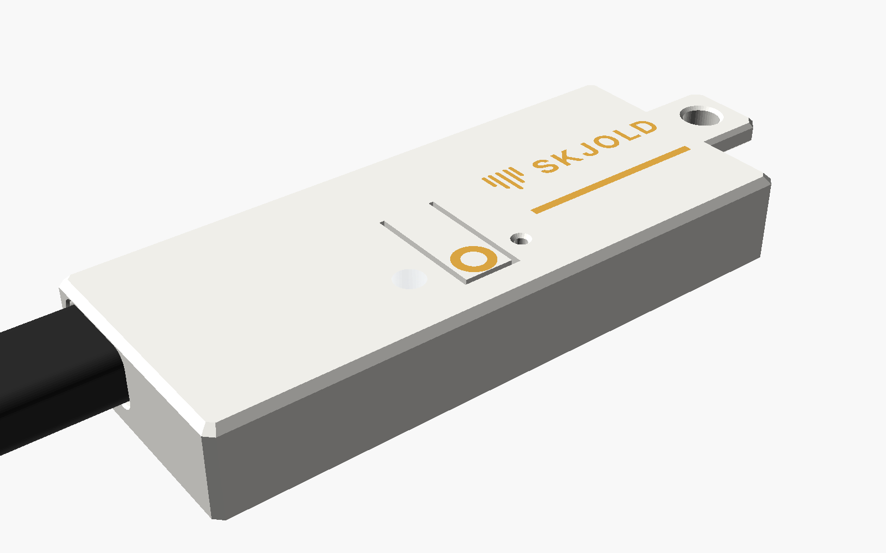

# Skjold Nøkkel

Et lite kabinett som gjør et **ESP32-S3-DevKitC-1-klonekort** (N16R8, YD-ESP32-S3 / VCC-GND-stil) om til en
**FIDO2/passkey-sikkerhetsnøkkel** med fastvaren [pico-fido](https://github.com/polhenarejos/pico-fido). Bare den
innebygde USB-C-en («USB») er tilgjengelig i enden; COM-porten er dekket. Over BOOT-knappen er det en **fjærtunge** i
toppen med en gullring: trykk der for å bekrefte. Et **lysvindu** over RGB-LED-en viser når nøkkelen ber om trykk,
og RST nås bare med en **binders** gjennom et lite hull. Kortet ligger i en holder og klemmes av puter i toppen, og
bunnplata klikkes inn nedenfra. Ingen skruer. Øye for nøkkelring i antenneenden.

Bilder: [lys](render/01_skra_lys.png) · [mørk](render/02_skra_mork.png) · [USB-enden](render/03_usb_ende.png) ·
[eksplodert](render/04_eksplodert.png) · [inni](render/05_inni.png) · [undersiden](render/06_undersiden.png) ·
[snitt gjennom BOOT](render/07_snitt_boot.png)

Status: **ikke printet eller testet på maskinvare.** Modellen er sjekket med `lag_nokkel.py`: alle delene er tette,
ingenting overlapper i montert stilling (kort, knapper og USB-plugg er med), kortet ligger fast (flyttet 0,4 mm i
hver retning treffer det kabinettet), bunnplata henger i klipsene, BOOT har 0,2 mm luft til stempelet og tunga kan
trykke knappen 0,3 mm forbi klikket uten å treffe noe annet, USB-pluggen går helt inn, COM er dekket, det er fri vei
fra LED-en til vinduet og fra RST-hullet til knappen, ingen overheng trenger støtte, og alt får plass på K2.
**Kortmålene er standardverdier, ikke målt på ditt kort.** Mål kortet før du printer (se under).

## Mål

| | |
|---|---|
| Kabinettet | 69,3 × 29,1 × 10,9 mm (l × b × h), 77,3 mm med øyet |
| Med stiftlister loddet på | 69,3 × 29,1 × 17,9 mm (`stift = true`) |
| Vekt | ca. 12 g PETG |
| USB-hullet | 11,6 × 6,6 mm (plugg inntil 11 × 6 mm) |
| Trykkpunktet | fjærtunge 5,6 mm bred, 11 mm fra roten til stempelet, 0,2 mm luft til BOOT |
| RST-hullet | Ø1,4 mm (en binders er ca. 1 mm) |

## Deler

| Del | Antall | Merk |
|---|---|---|
| ESP32-S3-DevKitC-1 N16R8-klone (YD-ESP32-S3 o.l.) med to USB-C | 1 | Helst uten stiftlister (da blir nøkkelen 7 mm tynnere) |
| USB-C-kabel | 1 | Pluggens plastkappe inntil 11 × 6 mm (endre `pluggB`/`pluggH` for større) |
| Nøkkelring | 1 | Valgfritt (`oye = false` fjerner øyet) |

## Mål kortet ditt

Klonene varierer med en millimeter eller to, og et kabinett som er så tett som dette, passer ikke da. Alle kortmålene
står øverst i `skjold_nokkel.scad` under **MÅL DITT KORT**. Legg kortet med komponentene opp og USB-enden mot deg.
Da er **x** avstanden fra kortkanten ved USB-kontaktene innover mot antennen, og **y** avstanden sideveis fra
midtlinja av kortet (+ = venstre, − = høyre). Mål til **midten** av hver ting.

| Parameter | Standard | Hva du måler |
|---|---|---|
| `kortL`, `kortB`, `kortT` | 63,0 / 25,5 / 1,6 | Kretskortet: lengde (uten modulen som stikker ut), bredde, tykkelse |
| `modulUt` | 2,0 | Hvor langt modulen/antennen stikker ut over kortenden |
| `modulL`, `modulH` | 25,5 / 3,2 | Modulens lengde langs kortet og høyde over kortet |
| `usbY`, `comY` | +6,6 / −6,6 | Midten av USB-C-kontakten merket **USB** og den merket **COM**. Bytt fortegn hvis USB sitter til høyre |
| `kontUt` | 0,8 | Hvor langt kontaktene stikker ut over kortkanten |
| `bootX`, `bootY` | 31,0 / −7,5 | Midten av **BOOT** |
| `rstX`, `rstY` | 37,0 / −7,5 | Midten av **RST** |
| `knappH` | 2,0 | Toppen av knappene over kortet (viktig: stempelet skal ha 0,2 mm luft) |
| `rgbX`, `rgbY`, `rgbH` | 24,0 / −6,5 / 1,0 | Midten av **RGB**-LED-en og høyden |
| `stift` | `false` | `true` hvis kortet har stiftlister loddet på |
| `underKomp` | 1,6 | Det høyeste som stikker ut under kortet (lodding), uten stiftlister |
| `pluggB`, `pluggH` | 11,0 / 6,0 | Plastkappa på USB-C-pluggen din |

Sjekk også at det ikke står høye komponenter der fjærtunga går (på tvers av kortet fra BOOT og 11 mm mot midten) og
der støttene i bunnplata står (midt i USB-enden, under BOOT og tvers over under antenneenden). Kjør så
`python3 lag_nokkel.py`: den lager STL-ene på nytt og sier fra om noe kolliderer.

## Print

| Del | Plassering | Merk |
|---|---|---|
| `kasse.stl` | **toppen ned** | Ingen støtte. Gullet og lysvinduet er egne deler i de første lagene |
| `gull.stl` | sammen med kassa | Filament 2 (gull). Ligger allerede riktig i 3MF-fila |
| `vindu.stl` | sammen med kassa | Filament 3 (hvit eller klar PETG). Lyslederen går gjennom toppen og ned mot LED-en |
| `bunn.stl` | flat | Støttene og vulstene opp |

Ferdig plate for Creality K2: `skjold-nokkel-k2.3mf` (kasse med gull og vindu, og bunnplata). **PETG** anbefales:
fjærtunga skal bøye seg mange tusen ganger, og PLA blir sprøtt. 0,2 mm lag (gjerne 0,12 mm for de første lagene, så
blir merket skarpere), 3 vegger, 20 % fyll. Mørk utgave: bytt filament 1 til mørk i sliceren.
Uten flerfarge: print kassa alene. Da blir lysvinduet et åpent hull (Ø3,4 mm), og merket blir bare et innfelt spor.

## Montering

1. **Flash fastvaren først** (se under), og sjekk at nøkkelen virker før du lukker kabinettet.
2. Legg kassa med toppen ned. Legg kortet oppi med komponentene ned og USB-enden mot enden med hullet: kontakten
   merket **USB** skal stå i hullet, **COM** bak den tette veggen.
3. Trykk bunnplata inn nedenfra, med hakket mot øyet, til vulstene klikker i sporene på begge sider. Støttene
   presser kortet opp mot putene i toppen, så det ikke kan flytte seg.
   *Åpne:* stikk en negl eller en mynt i hakket ved øyet og vipp bunnplata ut.
4. Trykk på gullringen: du skal kjenne klikket fra BOOT-knappen. Gjør du ikke det, er `knappH` for lav eller tunga
   står ikke over knappen; mål på nytt.

## Fastvaren: pico-fido

[pico-fido](https://github.com/polhenarejos/pico-fido) gjør kortet til en FIDO2/U2F-sikkerhetsnøkkel: passkeys,
WebAuthn-innlogging og tofaktor i nettlesere og operativsystemer, over **den innebygde USB-en** (som en vanlig
USB-HID-nøkkel, uten egne drivere). Prosjektet har ferdige bygg for ESP32-S3; README-en i prosjektet forklarer hvordan
du flasher et ESP32-S3-kort. Bruk USB-kontakten merket **USB** (hold BOOT inne mens du kobler til hvis kortet ikke
går i flashemodus av seg selv). Følg prosjektets egen dokumentasjon, den endres oftere enn denne fila.

- **BOOT er bekreftelsesknappen.** Når en nettside ber deg «berøre sikkerhetsnøkkelen», trykker du på gullringen.
- **Lyset:** ifølge pico-fido lyser LED-en nesten hele tiden (av 100 ms hvert sekund) når den venter på trykk. Lyser den
  ikke, sjekk LED-innstillingene i pico-fido sin dokumentasjon (kort har LED-en på ulike pinner).
- **Sett en PIN.** Da trengs både nøkkelen og PIN-en.

### Sikkerhet – les dette

ESP32-S3 er **ikke** en sikker brikke som i en YubiKey eller annen kommersiell nøkkel. Nøklene ligger i vanlig flash.
**Uten flash-kryptering og secure boot kan alle som får tak i nøkkelen lese ut de hemmelige nøklene** med en
USB-kabel. Derfor:

- **Skru på secure boot og flash-kryptering** slik pico-fido beskriver (prosjektet kaller det *Secure Boot* og
  *Secure Lock* for ESP32-S3, med hovednøkkelen i engangsprogrammerbart minne). Dette **kan ikke angres**: det brenner
  sikringer (eFuse) i brikka, og det som låses (for eksempel hvilken fastvare kortet godtar) er låst for godt.
  Gjør det på et kort du bare skal bruke som nøkkel.
- Selv da er beskyttelsen svakere enn i en sikker brikke (for eksempel mot noen som har kortet lenge og avansert
  utstyr). Bruk den til det den er god til: en billig ekstra nøkkel som er mye bedre enn bare passord.
- **Ha alltid en reservenøkkel eller gjenopprettingskoder** for hver konto. Mister du eller ødelegger du nøkkelen
  (eller låser deg ute under secure boot-oppsettet), er det den eneste veien inn igjen.

## Bygg selv

    python3 lag_nokkel.py            STL-er, kontroll og 3MF
    python3 lag_nokkel.py bilder     også bildene i render/

Andre mål øverst i `skjold_nokkel.scad`: `luft` (luft mellom stempelet og BOOT, 0,1–0,3 mm), `overTrykk` (hvor langt
forbi klikket tunga trykker), `tL`/`tT` (tungas lengde og tykkelse: lengre eller tynnere gir lettere trykk), `vinduD`
(lysvinduet), `rstHull`, `oye` og `pluggKlar`. Merket ved siden av SKJOLD er Skjold-merket fra
`branding/skjold/skjold_merke.svg`.
