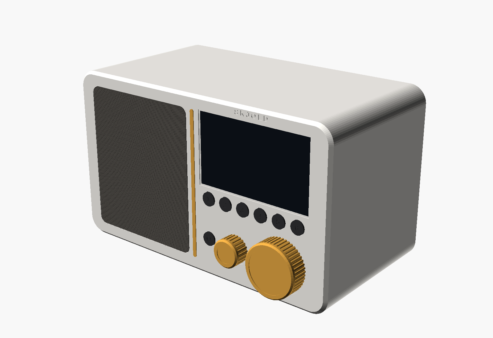

# Skjold Radio

En lav bordradio med 4,3″ skjerm, seks favorittknapper, et stort navigasjonshjul, en liten volumknott og ett 3″-element (mono). Inni sitter en Raspberry Pi 4 med vanlig Skjold-programvare. Radioen er altså en Skjold-spiller med alt Skjold kan (nettradio, AirPlay, Spotify Connect, Bluetooth, Lyrion, multirom, appen og Home Assistant), bare bygget inn i en kasse med knapper.



Bilder: [forfra, lys](render/01_forfra_lys.png) · [skrått, lys](render/02_skra_lys.png) · [eksplodert, lys](render/03_eksplodert_lys.png) · [forfra, mørk](render/04_forfra_mork.png) · [skrått, mørk](render/05_skra_mork.png) · [eksplodert, mørk](render/06_eksplodert_mork.png) · [bak](render/07_bak_lys.png)

Mål: 240 × 125 × 140 mm (B × D × H, uten knotter og gummiføtter). Hjulet stikker 15,6 mm ut fra fronten, volumknotten 13,6 mm. Forrige utgave var en stående radio på 236 × 145 × 205 mm med to elementer (stereo) under en vannrett gullist. Den nye er 65 mm lavere, fordi det bare er ett element og det sitter ved siden av betjeningspanelet i stedet for under. Første utgave var en lav pult med skjermen og knappene på den skrå toppen.

## Designet

Radioen er en lav, liggende bordradio der alt vender mot deg. Fronten er loddrett, så du ser skjermen rett forfra og når knappene som på en vanlig radio, enten den står på kjøkkenbenken, i bokhylla eller på nattbordet.

- **Fronten er delt i to av en tynn, loddrett gullist.** Til venstre er en grill trukket med mørkt, vevd høyttalerstoff foran det ene 3″-elementet. Stoffet ligger i flukt med fronten og er brettet rundt kanten, så ingen skjøter synes. Til høyre er et rolig betjeningspanel i kroppsfargen.
- **Betjeningspanelet har tre lag.** Øverst sitter skjermen, med overkanten i flukt med grillens overkant. Rett under den står favoritt 1–6 på én rad, like bred som skjermen. Nederst sitter av/på til venstre, den lille gullknotten for volum i midten og det store gullhjulet (Ø 42 mm) til høyre, i flukt med skjermens høyre kant.
- **Gullhjulet** er det største elementet på radioen. Drei for å bla i favorittene, trykk for spill/pause.
- **Skjold-formspråket:** myke hjørner (R14, som Node og Røst) sett forfra, faset frontkant hele veien rundt, lys kropp med mørkt høyttalerstoff og mørke knapper, gull hjul, volumknott og list, og SKJOLD preget over skjermen. Sidene, toppen og baksiden er helt rene.
- **Mørk variant:** matt sort kropp, grafittgrått stoff og gullknapper. Bare filamentet byttes.

Designet er laget fra bunnen av for Skjold. Oppdelingen med høyttaler til venstre og betjening til høyre er vanlig for bordradioer, men proporsjonene, plasseringen av knappene og detaljene er egne. Den loddrette gullista mellom grill og panel, panelet i tre lag og gullhjulet nede i hjørnet er Skjold Radios kjennetegn.

## Elektronikk – hva og hvorfor

| Del | Hvorfor |
|---|---|
| **Raspberry Pi 4 (2 GB)** | Kjører hele Skjold (squeezelite, AirPlay, Spotify, Bluetooth, CamillaDSP og skjold-ui). Har DSI-kontakt for skjermen, så ingen GPIO går med til den. 2 GB er nok. |
| **Waveshare 4,3″ DSI LCD (800 × 480, kapasitiv touch)** | DSI-skjermen kobles med flatkabel, uten driverkort og uten HDMI-kabel i kassa. Den er skarp, lys nok og rimelig. Touch fungerer som bonus. |
| **PCM5102A I²S DAC** (samme som Skjold Kit) | God lyd for pengene. Radioen bruker `KI_AMP_BOARD=kit`, så daemonen styrer XSMT (myk demping uten smell) og forsterkeren uten endringer. |
| **TPA3116D2 2 × 50 W-forsterker, én kanal i bruk** | Samme kort som i Kit og S1, så relé og XSMT virker uten endringer. Elementet kobles til venstre utgang. Radioen kjører i mono (`KI_AMP_MONO=1`, se [Mono](#mono)), så begge kanalene får L+R. Et rent monokort (TPA3116D2 mono/PBTL) fungerer også. Rikelig med reserve på 19–24 V for ett 3″-element, og kortet kjører kjølig. |
| **Dayton Audio RS75-4 (3″ fullrange, 4 Ω)** | Et vanlig, rimelig 3″-element med ren lyd og bred spredning, uten delefilter. Det sitter i ett lukket kammer på ca. 0,74 l netto. Lukket kasse gir stram bass og tåler å stå inntil veggen. |
| **19–24 V / 3 A strømadapter + 5 V / 5 A nedtrapper** | Én adapter for alt. Forsterkeren får hele spenningen, og Pi-en får 5 V via GPIO-pinnene 2/4 (ikke via USB-C). Nedtrapperen må tåle 5 A, fordi Pi 4 med skjerm trekker opptil 3 A ved oppstart. |
| **Relémodul 1-kanal, 3,3 V-styrt (jumper H)** | Som i Kit: GPIO 27 slår forsterkeren av og på uten smell. |
| **2 × EC11 dreieknapp med trykk** | Hjulet (20 mm aksel) og volum (15 mm aksel). Billige, holdbare og med tydelige hakk. |
| **7 × taktbryter 6 × 6 × 4,3 mm** | Under de printede knappehettene: seks på favorittkortet og én på et lite kort for av/på. Nuppen på hetta treffer bryteren med 0,1 mm forspenning. |

Strømtrekket er normalt 6–15 W. Pi-en og skjermen trekker ca. 4–5 W alene.

## Kobling

Alle knapper og dreieknapper går til GND og bruker Pi-ens interne pull-up. Pinnene står i [`pi/config/radio_pins.yaml`](../../pi/config/radio_pins.yaml) og kan endres der.

| Fra | Til (Raspberry Pi, BCM / fysisk pinne) |
|---|---|
| Favoritt 1 · 2 · 3 · 4 · 5 · 6 | GPIO 5 (29) · 6 (31) · 12 (32) · 13 (33) · 16 (36) · 17 (11) |
| Av/på | GPIO 4 (7) |
| Hjulet A · B · trykk | GPIO 22 (15) · 23 (16) · 24 (18) |
| Volum A · B · trykk | GPIO 25 (22) · 9 (21) · 7 (26) |
| Felles for knapper og EC11 (C og den andre trykkpinnen) | GND (6, 9, 14, 20, 25, 30, 34, 39) |
| PCM5102A BCK · LCK · DIN | GPIO 18 (12) · 19 (35) · 21 (40) |
| PCM5102A XSMT | GPIO 26 (37). Høy = lyd. Kit-profilen demper DAC-en før forsterkeren slås av. |
| PCM5102A VIN · GND · SCK · FMT/FLT/DEMP | 5 V · GND · GND · GND |
| PCM5102A L · R · G | TPA3116D2 inn L · R · GND (skjermet kabel, kort) |
| Relémodul IN · VCC · GND | GPIO 27 (13) · 5 V · GND. Releet bryter + fra DC-kontakten til forsterkeren. |
| DC-kontakt 19–24 V | Nedtrapper inn, og releet → TPA3116D2 VIN |
| Nedtrapper ut 5,0 V | Pi pinne 2 (5 V) og 6 (GND). **Still inn 5,1 V før du kobler til Pi-en.** |
| TPA3116D2 ut L | Elementet. Kabelen går gjennom hullet i kammergulvet, som tettes med silikon. Utgang R brukes ikke. |
| Skjerm | DSI-flatkabel til Pi-ens DSI-kontakt (touch går over I²C i samme kabel) |
| 3,5 mm-kontakt bak (linje ut) | PCM5102A L/R/G i parallell med forsterkeren, til en ekstern forsterker eller aktive høyttalere. Ikke for hodetelefoner. Med `KI_AMP_MONO=1` er linje ut også mono. |
| USB-C bak (service) | Panelmontert USB-C-skjøt til en av Pi-ens USB-A-porter, for minnepinne eller tastatur |

## Deler og priser

Prisene er **anslag i norske kroner per november 2026**, med frakt fra AliExpress inkludert der det er vanlig. Sjekk dagens pris.

| Del | Ant. | Søkeord | Ca. pris |
|---|---|---|---|
| Raspberry Pi 4 Model B 2 GB | 1 | «Raspberry Pi 4 2GB» (Kjell, Elfa, Pimoroni) | 650 kr |
| microSD 32 GB A1 | 1 | «SanDisk Ultra 32GB A1» | 80 kr |
| Waveshare 4,3″ DSI LCD 800×480 | 1 | AliExpress: «Waveshare 4.3inch DSI LCD capacitive» | 400–500 kr |
| PCM5102A I²S DAC-kort | 1 | AliExpress: «PCM5102A I2S DAC GY-PCM5102» | 40 kr |
| TPA3116D2 2 × 50 W-kort (én kanal brukes) eller TPA3116D2 monokort | 1 | AliExpress: «TPA3116D2 2x50W stereo amplifier board» eller «TPA3116D2 mono 100W» | 70–120 kr |
| Dayton Audio RS75-4 (3″ fullrange, 4 Ω) | 1 | Soundimports: «Dayton Audio RS75-4» | 300 kr |
| Strømadapter 19 V / 3,42 A (5,5 × 2,5 mm) | 1 | «19V 3.42A laptop adapter» (eller 24 V / 3 A) | 150–250 kr |
| DC-DC nedtrapper 5 V / 5 A | 1 | AliExpress: «DC-DC buck 24V to 5V 5A module» | 40 kr |
| Relémodul 1-kanal, H/L-jumper | 1 | AliExpress: «1 channel relay module 3.3V high low level trigger» | 20 kr |
| DC-kontakt for panel 5,5 × 2,1/2,5 mm (Ø 8 mm) | 1 | «DC-022 panel jack» | 15 kr |
| 3,5 mm stereokontakt for panel (Ø 6 mm) | 1 | «PJ-392 3.5mm panel jack» | 10 kr |
| USB-C panelskjøt (hunn til USB-A) | 1 | AliExpress: «USB C female panel mount to USB A male» | 40 kr |
| EC11 med trykk, 20 mm D-aksel | 1 | AliExpress: «EC11 rotary encoder 20mm D shaft» | 15 kr |
| EC11 med trykk, 15 mm D-aksel | 1 | Samme | 15 kr |
| Taktbryter 6 × 6 × 4,3 mm | 7 | «tactile switch 6x6x4.3 THT» | 10 kr |
| Hullkort ca. 110 × 16 mm (favoritter) og 30 × 16 mm (av/på) | 1 | «perfboard 5x15 cm», kuttes i to | 20 kr |
| M3 innpressmutter (M3 × 5,7, Ø 4,0 hull) | 15 | «M3 heat set insert 5.7mm» | 40 kr |
| M3 × 10 senkeskrue | 9 | Bakplata (5) og kammerørene (4) | 20 kr |
| M3 × 8 skrue | 6 | Lokket på kammeret | 15 kr |
| M3 × 10 selvgjengende | 4 | Elementet | 10 kr |
| M2,5 × 6 selvgjengende | 12 | Skjermbrakett (4), favorittkort (2), av/på-kort (2), Pi (4) | 15 kr |
| Gummiføtter Ø 12 mm, selvklebende | 4 | «bumpon 12mm» | 20 kr |
| Skumtape 1–2 mm, 6 mm bred | 1 m | Tetning rundt kammerlokket | 30 kr |
| Høyttalerstoff, akustisk transparent, antrasitt eller mørk grå, minst 120 × 140 mm (selges ofte som 50 × 140 cm) | 1 | AliExpress: «speaker grill cloth fabric acoustically transparent», eller Soundimports/Elfa «høyttalerstoff» | 50–100 kr |
| Kontaktlim på spray (f.eks. 3M Super 77) eller tekstillim | 1 | Byggvare-/hobbybutikk | 60–120 kr |
| Dempeull / polyfill | ca. 10 g | Løst i kammeret | 30 kr |
| Ledning, skjermet lydkabel, krympestrømpe | – | | 50 kr |
| **Elektronikk og stoff totalt** | | | **ca. 2 300–2 600 kr** |
| PETG/ASA-filament (FDM) | ca. 0,75 kg | 3 farger: kropp, sort, gull | 150–250 kr |

## Kabinettet

Kabinettet er tegnet i [`skjold_radio.scad`](skjold_radio.scad) (OpenSCAD, parametrisk). [`lag_stl.sh`](lag_stl.sh) eksporterer alle STL-er, sjekker modellen ([`sjekk_modell.py`](sjekk_modell.py)) og lager 3MF-platene ([`lag_3mf.py`](lag_3mf.py)). [`lag_render.sh`](lag_render.sh) lager bildene i `render/` (uten skjerm: `xvfb-run -a ./lag_render.sh`).

| Del | STL | Volum | Print (FDM) |
|---|---|---|---|
| Kropp (ett skall: front, sider, topp og gulv; åpen bak) | `stl/kropp.stl` | 327 cm³ | Fronten ned på platen. Alle vegger står loddrett, ingen støtte. 240 × 140 × 125 mm. |
| Bakplate (DC, linje ut, USB-C, lufting) | `stl/bak.stl` | 87 cm³ | Baksiden ned |
| Lydkammer (baffel, ører) | `stl/kammer.stl` | 176 cm³ | Baffelen ned. 100 % fyll i baffelen gir minst resonans. |
| Lokk for kammeret | `stl/lokk.stl` | 32 cm³ | Flatt |
| Grillramme for høyttalerstoff (tre vinduer, to stag, flens og to ribber mot baffelen) | `stl/grill.stl` | 9,7 cm³ | Forsiden ned, ribbene opp. Ingen støtte. |
| Gullist (loddrett, 118 mm) | `stl/list.stl` | 0,6 cm³ | Forsiden ned |
| Skjermbrakett med Pi-tårn | `stl/brakett.stl` | 13 cm³ | Flatt, tårnene opp |
| Navigasjonshjul Ø 42 | `stl/knott.stl` | 7,5 cm³ | Toppen opp. Hult bakfra. |
| Volumknott Ø 22 | `stl/volum.stl` | 2,8 cm³ | Toppen opp |
| Knappehetter 1–6 og av/på | `stl/knapp.stl` | 4,0 cm³ | Toppen ned (sju hetter) |

3MF-plater for Creality K2 (250 × 250 mm, filament 1 = kroppsfarge, 2 = sort, 3 = gull):

- `skjold-radio-k2.3mf`: kropp, volumknott, knappehetter og gullist
- `skjold-radio-k2-kammer.3mf`: lydkammer og lokk
- `skjold-radio-k2-grill.3mf`: grillramme og skjermbrakett
- `skjold-radio-k2-bak.3mf`: bakplate og navigasjonshjul

Tips for FDM: 0,16 mm lag, 3 vegger, 15 % gyroid. Bruk teksturert PEI for kroppen, så fronten får en jevn, matt struktur. Skjermvinduet, knappehullene og grillåpningen er gjennomgående hull rett opp fra platen, så kanten rundt dem blir skarp. Varm innpressmutterne inn med 220–240 °C.

**Sjekket med `sjekk_modell.py`:** høyttalerstoffet (0,5 mm, brettet rundt rammen og flensen) er tatt med i kollisjonssjekken. Alle delene er vanntette og hver er ett legeme (knapp-fila har sju hetter). Alle ligger på platen og passer i K2. Ingen deler kolliderer i montert stilling. Kammeret er lukket i alle retninger når lokket og elementet er på, med ca. 0,74 l netto. Sidene, toppen, gulvet og bakplata er minst 2 mm overalt utenom de tiltenkte hullene.

**Lydkammeret** er en egen boks med baffel (7 mm) og lokk med skumtape, bak venstre halvdel av fronten. Kroppen trenger derfor ikke være tett, og ventilasjonen til Pi-en og forsterkeren påvirker ikke bassen. Elementet skrus på baffelen forfra. Elementets ramme havner da 1 mm bak grillflensen med stoffet. Med ca. 0,74 l netto blir Qtc for RS75-4 ca. 0,95. Det gir en stram bass som likevel går godt ned for et 3″-element. Litt dempeull løst i kammeret gjør bassen enda jevnere. Bruker du et annet 3″-element, sjekk utsparingen (`drvCut`), rammen (`drvF`) og skruehullsirkelen (`drvPCD`) i `skjold_radio.scad`.

## Montering

Alt monteres bakfra gjennom den åpne baksiden.

1. **Innpressmuttere:** 5 i tårnene bak i kroppen, 6 bak i kammeret (lokket) og 4 i kammerørene (nedenfra).
2. **Kammeret:** trekk høyttalerkabelen gjennom hullet i gulvet og tett med silikon. Skru elementet på baffelen (4 × M3 × 10 selvgjengende). Legg i litt dempeull. Legg skumtape rundt kanten og skru på lokket (6 × M3 × 8).
3. **Høyttalerstoffet:** klipp en bit på ca. 120 × 140 mm, med trådene rett langs kantene. Legg den med vrangsiden opp på bordet og grillrammen med forsiden ned midt på. Spray tynt med kontaktlim på baksiden av flensen (dekk resten av rammen med papir) og vent 1–2 minutter til limet er klebrig. Brett stoffet rundt kanten og trykk det på flensen: først midt på langsidene, så midt på kortsidene, og strekk jevnt utover mot hjørnene, så trådene holder seg rette og stoffet ligger stramt uten bobler. I hjørnene klipper du bort en kile og legger stoffet i små folder. Skjær bort overskuddet innenfor flensen og la limet herde i en time. Stoffet ligger da over forsiden, rundt kanten og limt bak flensen, og de to stagene holder det flatt foran elementet. Bruk ikke for mye lim på forsiden: limet tetter stoffet og gir flekker.
4. **Fronten:** trykk gullista inn i det loddrette sporet mellom grillen og panelet (en dråpe lim i hver ende). Legg grillrammen med stoffet inn i åpningen fra innsiden, så flensen ligger i falsen og stoffet flukter med fronten.
5. **Kammeret i kroppen:** skyv det inn bakfra mot grillen og skru det fast med 4 × M3 × 10 senkeskrue nedenfra i ørene. Ribbene på grillrammen ligger mot baffelen og holder grillen på plass. Grillen kan tas ut igjen bakfra hvis stoffet skal byttes.
6. **Skjermen og Pi-en:** legg skjermmodulen i lomma bak vinduet, med 1 mm skumtape mot kanten. Skru Pi-en på tårnene bak på braketten (4 × M2,5), før DSI-flatkabelen gjennom slissen og skru braketten over skjermen (4 × M2,5 i tårnene på hver side).
7. **Knappene:** sett de seks favoritthettene og av/på-hetta i hullene fra innsiden. Lodd seks taktbrytere på favorittkortet med 16 mm mellom, og skru det på de to tårnene under skjermen (M2,5). Lodd av/på-bryteren midt på det lille kortet og skru det på tårnene nede til venstre (M2,5).
8. **EC11:** hjulet og volumknotten monteres gjennom fronten med mutter. Trykk på knottene.
9. **Gulvet under panelet (høyre halvdel):** fest forsterkeren, nedtrapperen og releet med dobbeltsidig tape over luftespaltene. Monter DC-, 3,5 mm- og USB-C-kontaktene i bakplata nede til høyre.
10. **Kobl til** etter tabellen over. Skru på bakplata (5 × M3 × 10 senkeskrue) og sett gummiføttene i forsenkningene under.

## Programvare

Radioen bruker vanlig Skjold med Kit-profilen og mono, med knappene som en liten egen tjeneste ([`pi/skjold_radio_knapper.py`](../../pi/skjold_radio_knapper.py)).

```bash
cd pult-forsterker/pi && KI_AMP_BOARD=kit KI_AMP_MONO=1 KI_AMP_NAME="Skjold Radio" bash install.sh
```

```bash
sudo install -m 755 skjold_radio_knapper.py /usr/local/bin/ && sudo install -m 644 skjold-radio-knapper.service /etc/systemd/system/
```

```bash
sudo mkdir -p /etc/skjold && sudo cp config/radio_pins.yaml /etc/skjold/ && sudo systemctl daemon-reload && sudo systemctl enable --now skjold-radio-knapper
```

```bash
sudo bash install_skjold_ui.sh
```

- **Skjermen:** legg inn DSI-linja fra Waveshares wiki for «4.3inch DSI LCD» i `/boot/firmware/config.txt`. skjold-ui viser da Skjold-skjermen i Chromium. skjold-ui er tegnet for 960 × 320 (S1). På 800 × 480 vises den, men oppsettet er ikke tilpasset ennå.
- **Favoritt 1–6:** kort trykk spiller favoritten, hold 2 s lagrer det som spiller.
- **Hjulet:** drei for å bla i favorittene (starter etter 0,6 s ro), trykk for spill/pause.
- **Volumknotten:** drei for volum ±2, trykk for å dempe.
- **Av/på:** kort trykk for av/på, hold 3 s for omstart.
- **Endre pinner:** rediger `/etc/skjold/radio_pins.yaml` og kjør `sudo systemctl restart skjold-radio-knapper`.

### Mono

Radioen har ett element, så den skal spille mono. Ellers mister du alt som bare ligger i høyre kanal (f.eks. en gitar eller et kor som er panorert helt ut). Mono ordnes på to steder:

1. **Forsterkeren:** koble elementet til én utgang (L) på 2 × 50 W-kortet, eller bruk et monokort (TPA3116D2 mono/PBTL). Koble aldri L og R sammen på utgangen.
2. **Programvaren:** `KI_AMP_MONO=1` i `/etc/ki-amp.env` får CamillaDSP til å summere L+R (−6 dB hver, så det ikke klipper) til begge kanalene, før EQ, loudness og volum. Det gjelder alle kilder: radio, AirPlay, Spotify, Bluetooth og AUX. Installasjonskommandoen over skriver det inn. På en radio som allerede er installert: legg inn linja `KI_AMP_MONO=1` i `/etc/ki-amp.env` og kjør `sudo systemctl restart ki-amp`. `KI_AMP_MONO=0` gir stereo igjen.

Romlig stereo (XTC) og venstre/høyre-trim i lydoppsettet gir ingen mening på én høyttaler. La dem være av. Vil du ha stereo, kan du koble en ekstern forsterker eller aktive høyttalere til linje ut og sette `KI_AMP_MONO=0`.

## Bestille print

Du kan bestille alle delene i resin (SLA) eller nylon (MJF) i stedet for å printe dem selv. Last opp STL-ene fra `stl/` direkte; de er allerede orientert, men tjenestene snur dem selv.

**Kan resin bli like pent som sprøytestøpt plast?** Nesten. SLA-resin har ingen synlige lag. Med 0,05 mm lag og en god resin som JLC 8001 eller 9600 blir overflaten glatt og matt, og kantene skarpe. Det skiller seg fra sprøytestøpt plast på tre punkter:

1. **Støttemerker:** små prikker der støttene satt. Be om at de plasseres på innsiden. Kroppen er et skall som er åpent bak, så det går fint.
2. **Overflaten:** den er glatt, men ikke helt «støpt». Etter sliping (400 → 800 → 1500 vått), sprøyteprimer, ny sliping og 2–3 lag lakk (matt eller silkematt 2K/akryl) er det svært vanskelig å se forskjell på 30 cm avstand.
3. **Holdbarhet:** standardresin er hardere, men sprøere enn ABS/PC. Den kan sprekke hvis radioen faller i gulvet. Resin gulner også litt i sol over tid; lakk med UV-filter hjelper. Innpressmuttere fungerer dårlig i resin, så **lim M3-muttere (epoksy) i stedet**, eller bruk selvgjengende skruer.

**MJF (HP Multi Jet Fusion) i PA12, farget sort** er det andre gode valget. Det er seigt som sprøytestøpt nylon, tåler fall og innpressmuttere, og har en jevn, litt sandaktig matt overflate. Det ser ut som et ferdig produkt rett fra maskinen. Det kan ikke bli blankt eller lyst uten maling, og det er bare grått eller sort. For den lyse varianten må du slipe og male.

| Prosess | Overflate | Styrke | Detaljer | Etterarbeid for «støpt» look |
|---|---|---|---|---|
| **SLA resin** (JLC 8001/9600, sort/hvit resin) | Glattest, ingen lag | Hard, sprø | Skarpest (0,05 mm) | Fjern støttemerker, slip, primer, lakk |
| **MJF PA12, farget sort** | Jevn matt sandstruktur | Best (seig nylon) | Gode (0,08 mm) | Ingen for mørk variant; ev. damping/«vapor smoothing» for halvblank |
| **FDM PETG/ASA** (egen K2) | Lag synlige på sidene; fronten glatt (mot PEI) | God | OK (0,4 mm dyse) | Mye: sparkel, primer, sliping, lakk |

**Tjenester:**

- **JLC3DP (JLCPCB):** billigst for SLA og MJF, rask frakt til Norge (DHL/FedEx, ca. 5–8 dager). Resinene 8001 (gjennomskinnelig), 9600 (hvit, grei), Imagine Black (sort) og LEDO 6060 (seigere). MJF PA12 i grått, farget sort ved bestilling.
- **PCBWay:** samme prosesser og ofte litt dyrere, men flere materialer: tåleligere resin, MJF, SLS og ferdig lakkering («painting/spraying» som tilleggstjeneste).
- **Craftcloud (All3DP):** sammenligner mange verksteder, også i Europa. Det gir kortere vei og ofte ingen toll, men pris og kvalitet varierer.

**Prisanslag per del (november 2026, uten frakt og MVA).** Dette er anslag ut fra volum og størrelse, ikke tilbud. Last opp STL-ene for eksakt pris.

| Del | SLA resin (JLC3DP) | MJF PA12 sort (JLC3DP) | Craftcloud (EU, SLA/MJF) |
|---|---|---|---|
| Kropp (327 cm³, 240 × 140 × 125) | 750–1 400 kr | 800–1 550 kr | 1 500–3 000 kr |
| Grillramme + gullist (10 cm³, stoffet kjøpes) | 60–130 kr | 80–160 kr | 200–400 kr |
| Hjul + volumknott + 7 knappehetter (14 cm³) | 60–150 kr | 80–180 kr | 200–400 kr |
| Lydkammer + lokk (208 cm³, usynlig) | 450–850 kr | 550–1 000 kr | – (print selv) |
| Bakplate + brakett (100 cm³, synes bare bakfra) | 220–450 kr | 250–520 kr | – (print selv) |
| Frakt til Norge | 200–350 kr | 200–350 kr | 0–200 kr |

Legg til 25 % MVA (og eventuelt fortollingsgebyr på ca. 100–200 kr fra Kina).

**Anbefaling:** bestill bare de synlige delene i resin eller MJF (kropp, gullist, hjul, volumknott og knappehetter, ca. 1 300–2 500 kr med frakt og MVA; grillrammen synes ikke under stoffet og kan like gjerne printes selv). Print lydkammeret, lokket, bakplata og braketten selv på K2. De synes ikke, og kammeret blir faktisk bedre i tett PETG enn i hul resin. Velg MJF sort for den mørke varianten uten maling, og SLA med sliping, primer og lakk for den lyse varianten som skal se mest mulig sprøytestøpt ut.

## Lisens

Maskinvare: CC BY-NC-SA 4.0 (se [LISENS-MASKINVARE.md](../../LISENS-MASKINVARE.md)).
