# Skjold Radio

En lav bordradio med 4,3″ skjerm, seks favorittknapper, et stort navigasjonshjul, en liten volumknott og ett 3″-element (mono). Inni sitter en Raspberry Pi 4 med vanlig Skjold-programvare. Radioen er altså en Skjold-spiller med alt Skjold kan (nettradio, AirPlay, Spotify Connect, Bluetooth, Lyrion, multirom, appen og Home Assistant), bare bygget inn i en kasse med knapper.


Bilder: [forfra, lys](render/01_forfra_lys.png) · [skrått, lys](render/02_skra_lys.png) · [eksplodert, lys](render/03_eksplodert_lys.png) · [forfra, mørk](render/04_forfra_mork.png) · [skrått, mørk](render/05_skra_mork.png) · [eksplodert, mørk](render/06_eksplodert_mork.png) · [bak](render/07_bak_lys.png) · [nær, grillen og panelet](render/08_naer_lys.png) · [inni](render/09_inni_lys.png) · [oppsett inni](render/10_oppsett.png). Skjermen i bildene viser det ekte skjermbildet fra skjold-ui (se [Skjermen](#skjermen)).

Mål på bordet: 240 × 129 × 151 mm (B × D × H, med grillen, uten knotter og gummiføtter). Radioen står med fronten 6° bakover, så skjermen og knappene peker litt opp mot ansiktet (se [Designet](#designet)). Selve kassa er 115 mm dyp og 152 mm høy foran (140 mm før hellingen). Før var radioen 128 mm dyp med grillen og sto rett; grillen stikker 3 mm ut fra fronten, som på Skjold Røst. Hjulet stikker 15,6 mm ut fra fronten, volumknotten 13,6 mm. Forrige utgave var en stående radio på 236 × 145 × 205 mm med to elementer (stereo) under en vannrett gullist. Den nye er 65 mm lavere, fordi det bare er ett element og det sitter ved siden av betjeningspanelet i stedet for under. Første utgave var en lav pult med skjermen og knappene på den skrå toppen.

## Designet

Radioen er en lav, liggende bordradio der alt vender mot deg. Fronten er loddrett, så du ser skjermen rett forfra og når knappene som på en vanlig radio, enten den står på kjøkkenbenken, i bokhylla eller på nattbordet.

- **Fronten er delt i to av en tynn, loddrett gullist.** Til venstre er en grill trukket med mørkt, vevd høyttalerstoff foran det ene 3″-elementet. Grillen stikker 3 mm ut fra fronten, akkurat som på Skjold Røst, så den leses som en egen, myk pute. Rammen har rundet forkant (R 1,5), og stoffet er trukket over den og brettet rundt kanten, så ingen skjøter synes. Gullista og panelet ligger i flukt med fronten. Til høyre er et rolig betjeningspanel i kroppsfargen.
- **Betjeningspanelet har tre lag.** Øverst sitter skjermen, med overkanten i flukt med grillens overkant. Rett under den står favoritt 1–6 på én rad, like bred som skjermen. Nederst sitter av/på til venstre, den lille gullknotten for volum i midten og det store gullhjulet (Ø 42 mm) til høyre, i flukt med skjermens høyre kant.
- **Gullhjulet** er det største elementet på radioen. Drei for å bla i favorittene, trykk for spill/pause, hold for menyen på skjermen.
- **Symbolene er printet inn i knappene.** Hver knapp har symbolet sitt innfelt i flukt i en kontrastfarge, printet i samme utskrift med CFS (se [Flerfarget print](#flerfarget-print-symbolene-i-knappene)): favorittene har tallene 1–6 og av/på har det vanlige av/på-symbolet ⏻ (IEC 60417-5009: en åpen sirkel med en loddrett strek, tegnet som geometri og ikke fra en skrifttype). Begge er i gull på de mørke hettene. Volumknotten har en høyttaler med to lydbølger, og hjulet har spill/pause ⏯, fordi et trykk på hjulet er spill/pause. Begge er sorte i skåla på de gule knottene. Overflaten er helt glatt, så symbolene kan ikke slites av.
- **Skjold-formspråket:** myke hjørner (R14, som Node og Røst) sett forfra, faset frontkant hele veien rundt, lys kropp med mørkt høyttalerstoff og mørke knapper, gull hjul, volumknott og list, og SKJOLD preget over skjermen. Sidene, toppen og baksiden er helt rene.
- **6° helling mot ansiktet.** Fronten lener 6° bakover, så skjermen og knappene peker litt opp mot deg når radioen står på en benk eller et bord. Kassa er en kile: alt over gulvet er som før, og under gulvet fortsetter sidene, fronten og fasen rett ned til bordet. Foran er kilen 12,1 mm høy, og bak går den til null. Fronten blir da 152 mm høy, med et rolig bånd under grillen og panelet, og de nedre hjørnene (R14) sitter nede ved bordet. Undersiden er åpen. Der sitter fire føtter med forsenkning for gummiføttene, og skruene i kammerørene og luftespaltene under forsterkeren er tilgjengelige. Gummiføttene løfter kanten ca. 2 mm, så forsterkeren får luft nedenfra. Inni er alt uendret, så alle fester, klaringer og lydkammeret er som før. Kilen printes også med fronten ned uten støtte: den er en forlengelse av veggene, og bordplanet heller oppover i printretningen. (Alternativet var vinklede føtter under en vanlig kasse, men kilen gir en renere form og ingen løse deler.)
- **Myk, avrundet bakdel.** Kassa er ikke en firkantet boks. Fronten er flat med R14-hjørner og fas, men bakover smalner kroppen svakt og rundes av med en stor radius (R26) over toppen og ned langs sidene, som en pute. Helt bak er toppen 12,7 mm lavere og hver side 6,4 mm smalere enn fronten, og de øvre hjørnene vokser fra R14 til R20. Bakplata er de siste 3 mm av den avrundede formen: kroppen slutter 3 mm før bakkanten, og plata ligger an mot kanten utenpå og fortsetter formen. Derfor er det ingen spalte rundt den, og en smal krage inni sentrerer den. Gulvet og de nedre hjørnene er uendret, så radioen står stødig. Buen stopper ved 42°, så kroppen printes fortsatt med fronten ned uten støtte.
- **Mørk variant:** matt sort kropp, grafittgrått stoff og gullknapper med sorte symboler. Bare filamentet byttes.

Designet er laget fra bunnen av for Skjold. Oppdelingen med høyttaler til venstre og betjening til høyre er vanlig for bordradioer, men proporsjonene, plasseringen av knappene og detaljene er egne. Den loddrette gullista mellom grill og panel, panelet i tre lag og gullhjulet nede i hjørnet er Skjold Radios kjennetegn.

## Elektronikk – hva og hvorfor

| Del | Hvorfor |
|---|---|
| **Raspberry Pi 4 (2 GB)** | Kjører hele Skjold (squeezelite, AirPlay, Spotify, Bluetooth, CamillaDSP og skjold-ui). Har DSI-kontakt for skjermen, så ingen GPIO går med til den. 2 GB er nok. |
| **Waveshare 4,3″ DSI LCD (800 × 480, kapasitiv touch)** | DSI-skjermen kobles med flatkabel, uten driverkort og uten HDMI-kabel i kassa. Den er skarp, lys nok og rimelig. Touch fungerer som bonus. |
| **PCM5102A I²S DAC** (samme som Skjold Kit) | God lyd for pengene. Radioen bruker `KI_AMP_BOARD=kit`, så daemonen styrer XSMT (myk demping uten smell) og forsterkeren uten endringer. |
| **TPA3116D2 2 × 50 W-forsterker, én kanal i bruk** | Samme kort som i Kit og S1, så relé og XSMT virker uten endringer. Elementet kobles til venstre utgang. Radioen kjører i mono (`KI_AMP_MONO=1`, se [Mono](#mono)), så begge kanalene får L+R. Et rent monokort (TPA3116D2 mono/PBTL) fungerer også. Rikelig med reserve på 19–24 V for ett 3″-element, og kortet kjører kjølig. |
| **Dayton Audio RS75-4 (3″ fullrange, 4 Ω)** | Et vanlig, rimelig 3″-element med ren lyd og bred spredning, uten delefilter. Det sitter i ett lukket kammer på ca. 0,74 l netto. Lukket kasse gir stram bass og tåler å stå inntil veggen. |
| **19–24 V / 3 A strømadapter + 5 V / 5 A nedtrapper** | Én adapter for alt. Forsterkeren får hele spenningen, og Pi-en får 5 V via GPIO-pinnene 2/4 (ikke via USB-C). Nedtrapperen må tåle 5 A, fordi Pi 4 med skjerm trekker opptil 3 A ved oppstart. |
| **Relémodul 1-kanal, 3,3 V-styrt (jumper H)** | Som i Kit: GPIO 27 slår forsterkeren av og på uten smell. |
| **2 × EC11 dreieknapp med trykk** | Hjulet og volum, begge med 15 mm D-aksel (kappes), hver på sitt lille kort. Billige, holdbare og med tydelige hakk. |
| **7 × taktbryter 6 × 6 × 4,3 mm** | Under de printede knappehettene: seks på favorittkortet og én på et lite kort for av/på. Det er 0,1 mm luft mellom nuppen på hetta og bryteren, så vandringen blir ca. 0,35 mm (0,1 mm fritt + bryterens 0,25 mm). |

Strømtrekket er normalt 6–15 W. Pi-en og skjermen trekker ca. 4–5 W alene.

## Kobling

Alle knapper og dreieknapper går til GND og bruker Pi-ens interne pull-up. Pinnene står i [`pi/config/radio_pins.yaml`](../../pi/config/radio_pins.yaml) og kan endres der.

| Fra | Til (Raspberry Pi, BCM / fysisk pinne) |
|---|---|
| Favoritt 1 · 2 · 3 · 4 · 5 · 6 | GPIO 5 (29) · 6 (31) · 12 (32) · 13 (33) · 16 (36) · 17 (11) |
| Av/på | GPIO 4 (7) |
| Hjulet A · B · trykk | GPIO 22 (15) · 23 (16) · 24 (18) |
| Volum A · B · trykk | GPIO 25 (22) · 9 (21) · 7 (26) |
| Felles for knapper og EC11 (C og den andre trykkpinnen) | GND (6, 9, 14, 20, 25, 30, 34, 39) |
| PCM5102A BCK · LCK · DIN | GPIO 18 (12) · 19 (35) · 21 (40) |
| PCM5102A XSMT | GPIO 26 (37). Høy = lyd. Kit-profilen demper DAC-en før forsterkeren slås av. |
| PCM5102A VIN · GND · SCK · FMT/FLT/DEMP | 5 V · GND · GND · GND |
| PCM5102A L · R · G | TPA3116D2 inn L · R · GND (skjermet kabel, kort) |
| Relémodul IN · VCC · GND | GPIO 27 (13) · 5 V · GND. Releet bryter + fra DC-kontakten til forsterkeren. |
| DC-kontakt 19–24 V | Nedtrapper inn, og releet → TPA3116D2 VIN |
| Nedtrapper ut 5,0 V | Pi pinne 2 (5 V) og 6 (GND). **Still inn 5,1 V før du kobler til Pi-en.** |
| TPA3116D2 ut L | Elementet. Kabelen går gjennom hullet i kammergulvet, som tettes med silikon. Utgang R brukes ikke. |
| Skjerm | DSI-flatkabel til Pi-ens DSI-kontakt (touch går over I²C i samme kabel) |
| 3,5 mm-kontakt bak (linje ut) | PCM5102A L/R/G i parallell med forsterkeren, til en ekstern forsterker eller aktive høyttalere. Ikke for hodetelefoner. Med `KI_AMP_MONO=1` er linje ut også mono. |
| USB-C bak (service) | Panelmontert USB-C-skjøt til en av Pi-ens USB-A-porter, for minnepinne eller tastatur |

## Deler og priser

Prisene er **anslag i norske kroner per november 2026**, med frakt fra AliExpress inkludert der det er vanlig. Sjekk dagens pris.

| Del | Ant. | Søkeord | Ca. pris |
|---|---|---|---|
| Raspberry Pi 4 Model B 2 GB | 1 | «Raspberry Pi 4 2GB» (Kjell, Elfa, Pimoroni) | 650 kr |
| microSD 32 GB A1 | 1 | «SanDisk Ultra 32GB A1» | 80 kr |
| Waveshare 4,3″ DSI LCD 800×480 | 1 | AliExpress: «Waveshare 4.3inch DSI LCD capacitive» | 400–500 kr |
| PCM5102A I²S DAC-kort | 1 | AliExpress: «PCM5102A I2S DAC GY-PCM5102» | 40 kr |
| TPA3116D2 2 × 50 W-kort (én kanal brukes) eller TPA3116D2 monokort | 1 | AliExpress: «TPA3116D2 2x50W stereo amplifier board» eller «TPA3116D2 mono 100W» | 70–120 kr |
| Dayton Audio RS75-4 (3″ fullrange, 4 Ω) | 1 | Soundimports: «Dayton Audio RS75-4» | 300 kr |
| Strømadapter 19 V / 3,42 A (5,5 × 2,5 mm) | 1 | «19V 3.42A laptop adapter» (eller 24 V / 3 A) | 150–250 kr |
| DC-DC nedtrapper 5 V / 5 A | 1 | AliExpress: «DC-DC buck 24V to 5V 5A module» | 40 kr |
| Relémodul 1-kanal, H/L-jumper | 1 | AliExpress: «1 channel relay module 3.3V high low level trigger» | 20 kr |
| DC-kontakt for panel 5,5 × 2,1/2,5 mm (Ø 8 mm) | 1 | «DC-022 panel jack» | 15 kr |
| 3,5 mm stereokontakt for panel (Ø 6 mm) | 1 | «PJ-392 3.5mm panel jack» | 10 kr |
| USB-C panelskjøt (hunn til USB-A), helst med vinklet USB-A-plugg (Pi-ens USB-porter peker mot sideveggen) | 1 | AliExpress: «USB C female panel mount to USB A male 90 degree» | 40 kr |
| EC11 med trykk, 15 mm D-aksel, vertikal (for kort) | 2 | AliExpress: «EC11 rotary encoder 15mm D shaft». Akselen kappes så den stikker 11 mm ut fra fronten. | 30 kr |
| Taktbryter 6 × 6 × 4,3 mm | 7 | «tactile switch 6x6x4.3 THT» | 10 kr |
| Hullkort: 110 × 16 mm (favoritter), 30 × 16 mm (av/på) og 2 × 20 × 34 mm (dreieknappene) | 1 | «perfboard 5x15 cm», kuttes i fire | 20 kr |
| M3 innpressmutter (M3 × 5,7, Ø 4,0 hull) | 15 | «M3 heat set insert 5.7mm» | 40 kr |
| M3 × 10 senkeskrue | 9 | Bakplata (5) og kammerørene (4) | 20 kr |
| M3 × 8 skrue | 6 | Lokket på kammeret | 15 kr |
| M3 × 10 selvgjengende | 4 | Elementet | 10 kr |
| M2,5 × 6 selvgjengende | 16 | Skjermbrakett (4), Pi (4), favorittkort (2), av/på-kort (2), EC11-kortene (2 + 2) | 15 kr |
| M3 × 8 selvgjengende | 6 | Forsterkeren (4), USB-C-skjøten i bakplata (2) | 10 kr |
| Strips 2,5 × 100 mm | ca. 10 | DAC, nedtrapper, relé og kablene | 10 kr |
| Gummiføtter Ø 12 mm, selvklebende | 4 | «bumpon 12mm» | 20 kr |
| Skumtape 1–2 mm, 6 mm bred | 1 m | Tetning rundt kammerlokket | 30 kr |
| Høyttalerstoff, akustisk transparent, antrasitt eller mørk grå, minst 120 × 140 mm (selges ofte som 50 × 140 cm) | 1 | AliExpress: «speaker grill cloth fabric acoustically transparent», eller Soundimports/Elfa «høyttalerstoff» | 50–100 kr |
| Kontaktlim på spray (f.eks. 3M Super 77) eller tekstillim | 1 | Byggvare-/hobbybutikk | 60–120 kr |
| Dempeull / polyfill | ca. 10 g | Løst i kammeret | 30 kr |
| Ledning, skjermet lydkabel, krympestrømpe | – | | 50 kr |
| **Elektronikk og stoff totalt** | | | **ca. 2 300–2 600 kr** |
| PETG/ASA-filament (FDM) | ca. 0,7 kg | 3 farger: kropp, sort, gull | 150–250 kr |

## Kabinettet

Kabinettet er tegnet i [`skjold_radio.scad`](skjold_radio.scad) (OpenSCAD, parametrisk). [`lag_stl.sh`](lag_stl.sh) eksporterer alle STL-er, sjekker modellen ([`sjekk_modell.py`](sjekk_modell.py)) og lager 3MF-platene ([`lag_3mf.py`](lag_3mf.py)). [`lag_render.sh`](lag_render.sh) lager bildene i `render/` (uten skjerm: `xvfb-run -a ./lag_render.sh`), og [`skjerm_i_render.py`](skjerm_i_render.py) legger skjermbildet inn på skjermen.

| Del | STL | Volum | Print (FDM) |
|---|---|---|---|
| Kropp (ett skall: front, sider, topp og gulv; åpen bak) | `stl/kropp.stl` | 348 cm³ | Fronten ned på platen. Ingen støtte: veggene står loddrett og heller innover mot den avrundede bakkanten (maks 42°), og kilen under gulvet fortsetter veggene. Tårnene for bakplata har avstivere ut til veggen, skrådd av under. 240 × 152 × 112 mm. |
| Bakplate (de siste 3 mm av kassa: DC, linje ut, USB-C, lufting, holdere for nedtrapper og relé) | `stl/bak.stl` | 84 cm³ | Baksiden ned, holderne og kragen opp. Kanten heller inntil 42° utover, ingen støtte. |
| Lydkammer (baffel, ører) | `stl/kammer.stl` | 176 cm³ | Baffelen ned. 100 % fyll i baffelen gir minst resonans. |
| Lokk for kammeret | `stl/lokk.stl` | 32 cm³ | Flatt |
| Grillramme for høyttalerstoff (tre vinduer, to stag, flens, to ribber mot baffelen; står 3 mm ut med rundet forkant) | `stl/grill.stl` | 18,8 cm³ | Forsiden ned, ribbene opp. Ingen støtte (den runde kanten R 1,5 ved platen går fint). |
| Gullist (loddrett, 118 mm) | `stl/list.stl` | 0,6 cm³ | Forsiden ned |
| Skjermbrakett med Pi-tårn | `stl/brakett.stl` | 13 cm³ | Flatt, tårnene opp |
| Navigasjonshjul Ø 42 | `stl/knott.stl` | 7,4 cm³ | Toppen opp. Hult bakfra. Lomme for symbolet i skåla. |
| Symbol spill/pause ⏯ (innlegg i hjulet, sort) | `stl/knott_symbol.stl` | 0,04 cm³ | Ligger i lomma i hjulet (samme koordinater som `knott.stl`) |
| Volumknott Ø 22 | `stl/volum.stl` | 2,8 cm³ | Toppen opp. Lomme for symbolet i skåla. |
| Symbol høyttaler (innlegg i volumknotten, sort) | `stl/volum_symbol.stl` | 0,02 cm³ | Ligger i lomma i volumknotten (samme koordinater som `volum.stl`) |
| Knappehetter 1–6 og av/på | `stl/knapp.stl` | 3,6 cm³ | Toppen ned (sju hetter), lomme for symbolet i toppen. Flensen er rett avskåret oppe, så tallet står rett og hetta går klar av skjermmodulen. |
| Symboler 1–6 og ⏻ (innlegg i hettene, gull) | `stl/knapp_symbol.stl` | 0,06 cm³ | Ligger i lommene i hettene (samme koordinater som `knapp.stl`), de første tre lagene |

`ref/` har forenklede modeller av de kjøpte delene (referanse, ikke for print). `lag_oppsett.py` tegner det merkede oppsettet (`render/10_oppsett.png`) fra dem.

3MF-plater for Creality K2 (250 × 250 mm, filament 1 = kroppsfarge, 2 = sort, 3 = gull):

- `skjold-radio-k2.3mf`: kropp, volumknott med symbol, sju knappehetter med symbol og gullist
- `skjold-radio-k2-kammer.3mf`: lydkammer og lokk
- `skjold-radio-k2-grill.3mf`: grillramme og skjermbrakett
- `skjold-radio-k2-bak.3mf`: bakplate og navigasjonshjul med symbol

### Flerfarget print: symbolene i knappene

Symbolene er egne legemer (innlegg), 0,6 mm dype, som ligger i en lomme med nøyaktig samme form i hetta eller knotten. Toppen av innlegget er i flukt med flaten. I 3MF-fila er hver knappehette, volumknotten og hjulet ett objekt med to deler, og hver del har sitt eget filament. Creality Print og OrcaSlicer printer da symbolet i kontrastfarge i samme utskrift, og CFS bytter filament selv.

| Del | Selve delen | Symbolet |
|---|---|---|
| Favoritt 1–6 (tallene) og av/på (⏻) | filament 2, sort | filament 3, gull |
| Volumknotten (høyttaler) | filament 3, gull | filament 2, sort |
| Hjulet (spill/pause ⏯) | filament 3, gull | filament 2, sort |

**Oppsett på K2 med CFS:** legg kroppsfargen i spor 1, sort i spor 2 og gull i spor 3, og koble sporene til filament 1–3 i Creality Print når du åpner 3MF-fila. Fargene står allerede på delene, så du trenger ikke male noe. Hettene printes med toppen ned, så symbolet blir de første lagene (3 lag à 0,2 mm eller 4 à 0,16 mm). Det gir rene kanter mot platen og trenger ingen støtte. Volumknotten og hjulet printes med toppen opp, så der skiftes fargen bare i de øverste 0,6 mm i skåla. Det blir få fargebytter, fordi de ligger på samme lag som resten av plata. Sett gjerne et avfallstårn (prime tower) og «flush into object infill» for å spare filament. **Mørk variant:** legg sort i spor 1, og bytt filament på hettene til 3 (gull) og symbolene i hettene til 2 (sort). Da får du gullknapper med sorte tall.

**Uten flerfarge (én farge):** print delene som de er. Lommene blir da 0,6 mm dype, rene fordypninger med symbolet. Fyll dem med akrylmaling, emaljemaling eller lakktusj i kontrastfarge, og tørk av overskuddet med en klut med litt sprit før det tørker. Det blir like pent, og malingen sitter godt nede i lomma. Du kan også printe `knapp_symbol.stl`, `volum_symbol.stl` og `knott_symbol.stl` for seg i den andre fargen (0,6 mm tynne, toppen ned) og lime dem i lommene med en dråpe superlim. Ved bytte av filament midt i utskriften (M600/pause ved 0,6 mm) kan også hettene printes tofarget på en vanlig skriver.

Tips for FDM: 0,16 mm lag, 3 vegger, 15 % gyroid. Bruk teksturert PEI for kroppen, så fronten får en jevn, matt struktur. Skjermvinduet, knappehullene og grillåpningen er gjennomgående hull rett opp fra platen, så kanten rundt dem blir skarp. Varm innpressmutterne inn med 220–240 °C.

**Sjekket med `sjekk_modell.py`:** høyttalerstoffet (0,5 mm, over den utstikkende rammen, rundt den runde kanten og inn bak flensen) er tatt med i kollisjonssjekken. Grillen med stoffet stikker 3,0 mm ut, gullista 0,4 mm, og panelet ligger i flukt. Alle delene er vanntette og hver er ett legeme (knapp-fila har sju hetter). Symbolinnleggene er vanntette, 0,6 mm dype, i flukt med flaten, og fyller lomma i sin egen del uten å overlappe den. I montert stilling berører de bare sin egen del. De kjøpte delene (kort, brytere, EC11, skjerm, Pi, DAC, forsterker, nedtrapper, relé, kontakter) kolliderer ikke med noe, og knappehettene har 0,1 mm luft til bryterne. Skjøten mellom kroppen og bakplata er tett (0 mm spalte, også sett 30° på skrå). Hellingen er sjekket: fronten lener 6,0° bakover, og kroppen og bakplata står plant på bordet. Kilen under gulvet har ingen flater brattere enn 50° i printretningen. Det avrundede bakpartiet har ingen flater brattere enn 50° når kroppen ligger med fronten ned (maks 42°), og veggen er minst 2 mm også der. Dybden er sjekket: 8,4 mm bak kammerlokket (skruehoder og skumtape), 78 mm bak Pi-en og 26 mm fri gulvflate foran bakplata for DC-, 3,5 mm- og USB-C-kontaktene. Alle ligger på platen og passer i K2. Ingen deler kolliderer i montert stilling. Kammeret er lukket i alle retninger når lokket og elementet er på, med ca. 0,74 l netto. Sidene, toppen, gulvet og bakplata er minst 2 mm overalt utenom de tiltenkte hullene.

**Grunnere kasse (115 mm).** Kroppen ble 10 mm grunnere uten at noe inni måtte krympes, og den avrundede bakdelen tar heller ikke plass fra innmaten: kammeret slutter før buen begynner for alvor, og tårnene for bakplata sitter i hjørnene utenfor kammeret. Lydkammeret er det samme (ca. 0,74 l netto), fordi det var plass bak lokket. Pi-en sitter rett bak skjermbraketten, ca. 34 mm bak fronten med kontaktene, så det er god plass til å bøye DSI-flatkabelen og USB-skjøten. Luftespaltene i gulvet er flyttet 10 mm fram, så det er like mye fri gulvflate som før (26 mm) mellom forsterkeren og kontaktene i bakplata.

**Lydkammeret** er en egen boks med baffel (7 mm) og lokk med skumtape, bak venstre halvdel av fronten. Kroppen trenger derfor ikke være tett, og ventilasjonen til Pi-en og forsterkeren påvirker ikke bassen. Elementet skrus på baffelen forfra. Elementets ramme havner da 1 mm bak grillflensen med stoffet. Med ca. 0,74 l netto blir Qtc for RS75-4 ca. 0,95. Det gir en stram bass som likevel går godt ned for et 3″-element. Litt dempeull løst i kammeret gjør bassen enda jevnere. Bruker du et annet 3″-element, sjekk utsparingen (`drvCut`), rammen (`drvF`) og skruehullsirkelen (`drvPCD`) i `skjold_radio.scad`.

## Montering

Alt monteres bakfra gjennom den åpne baksiden.

1. **Innpressmuttere:** 5 i tårnene bak i kroppen, 6 bak i kammeret (lokket) og 4 i kammerørene (nedenfra).
2. **Kammeret:** trekk høyttalerkabelen gjennom hullet bak i høyre sidevegg (mot forsterkeren) og tett med silikon. Skru elementet på baffelen (4 × M3 × 10 selvgjengende). Legg i litt dempeull. Legg skumtape rundt kanten og skru på lokket (6 × M3 × 8).
3. **Høyttalerstoffet:** klipp en bit på ca. 120 × 140 mm, med trådene rett langs kantene. Legg den med vrangsiden opp på bordet og grillrammen med forsiden ned midt på. Spray tynt med kontaktlim på baksiden av flensen (dekk resten av rammen med papir) og vent 1–2 minutter til limet er klebrig. Brett stoffet rundt den runde forkanten og sidene og trykk det på flensen: først midt på langsidene, så midt på kortsidene, og strekk jevnt utover mot hjørnene, så trådene holder seg rette og stoffet ligger stramt uten bobler. I hjørnene klipper du bort en kile og legger stoffet i små folder. Skjær bort overskuddet innenfor flensen og la limet herde i en time. Stoffet ligger da over forsiden, rundt kanten og limt bak flensen, og de to stagene holder det flatt foran elementet. Bruk ikke for mye lim på forsiden: limet tetter stoffet og gir flekker.
4. **Fronten:** trykk gullista inn i det loddrette sporet mellom grillen og panelet (en dråpe lim i hver ende). Legg grillrammen med stoffet inn i åpningen fra innsiden, så flensen ligger i falsen og grillen stikker 3 mm ut av åpningen foran.
5. **Kammeret i kroppen:** skyv det inn bakfra mot grillen og skru det fast med 4 × M3 × 10 senkeskrue nedenfra i ørene. Ribbene på grillrammen ligger mot baffelen og holder grillen på plass. Grillen kan tas ut igjen bakfra hvis stoffet skal byttes.
6. **Skjermen og Pi-en:** legg skjermmodulen i lomma bak vinduet, med 1 mm skumtape mot kanten. Skru Pi-en på tårnene bak på braketten (4 × M2,5), før DSI-flatkabelen gjennom slissen og skru braketten over skjermen (4 × M2,5 i tårnene på hver side).
7. **Knappene:** sett de seks favoritthettene (1–6 fra venstre) og av/på-hetta (⏻) i hullene fra innsiden, med symbolet rett vei. Lodd seks taktbrytere på favorittkortet med 16 mm mellom, og skru det på de to tårnene under skjermen (M2,5). Lodd av/på-bryteren midt på det lille kortet og skru det på tårnene nede til venstre (M2,5).
8. **EC11:** lodd hver dreieknapp midt på sitt lille kort (20 × 34 mm), stikk gjengehylsen inn i hullet i fronten og skru kortet på de to tårnene over og under (2 × M2,5 × 6). Huset står da mot innsiden av fronten og tar trykket; mutteren brukes ikke. Kapp akslene så de stikker 11 mm ut fra fronten, og trykk på knottene.
9. **Gulvet:** skru forsterkeren på de fire stolpene over luftespaltene (4 × M3 × 8 selvgjengende). Legg DAC-en på de fire små stolpene foran og strips den fast. Se [Slik er det inni](#slik-er-det-inni).
10. **Bakplata:** sett nedtrapperen og releet i hjørneholderne på innsiden og strips dem fast. Monter DC-kontakten og 3,5 mm-kontakten med mutter og USB-C-skjøten med 2 × M3 × 8.
11. **Kobl til** etter tabellen over og [kabelveiene](#slik-er-det-inni). Skru på bakplata (5 × M3 × 10 senkeskrue) og sett gummiføttene i forsenkningene under.

## Slik er det inni

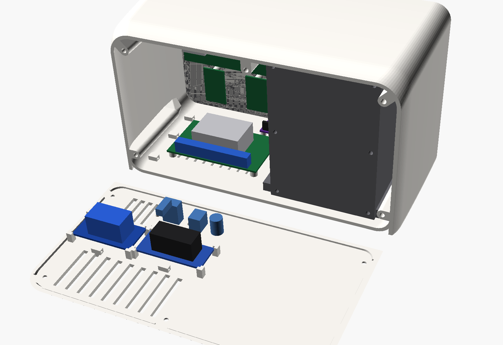

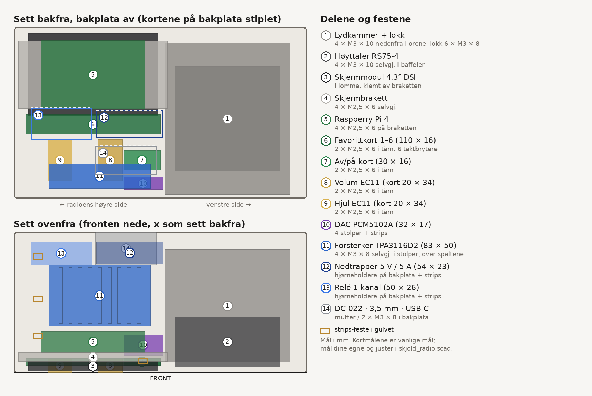

Alt er plassert slik at det går klar av hverandre i den grunnere og avrundede kassa. `sjekk_modell.py` sjekker det med forenklede modeller av alle kjøpte deler i `ref/`: kortene, taktbryterne, EC11, skjermmodulen, Pi-en, DAC-en, forsterkeren, nedtrapperen, releet, kontaktene og elementet. Kortmålene er vanlige mål for disse kortene, men de varierer mellom selgere. **Mål dine egne kort** og juster variablene i `skjold_radio.scad` (`forstM`, `dacM`, `buckM`, `releM` og så videre) før du printer.

| # | Del | Mål (mm) | Feste | Skruer | Plassering |
|---|---|---|---|---|---|
| 1 | Lydkammer + lokk | 102 × 92 × 124 | Ører på gulvet, lokk med skumtape | 4 × M3 × 10 senkeskrue nedenfra, 6 × M3 × 8 i lokket | Venstre halvdel, bak grillen |
| 2 | Høyttaler RS75-4 | Ø 86 | På baffelen forfra | 4 × M3 × 10 selvgjengende | I kammeret |
| 3 | Skjermmodul 4,3″ DSI | 106 × 68 × ca. 8 | I lomma bak vinduet, klemt av braketten | – | Høyre, øverst |
| 4 | Skjermbrakett | 122 × 55 | Fire tårn i fronten | 4 × M2,5 × 6 selvgjengende | Bak skjermen |
| 5 | Raspberry Pi 4 | 85 × 56, hull 58 × 49 | Fire tårn bak på braketten | 4 × M2,5 × 6 selvgjengende | Bak skjermen, portene mot høyre side |
| 6 | Favorittkort med 6 taktbrytere | 110 × 16 | To tårn i fronten (y 3–10) | 2 × M2,5 × 6 selvgjengende | Under skjermen, brytere med 16 mm deling |
| 7 | Av/på-kort | 30 × 16 | To tårn i fronten | 2 × M2,5 × 6 selvgjengende | Nede til venstre i panelet |
| 8–9 | EC11 volum og hjul, hvert på eget kort | 20 × 34 (EC11 12 × 12) | To tårn 13 mm over og under aksen; huset mot fronten | 2 × M2,5 × 6 per kort | Bak knottene |
| 10 | DAC PCM5102A | 32 × 17, uten hull | Fire stolper (4 mm) i gulvet + strips | – | Foran på gulvet, under av/på |
| 11 | Forsterker TPA3116D2 (XH-M189-type) | 83 × 50 × 20, hull ca. 76 × 43 | Fire stolper (5 mm) i gulvet, rett over luftespaltene | 4 × M3 × 8 selvgjengende | Midt på gulvet til høyre |
| 12 | Nedtrapper 5 V / 5 A (XL4015-type) | ca. 54 × 23 × 18 | Fire hjørneholdere på innsiden av bakplata + strips | – | Bakplata, over kontaktene |
| 13 | Relémodul 1-kanal | ca. 50 × 26 × 19 | Fire hjørneholdere på innsiden av bakplata + strips | – | Bakplata, ved siden av nedtrapperen |
| 14 | DC-022, PJ-392, USB-C-skjøt | Ø 8 / Ø 6 / 10 × 4,4 | Mutter / mutter / 2 × M3 (28 mm mellom hullene) | 2 × M3 × 8 | Bakplata nede |

**Knappene.** Taktbryterne (6 × 6 × 4,3 mm) sitter på forsiden av kortene, og kortene ligger an mot tårnene 7 mm bak fronten. Nuppen på hetta har 0,1 mm luft til bryteren, så hetta beveger seg ca. 0,35 mm før den klikker (0,1 mm fritt + bryterens 0,25 mm). Hetta står 0,8 mm ut fra fronten og ca. 0,45 mm når den er trykket inn. Flensen bak fronten holder hetta på plass, og den rette overkanten holder tallet på rett kjøl.

**Dreieknappene.** EC11 står på eget lite kort skrudd fast i to tårn, med huset mot innsiden av fronten. Da tar fronten trykket når du trykker på knotten, og kortet hindrer at dreieknappen roterer. Gjengehylsen går inn i hullet (Ø 7,2) og inn i en forsenkning under knotten, så mutteren trengs ikke.

**Varme.** Forsterkeren står på 5 mm høye stolper rett over luftespaltene i gulvet. De nederste spaltene i bakplata ligger bak den, så varm luft går opp og ut bak. Pi-en har spalter rett bak seg i bakplata. Nedtrapperen og releet sitter høyt på bakplata, bort fra forsterkeren.

**Kabelveier og strips-fester.** Det er fire strips-fester i gulvet: ett foran ved DAC-en og tre langs høyre side. Hjørneholderne på bakplata har også egne strips-fester.

- **Strøm:** DC-kontakten går til nedtrapperen og releet på bakplata, og videre til forsterkeren på korteste vei. Nedtrapperen gir 5 V, som går opp langs høyre side til Pi-ens pinne 2/6.
- **Lyd:** I²S fra Pi-ens GPIO går ned langs høyre side til DAC-en foran. Skjermet kabel fra DAC-en går bakover til forsterkerens inngang. Høyttalerkabelen går fra hullet i kammerets høyre sidevegg til forsterkerens utgang L.
- **Knapper:** båndkabler fra favorittkortet, av/på-kortet og EC11-kortene går opp til Pi-ens GPIO.
- **Skjerm:** DSI-flatkabelen går gjennom slissen i braketten rett til Pi-en.
- **USB-C:** skjøten går opp langs høyre side til en av Pi-ens USB-porter. Bruk en vinklet USB-A-plugg.
- **Bakplata:** la kablene til kontaktene, nedtrapperen og releet være 15–20 cm lange, så bakplata kan legges ned bak radioen mens du kobler. Det er slik den ligger i bildet over.

**Rekkefølge:** se [Montering](#montering). Kort sagt: innpressmuttere → kammer med element → stoff og grill → skjerm, brakett og Pi → knappekort og EC11-kort → forsterker og DAC på gulvet → nedtrapper, relé og kontakter på bakplata → kabler og strips → bakplata på.

**Print uten støtte.** Alt printes uten støtte. Stolpene og strips-festene i gulvet er dråpeformet sett ovenfra, med spissen mot fronten, så undersiden heller 45° når kroppen ligger med fronten ned. Skruehullene i dem har spisst tak. Tårnene for knappekortene og EC11-kortene står på fronten og bygges rett opp. Holderne på bakplata bygges rett opp fra plata.

## Programvare

Radioen bruker vanlig Skjold med Kit-profilen og mono, med knappene som en liten egen tjeneste ([`pi/skjold_radio_knapper.py`](../../pi/skjold_radio_knapper.py)).

```bash
cd pult-forsterker/pi && KI_AMP_BOARD=kit KI_AMP_MONO=1 KI_AMP_NAME="Skjold Radio" bash install.sh
```

```bash
sudo install -m 755 skjold_radio_knapper.py /usr/local/bin/ && sudo install -m 644 skjold-radio-knapper.service /etc/systemd/system/
```

```bash
sudo mkdir -p /etc/skjold && sudo cp config/radio_pins.yaml /etc/skjold/ && sudo systemctl daemon-reload && sudo systemctl enable --now skjold-radio-knapper
```

```bash
sudo SKJOLD_UI_LAYOUT=radio bash install_skjold_ui.sh
```

Kommandoen over installerer skjold-ui med radioskjermen (800 × 480). Den skriver `SKJOLD_UI_LAYOUT=radio` i `/etc/ki-amp.env`, så `update.sh` holder den oppdatert.

- **Skjermen:** legg inn DSI-linja fra Waveshares wiki for «4.3inch DSI LCD» i `/boot/firmware/config.txt`. skjold-ui åpner da radioskjermen i Chromium (se [Skjermen](#skjermen)).
- **Favoritt 1–6:** kort trykk spiller favoritten, hold 2 s lagrer det som spiller («Lagret som favoritt 4» på skjermen).
- **Hjulet:** drei for å bla i favorittene (starter etter 0,6 s ro), trykk for spill/pause, hold 0,8 s for menyen.
- **Volumknotten:** drei for volum ±2, trykk for å dempe.
- **Av/på:** kort trykk for av/på, hold 3 s for omstart.
- **Endre pinner:** rediger `/etc/skjold/radio_pins.yaml` og kjør `sudo systemctl restart skjold-radio-knapper`.

### Skjermen

skjold-ui har et eget oppsett for radioens 4,3″-skjerm (800 × 480), i samme formspråk som S1-skjermen: uskarpt omslag i bakgrunnen, hvite brikker for det som er valgt og gull som aksent, samme gull som hjulet. Oppsettet velges med `?layout=radio` (kiosken på radioen gjør det), og automatisk når vinduet er omtrent 5:3. S1 (960 × 320) er uendret. Alt kommer fra daemonens vanlige API; skjermen har ingen egne data.

| | |
|---|---|
| 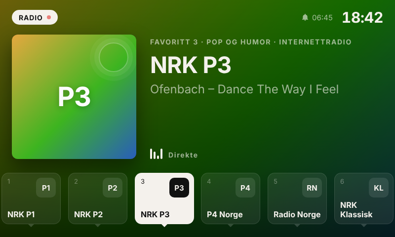 | 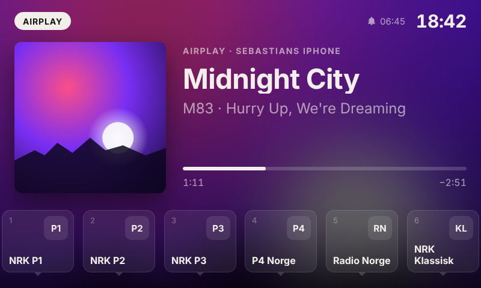 |
| **Nå spilles (radio).** Kanallogo eller omslag, stasjonsnavn, hva som spilles nå, kilde og sjanger, klokke og neste vekking øverst. Nederst står favoritt 1–6, hver rett over sin fysiske knapp (16 mm deling). Den som spiller er hvit. | **Nå spilles (AirPlay, Spotify, Blåtann …).** Omslag, tittel, artist og album, enheten som spiller og fremdriftslinje når låten har lengde. |
| 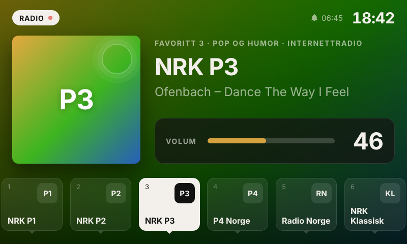 | 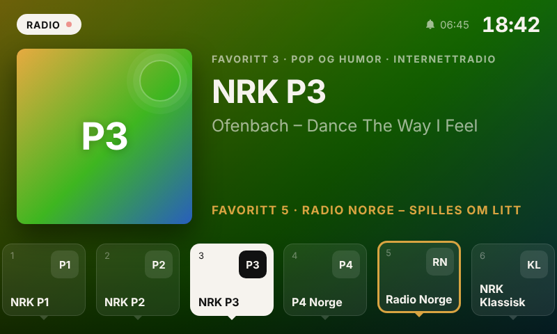 |
| **Volum.** Når volumknotten dreies, vises volumet i 2,2 s. «DEMPET» blir stående mens lyden er dempet. | **Hjulet blar.** Drei hjulet: favoritten det starter på får gull ring, og «Favoritt 5 · Radio Norge – spilles om litt» vises. Den starter etter 0,6 s ro. |
| 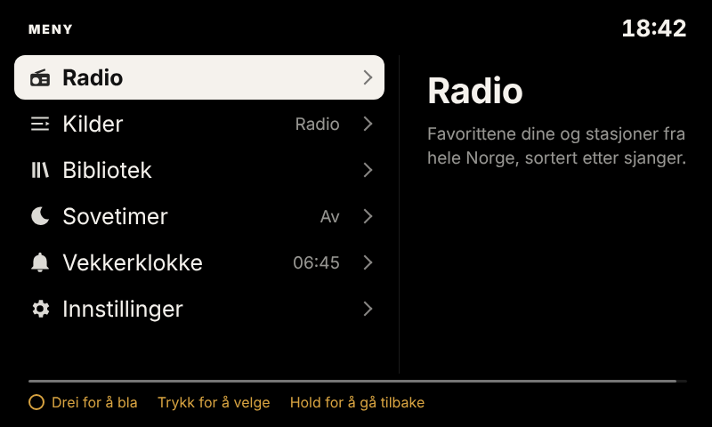 | 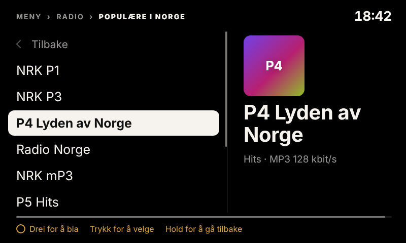 |
| **Menyen** (hold hjulet 0,8 s): Radio, Kilder, Bibliotek (bare når Plex eller Jellyfin er satt opp), Sovetimer, Vekkerklokke (når pluginen finnes) og Innstillinger. | **Radio:** favorittene og stasjonslistene fra radio-browser (populære i Norge og sjangre). Trykk spiller stasjonen og lukker menyen. |
| 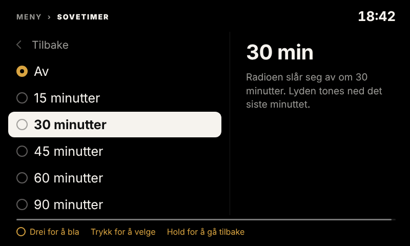 | 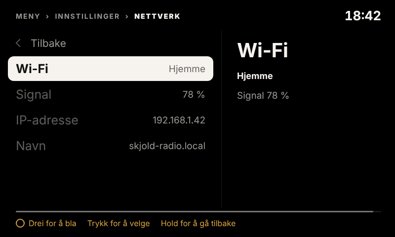 |
| **Sovetimer:** av, 15–90 min. Tiden som er igjen vises øverst på skjermen. | **Innstillinger:** lysstyrke (Auto/Høy/Middels/Lav), klokke i standby, nettverk (Wi-Fi, signal, IP, navn) og om radioen. |
| 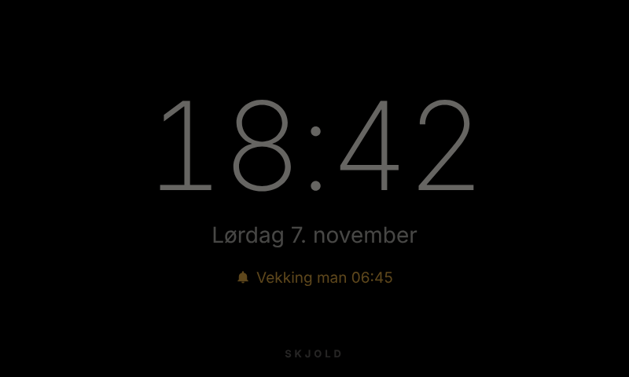 | 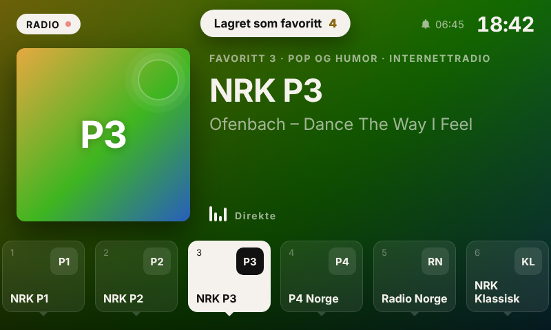 |
| **Standby:** når radioen er av, eller har stått stille i 5 min, vises en dempet klokke med dato og neste vekking. Den flytter seg litt hvert minutt. | **Lagret:** hold en favorittknapp i 2 s, så lagres det som spiller, og skjermen bekrefter det. |

**Slik styrer knappene skjermen.** `skjold_radio_knapper.py` sender hver hendelse til skjold-ui først (`POST /ui/event`, se [`pi/skjold_ui/KONTRAKT.md`](../../pi/skjold_ui/KONTRAKT.md) § 4):

| Knapp | Uten meny | Med meny åpen |
|---|---|---|
| Hjulet, drei | blar i favorittene (gull ring på skjermen) | blar i menyen |
| Hjulet, trykk | spill/pause | velger |
| Hjulet, hold 0,8 s | åpner menyen | tilbake ett nivå (fra toppen: lukker) |
| Favoritt 1–6 | spiller (brikken blinker), hold 2 s lagrer | spiller og lukker menyen |
| Volumknotten | volum, trykk demper | volum |
| Av/på | av/på, hold 3 s omstart | av/på |

Skjermen har også touch: trykk på en favoritt for å spille den, på omslaget for spill/pause og på klokka for menyen. Menyen lukker seg etter 30 s uten hjul. Lysstyrken styrer baklyset på DSI-skjermen (`/sys/class/backlight`). Auto demper skjermen mellom kl. 22 og 07.

Skjermbildene lages med en falsk daemon: `node pi/skjold_ui/test_render.js kabinett/radio/render radio` (Playwright og Chromium). `lag_render.sh` legger «nå spilles» inn på skjermen i OpenSCAD-bildene (`skjerm_i_render.py`).

### Mono

Radioen har ett element, så den skal spille mono. Ellers mister du alt som bare ligger i høyre kanal (f.eks. en gitar eller et kor som er panorert helt ut). Mono ordnes på to steder:

1. **Forsterkeren:** koble elementet til én utgang (L) på 2 × 50 W-kortet, eller bruk et monokort (TPA3116D2 mono/PBTL). Koble aldri L og R sammen på utgangen.
2. **Programvaren:** `KI_AMP_MONO=1` i `/etc/ki-amp.env` får CamillaDSP til å summere L+R (−6 dB hver, så det ikke klipper) til begge kanalene, før EQ, loudness og volum. Det gjelder alle kilder: radio, AirPlay, Spotify, Bluetooth og AUX. Installasjonskommandoen over skriver det inn. På en radio som allerede er installert: legg inn linja `KI_AMP_MONO=1` i `/etc/ki-amp.env` og kjør `sudo systemctl restart ki-amp`. `KI_AMP_MONO=0` gir stereo igjen.

Romlig stereo (XTC) og venstre/høyre-trim i lydoppsettet gir ingen mening på én høyttaler. La dem være av. Vil du ha stereo, kan du koble en ekstern forsterker eller aktive høyttalere til linje ut og sette `KI_AMP_MONO=0`.

## Bestille print

Du kan bestille alle delene i resin (SLA) eller nylon (MJF) i stedet for å printe dem selv. Last opp STL-ene fra `stl/` direkte; de er allerede orientert, men tjenestene snur dem selv.

**Kan resin bli like pent som sprøytestøpt plast?** Nesten. SLA-resin har ingen synlige lag. Med 0,05 mm lag og en god resin som JLC 8001 eller 9600 blir overflaten glatt og matt, og kantene skarpe. Det skiller seg fra sprøytestøpt plast på tre punkter:

1. **Støttemerker:** små prikker der støttene satt. Be om at de plasseres på innsiden. Kroppen er et skall som er åpent bak, så det går fint.
2. **Overflaten:** den er glatt, men ikke helt «støpt». Etter sliping (400 → 800 → 1500 vått), sprøyteprimer, ny sliping og 2–3 lag lakk (matt eller silkematt 2K/akryl) er det svært vanskelig å se forskjell på 30 cm avstand.
3. **Holdbarhet:** standardresin er hardere, men sprøere enn ABS/PC. Den kan sprekke hvis radioen faller i gulvet. Resin gulner også litt i sol over tid; lakk med UV-filter hjelper. Innpressmuttere fungerer dårlig i resin, så **lim M3-muttere (epoksy) i stedet**, eller bruk selvgjengende skruer.

**MJF (HP Multi Jet Fusion) i PA12, farget sort** er det andre gode valget. Det er seigt som sprøytestøpt nylon, tåler fall og innpressmuttere, og har en jevn, litt sandaktig matt overflate. Det ser ut som et ferdig produkt rett fra maskinen. Det kan ikke bli blankt eller lyst uten maling, og det er bare grått eller sort. For den lyse varianten må du slipe og male.

| Prosess | Overflate | Styrke | Detaljer | Etterarbeid for «støpt» look |
|---|---|---|---|---|
| **SLA resin** (JLC 8001/9600, sort/hvit resin) | Glattest, ingen lag | Hard, sprø | Skarpest (0,05 mm) | Fjern støttemerker, slip, primer, lakk |
| **MJF PA12, farget sort** | Jevn matt sandstruktur | Best (seig nylon) | Gode (0,08 mm) | Ingen for mørk variant; ev. damping/«vapor smoothing» for halvblank |
| **FDM PETG/ASA** (egen K2) | Lag synlige på sidene; fronten glatt (mot PEI) | God | OK (0,4 mm dyse) | Mye: sparkel, primer, sliping, lakk |

**Tjenester:**

- **JLC3DP (JLCPCB):** billigst for SLA og MJF, rask frakt til Norge (DHL/FedEx, ca. 5–8 dager). Resinene 8001 (gjennomskinnelig), 9600 (hvit, grei), Imagine Black (sort) og LEDO 6060 (seigere). MJF PA12 i grått, farget sort ved bestilling.
- **PCBWay:** samme prosesser og ofte litt dyrere, men flere materialer: tåleligere resin, MJF, SLS og ferdig lakkering («painting/spraying» som tilleggstjeneste).
- **Craftcloud (All3DP):** sammenligner mange verksteder, også i Europa. Det gir kortere vei og ofte ingen toll, men pris og kvalitet varierer.

**Prisanslag per del (november 2026, uten frakt og MVA).** Dette er anslag ut fra volum og størrelse, ikke tilbud. Last opp STL-ene for eksakt pris.

| Del | SLA resin (JLC3DP) | MJF PA12 sort (JLC3DP) | Craftcloud (EU, SLA/MJF) |
|---|---|---|---|
| Kropp (348 cm³, 240 × 152 × 112) | 800–1 500 kr | 850–1 650 kr | 1 600–3 200 kr |
| Grillramme + gullist (19 cm³, stoffet kjøpes) | 80–170 kr | 100–200 kr | 220–450 kr |
| Hjul + volumknott + 7 knappehetter (14 cm³; symbolene males inn i lommene) | 60–150 kr | 80–180 kr | 200–400 kr |
| Lydkammer + lokk (208 cm³, usynlig) | 450–850 kr | 550–1 000 kr | – (print selv) |
| Bakplate + brakett (97 cm³, synes bare bakfra) | 220–450 kr | 250–520 kr | – (print selv) |
| Frakt til Norge | 200–350 kr | 200–350 kr | 0–200 kr |

Legg til 25 % MVA (og eventuelt fortollingsgebyr på ca. 100–200 kr fra Kina).

**Anbefaling:** bestill bare de synlige delene i resin eller MJF (kropp, gullist, hjul, volumknott og knappehetter, ca. 1 350–2 600 kr med frakt og MVA; symbolene males inn i lommene; grillrammen synes ikke under stoffet og kan like gjerne printes selv). Print lydkammeret, lokket, bakplata og braketten selv på K2. De synes ikke, og kammeret blir faktisk bedre i tett PETG enn i hul resin. Velg MJF sort for den mørke varianten uten maling, og SLA med sliping, primer og lakk for den lyse varianten som skal se mest mulig sprøytestøpt ut.

## Lisens

Maskinvare: CC BY-NC-SA 4.0 (se [LISENS-MASKINVARE.md](../../LISENS-MASKINVARE.md)).
