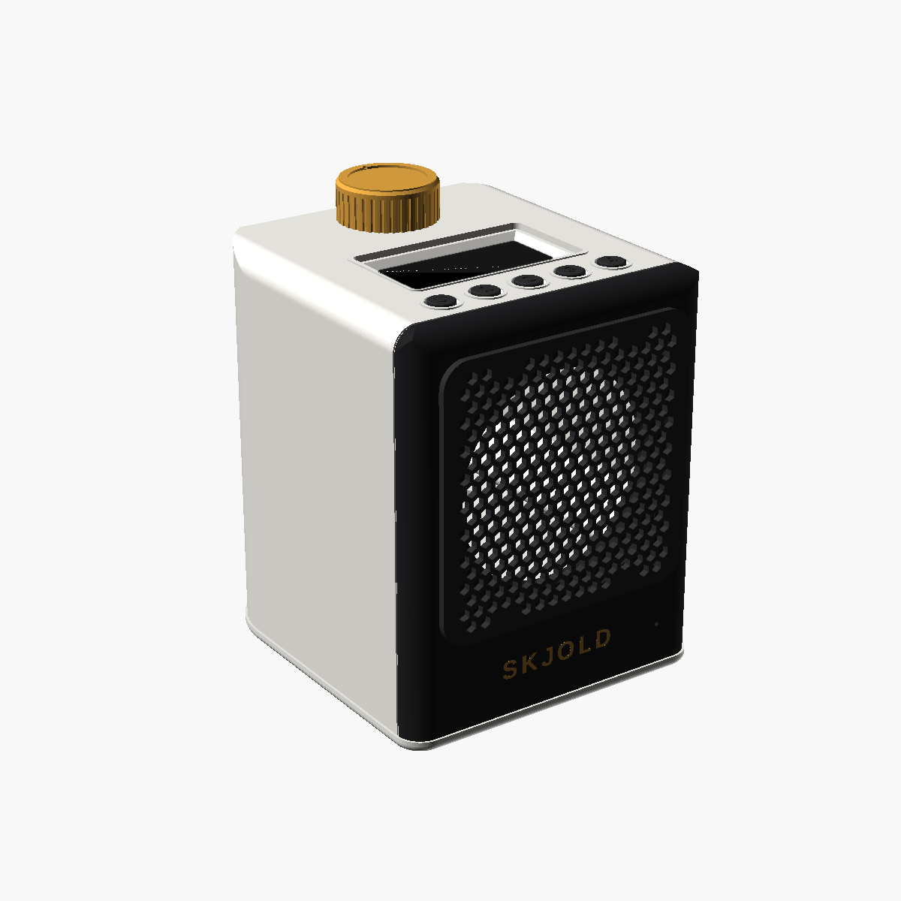

# Skjold Røst

En liten aktiv høyttaler for bad, kjøkken og barnerom. Den har et 3″ fullrange-element i et bassrefleks-kabinett, en ESP32-S3, en klasse D-forsterker, en 2,42″ OLED-skjerm og knapper for av/på og fire radiofavoritter. Røst er en vanlig Squeezebox-spiller i Lyrion, så den spiller synkront med S1, Node og Touch.

Røst er laget for å tåle damp på badet. Skjøtene er pakket med TPU, men knappene på toppen er vanlige knappehetter og er **ikke tette**, så toppen tåler bare litt sprut. Røst er **ikke vanntett** og skal ikke stå i dusjen. Se [På badet](#på-badet).

Bilder: [Røst](render/01_rost.png) · [eksplodert](render/02_eksplodert.png) · [bak](render/03_bak.png) · [fra siden](render/04_side.png) · [skjøten](render/05_skjot.png) · [toppanelet](render/06_knapper_skjerm.png)

Mål: 112 × 124,5 × 142 mm (B × D × H, med grill, bunn og føtter, uten knott). Kroppen er 112 × 113 × 134 mm, frontplaten 8,5 mm og grillen står 3 mm foran den. Knotten stikker 14,6 mm over toppen. (Forrige utgave: 106 × 124,5 × 144 mm med skrå topp, 136 mm bak og 131 mm foran. Den flate toppen ligger nå på 134 mm, midt mellom.)

Skjermen og knappene sitter på toppen, foran volumhjulet. Toppen er flat. Fronten har bare grillen (en løs del som trykkes på) og SKJOLD-logoen under den. Fastvare og oppsett: [`firmware/rost/`](../../firmware/rost/LES_MEG.md).

## Formen

Røst er en myk, avrundet blokk: lys kropp, mørk front med grill, gull knott. Formen er laget i Skjold-stil, ikke kopiert fra noen annen høyttaler: rette, flate sider og en flat topp, men store radier der flatene møtes.

- **Hjørnene bak, sett ovenfra: R28.** Buen går til 45° og går så over i en rett 45°-fas mot bakveggen. En hel bue ville hengt over når kroppen printes med bakveggen ned; slik printes den uten støtte.
- **Hjørnene foran: R8,5**, like stor som frontplatens tykkelse. Buen ender akkurat i skjøten, så frontplaten og kroppen følger samme kurve. Mer går ikke: elementets ramme (Ø86) og grillen (93 mm) trenger en flat front.
- **Toppkantene: R8** langs sidene og forkanten. Bak er det samme bue til 45° og så fas, av samme grunn som hjørnene bak.
- **Underkanten: R2,5** rundt bunnplaten, så bunnen ser lett ut og ikke som en egen sokkel.
- **Grill og front følger formen:** frontplaten er skåret fra den samme ytre formen som kroppen, så R8-toppkanten og R8,5-hjørnene går rett over i fronten. Grillen er en egen, mørk flate på fronten med avrundede hjørner.

**Ingen sort sokkel.** Bunnplaten og føttene er i samme lyse farge som kroppen, og TPU-pakningen nederst ligger i et spor innenfor ytterkanten, så den synes ikke som en mørk stripe. Fra siden er skjøten mellom kropp og bunn bare en tynn lys linje over den 0,8 mm brede dryppkanten. Det eneste mørke helt nede er frontplaten: den går ned til bunnen og bærer SKJOLD-logoen under grillen. Jeg har beholdt den mørke fronten med vilje. Sett fra siden og bakfra er Røst helt lys, og forfra leser den mørke fronten som et panel med logo, ikke som en sokkel, fordi den går hele veien opp til toppkanten. En lys front med bare grillen mørk ville gjort grillen til en løs flekk midt på og tatt bort kontrasten bak gull-logoen.

**Flat topp og vann.** Toppen heller ikke lenger. Vann holdes ute slik:
- en 0,5 mm hevet leppe rundt hvert knappehull og en ramme rundt skjermruta, så vann som renner på toppen går rundt hullene og fugene i stedet for ned i dem
- TPU-kragen rundt dreieknappens aksel står 0,5 mm over toppen og dekkes av knotten
- ruta er lagt på skumtape og tettet med silikon langs kanten
- R8-kantene rundt toppen gjør at vann renner av over kanten i stedet for å bli stående i et skarpt hjørne.

Det er ingen skjult bombering, så toppen er helt flat. Vann som ligger på toppen eller på ruta (inne i rammen) må tørkes av.

## Hvorfor disse komponentene

- **PCM5102A (DAC) + TPA3118D2 i mono (PBTL)** i stedet for MAX98357A. MAX98357A gir bare ca. 3 W fra 5 V og blir fort hard på et 3″-element. TPA3118 på 12 V gir ca. 15 W rent i 4 Ω.
- **ESP32-S3 N16R8:** PSRAM gir squeezelite-esp32 god buffer for strømming over Wi-Fi.
- **2,42″ OLED 128×64, SSD1309, I²C (hvit tekst på svart):** stor og godt lesbar på avstand, og bare fire ledninger. squeezelite-esp32 driver den som SSD1306 (registerkompatibel). Den er monokrom, så den viser tekst og ikoner (kanal, låt, artist, volum), ikke cover eller kanallogo.
- **Taktbrytere med printede knappehetter:** hettene går gjennom hull i toppen og har en flens under, så de ikke faller ut. Ikonene (av/på, 1–4) er preget i toppen av hettene. Enkelt å printe og bytte, men ikke tett.
- **12 V / 2 A-adapter** med en MP1584-nedtrapper til 5 V for ESP-en. 12 V er ufarlig å ta på, og adapteren kan stå utenfor badet.

## Deler

| Del | Antall | Merknad |
|---|---|---|
| 3″ fullrange-element, 4 Ω (Dayton Audio RS75-4 anbefalt) | 1 | Utsparing Ø72 mm, ramme inntil Ø86 mm, 4 skruer på Ø82 mm hullsirkel. Sjekk ditt element og juster `drvCut`/`drvPCD`. |
| ESP32-S3-DevKitC-1 N16R8 | 1 | |
| PCM5102A I²S DAC-kort | 1 | SCK til GND, XSMT til 3V3, FMT/FLT/DEMP til GND |
| TPA3118D2 mono PBTL-forsterkerkort | 1 | 12–24 V inn. Sjekk at kortet er satt opp for PBTL (mono). |
| 2,42″ OLED 128×64 SSD1309, «I2C interface, white» (AliExpress «Zave», ca. 105 kr) | 1 | Kort 70,08 × ca. 39 mm, 4 hull Ø3 (62 mm i bredden), glass ca. 60 × 30,5 × 3,25 mm, aktivt område 55,4 × 27,7 mm. Pinneraden (GND VDD SCK SDA) vender bakover, flatkabelen fremover. Mål din modul og juster `pcbH`, `dHoleV`, `glW`/`glH` og `glOffV`. **Bruk vinklede pinner eller lodd ledningene rett på kortet**: takrommet er bare 8,5 mm høyt, og rette pinner med plasthus får ikke plass. Noen moduler må loddes om fra SPI til I²C (motstander på baksiden). |
| Taktbryter 6 × 6 × 5 mm | 5 | Loddes på et hullkort på ca. 86 × 14 mm, sentrert under knappene (16 mm mellom) |
| M2 × 6 mm avstandsstykke + 4 M2 × 4 skruer | 2 | Holder knappekortet 6 mm bak frontplaten |
| MP1584EN nedtrapper 12 V → 5 V | 1 | Still inn 5,0 V før du kobler til ESP-en |
| DC-kontakt 5,5/2,1 mm for panel (Ø8 mm) | 1 | Med mutter. TPU-skiven legges under flensen utvendig. |
| Strømadapter 12 V / 2 A | 1 | Skal stå utenfor badet (se under) |
| EC11 dreieknapp med trykk, 20 mm D-aksel | 1 | |
| INMP441 I²S-mikrofon | 1 | Valgfri |
| M3 innpressmutter (M3 × 5,7, Ø4,0 hull) | 8 | 4 i fronten av kroppen, 4 i tårnene under |
| M3 × 10 senkeskrue | 8 | |
| M3 × 10 selvgjengende (element) | 4 | |
| M2 × 6 selvgjengende (skjerm) | 4 | Gjennom skjermkortets hull og rett i toppanelet |
| Akryl 1,5 mm, 64 × 36 mm, hjørneradius 2 | 1 | Rute foran skjermen. Kan også printes i klar PETG (`stl/rute.stl`), men akryl er klarere. |
| TPU 95A filament | ca. 8 g | Pakninger i skjøtene, krage, DC-skive og USB-propp |
| Tynn dobbeltsidig skumtape (ca. 0,2 mm) eller lim | – | Under skjermruta |
| ePTFE trykkutjevningsventil M12 × 1,5 (med mutter) | 1 | Eller en selvklebende ePTFE-membran (Ø16 mm eller større) over hullet. Slipper ut damp og trykk, ikke vann. |
| ePTFE akustisk membran, selvklebende, Ø8–10 mm | 1 | Bare med mikrofon: limes over mikrofonhullet på innsiden |
| Vannavstøtende akustisk duk, ca. 100 × 100 mm | 1 | Polyester-/nylonduk for høyttalere (hydrofob). Ligger bak grillen. |
| Beskyttelseslakk (conformal coating) | – | Akryl- eller silikonlakk på alle kretskortene. Ikke på kontakter, skjermglass og mikrofon. |
| Silikon eller fleksibelt lim (f.eks. Sikaflex 11FC) | – | Kanten av ruta, kabelgjennomføringen og skruehodene i bunnen |
| Polyfill / dempeull | ca. 5 g | Løst i kammeret, ikke foran porten |

## Kobling (ESP32-S3)

| Fra | Til |
|---|---|
| PCM5102A BCK / LCK (WS) / DIN | GPIO4 / GPIO5 / GPIO6 |
| PCM5102A VIN / GND | 5V / GND |
| PCM5102A OUT L (eller L+R via 2 × 1 kΩ) | TPA3118 inn |
| TPA3118 SDZ (forsterker på) | GPIO7 |
| TPA3118 PVCC / GND | 12 V / GND (fra DC-kontakten) |
| TPA3118 ut + / − | Element + / − |
| Skjerm SDA / SCK (I²C) | GPIO11 / GPIO12 |
| Skjerm VDD / GND | 3V3 / GND |
| (Skjerm RES, bare 7-pinners kort, valgfritt) | GPIO13 |
| Knapp av/på / 1 / 2 / 3 / 4 (andre bein til GND) | GPIO8 / GPIO9 / GPIO18 / GPIO39 / GPIO47 |
| EC11 A / B / trykk (C og trykk-retur til GND) | GPIO15 / GPIO16 / GPIO17 |
| INMP441 SCK / WS / SD, L/R til GND | GPIO41 / GPIO42 / GPIO40 |
| MP1584 ut 5 V | ESP32 5V |

Ikke bruk GPIO0, 3, 45 eller 46 (oppstartspinner), GPIO19/20 (USB), GPIO26–32 (flash), GPIO35–37 (PSRAM) eller GPIO38/48 (RGB-LED på DevKitC-1, avhenger av versjon). Knappene bruker intern pull-up og trekkes til GND. Det er ingen status-LED lenger. Skjermen viser status.

## Akustikk

- Lydkammer: ca. 1,01 l luft mellom vegger, front, gulv og takrommet, ca. 0,96 l netto når et element (ca. 50 cm³) er satt inn (målt på `asm/luft.stl` av `sjekk_modell.py`). De runde hjørnene tar litt volum, men den flate toppen og 6 mm ekstra bredde gir det tilbake. Forrige utgave (skrå topp, R12-hjørner) hadde 1,02 l luft og 0,97 l netto målt på samme måte.
- Bassrefleks: port Ø16 mm, 78 mm lang, nede til venstre i bakveggen (til siden for elementets magnet) og vendt bakover. Munningen er avrundet. Det gir en beregnet tuning på ca. 84 Hz (forrige utgave ca. 83 Hz med samme formel og samme port).
- **Takrommet:** skjermen og knappekortet ligger i et eget, lukket rom rett under toppen (ca. 56 cm³), adskilt fra lydkammeret av et 3 mm gulv. Da rasler ikke knappehettene med bassen, og takrommet påvirker ikke tuningen. Ledningene går gjennom et Ø6-hull i takrommets gulv og videre gjennom hullet i kammergulvet. Begge hullene tettes med silikon.
- Dette er beregnet ut fra volum og port, ikke målt. Simuler ditt element i WinISD eller VituixCAD. Endre `portL` (lengre port gir lavere tuning) eller tett porten for et lukket kabinett.
- Porten peker bakover, så sprut forfra ikke kommer inn i kammeret. La det være minst 5 cm luft bak Røst.
- Kammeret er skilt fra elektronikkrommet av et gulv. Elementkabelen går gjennom et Ø6-hull i gulvet, og det må tettes med silikon, ellers lekker kammeret.

## Hvordan Røst holder fuktigheten ute

- **Skjøten front–kropp:** kropp og frontplate er skåret fra samme ytre form, så sidene og toppen flukter helt (ingen trinn eller spalte). En smal skyggefuge (0,5 mm inn, 0,8 mm bred) gjør skjøten til en ren linje. Bak den ligger en TPU-pakning i et spor i kroppen, langs sidene, forkanten av takrommets gulv og forkanten av kammergulvet. Frontplaten trykker den 0,2 mm sammen.
- **Bunnen:** en TPU-pakning i et spor rundt hele bunnplaten, under kroppen og frontplaten. Bunnen stikker 0,8 mm ut, har R2,5 avrundet underkant og en dryppnese på undersiden innenfor buen, så vann som renner nedover sidene drypper av i stedet for å trekke inn under. Føttene er 4 mm høye, så Røst ikke står i vann.
- **Knappene:** fem printede knappehetter (av/på og 1–4) i hull i toppen, med 0,25 mm klaring rundt. De står 1,1 mm over toppen (0,6 mm over leppa rundt hullet) og har en flens under toppanelet. Leppa leder vann på toppen rundt hullet. **Hullene er ikke tette.** Vann som kommer på toppen kan renne ned langs hettene til takrommet. Vil du ha det tettere, smør en tynn ring silikonfett rundt hver hette før du setter den i, eller legg en dråpe nøytral silikon mellom flensen og panelet.
- **Skjermen:** klar rute (akryl 1,5 mm, 64 × 36 mm) i en forsenkning i toppen, over et vindu tilpasset det aktive området, med fas, lagt på tynn dobbeltsidig skumtape (0,2 mm) eller lim. Ruta flukter med toppen, og en 0,5 mm hevet ramme rundt den holder vann på toppen borte fra fugen. En tynn streng silikon langs kanten gjør den tett.
- **Toppen:** flat, med hevede lepper rundt knappene og ruta og en hevet TPU-krage under knotten (se [Formen](#formen)). Vann som renner av går over de avrundede kantene. Av forkanten drypper det ned foran grillen, der den vannavstøtende duken stopper det.
- **Grillen:** en løs del som står 3 mm foran frontplaten, som på første Røst. Den trykkes på med 4 tapper med små klemribber, så den sitter stramt uten å rasle og kan trekkes av for rengjøring. Den vannavstøtende duken klemmes mellom grillen og frontplaten.
- **Dreieknappen:** TPU-krage rundt akselen i en forsenkning i toppen. Den står 0,5 mm over toppen, og knotten dekker den.
- **DC og USB-C bak:** TPU-skive under flensen på DC-kontakten. USB-C brukes bare til flashing, og har en TPU-propp ellers.
- **Trykkutjevning:** en ePTFE-ventil i bunnen av elektronikkrommet slipper ut trykk og damp når Røst blir varm og kald, slik at fukt ikke pumpes inn gjennom pakningene.
- **Kretskortene:** lakk dem med beskyttelseslakk (conformal coating). Det beskytter mot kondens som likevel kommer inn.

## På badet

- **Strøm:** 12 V er ufarlig å ta på, men **strømadapteren (230 V) skal stå utenfor badet eller utenfor våtromssonene**, slik NEK 400 krever for elektrisk utstyr i våtrom. Bruk en lang 12 V-kabel. Har du en fast installert stikkontakt på badet, må den være godkjent for våtrom og riktig sone.
- **Plassering:** ikke plasser Røst i direkte dusjsprut eller der den kan bli stående i vann. Den tåler damp, men **knappene på toppen er ikke tette**, så sett den der toppen ikke får sprut (for eksempel på en hylle unna dusjen). Silikonfett rundt knappehettene hjelper.
- **Materiale:** print i **PETG eller ASA**, ikke PLA. PLA blir mykt ved varme og trekker fukt over tid. Pakningene i TPU 95A.
- **Tørk av** vann som samler seg på toppen. Rengjør grillen forsiktig, så duken ikke blir skadet.

## Utskrift (Creality K2)

Det er tre 3MF-filer, alle innenfor 250 × 250 mm, så de passer K2, K2 Pro og K2 Plus:

| Fil | Deler | Filament |
|---|---|---|
| `skjold-rost-k2.3mf` | Kropp (med toppanel og takrom), frontplate med innfelt logo, knott, 5 knappehetter | 1 = lys (kropp), 2 = sort (front, knappehetter), 3 = gull (logo, knott) |
| `skjold-rost-k2-bunn.3mf` | Grill, bunn | 2 = sort |
| `skjold-rost-k2-tpu.3mf` | Pakning front, pakning bunn, krage, DC-skive, USB-propp | TPU 95A (egen utskrift; CFS mater ikke myk TPU, så bruk ekstern spole) |

Setter ikke Creality Print fargene selv, sett filament per del.

| Del | Retning | Støtte |
|---|---|---|
| `kropp.stl` | Bakveggen ned, åpen front opp. Takrommets frontvegg printes som en kort bro (8,5 mm). | Nei |
| `front.stl` + `logo.stl` | **Baksiden ned, forsiden opp** (logoen er åpen oppover) | Nei |
| `grill.stl` | Forsiden ned, tappene opp | Nei |
| `bunn.stl` | Innsiden ned, føttene opp | Nei |
| `knott.stl` | Toppen ned | Nei |
| `knapp.stl` | Fem hetter, toppen ned og flensen opp | Nei |
| TPU-delene | Flate | Nei |

**Innstillinger, PETG/ASA:** 0,2 mm lag, 0,4 mm dyse, 4 vegger (tette, stive vegger gir mindre resonans), 20 % gyroid fyll. PETG 240 °C / 75 °C seng, ASA 260 °C / 100 °C seng med lukket kammer. Teksturert PEI gir matt overflate.

**Innstillinger, TPU 95A:** 0,2 mm lag, 100 % fyll, 20–30 mm/s, 225–235 °C, ingen eller svært kort retraksjon.

Vekt og tid er ikke slicet.

### Logoen i egen farge

SKJOLD-logoen er et eget legeme (`logo.stl`) som ligger 0,6 mm inn i frontplaten og flukter med forsiden. Strekene er minst 1 mm brede.
- **Med CFS:** `skjold-rost-k2.3mf` har logoen som egen del med filament 3, plassert nøyaktig i fronten. Den printes i samme utskrift.
- **Uten CFS:** en vanlig pause med filamentbytte virker ikke her, fordi frontplaten printes med forsiden opp. Da blir hele det øverste laget gull, ikke bare logoen. Gjør heller slik:
  - Print frontplaten i sort uten logoen. Slett logo-delen i sliceren, så blir lomma tom.
  - Print `logo.stl` alene i gull.
  - Lim den i lomma med en tynn dråpe lim.

## Montering

1. Varm inn 8 M3-innpressmuttere: 4 i fronten av kroppens skruetårn, 4 i tårnene under.
2. Lakk kretskortene med beskyttelseslakk og la det tørke.
3. Takrommet nås forfra før frontplaten er på. Lodd taktbryterne på hullkortet, og skru det på de to M2 × 6-avstandsstykkene under toppanelet, med bryterne opp mot hullene.
4. Lodd fire ledninger (eller vinklede pinner) på skjermkortet. Legg skjermen med glasset opp i lomma under vinduet, med pinneraden bakover og flatkabelen fremover, og skru kortet fast med fire M2 × 6 selvgjengende skruer i hullene i toppanelet. Legg tynn skumtape i forsenkningen i toppen, og legg ruta oppå. En tynn streng silikon langs kanten gjør den tett.
5. Sett de fem knappehettene i hullene fra undersiden, før knappekortet skrus på (punkt 3 kan gjøres etter dette): av/på til venstre, så 1–4. Flensen holder dem på plass. Smør gjerne litt silikonfett rundt hettene.
6. Trekk ledningene fra skjerm og knapper gjennom hullet i takrommets gulv og ned i kammeret. Tett hullet med silikon.
7. Monter EC11 gjennom toppen innenfra (bak takrommet). Trykk TPU-kragen ned over akselen i forsenkningen, og trykk på knotten.
8. Legg elektronikken i rommet under gulvet:
   - DC-kontakten (med TPU-skiven utvendig) og ESP32 (USB-C) skal sitte mot hullene bak.
   - Fest kortene med dobbeltsidig tape eller lim.
   - Skru inn ePTFE-ventilen i hullet i bunnplaten.
9. Trekk elementkabelen og ledningene fra takrommet gjennom hullet i gulvet, og tett med silikon.
10. Skru elementet fast i frontplaten, med rammen i forsenkningen.
11. Legg TPU-pakningen i sporet i kroppens forkant. Legg litt dempeull i kammeret (ikke foran porten).
12. Skru frontplaten fast med 4 senkeskruer. Hodene ligger bak grillen.
13. Legg den akustiske duken over fronten, og trykk grillen på, slik at tappene går gjennom duken og inn i hullene. Klipp duken rundt grillen. Grillen kan trekkes av igjen.
14. Legg TPU-pakningen i sporet i bunnplaten, og skru bunnen fast med 4 senkeskruer. En dråpe silikon på skruehodene holder vannet ute.
15. Sett TPU-proppen i USB-C-hullet.

## Sjekket og ikke sjekket

- `./lag_stl.sh` lager alle STL-er (utskrift i `stl/`, montert stilling i `asm/`), kjører sjekken og lager 3MF-filene. `xvfb-run -a ./lag_render.sh` lager bildene i `render/` (med OLED-bildet fra `lag_oled.py` lagt inn på skjermen), og `python3 lag_nettbilder.py` lager bildene til nettsiden fra dem.
- Sjekket i modellen (`python3 sjekk_modell.py <mappe med monterte STL-er>`):
  - alle 13 STL-er er vanntette, ett legeme hver (knapp.stl: fem hetter, logo.stl: bokstavene), ligger på platen og passer på 250 × 250 mm
  - ingen deler overlapper når de er montert
  - ytterveggen er minst 1,6 mm overalt, utenom de tiltenkte hullene
  - kropp og frontplate flukter i skjøten
  - pakningene følger formen hele veien rundt (minst 0,5 mm materiale på hver side av sporet)
  - lydkammerets volum og porttuning (0,96 l netto, ca. 84 Hz)
  - yttersiden av kropp, bunn og grill har ingen overheng brattere enn 50° i utskriftsretningen
- Ikke testet: ingenting er printet eller bygget. Følgende må prøves:
  - passformen til element, innpressmuttere, grilltapper (klemribbene), knott, skjermlomme og knappehetter (0,25 mm klaring, flens)
  - om det går greit å montere skjerm og knappekort i takrommet forfra (det er trangt: 8,5 mm høyt)
  - hvor tett pakningene faktisk er (knappene på toppen er ikke tette)
  - om knappehettene får et godt klikk (forspenningen mot bryteren er 0,15 mm)
  - lyden og porttuningen
  - om squeezelite-esp32 driver SSD1309-skjermen som SSD1306 på 0x3C (ev. med HFlip/VFlip eller reset-pinne)
  - de nøyaktige målene på skjermmodulen (høyden på kortet, hullavstanden i høyden og glassets plassering)

Lisens: CC BY-NC-SA 4.0.
