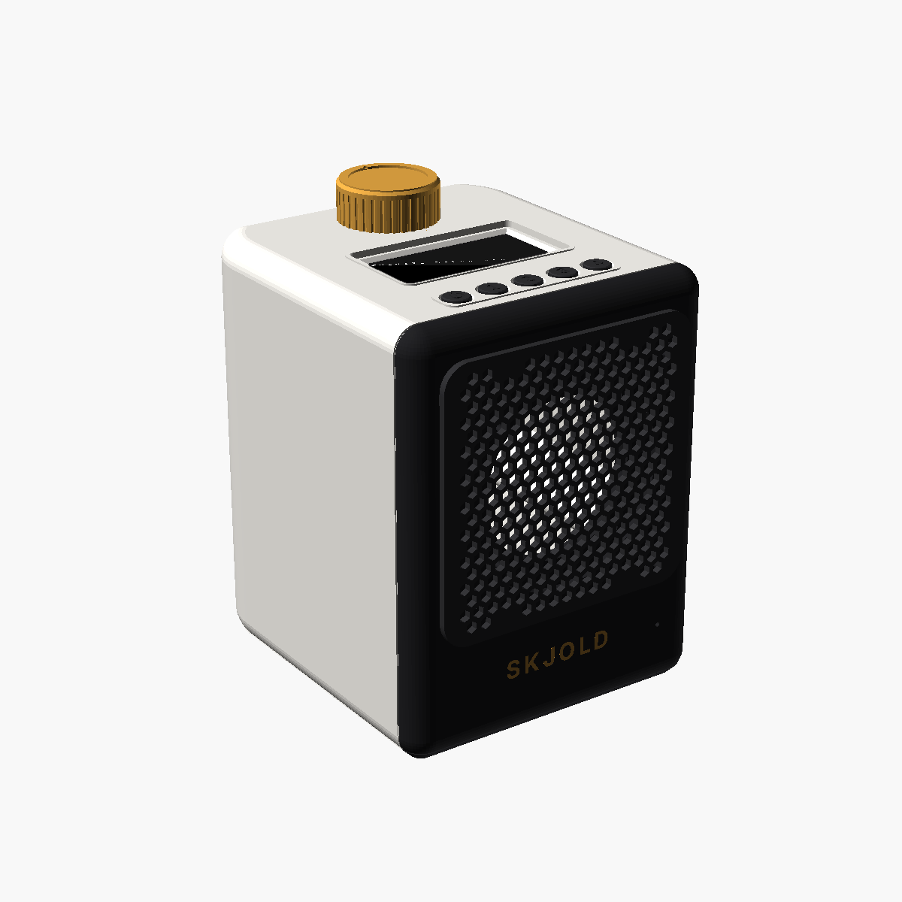
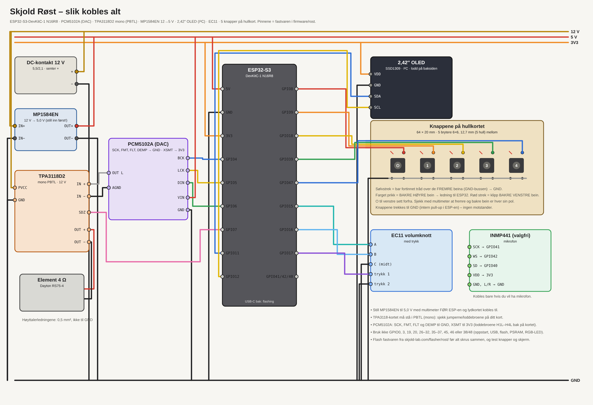

# Skjold Røst

En liten aktiv høyttaler for bad, kjøkken og barnerom. Den har et 3″ fullrange-element i et bassrefleks-kabinett, en ESP32-S3, en klasse D-forsterker, en 2,42″ OLED-skjerm og knapper for av/på og fire radiofavoritter. Røst er en vanlig Squeezebox-spiller i Lyrion, så den spiller synkront med S1, Node og Touch.

Røst er laget for å tåle damp på badet. Skjøtene er pakket med TPU, men knappene på toppen er vanlige knappehetter og er **ikke tette**, så toppen tåler bare litt sprut. Røst er **ikke vanntett** og skal ikke stå i dusjen. Se [På badet](#på-badet).

Bilder: [Røst](render/01_rost.png) · [eksplodert](render/02_eksplodert.png) · [bak](render/03_bak.png) · [fra siden](render/04_side.png) · [skjøten](render/05_skjot.png) · [toppanelet](render/06_knapper_skjerm.png) · [skrått bakfra](render/07_bak_skra.png) · [takrommet i snitt](render/08_takrom.png) · [knappeholderen trukket ut](render/09_takrom_ut.png)

Elementet: hullene i frontplata tegnes fra malen i [../elementer](../elementer/LES_MEG.md) (standard Dayton RS75-4: utsparing 54 mm, ramme 72 mm, hullsirkel 64 mm). Velg et annet med `element = "..."`.

Mål: 112 × 124,5 × 145,5 mm (B × D × H, med grill, bunnbrett og gummiføtter, uten knott). Kroppen er 112 × 113 × 134 mm, frontplaten 8,5 mm og grillen står 3 mm foran den. Knotten stikker 14,6 mm over toppen. (Forrige utgave: 106 × 124,5 × 144 mm med skrå topp, 136 mm bak og 131 mm foran. Den flate toppen ligger nå på 134 mm, midt mellom.)

Skjermen og knappene sitter på toppen, foran volumhjulet. Toppen er flat. Fronten har bare grillen (en løs del som trykkes på) og SKJOLD-logoen under den. Fastvare og oppsett: [`firmware/rost/`](../../firmware/rost/LES_MEG.md).

## Formen

Røst er en myk, avrundet blokk: lys kropp, mørk front med grill, gull knott. Formen er laget i Skjold-stil, ikke kopiert fra noen annen høyttaler: rette, flate sider og en flat topp, med store, rolige radier der flatene møtes.

Ytterformen er én glatt flate. Den er laget som en Minkowski-sum: et prisme (grunnrisset) «rullet» med en kule på R8,5. Alle kanter får da samme radius, og hjørnene der tre kanter møtes blir jevne, doble kurver uten fasetter eller knekker.

- **Front og topp: R8,5 overalt.** Hjørnene foran, toppkanten foran, langs sidene og bak har alle R8,5, akkurat like mye som frontplatens tykkelse. Buen foran ender derfor nøyaktig i skjøten, og skillelinjen mellom den mørke fronten og den lyse kroppen går der flaten blir rett.
- **Hjørnene bak, sett ovenfra: R28.** Det gir den myke, runde baksiden.
- **Bakveggen** er en flat flate med en jevn, skarp 45°-kant rundt. Buene bak (R28 i hjørnene, R8,5 i toppkanten) går helt til de møter bakveggen i 45°, uten den flate fasen som var der før. Kanten er lik hele veien rundt, også i de to øvre hjørnene, så den leser som en bevisst ramme rundt bakpanelet.
- **Underkanten: R8,5 som toppen.** Bunnen er et 8,5 mm høyt brett i samme lyse farge som kroppen, og frontplaten går helt ned til bordet, så fronten er sort fra topp til bunn. Nederst flater buen ut i en 45°-fas, så brettet printes med gulvet ned uten støtte.
- **Grill og front følger formen:** frontplaten er skåret fra den samme ytre formen som kroppen. Grillen er en egen, mørk flate på fronten med avrundede hjørner.

**Hvorfor kanten bak.** Kroppen printes med bakveggen ned. Da blir alle de indre gulvene (lydkammergulvet, takrommets gulv og toppanelet) loddrette vegger, porten står rett opp, og ingenting trenger støtte. En hel R28-bue helt inn til bakveggen ville hengt over opp til 90° rett over printplata. Derfor stopper buen ved 45°. Andre retninger er vurdert:
- **Stående på bunnen:** lydkammergulvet og toppanelet blir tak på over 100 mm, som ikke kan printes uten støtte.
- **Med fronten ned:** bakveggen blir et tak på 112 × 134 mm.
- **Med toppen ned:** lydkammergulvet blir tak, og toppkantene får samme problem som baksiden har nå.

**Hjørnene foran** kunne vært større om fronten var smalere. Elementets ramme (inntil Ø86 i en forsenkning i fronten, RS75-4 er Ø72) og grillen (93 mm) trenger en flat front på minst ca. 90 mm, og med 112 mm bredde gir det høyst R11. Et mindre element (2,5″) ville gitt plass til R16–20, men koster bass og effekt. R8,5 er valgt fordi buen da ender nøyaktig i skjøten, og fordi den er lik radiusen på alle toppkantene. Volumet og tuningen er uendret (se [Akustikk](#akustikk)).

**Toppen.** Knappelista og rammen rundt ruta er like brede (65,6 mm), har samme kantbredde (1,6 mm) og samme hjørneradius (3,8 mm), og står begge 0,5 mm over toppen. Knappene sitter med 13,2 mm mellomrom, så de fyller lista jevnt. Bak dem ligger ruta, og bakerst volumhjulet, alt på midtlinjen. Fra forkanten: knappene (senter 11 mm bak skjøten), vinduet (senter 46,8 mm), knotten (senter 88 mm).

**Baksiden.** Porten, DC-kontakten og USB-C sitter på én loddrett linje (x = −26, til siden for elementets magnet) med like store mellomrom (ca. 6 mm), og Skjold-merket (fem staver, 14 × 15 mm, preget 1 mm inn) sitter på samme linje over porten. Portens munning er en R8-bue som møter bakveggen i 45°, samme form som kantene rundt. DC- og USB-hullet har 0,6 mm fas. Den graverte teksten «SKJOLD RØST» er fjernet.

**Ingen sort sokkel.** Bunnplaten og føttene er i samme lyse farge som kroppen, og TPU-pakningen nederst ligger i et spor innenfor ytterkanten, så den synes ikke som en mørk stripe. Fra siden er skjøten mellom kropp og bunn bare en tynn lys linje over den 0,8 mm brede dryppkanten. Det eneste mørke helt nede er frontplaten: den går ned til bunnen og bærer SKJOLD-logoen under grillen. Jeg har beholdt den mørke fronten med vilje. Sett fra siden og bakfra er Røst helt lys, og forfra leser den mørke fronten som et panel med logo, ikke som en sokkel, fordi den går hele veien opp til toppkanten. En lys front med bare grillen mørk ville gjort grillen til en løs flekk midt på og tatt bort kontrasten bak gull-logoen.

**Flat topp og vann.** Toppen heller ikke lenger. Vann holdes ute slik:
- en 0,5 mm hevet knappelist rundt knappehullene og en like høy ramme rundt skjermruta, så vann som renner på toppen går rundt hullene og fugene i stedet for ned i dem
- TPU-kragen rundt dreieknappens aksel står 0,5 mm over toppen og dekkes av knotten
- ruta er lagt på skumtape og tettet med silikon langs kanten
- R8,5-kantene rundt toppen gjør at vann renner av over kanten i stedet for å bli stående i et skarpt hjørne.

Det er ingen skjult bombering, så toppen er helt flat. Vann som ligger på toppen eller på ruta (inne i rammen) må tørkes av.

## Hvorfor disse komponentene

- **PCM5102A (DAC) + TPA3118D2 i mono (PBTL)** i stedet for MAX98357A. MAX98357A gir bare ca. 3 W fra 5 V og blir fort hard på et 3″-element. TPA3118 på 12 V gir ca. 15 W rent i 4 Ω.
- **ESP32-S3 N16R8:** PSRAM gir squeezelite-esp32 god buffer for strømming over Wi-Fi.
- **2,42″ OLED 128×64, SSD1309, I²C (hvit tekst på svart):** stor og godt lesbar på avstand, og bare fire ledninger. squeezelite-esp32 driver den som SSD1306 (registerkompatibel). Den er monokrom, så den viser tekst og ikoner (kanal, låt, artist, volum), ikke cover eller kanallogo.
- **Taktbrytere med printede knappehetter:** hettene går gjennom hull i toppen og har en flens under, så de ikke faller ut. Ikonene (av/på, 1–4) er preget i toppen av hettene. Enkelt å printe og bytte, men ikke tett.
- **Printet knappeholder i stedet for hullkort:** de fem bryterne trykkes ned i lommer i en printet holder, og ledningene loddes rett på beina. Holderen skyves inn i takrommet forfra, ligger på gulvet der og trykker samtidig skjermkortet opp mot toppen, så verken knapper eller skjerm trenger skruer eller avstandsstykker. Frontplaten holder den på plass.
- **12 V / 2 A-adapter** med en MP1584-nedtrapper til 5 V for ESP-en. 12 V er ufarlig å ta på, og adapteren kan stå utenfor badet.

## Deler

| Del | Antall | Merknad |
|---|---|---|
| 3″ fullrange-element, 4 Ω (Dayton Audio RS75-4 anbefalt) | 1 | RS75-4: utsparing Ø54 mm, ramme Ø72 mm, 4 skruer på Ø64 mm hullsirkel. Andre elementer: velg eller legg inn målene i [../elementer/elementer.scad](../elementer/LES_MEG.md). |
| ESP32-S3-DevKitC-1 N16R8 | 1 | |
| PCM5102A I²S DAC-kort | 1 | SCK til GND, XSMT til 3V3, FMT/FLT/DEMP til GND |
| TPA3118D2 mono PBTL-forsterkerkort | 1 | 12–24 V inn. Sjekk at kortet er satt opp for PBTL (mono). |
| 2,42″ OLED 128×64 SSD1309, «I2C interface, white» (AliExpress «Zave», ca. 105 kr) | 1 | Fra tegningen: kort 70,08 × 48,04 × 1,0 mm, 5,25 mm tykk med glass, glass 62,64 × 39,18 mm, synlig område 57,80 × 29,70 mm, aktivt område 55,40 × 27,78 mm, 4 hull Ø3 (62,64 × 41,60 mm, 3,22 mm fra kanten). Pinneraden (GND VDD SCL SDA) vender bakover, flatkabelen (12,64 mm) fremover. **Lodd ledningene rett på kortet fra baksiden** (ingen pinner): takrommet er bare 8,5 mm høyt. Noen moduler må loddes om fra SPI til I²C (motstander på baksiden). Se [Skjermen](#skjermen) for hvilke mål som er tolket. |
| Taktbryter 6 × 6 × 5 mm (THT, 4 bein) | 5 | Trykkes ned i den printede knappeholderen (`knappeholder.stl`), ingen hullkort |
| Tynn kobbertråd, fortinnet (ca. 0,5 mm) + 6 tynne ledninger (f.eks. 28–30 AWG, ca. 20 cm) | – | GND-buss over bryterbeina, og ledninger fra bryterne og skjermen ned til ESP32 |
| MP1584EN nedtrapper 12 V → 5 V | 1 | Still inn 5,0 V før du kobler til ESP-en |
| DC-kontakt 5,5/2,1 mm for panel (Ø8 mm) | 1 | Med mutter. TPU-skiven legges under flensen utvendig. |
| Strømadapter 12 V / 2 A | 1 | Skal stå utenfor badet (se under) |
| EC11 dreieknapp med trykk, 20 mm D-aksel | 1 | |
| INMP441 I²S-mikrofon | 1 | Valgfri |
| M3 innpressmutter (M3 × 5,7, Ø4,0 hull) | 8 | 4 i fronten av kroppen, 4 i tårnene under |
| M3 × 10 senkeskrue (front) | 4 | |
| M3 × 12 senkeskrue (bunnbrett) | 4 | gjennom brettet og inn i innpressmutterne |
| Selvklebende gummiføtter Ø12 × 3 mm | 4 | i forsenkningene under brettet |
| M3 × 10 selvgjengende (element) | 4 | |
| Akryl 1,5 mm, 62 × 34 mm, hjørneradius 2 | 1 | Rute foran skjermen. Kan også printes i klar PETG (`stl/rute.stl`), men akryl er klarere. |
| TPU 95A filament | ca. 8 g | Pakninger i skjøtene, krage, DC-skive og USB-propp |
| Tynn dobbeltsidig skumtape (ca. 0,2 mm) eller lim | – | Under skjermruta |
| ePTFE trykkutjevningsventil M12 × 1,5 (med mutter) | 1 | Eller en selvklebende ePTFE-membran (Ø16 mm eller større) over hullet. Slipper ut damp og trykk, ikke vann. |
| ePTFE akustisk membran, selvklebende, Ø8–10 mm | 1 | Bare med mikrofon: limes over mikrofonhullet på innsiden |
| Vannavstøtende akustisk duk, ca. 100 × 100 mm | 1 | Polyester-/nylonduk for høyttalere (hydrofob). Ligger bak grillen. |
| Beskyttelseslakk (conformal coating) | – | Akryl- eller silikonlakk på alle kretskortene. Ikke på kontakter, skjermglass og mikrofon. |
| Silikon eller fleksibelt lim (f.eks. Sikaflex 11FC) | – | Kanten av ruta, kabelgjennomføringen og skruehodene i bunnen |
| Polyfill / dempeull | ca. 5 g | Løst i kammeret, ikke foran porten |

## Skjermen

Toppanelet er tilpasset tegningen av 2,42″-modulen (alle mål er parametere øverst i `skjold_rost.scad`):

| Mål | Verdi | Fra tegningen? |
|---|---|---|
| Kort (`pcbW` × `pcbH` × `pcbT`) | 70,08 × 48,04 × 1,00 mm | ja |
| Total tykkelse med glass (`modT`) | 5,25 mm, dvs. 4,25 mm over kortet | ja |
| Glass (`glW` × `glH`) | 62,64 × 39,18 mm | målene står på tegningen, men det er tolket at de gjelder glasset |
| Synlig område (VA) | 57,80 × 29,70 mm | ja |
| Aktivt område (`actW` × `actH`) | 55,40 × 27,78 mm | ja |
| Hull Ø3 (`dHoleX`, `dHoleV`) | ±31,32 × ±20,80 mm (62,64 × 41,60 mm mellom sentrene) | 62,64 i bredden er tolket. 41,60 i høyden er regnet ut fra 3,22 mm fra nedre kant, og at hullene sitter likt oppe og nede |
| Glassets plassering på kortet (`glOffV`) | midt på kortet i høyden | tolket |
| VA/AA i glasset (`aaOffV`) | 2,32 mm mot pinneraden: smal kant (2,42 mm, som på sidene) mot pinneraden, bred kant (7,06 mm) mot flatkabelen | tolket |
| Flatkabelen (`fpcW`, `fpcL`) | 12,64 mm bred, stikker ca. 2 mm ut over nedre kant og bretter rundt til baksiden | bredden fra tegningen, lengden tolket |
| Pinneraden (`hdrFraKant`) | 4 × 2,54 mm, ca. 2,3 mm fra øvre kant | tolket |

Slik sitter den:
- Glasset ligger i en lomme i undersiden av toppanelet (0,4 mm klaring rundt, 0,15 mm over), og kortet ligger flatt mot undersiden av panelet. Det er utsparinger for flatkabelen (foran) og loddingen i pinneraden (bak).
- Vinduet er 56,6 × 29,0 mm (det aktive området + 0,6 mm rundt, innenfor det synlige området), sentrert over det aktive området, med 45° fas opp mot ruta (62 × 34 mm).
- Kortet holdes oppe av knappeholderens to sidevanger. De ligger under de ytterste 2 mm av kortet på hver side (x = ±33,0…35,0, utenfor hullene). Der må baksiden av kortet være fri for komponenter. Det er ingen skruer. Med `knappefeste = "hullkort"` får toppanelet i stedet fire Ø1,8-hull for M2 × 6 selvgjengende skruer i kortets hull.
- **Sidevangene stanger ikke mot kortet:** oversiden ligger 0,5 mm under kortet, så det er bare klemribbene (med 6 mm
  lange skrå ramper i begge ender) som løfter kortet på plass mens holderen skyves inn. Glasslomma har 0,6 mm klaring
  rundt glasset, så moduler som er litt større enn tegningen også går inn.
- **Skjermen din har andre mål?** Mål kort og glass og bygg på nytt med dine tall, for eksempel
  `openscad -D pcbW=72.0 -D pcbH=49.0 -D glW=64.0 -D glH=40.0 -D 'part="kropp"' -o stl/kropp.stl skjold_rost.scad`
  (og det samme for `knappeholder`). `./lag_stl.sh` sjekker at alt passer.
- **Mål din modul før du printer:** hvor langt det er fra kortets nedre kant (flatkabelsiden) til det aktive området, og hullavstanden i høyden. Avviker de, juster `glOffV`/`aaOffV` (vinduet følger det aktive området) og `hullKant`.

## Knappeholderen

Ingen hullkort: de fem taktbryterne (6 × 6 × 5 mm) sitter i en printet holder (`knappeholder.stl`, 78,9 × 63,7 × 8 mm, ca. 10 g PETG/ASA) som skyves inn i takrommet forfra:
- **Lommene:** 6,4 mm firkantede lommer med fire klemribber (5,9 mm mellom), så bryterhuset sitter med presspasning. Bryteren står på bunnen av lomma, med stempelet 0,2 mm under hettens flens (`btnGap`). Da gir hetten et rent klikk uten forspenning, og hetten kan trykkes 0,25 mm forbi klikket uten å treffe noe annet.
- **Beina:** snu bryteren så beina peker mot sidene (mot nabobryterne), og bøy alle fire rett ut før bryteren trykkes ned. Sporene i lommeveggene tar dem.
- **Ledninger:** beina som står rett overfor hverandre (6,5 mm) er koblet sammen inne i bryteren, så de to fremre beina er den ene polen og de to bakre den andre (sjekk med et multimeter at det stemmer for dine brytere).
  - **GND:** legg en bar, fortinnet tråd over de fremre beina på alle fem bryterne, og lodd. Det er GND-bussen. Før enden bakover gjennom sporet lengst til venstre i kammen.
  - **Signal:** lodd én ledning på det bakre høyre beinet på hver bryter, og legg den i sporet i kammen rett bak. **Klipp av det bakre venstre beinet**, så det ikke kan berøre nabobryterens signalbein.
  - Lodd raskt (PETG/ASA tåler kort varme), eller lodd bussen før bryterne trykkes helt ned.
- **Festet:** holderen ligger på takrommets gulv, mellom to styrelister, og står 0,3 mm bak frontplaten, som holder den på plass. Sidevangene går bakover under skjermkortet og trykker det opp mot toppanelet (en klemribbe på 0,1 mm). Ingen skruer, avstandsstykker eller snepphaker.
- **Printes** med bunnen ned, uten støtte. Ingen overheng.
- **Hullkort i stedet:** sett `knappefeste = "hullkort"`. Da får hettene en nupp med 0,15 mm forspenning, toppanelet får hull for to M2 × 6-avstandsstykker (±38 mm) og fire skruehull for skjermkortet, og holderen og styrelistene blir borte. Kortet er ca. 86 × 14 mm, med bryterne sentrert under knappene (13,2 mm mellom).

## Kobling (ESP32-S3)

Skjemaet ([PNG](rost_koblinger.png) · [SVG](rost_koblinger.svg), laget av `lag_koblinger.py`) viser alle ledningene med 12 V-, 5 V-, 3V3- og GND-skinner, og hvordan knappene kobles på hullkortet.

| Fra | Til |
|---|---|
| PCM5102A BCK / LCK (WS) / DIN | GPIO4 / GPIO5 / GPIO6 |
| PCM5102A VIN / GND | 5V / GND |
| PCM5102A OUT L (eller L+R via 2 × 1 kΩ) | TPA3118 inn |
| TPA3118 SDZ (forsterker på) | GPIO7 |
| TPA3118 PVCC / GND | 12 V / GND (fra DC-kontakten) |
| TPA3118 ut + / − | Element + / − |
| Skjerm SDA / SCK (I²C) | GPIO11 / GPIO12 |
| Skjerm VDD / GND | 3V3 / GND |
| (Skjerm RES, bare 7-pinners kort, valgfritt) | GPIO13 |
| Knapp av/på / 1 / 2 / 3 / 4 (bakre høyre bein; de fremre beina på GND-bussen) | GPIO8 / GPIO9 / GPIO18 / GPIO39 / GPIO47 |
| EC11 A / B / trykk (C og trykk-retur til GND) | GPIO15 / GPIO16 / GPIO17 |
| INMP441 SCK / WS / SD, L/R til GND | GPIO41 / GPIO42 / GPIO40 |
| MP1584 ut 5 V | ESP32 5V |

Ikke bruk GPIO0, 3, 45 eller 46 (oppstartspinner), GPIO19/20 (USB), GPIO26–32 (flash), GPIO35–37 (PSRAM) eller GPIO38/48 (RGB-LED på DevKitC-1, avhenger av versjon). Knappene bruker intern pull-up og trekkes til GND. Det er ingen status-LED lenger. Skjermen viser status.

## Akustikk

- Lydkammer: ca. 0,94 l luft mellom vegger, front, gulv og takrommet, ca. 0,89 l netto når et element (ca. 50 cm³) er satt inn (målt på `asm/luft.stl` av `sjekk_modell.py`). **Rettet:** de tidligere tallene (1,02 l luft, 0,97 l netto, ca. 83 Hz) regnet med luften i takrommet ved en feil. Forrige utgave hadde egentlig 0,95 l luft og 0,90 l netto. Det større takrommet til den nye skjermen tar ca. 7 cm³.
- Bassrefleks: port Ø16 mm, 78 mm lang, nede til venstre i bakveggen (til siden for elementets magnet) og vendt bakover. Munningen er en R8-bue. Det gir en beregnet tuning på ca. 86 Hz. Vil du ned mot 83 Hz, gjør porten ca. 84 mm lang (`portL`), men sjekk først at den ikke treffer kurven på elementet ditt.
- **Takrommet:** skjermen og knappene ligger i et eget rom rett under toppen (ca. 60 cm³), adskilt fra lydkammeret av et 3 mm gulv. Da rasler ikke knappehettene med bassen, og takrommet påvirker ikke tuningen. Rommet er åpent forover, så skjermen og knappeholderen settes inn forfra, og frontplaten lukker det (`takAapen`). Ledningene går gjennom et Ø6-hull i takrommets gulv og videre gjennom hullet i kammergulvet. Begge hullene tettes med silikon.
- Dette er beregnet ut fra volum og port, ikke målt. Simuler ditt element i WinISD eller VituixCAD. Endre `portL` (lengre port gir lavere tuning) eller tett porten for et lukket kabinett.
- Porten peker bakover, så sprut forfra ikke kommer inn i kammeret. La det være minst 5 cm luft bak Røst.
- Kammeret er skilt fra elektronikkrommet av et gulv. Elementkabelen går gjennom et Ø6-hull i gulvet, og det må tettes med silikon, ellers lekker kammeret.

## Hvordan Røst holder fuktigheten ute

- **Skjøten front–kropp:** kropp og frontplate er skåret fra samme ytre form, så sidene og toppen flukter helt (ingen trinn eller spalte). En smal skyggefuge (0,5 mm inn, 0,8 mm bred) gjør skjøten til en ren linje. Bak den ligger en TPU-pakning i et spor i kroppen, langs sidene, forkanten av takrommets gulv og forkanten av kammergulvet. Frontplaten trykker den 0,2 mm sammen.
- **Bunnen:** et lyst brett med TPU-pakning i et spor rundt kanten (også langs forkanten), tett mot kroppen. Skjøten mellom frontplaten og brettet har en hel vegg bak seg. Undersiden har en dryppnese innenfor buen, så vann som renner nedover sidene drypper av i stedet for å trekke inn under, og fire selvklebende gummiføtter (Ø12 × 3 mm) i forsenkninger holder Røst over vann.
- **Knappene:** fem printede knappehetter (av/på og 1–4) i hull i toppen, med 0,25 mm klaring rundt. De står 1,1 mm over toppen (0,6 mm over knappelista) og har en flens under toppanelet. Lista leder vann på toppen rundt hullene. **Hullene er ikke tette.** Vann som kommer på toppen kan renne ned langs hettene til takrommet. Vil du ha det tettere, smør en tynn ring silikonfett rundt hver hette før du setter den i, eller legg en dråpe nøytral silikon mellom flensen og panelet.
- **Skjermen:** klar rute (akryl 1,5 mm, 62 × 34 mm) i en forsenkning i toppen, over et vindu tilpasset det aktive området, med fas, lagt på tynn dobbeltsidig skumtape (0,2 mm) eller lim. Ruta flukter med toppen, og en 0,5 mm hevet ramme rundt den holder vann på toppen borte fra fugen. En tynn streng silikon langs kanten gjør den tett.
- **Toppen:** flat, med hevet knappelist og ramme rundt ruta og en hevet TPU-krage under knotten (se [Formen](#formen)). Vann som renner av går over de avrundede kantene. Av forkanten drypper det ned foran grillen, der den vannavstøtende duken stopper det.
- **Grillen:** en løs del som står 3 mm foran frontplaten, som på første Røst. Den trykkes på med 4 tapper med små klemribber, så den sitter stramt uten å rasle og kan trekkes av for rengjøring. Den vannavstøtende duken klemmes mellom grillen og frontplaten.
- **Dreieknappen:** TPU-krage rundt akselen i en forsenkning i toppen. Den står 0,5 mm over toppen, og knotten dekker den.
- **DC og USB-C bak:** TPU-skive under flensen på DC-kontakten. USB-C brukes bare til flashing, og har en TPU-propp ellers.
- **Trykkutjevning:** en ePTFE-ventil i bunnen av elektronikkrommet slipper ut trykk og damp når Røst blir varm og kald, slik at fukt ikke pumpes inn gjennom pakningene.
- **Kretskortene:** lakk dem med beskyttelseslakk (conformal coating). Det beskytter mot kondens som likevel kommer inn.

## På badet

- **Strøm:** 12 V er ufarlig å ta på, men **strømadapteren (230 V) skal stå utenfor badet eller utenfor våtromssonene**, slik NEK 400 krever for elektrisk utstyr i våtrom. Bruk en lang 12 V-kabel. Har du en fast installert stikkontakt på badet, må den være godkjent for våtrom og riktig sone.
- **Plassering:** ikke plasser Røst i direkte dusjsprut eller der den kan bli stående i vann. Den tåler damp, men **knappene på toppen er ikke tette**, så sett den der toppen ikke får sprut (for eksempel på en hylle unna dusjen). Silikonfett rundt knappehettene hjelper.
- **Materiale:** print i **PETG eller ASA**, ikke PLA. PLA blir mykt ved varme og trekker fukt over tid. Pakningene i TPU 95A.
- **Tørk av** vann som samler seg på toppen. Rengjør grillen forsiktig, så duken ikke blir skadet.

## Utskrift (Creality K2)

Det er tre 3MF-filer, alle innenfor 250 × 250 mm, så de passer K2, K2 Pro og K2 Plus:

| Fil | Deler | Filament |
|---|---|---|
| `skjold-rost-k2.3mf` | Kropp (med toppanel og takrom), frontplate med innfelt logo, knott, 5 knappehetter, knappeholder | 1 = lys (kropp, knappeholder), 2 = sort (front, knappehetter), 3 = gull (logo, knott) |
| `skjold-rost-k2-bunn.3mf` | Grill, bunn | 2 = sort (grill), 1 = lys (bunn) |
| `skjold-rost-k2-tpu.3mf` | Pakning front, pakning bunn, krage, DC-skive, USB-propp | TPU 95A (egen utskrift; CFS mater ikke myk TPU, så bruk ekstern spole) |

Setter ikke Creality Print fargene selv, sett filament per del.

| Del | Retning | Støtte |
|---|---|---|
| `kropp.stl` | Bakveggen ned, åpen front opp. Takrommet er åpent forover, og styrelistene i gulvet står rett opp. | Nei |
| `front.stl` + `logo.stl` | **Baksiden ned, forsiden opp** (logoen er åpen oppover) | Nei |
| `grill.stl` | Forsiden ned, tappene opp | Nei |
| `bunn.stl` | Innsiden ned, føttene opp | Nei |
| `knott.stl` | Toppen ned | Nei |
| `knapp.stl` | Fem hetter, toppen ned og flensen opp | Nei |
| `knappeholder.stl` | Bunnen ned | Nei |
| `rute.stl` | Flat (bare hvis du ikke bruker akryl; klar PETG) | Nei |
| TPU-delene | Flate | Nei |

**Innstillinger, PETG/ASA:** 0,2 mm lag, 0,4 mm dyse, 4 vegger (tette, stive vegger gir mindre resonans), 20 % gyroid fyll. PETG 240 °C / 75 °C seng, ASA 260 °C / 100 °C seng med lukket kammer. Teksturert PEI gir matt overflate.

**Innstillinger, TPU 95A:** 0,2 mm lag, 100 % fyll, 20–30 mm/s, 225–235 °C, ingen eller svært kort retraksjon.

Vekt og tid er ikke slicet.

### Logoen i egen farge

SKJOLD-logoen er et eget legeme (`logo.stl`) som ligger 0,6 mm inn i frontplaten og flukter med forsiden. Strekene er minst 1 mm brede.
- **Med CFS:** `skjold-rost-k2.3mf` har logoen som egen del med filament 3, plassert nøyaktig i fronten. Den printes i samme utskrift.
- **Uten CFS:** en vanlig pause med filamentbytte virker ikke her, fordi frontplaten printes med forsiden opp. Da blir hele det øverste laget gull, ikke bare logoen. Gjør heller slik:
  - Print frontplaten i sort uten logoen. Slett logo-delen i sliceren, så blir lomma tom.
  - Print `logo.stl` alene i gull.
  - Lim den i lomma med en tynn dråpe lim.

## Montering

1. Varm inn 8 M3-innpressmuttere: 4 i fronten av kroppens skruetårn, 4 i tårnene under.
2. Lakk kretskortene med beskyttelseslakk og la det tørke.
3. Takrommet nås forfra før frontplaten er på. Legg kroppen **opp-ned** (toppen ned på et mykt underlag), så knappehettene og skjermen blir liggende i hullene mens du jobber.
4. Legg tynn skumtape i forsenkningen i toppen, og legg ruta (62 × 34 mm) oppå. En tynn streng silikon langs kanten gjør den tett.
5. Lodd fire ledninger rett på pinneraden på skjermkortet, fra baksiden (ingen pinner). Legg skjermen med glasset ned i lomma under vinduet, med pinneraden bakover og flatkabelen fremover.
6. Sett de fem knappehettene i hullene fra innsiden: av/på til venstre (sett forfra), så 1–4. Flensen holder dem. Smør gjerne litt silikonfett rundt hettene.
7. Gjør klar knappeholderen (se [Knappeholderen](#knappeholderen)): bøy beina ut, trykk bryterne ned i lommene med stempelet opp, lodd GND-bussen over de fremre beina og én signalledning på hver bryter, klipp det bakre venstre beinet og legg ledningene i kammen.
8. Skyv knappeholderen inn i takrommet forfra, med bryterne mot toppen, mellom styrelistene i gulvet, til forkanten er 0,3 mm innenfor kroppens forkant. Klemribbene på sidevangene glir inn under kanten av skjermkortet på skrå ramper og trykker det opp – kortet kan ikke stange mot vangene. Holderen sitter stramt; frontplaten låser den.
9. Trekk ledningene fra skjerm og knapper bakover under skjermkortet, gjennom hullet i takrommets gulv og ned i kammeret. Tett hullet med silikon.
10. Monter EC11 gjennom toppen innenfra (bak takrommet). Trykk TPU-kragen ned over akselen i forsenkningen, og trykk på knotten.
11. Legg elektronikken i rommet under gulvet:
   - DC-kontakten (med TPU-skiven utvendig) og ESP32 (USB-C) skal sitte mot hullene bak. Midten av USB-C-hullet er 7 mm over bunnen, så legg ESP32-kortet på et par millimeter tykk tape eller avstandsbiter.
   - Fest kortene med dobbeltsidig tape eller lim.
   - Skru inn ePTFE-ventilen i hullet i bunnplaten.
12. Trekk elementkabelen og ledningene fra takrommet gjennom hullet i gulvet, og tett med silikon.
13. Skru elementet fast i frontplaten, med rammen i forsenkningen.
14. Legg TPU-pakningen i sporet i kroppens forkant. Legg litt dempeull i kammeret (ikke foran porten).
15. Skru frontplaten fast med 4 senkeskruer. Hodene ligger bak grillen. Frontplaten lukker takrommet og holder knappeholderen på plass.
16. Legg den akustiske duken over fronten, og trykk grillen på, slik at tappene går gjennom duken og inn i hullene. Klipp duken rundt grillen. Grillen kan trekkes av igjen.
17. Legg TPU-pakningen i sporet i bunnbrettet, og skru brettet fast med 4 M3 × 12 senkeskruer. Sett på gummiføttene. En dråpe silikon på skruehodene holder vannet ute.
18. Sett TPU-proppen i USB-C-hullet.

## Første oppstart

Flash fastvaren (se [`firmware/rost/`](../../firmware/rost/LES_MEG.md)) og sett Røst i strømmen. Skjermen viser **RECOVERY** til den har fått Wi-Fi.

1. **Med Skjold-appen:** Rom → **Legg til enhet → Skjold Røst**. Appen kobler telefonen kort til Røst, sender Wi-Fi og romnavn (for eksempel `Skjold-Rost-Bad`), og venter til Røst dukker opp i Lyrion. Så velger du favorittknappene.
2. **Uten appen:** koble til Wi-Fi-nettet **Skjold-Rost** (passord `squeezelite`), åpne `192.168.4.1`, velg ditt Wi-Fi og trykk **Exit Recovery**.

## Sjekket og ikke sjekket

- `./lag_stl.sh` lager alle STL-er (utskrift i `stl/`, montert stilling i `asm/`), kjører sjekken og lager 3MF-filene. `xvfb-run -a ./lag_render.sh` lager bildene i `render/` (med OLED-bildet fra `lag_oled.py` lagt inn på skjermen), og `python3 lag_nettbilder.py` lager bildene til nettsiden fra dem.
- Sjekket i modellen (`python3 sjekk_modell.py <mappe med monterte STL-er>`):
  - alle 14 STL-er er vanntette, ett legeme hver (knapp.stl: fem hetter, logo.stl: bokstavene), ligger på platen og passer på 250 × 250 mm
  - ingen deler overlapper når de er montert, heller ikke med skjermmodulen (kort, glass, flatkabel, pinnerad) og de fem bryterne
  - skjermen: kortet (70,08 × 48,04 mm) ligger i lomma uten kollisjon, hele det aktive området er synlig, og vinduet går like langt (0,6 mm) utenfor det på alle fire sider. Sidevangene klemmer kortet.
  - knappene: bryterne sitter med presspasning i lommene, luften mellom flens og stempel er 0,20 mm på alle fem, og hettene kan trykkes 0,25 mm forbi klikket uten å treffe noe
  - knappeholderen har ingen overheng (printes uten støtte)
  - hyllen ruta ligger på (mellom forsenkningen og glasslomma) er minst 1,37 mm tykk
  - ytterveggen er minst 1,6 mm overalt, utenom de tiltenkte hullene
  - kropp og frontplate flukter i skjøten
  - pakningene følger formen hele veien rundt (minst 0,5 mm materiale på hver side av sporet)
  - lydkammerets volum og porttuning (0,89 l netto, ca. 86 Hz, uten takrommet)
  - yttersiden av kropp, bunn og grill har ingen overheng brattere enn 50° i utskriftsretningen
- Ikke testet: ingenting er printet eller bygget. Følgende må prøves:
  - passformen til element, innpressmuttere, grilltapper (klemribbene), knott, skjermlomme og knappehetter (0,25 mm klaring, flens)
  - om det går greit å skyve knappeholderen inn forfra med ledningene på (det er trangt: 8,5 mm høyt), og om klemribbene holder bryterne og skjermkortet passe stramt
  - om baksiden av skjermkortet er fri for komponenter der sidevangene ligger (de ytterste 2 mm på hver side)
  - hvor tett pakningene faktisk er (knappene på toppen er ikke tette)
  - om knappehettene får et godt klikk (0,2 mm luft mot stempelet; juster `btnGap` om det blir for slakt eller for stramt)
  - lyden og porttuningen
  - om squeezelite-esp32 driver SSD1309-skjermen som SSD1306 på 0x3C (ev. med HFlip/VFlip eller reset-pinne)
  - de tolkede målene på skjermmodulen: glassets og det aktive områdets plassering i høyden, hullavstanden i høyden og flatkabelen (se [Skjermen](#skjermen))

Lisens: CC BY-NC-SA 4.0.
