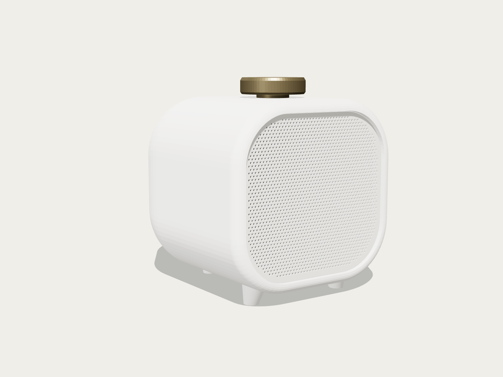

# Skjold Røst Myk (utkast)

Et nytt design for Røst: en liggende høyttaler med myk, avrundet kropp, finmasket grill foran og messingknott på toppen.
Den har ingen skjerm og ingen knapper. Alt styres med knotten og fra appen.

**Dette er et formutkast.** Kroppen, grillen og knotten er tegnet og tette, men delingen for utskrift, festene for
elektronikken og lydkammeret er ikke regnet ferdig. Ikke print den for å bygge en høyttaler ennå.



Bilder: [skrå](render/01_skra.png) · [kveldslys](render/02_kveld.png) · [forfra](render/03_front.png) · [siden](render/04_side.png) · [bakfra](render/05_bak.png) · [ovenfra](render/06_topp.png) · [snitt](render/07_snitt.png)

## Form

- **Kropp:** 128 × 150 × 131 mm (B × D × H med føtter). Tverrsnittet er et avrundet rektangel (128 × 122 mm, R40).
  Forkanten er rundet med R7, og bakenden er rundet som en halv ellipse over 52 mm.
- **Grill:** en 1,4 mm plate som ligger 3 mm inn fra forkanten, med 1 959 runde hull (Ø1,5 mm, 2,4 mm mellom, i
  trekantmønster). Rundt grillen står en 7,5 mm kant av kroppen.
- **Knott:** messingfarget, Ø44 × 11 mm, på en lav hals 50 mm inn fra forkanten.
- **Føtter:** to små foran og én bred bak. De løfter kroppen 9 mm.
- **Bak:** bassrefleksport (Ø18), DC-kontakt og USB-C.

## Tenkt innmat

Samme elektronikk som [Røst Rund](../rost_rund/LES_MEG.md): 3″ fullrange (Dayton RS75-4), ESP32-S3, PCM5102A, TPA3118 og
EC11 under knotten. Uten skjerm og knapper: trykk på knotten for spill og pause, og velg kanal i appen.

Lydkammeret er ca. 1,5 liter før elektronikk og port (Røst Rund har ca. 1,1 liter).

## Bygg modellen

```bash
python3 lag_myk.py
```

Krever `openscad`, `trimesh` og `manifold3d`. Skriver delene til `stl/` og sjekker at de er tette. Grillen lages i
skriptet, fordi nesten 2 000 hull er for tungt for OpenSCAD.

## Ikke gjort ennå

- Deling for utskrift. Kroppen er ett stykke med lukket bakende, og må deles eller printes stående på forkanten.
- Fester for frontplata, grillen, elementet, kretskortene og EC11.
- Portlengde og avstemming.
- Lysring eller annen visning av status, siden den ikke har skjerm.
- Fastvareoppsett uten skjerm og knapper.
- 3MF-filer for skriveren.
