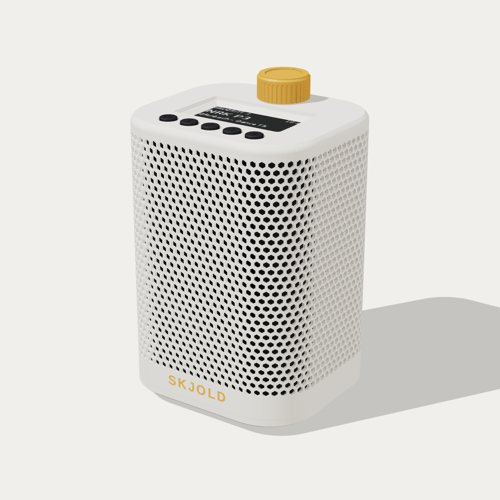

# Skjold Røst Rund

En alternativ Røst: avrundet kropp med grill hele veien rundt, fem knapper og gullknott på toppen. Samme elektronikk
og fastvare som [Skjold Røst](../rost/LES_MEG.md) (ESP32-S3, PCM5102A, TPA3118, 3″ fullrange, squeezelite-esp32),
men laget for stua, ikke badet: grillen er åpen hele veien rundt.

Bilder: [skrå](render/rund_skra.png) · [mørk utgave](render/rund_skra_mork.png) · [forfra](render/rund_front.png) · [toppen](render/rund_topp.png) · [bakfra](render/rund_bak.png)

## Form

- **Grunnriss:** avrundet rektangel 108 × 96 mm med R28 i hjørnene, loddrette sider, høyde 150 mm (+ 6 mm gummiføtter).
- **Grillen:** en løs hylse som går rundt hele kroppen, med Skjolds sekskantmønster (2 507 hull, 3,2 mm over flatene, en
  spiss opp). Nederst et helt bånd på 14,5 mm med **SKJOLD** innfelt i gull foran, øverst et smalt bånd under lokket.
  Bak nede en spiss utsparing rundt DC-kontakten og USB-C.
- **Toppen:** lokk med R4-kant, fem knapper foran (av/på, favoritt 1–4, pregede ikoner), **2,42″ OLED-skjerm** i midten
  bak en klar rute i flukt med toppen, og gull volumknott (EC11, Ø28) bak.

## Skjermen

Samme modul som Røst: 2,42″ OLED 128×64 (SSD1309, I²C, hvit), aktivt område 55,4 × 27,7 mm. Lokket er bare 5 mm, så det
har en skjermramme på undersiden som gir 7,5 mm fra toppen til glasset (som på Røst): forsenkning for ruta (64 × 36 × 1,5
mm akryl eller klar PETG, med 0,2 mm tape), vindu med 45° fas, lomme for glasset (60 × 30,5 × 3,25 mm) og flatkabelen, og
fire tårn der kortet skrus fast med M2 × 6 selvgjengende. Pinneraden vender bakover mot knotten, flatkabelen foran mot
knappene. Kobling og fastvare som Røst (I²C på GPIO11/12).
- **Kjernen** (mørk) synes gjennom hullene, så grillen får dybde. Lys hylse og lokk med mørk kjerne er standard; alt i
  mørkt med gullknott og gull logo er den andre fargekombinasjonen (bytt filamentene i sliceren).

## Oppbygging

| Del | Hva | Print |
|---|---|---|
| Lokk | topp med knappehull, skjermvindu og skjermramme, EC11-hull, krage ned i kjernen, tårn med M3-innpressmuttere | toppen ned, ingen støtte (se under) |
| Rute | klar rute over skjermen | flat, klar PETG, 100 % fyll (eller kjøp 1,5 mm akryl) |
| Kjerne | rør med frontblokk (elementet monteres bakfra), tunnel Ø74, stangtårn med ribber, DC- og USB-hull bak | stående, ingen støtte (frontblokka er 45° over og under) |
| Hylse | grillen | stående, ingen støtte |
| Bunn | bunnplate med bassrefleksport (Ø18 × 110 mm) opp i kammeret, avstandstapper for elektronikken, mutterlommer og forsenkninger for føttene | undersiden ned |
| Knott, knapper | som på Røst | toppen ned |

Alt holdes sammen av **fire M3-gjengestenger** fra innpressmutterne i lokket, ned gjennom tårnene i kjernen og ut
gjennom bunnplaten, med mutter i lommen under. Gummiføttene sitter rett over mutterne, så ingen skruer synes.

## Utskrift

Beste retning for hver del, og hvorfor ingen trenger støtte (innstillingene ligger som objektinnstillinger i 3MF-filene,
så Creality Print / OrcaSlicer henter dem selv):

- **Lokket: toppen ned.** Alt på undersiden (krage, tårn, skjermramme, knappekortets tapper) peker da opp. Glasslomma og
  flatkabelsporet blir åpne lommer øverst, vinduets fas er 45°, og rutas forsenkning ligger mot platen (en kant på 1,6 mm
  over den er en kort bro). Toppen får platens overflate: glatt PEI gir blank topp, teksturert PEI matt. Sakte første lag
  (20 mm/s) og elefantfot-kompensasjon 0,15 mm gir skarpe kanter rundt ruta og knappehullene. Toppen kan ikke printes opp:
  da må alt på undersiden ha støtte.
- **Ruta:** flat, klar PETG, 100 % fyll, én vegg og ingen topp-/bunnlag (klarest), sakte. Akryl 1,5 mm er klarere.
- **Kjernen: stående.** Frontblokka er 45° over og under, tunnelen er rund i en loddrett vegg (kort bro på toppen).
- **Hylsa: stående.** Sekskanthullene har en spiss opp (sidene 30° fra loddrett).
- **Bunnen: undersiden ned.** Porten og tappene peker opp.
- **Knapper og knott: toppen ned.**

## Lyd

- Lydkammer: ca. 1,04 l luft, ca. 0,94 l netto med element og elektronikk.
- Bassrefleks: port Ø18 × 110 mm, ned gjennom bunnen (føttene gir 6 mm luft) → ca. 81 Hz. Beregnet, ikke målt.
- Elementet sitter bak en 16 mm frontblokk med tunnel Ø74 og skrus med 4 × M3 × 25 forfra (senkehodene ligger under hylsa).

## Deler (i tillegg til Røst-elektronikken)

| Del | Antall |
|---|---|
| M3 gjengestang 150 mm (eller kapp en 1 m-stang) | 4 |
| M3 mutter + skive | 4 |
| M3 innpressmutter Ø4,0 × 5,5 | 4 |
| M3 × 25 senkeskrue + mutter (elementet) | 4 |
| Taktbryter 6 × 6 × 5 mm på hullkort (ca. 70 × 14 mm), 2 × M2-skruer | 5 |
| EC11 med trykk + mutter | 1 |
| 2,42″ OLED 128×64 SSD1309 (I²C, hvit) | 1 |
| M2 × 6 selvgjengende (skjermkortet) | 4 |
| Akryl 1,5 mm, 64 × 36 mm (eller printet klar rute) | 1 |
| Selvklebende gummiføtter Ø12 × 6 mm | 4 |
| Dempeull i kammeret | litt |

## Filer

- `skjold_rost_rund.scad` – lokk, kjerne, bunn, knott, knapper, logo (OpenSCAD)
- `lag_rund.py` – eksporterer alt, lager grillhylsa (manifold3d), sjekker modellen og skriver K2-platene:
  - `skjold-rost-rund-k2-kjerne.3mf` – kjerne, knapper (mørk) og knott (gull)
  - `skjold-rost-rund-k2-hylse.3mf` – grillhylsa (lys) med SKJOLD (gull)
  - `skjold-rost-rund-k2-lokk-bunn.3mf` – lokk med skjermramme og bunnplate (lys), og ruta (klar PETG)
- Kontrollen i `lag_rund.py`: alle deler tette og ett legeme, ingen overlapp i montert stilling, ingen overheng
  brattere enn 50° på yttersidene, alt får plass på 250 × 250 mm, og lydkammer/porttuning innenfor 0,85–1,4 l og 65–95 Hz.

## Montering

1. Press innpressmutterne inn i lokkets fire tårn. Lodd knappekortet og skru det på tappene under lokket; sett hettene i hullene først.
2. Skru EC11 fast i lokket (mutter under), sett på knotten.
3. Skru elementet fast bak frontblokka i kjernen med M3 × 25 forfra (mutter bak rammen).
4. Monter elektronikken på avstandstappene i bunnplaten: DC og USB-C mot hullene bak i kjernen.
5. Sett kjernen på bunnplaten, træ hylsa utenpå (utsparingen bak), og legg på lokket.
6. Skru gjengestengene ned gjennom lokket, kjernen og bunnen, og stram mutterne nedenfra. Sett på gummiføttene.
