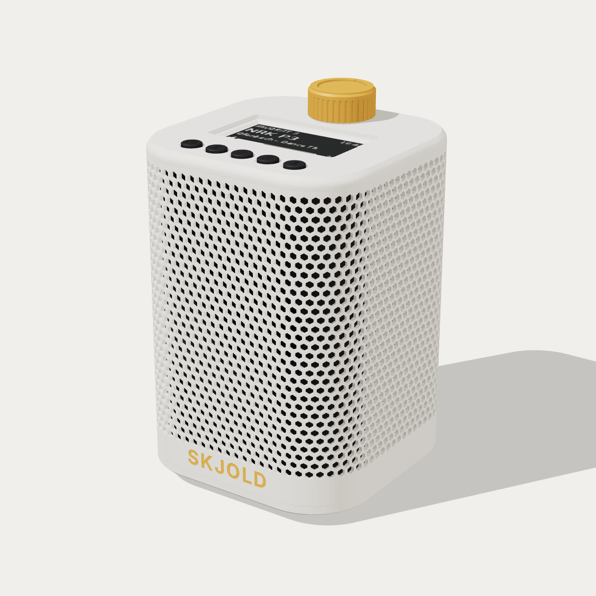
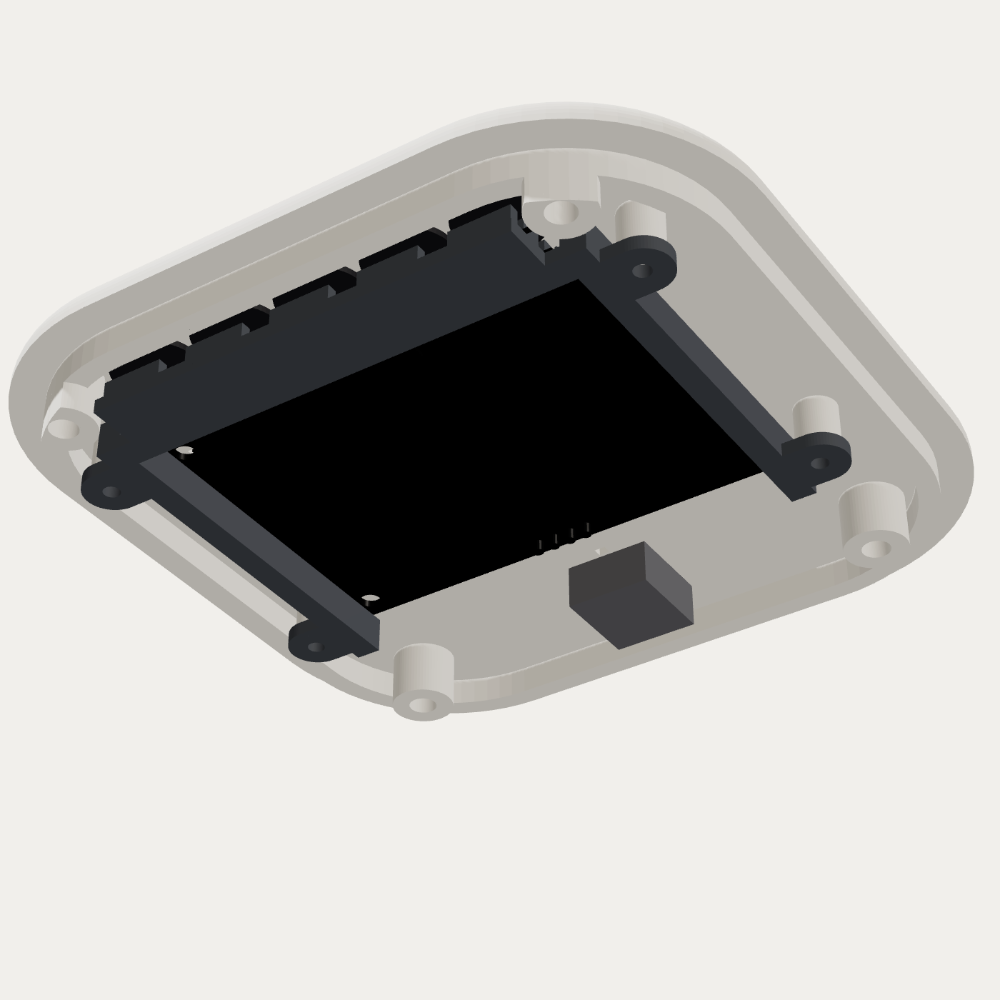
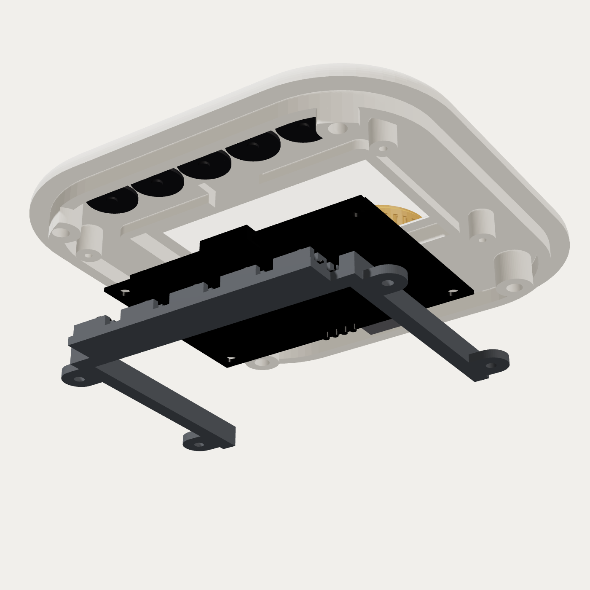

# Skjold Røst Rund

En alternativ Røst: avrundet kropp med grill hele veien rundt, fem knapper og gullknott på toppen. Samme elektronikk
og fastvare som [Skjold Røst](../rost/LES_MEG.md) (ESP32-S3, PCM5102A, TPA3118, 3″ fullrange, squeezelite-esp32),
men laget for stua, ikke badet: grillen er åpen hele veien rundt.

Bilder: [skrå](render/rund_skra.png) · [mørk utgave](render/rund_skra_mork.png) · [forfra](render/rund_front.png) · [toppen](render/rund_topp.png) · [bakfra](render/rund_bak.png) · [under lokket](render/rund_under.png) · [knappeholderen tatt ut](render/rund_under_ut.png)

## Form

- **Grunnriss:** avrundet rektangel 108 × 108 mm med R28 i hjørnene, loddrette sider, høyde 150 mm (+ 6 mm gummiføtter).
- **Grillen:** en løs hylse som går rundt hele kroppen, med Skjolds sekskantmønster (2 667 hull, 3,2 mm over flatene, en
  spiss opp). Nederst et helt bånd på 14,5 mm med **SKJOLD** innfelt i gull foran, øverst et smalt bånd under lokket.
  Bak nede en spiss utsparing rundt DC-kontakten og USB-C.
- **Toppen:** lokk med R4-kant, fem knapper foran (av/på, favoritt 1–4, pregede ikoner), **2,42″ OLED-skjerm** i midten
  bak en klar rute i flukt med toppen, og gull volumknott (EC11, Ø30) bak. Under lokket holder en printet knappeholder
  både bryterne og skjermen, uten hullkort og uten skruer i skjermen.
- **Kjernen** (mørk) synes gjennom hullene, så grillen får dybde. Lys hylse og lokk med mørk kjerne er standard; alt i
  mørkt med gullknott og gull logo er den andre fargekombinasjonen (bytt filamentene i sliceren).

## Fester under lokket

- **Knappeholderen** (`stl/knappeholder.stl`): én printet del som holder både de fem bryterne og skjermen. Den skrus i
  fire tapper under lokket (x = ±40 mm, utenfor skjermkortet) med 4 × M2 × 6 selvgjengende. Se [Knappeholderen](#knappeholderen).
- **Skjermen:** glasset ligger i en lomme i skjermrammen under lokket, og kortet klemmes opp mot rammen av knappeholderens
  to skinner. Ingen skruer i skjermen. Se [Skjermen](#skjermen).
- **Volumhjulet (EC11):** huset under lokket, halsen gjennom lokket, og mutteren i en forsenkning i toppen under
  knotten. Låsetappen går i en blind spalte, så den ikke kan vri seg.
- **Stengene:** fire tårn med M3-innpressmuttere i hjørnene.

## Skjermen

Samme modul som Røst (2,42″ OLED 128×64, SSD1309, I²C, hvit), og lokket er tilpasset de samme målene fra tegningen. Alle
er parametere øverst i `skjold_rost_rund.scad`; se tabellen i [Røst sin LES_MEG](../rost/LES_MEG.md#skjermen) for hva
som er målsatt og hva som er tolket.

| Mål | Verdi |
|---|---|
| Kort (`pcbW` × `pcbH` × `pcbT`) | 70,08 × 48,04 × 1,00 mm, 5,25 mm tykk med glass |
| Glass (`glW` × `glH`) | 62,64 × 39,18 mm |
| Aktivt område (`actW` × `actH`) | 55,40 × 27,78 mm (128 × 64), 2,32 mm mot pinneraden i glasset (`aaOffV`, tolket) |
| Flatkabelen (`fpcW`, `fpcL`) | 12,64 mm bred, ca. 2 mm ut over nedre kant (tolket) |
| Pinneraden (`hdrN`, `hdrFraKant`) | 4 × 2,54 mm, ca. 2,3 mm fra øvre kant (tolket) |

Slik sitter den:
- Lokket er bare 5 mm, så det har en **skjermramme** på undersiden (69,4 × 46,0 mm) som gir 7,5 mm fra toppen til
  kortet, som på Røst. Glasset ligger i en **lomme** i rammen (0,4 mm klaring rundt, 0,15 mm over glasset), og kortet
  ligger flatt mot undersiden av rammen. Rammen har utsparinger for **flatkabelen** (foran) og **pinnestumpene** i
  pinneraden (bak).
- **Vinduet** er 56,6 × 29,0 mm (det aktive området + 0,6 mm rundt, innenfor det synlige området), sentrert over det
  aktive området, med 45° fas opp mot ruta (64 × 36 × 1,5 mm akryl eller klar PETG på 0,2 mm tape, i flukt med toppen).
  Hyllen ruta ligger på er 1,4 mm.
- Det aktive området står omtrent midt mellom knapperaden og knotten (y = −4 mm, 2 mm lenger bak enn før, så
  flatkabelen går klar av knappehettene). Pinneraden vender bakover mot knotten, flatkabelen foran mot knappene.
- **Ingen skruer:** knappeholderens to skinner ligger under de ytterste 2 mm av kortet på hver side (x = ±33,0…35,0,
  utenfor hullene) og trykker det opp mot rammen med en klemribbe på 0,1 mm. Der må baksiden av kortet være fri for
  komponenter. Hullene i kortet brukes ikke.
- **Mål din modul før du printer:** hvor langt det er fra kortets nedre kant (flatkabelsiden) til det aktive området.
  Avviker det, juster `glOffV`/`aaOffV` (vinduet følger det aktive området, og lomma, kortet og skinnene følger med).
- Kobling og fastvare som Røst (I²C på GPIO11/12). **Lodd ledningene rett på kortet fra baksiden** (ingen pinner), og
  før dem ned mellom skinnene.

## Knappeholderen

Ingen hullkort: de fem taktbryterne (6 × 6 × 5 mm) sitter i en printet holder (`stl/knappeholder.stl`, 88 × 64 × 5,3 mm,
ca. 6 g PETG/ASA), som skrus under lokket:
- **Lommene:** 6,4 mm firkantede lommer med fire klemribber (5,9 mm mellom), så bryterhuset sitter med presspasning.
  Bryteren står på bunnen av lomma, med stempelet 0,2 mm under nuppen på hetten, så hetten gir et rent klikk og kan
  trykkes 0,25 mm forbi klikket uten å treffe noe annet.
- **Beina:** snu bryteren så beina peker mot sidene (mot nabobryterne), og bøy alle fire rett ut før bryteren trykkes
  ned. Sporene i lommeveggene tar dem.
- **Ledninger:** beina som står rett overfor hverandre er koblet sammen inne i bryteren, så de to fremre beina er den ene
  polen og de to bakre den andre (sjekk med et multimeter at det stemmer for dine brytere).
  - **GND:** legg en bar, fortinnet tråd over de fremre beina på alle fem bryterne, og lodd. Det er GND-bussen. Før enden
    bakover gjennom sporet lengst til venstre i kammen bak lommene.
  - **Signal:** lodd én ledning på det bakre høyre beinet på hver bryter, og legg den i sporet i kammen rett bak.
    **Klipp av det bakre venstre beinet**, så det ikke kan berøre nabobryterens signalbein.
  - Lodd raskt (PETG/ASA tåler kort varme), eller lodd bussen før bryterne trykkes helt ned.
- **Skinnene:** to skinner går bakover fra lommelista, under kantene av skjermkortet, og klemmer det opp mot
  skjermrammen. Holderen går klar av stangtårnene, kragen, EC11 og elementplatas krage.
- **Festet:** fire ører nederst på holderen (2 mm), skrudd i lokkets fire tapper (Ø6 med Ø1,8-hull) med M2 × 6
  selvgjengende.
- **Printes** med bunnen ned, uten støtte. Ingen overheng.
- **Hullkort i stedet:** sett `knappefeste = "hullkort"`. Da får holderen et dekk (2 mm) i stedet for lommene, og
  bryterne loddes på et hullkort 64 × 20 mm som skrus på dekket med 2 × M2 × 6 selvgjengende (hullene 59 mm fra
  hverandre, 9 mm bak knapperaden). Skinnene og festet er de samme, så skjermen holdes fortsatt uten skruer.

### Med hullkort

Har du bryterne på et hullkort i stedet, bruk filene i `stl/hullkort/`: `lokk.stl` og `knappeholder.stl` (med dekk for
kortet). Knappene står da **12,7 mm** fra hverandre (5 hull à 2,54 mm), så bryterne passer rett i hullrutenettet:

- Hullkort **64 × 20 mm**. Midterste bryter midt på kortet, de andre 5 og 10 hull til hver side. Bryterne står 7 mm fra
  forkanten av kortet (knappesiden).
- To skruehull for M2 × 6: **12 hull ut fra midten** til hver side, og **4 hull bak** knapperaden. Bor dem opp til Ø2,2.
- Kortet skrus på holderens dekk, og holderen skrus i lokket med 4 × M2 × 6 som ellers. Skjermen klemmes av de samme
  skinnene.
- I OpenSCAD: `knappefeste = "hullkort"` gir de samme filene.

## Oppbygging

| Del | Hva | Print |
|---|---|---|
| Lokk | topp med knappehull, skjermvindu og skjermramme, EC11-hull, krage ned i kjernen, tårn med M3-innpressmuttere | toppen ned, trestøtte, brim og store museører (se under) |
| Rute | klar rute over skjermen | flat, klar PETG, 100 % fyll (eller kjøp 1,5 mm akryl) |
| Kjerne | rør med frontblokk (elementet monteres bakfra), tunnel Ø74, stangtårn med ribber, DC- og USB-hull bak | stående, ingen støtte (frontblokka er 45° over og under) |
| Hylse | grillen | stående, ingen støtte |
| Bunn | bunnplate med bassrefleksport (Ø18 × 110 mm) opp i kammeret, avstandstapper for elektronikken, mutterlommer og forsenkninger for føttene | undersiden ned |
| Knott, knapper | som på Røst | toppen ned |
| Knappeholder | lommer for de fem bryterne, kam for ledningene, skinner som klemmer skjermkortet, fire ører for M2 | bunnen ned, ingen støtte |

Alt holdes sammen av **fire M3-gjengestenger** fra innpressmutterne i lokket, ned gjennom tårnene i kjernen og ut
gjennom bunnplaten, med mutter i lommen under. Gummiføttene sitter rett over mutterne, så ingen skruer synes.

## Utskrift

**Museører, brim og støtte:** `skjold-rost-rund-k2-lokk.3mf` og `skjold-rost-rund-k2-bunn.3mf` (hver sin plate, så brimmen får plass) har store museører på lokket og bunnplata (0,6 mm, Ø36 i hjørnene og Ø24 på sidene) og 6 mm brim, så de avrundede hjørnene ikke løsner fra plata. **Lokket har trestøtte** (bare fra plata, 40°) under skjermrammen og kragen. Støtte, brim og ører ligger som objektinnstillinger i 3MF-filen. Hylsefilene har mindre ører (Ø24/Ø16, bare utenfor veggen) i tillegg til 5 mm brim. Ørene er en del av samme modell, så det blir ingen fargebytter. Vri eller skjær dem av, og fjern støtten, etter print.

Beste retning for hver del, og hvorfor ingen trenger støtte (innstillingene ligger som objektinnstillinger i 3MF-filene,
så Creality Print / OrcaSlicer henter dem selv):

- **Lokket: toppen ned.** Alt på undersiden (krage, tårn, skjermramme, knappeholderens tapper) peker da opp. Glasslomma og
  flatkabelsporet blir åpne lommer øverst, vinduets fas er 45°, og rutas forsenkning ligger mot platen (en kant på 1,6 mm
  over den er en kort bro). Toppen får platens overflate: glatt PEI gir blank topp, teksturert PEI matt. Sakte første lag
  (20 mm/s) og elefantfot-kompensasjon 0,15 mm gir skarpe kanter rundt ruta og knappehullene. Toppen kan ikke printes opp:
  da må alt på undersiden ha støtte.
- **Ruta:** flat, klar PETG, 100 % fyll, én vegg og ingen topp-/bunnlag (klarest), sakte. Akryl 1,5 mm er klarere.
- **Kjernen: stående.** Frontblokka er 45° over og under, tunnelen er rund i en loddrett vegg (kort bro på toppen).
- **Hylsa: stående.** Sekskanthullene har en spiss opp (sidene 30° fra loddrett).
- **Bunnen: undersiden ned.** Porten og tappene peker opp.
- **Knapper og knott: toppen ned.**
- **Knappeholderen: bunnen ned.** Alt står rett opp fra platen (lommer, kam, skinner), ørene ligger på platen. Ingen
  overheng og ingen støtte. Den ligger på kjerneplata (mørk).

## Lyd

- Lydkammer: ca. 1,23 l luft (knappeholderen trukket fra), ca. 1,13 l netto med element og elektronikk.
- Bassrefleks: port Ø18 × 110 mm, ned gjennom bunnen (føttene gir 6 mm luft) → ca. 74 Hz. Beregnet, ikke målt.
- Elementet skrus i en **utskiftbar elementplate** (92 × 92 × 4 mm, tegnet fra malen i [../elementer](../elementer/LES_MEG.md)), som skrus bak frontblokka med 4 × M3 × 10 i innpressmuttere. Tunnelen gjennom blokka er fast (Ø80, dråpeformet med 45° spiss oppe så den printes uten støtte), men plata har en **krage som fyller hele tunnelen**: åpningen ved elementet er nøyaktig elementets utsparing (Ø54 for RS75-4) og vider seg ut i 45° mot fronten. Elementet skrus bakfra med M3 i innpressmuttere i plata. Plata printes med baksiden ned og kragen opp, uten støtte. Standard er Dayton RS75-4; `skjold-rost-rund-k2-elementplater.3mf` har plater for fire elementer.

## Deler (i tillegg til Røst-elektronikken)

| Del | Antall |
|---|---|
| M3 gjengestang 150 mm (eller kapp en 1 m-stang) | 4 |
| M3 mutter + skive | 4 |
| M3 innpressmutter Ø4,0 × 5,5 | 4 |
| M3 × 25 senkeskrue + mutter (elementet) | 4 |
| Taktbryter 6 × 6 × 5 mm (THT, 4 bein), trykkes ned i knappeholderen | 5 |
| M2 × 6 selvgjengende (knappeholderen i lokket) | 4 |
| Tynn fortinnet kobbertråd (GND-bussen) + 6 tynne ledninger (28–30 AWG) | – |
| EC11 med trykk + mutter | 1 |
| 2,42″ OLED 128×64 SSD1309 (I²C, hvit) | 1 |
| Akryl 1,5 mm, 64 × 36 mm (eller printet klar rute) | 1 |
| Selvklebende gummiføtter Ø12 × 6 mm | 4 |
| Dempeull i kammeret | litt |

## Filer

- `skjold_rost_rund.scad` – lokk, kjerne, bunn, knott, knapper, knappeholder, logo (OpenSCAD). `knappefeste = "holder"`
  (standard) eller `"hullkort"`.
- `lag_rund.py` – eksporterer alt, lager grillhylsa (manifold3d), sjekker modellen og skriver K2-platene:
  - `skjold-rost-rund-k2-kjerne.3mf` – kjerne, elementplate, knappeholder, knapper (mørk) og knott (gull)
  - `skjold-rost-rund-k2-hylse.3mf` – grillhylsa (lys) med SKJOLD (gull, 1 mm innfelt). Hylsa og logoen er én modell med to deler (lys og gull), så logoen blir liggende i lomma si i sliceren. Ingen støtte trengs: sekskanthullene har spiss topp og utsparingen bak har 45° tak. Hylsa har 0,24 mm lag, to vegger og full fart på de små hullene. Det kutter mye av printetiden.
  - `skjold-rost-rund-k2-hylse-en-farge.3mf` – samme hylse i én farge, uten fargebytter. SKJOLD står felt 1 mm inn og kan fylles med gulltusj etterpå. Raskest.
  - `skjold-rost-rund-k2-lokk.3mf` – lokk med skjermramme (lys) og ruta (klar PETG)
  - `skjold-rost-rund-k2-bunn.3mf` – bunnplate med port (lys)
- Kontrollen i `lag_rund.py`: alle deler tette og ett legeme, ingen overlapp i montert stilling (også med skjermmodulen,
  bryterne og EC11), ingen overheng brattere enn 50° på yttersidene, alt får plass på 250 × 250 mm, og lydkammer/porttuning
  innenfor 0,85–1,4 l og 65–95 Hz. I tillegg, som `sjekk_modell.py` for Røst:
  - skjermen: kortet (70,08 × 48,04 mm) ligger i lomma uten kollisjon, hele det aktive området er synlig, vinduet går like
    langt (0,6 mm) utenfor det på alle fire sider, og skinnene klemmer kortet. Hyllen under ruta er minst 1,3 mm.
  - knappene: bryterne sitter med presspasning i lommene, luften mellom nupp og stempel er 0,20 mm på alle fem, og hettene
    kan trykkes 0,25 mm forbi klikket uten å treffe lokket, holderen, skjermen eller EC11.
  - knappeholderen har ingen overheng (printes uten støtte).
- Ikke testet (ingenting er printet): passformen til lomma og klemribbene (bryterne og skjermkortet), om baksiden av
  skjermkortet er fri for komponenter der skinnene ligger, klikket i knappene, og de tolkede målene på skjermmodulen.

## Montering

1. Press innpressmutterne inn i lokkets fire tårn. Legg lokket med **toppen ned** på et mykt underlag.
2. Sett EC11 inn nedenfra, med låsetappen i spalten, og skru mutteren på i forsenkningen i toppen. Sett på knotten til slutt.
3. Legg ruta i forsenkningen på toppen på tynn tape (eller lim).
4. Sett de fem knappehettene i hullene fra innsiden: av/på til venstre (sett forfra), så 1–4. Flensen holder dem.
5. Lodd fire ledninger rett på pinneraden på skjermkortet, fra baksiden. Legg skjermen med glasset ned i lomma i
   skjermrammen, med pinneraden bakover (mot knotten) og flatkabelen fremover (mot knappene).
6. Gjør klar knappeholderen (se [Knappeholderen](#knappeholderen)): bøy beina ut, trykk bryterne ned i lommene med
   stempelet opp, lodd GND-bussen over de fremre beina og én signalledning på hver bryter, klipp det bakre venstre beinet
   og legg ledningene i kammen.
7. Legg knappeholderen på, med bryterne mot hettene og skinnene under kantene av skjermkortet, og skru den fast i de fire
   tappene med M2 × 6. Skinnene trykker skjermkortet mot rammen. Sjekk at alle fem knappene klikker.
8. Skru elementet fast bak frontblokka i kjernen med M3 × 25 forfra (mutter bak rammen).
9. Monter elektronikken på avstandstappene i bunnplaten: DC og USB-C mot hullene bak i kjernen.
10. Sett kjernen på bunnplaten, træ hylsa utenpå (utsparingen bak), og legg på lokket. Før ledningene fra skjermen og knappene ned til ESP32 i bunnen.
11. Skru gjengestengene ned gjennom lokket, kjernen og bunnen, og stram mutterne nedenfra. Sett på gummiføttene.

Første oppstart er som for [Skjold Røst](../rost/LES_MEG.md#første-oppstart): sett den opp fra Skjold-appen (Rom → **Legg til enhet → Skjold Røst**), eller koble til **Skjold-Rost** (passord `squeezelite`) og åpne `192.168.4.1`.
