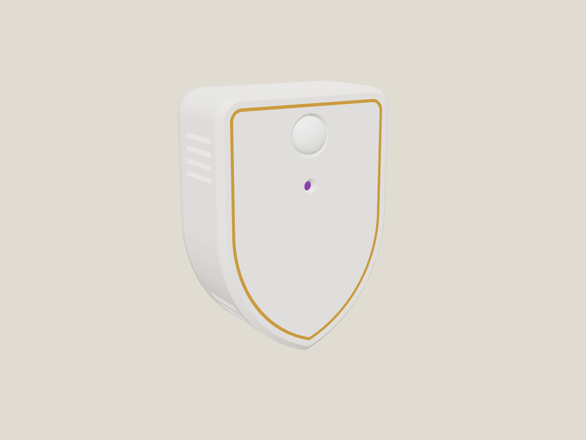
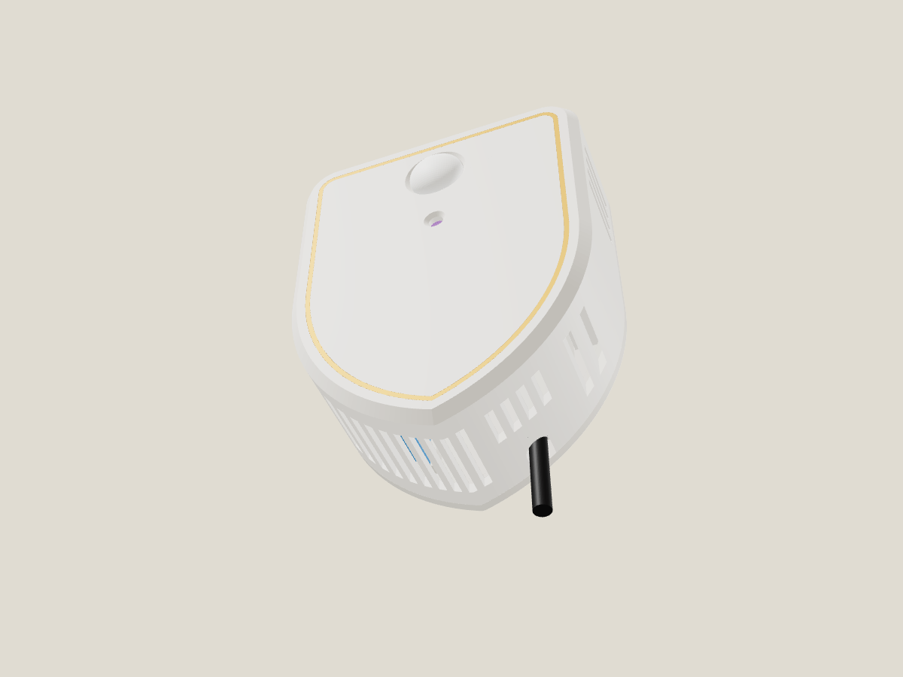
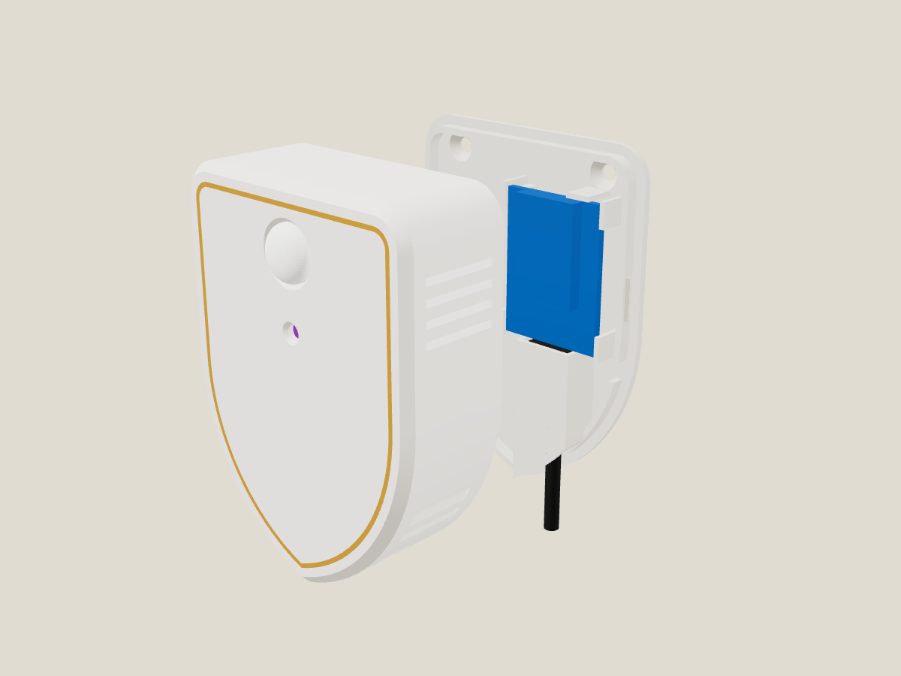
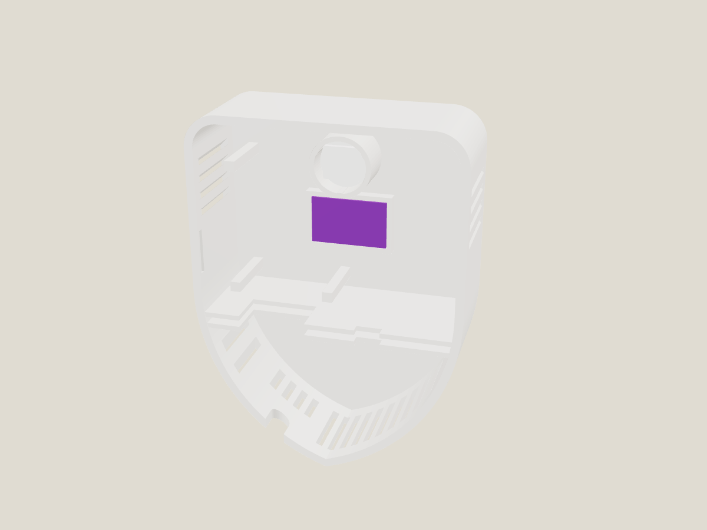
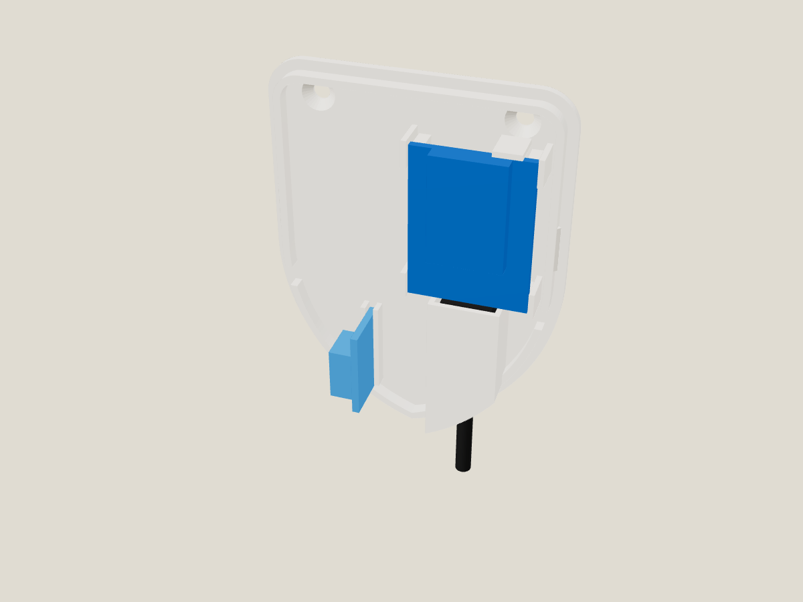

# Skjold Sans – multisensor for vegg

Bevegelse, temperatur, fuktighet og lys i et skjoldformet kabinett på 64 × 86 × 28 mm, laget for å tåle bad. Det
passer delene fra en vanlig D1 mini-multisensor: Wemos D1 mini, AM312 PIR, en temperatur- og fuktsensor (SHT40
anbefalt) og et lite lyskort.



## Formen

- **Et skjold:** flat topp med runde hjørner, rette sider og to buer som møtes i en spiss nede.
- **Forkant og gullkant:** forkanten har en 2 mm fas, og en tynn gullkant følger omrisset 4 mm inne i fronten.
  Gullkanten printes i samme jobb som kroppen.
- **Fronten:** PIR-kuppelen sitter øverst i midten, lysvinduet under. Ellers er fronten ren, uten spalter eller
  skruer.
- **Lameller oppe på sidene** for varmen fra ESP-en.
- **Spalter i spissen** som peker rett ned, for sensorkammeret.



## Innsiden

- **Sensorkammeret ligger i spissen,** under et dobbelt tak (to vegger med luftspalte). Spissens buer vender nedover,
  så spaltene der peker rett ned. Romluft kommer inn nedenfra, og vannsprut kan ikke falle inn.
- **D1 mini står over taket.** ESP-modulen vender fram, og USB-kontakten vender bak og ned.
- **Kabelen går i en lukket kanal** langs bakplata, gjennom kammeret og ut nederst. Kanalen er også luftinntaket
  for ESP-rommet. Varmen går ut gjennom lamellene oppe på sidene, altså bort fra sensoren.
- **Bakplata skrus i veggen** og holder D1 mini, kabelkanalen og sensorkortet. Kroppen klikkes på (to rygger) og
  trekkes rett ut for service.
- **Alt printes uten støtte.** Kroppen printes med forsiden ned, bakplata med baksiden ned. Kabelkanalens tak er en
  bro på 13 mm, som K2 klarer fint.



## Deler

| Del | Antall | Merknad |
|---|---|---|
| Wemos D1 mini (ESP8266) | 1 | ESP-modulen fram, USB-kontakten ned mot bakplata |
| AM312 mini-PIR | 1 | kuppel ca. Ø12, trykkes inn i røret bak hullet (tre ribber holder den, en dråpe lim om den er løs) |
| **SHT40**-modul (anbefalt), eller SHT31 / BME280 / DHT11 | 1 | står i sporet i kammeret med sensoren mot venstre. Kort inntil ca. 23 mm |
| BH1750 (GY-302) eller TEMT6000 | 1 | i rammen bak lysvinduet. Rammen er 11,5 × 18,5 mm: **mål ditt kort** og endre `lysB`/`lysL` |
| Micro-USB-kabel med rett plugg + 5 V-lader | 1 | pluggen (inntil 11 × 7 × 17 mm) står i kabelkanalen |
| Senkeskrue Ø3–3,5 × 25 + plugg | 2 | bakplata i veggen (eller dobbeltsidig monteringstape) |

**På bad: bytt ut DHT11.** Den måler bare 20–80 %RH (±5 %) og henger seg opp etter dusjing. SHT40 måler 0–100 %RH
(±1,8 %), tåler kondens og koster omtrent det samme.

## Utskrift (Creality K2)

`skjold-sans-k2.3mf` har kropp og bakplate på én plate. Innstillingene ligger i fila (ingen støtte, sakte første
lag).

- **Kropp:** lys PETG/ASA, forsiden ned. Gullkanten er filament 3, så det blir ett filamentbytte i de første lagene.
- **Bakplate:** lys PETG/ASA, baksiden ned.
- Bruk **PETG eller ASA på bad**, ikke PLA. PLA blir myk av varm, fuktig luft over tid.
- Ca. 17 g + 11 g.

## Montering

1. Lodd ledninger på sensorene og D1 mini (se kobling under). Hold dem korte.
2. Sett USB-pluggen i D1 mini. Legg kortet i holderen på bakplata, med ESP-modulen fram, mellom de fire
   hjørnestøttene. Pluggen går ned i kabelkanalen og kabelen ut i bunnen.
3. Sett sensorkortet i sporet i kammeret, med sensoren mot venstre. Ledningene går opp gjennom åpningen i taket ved
   bakkanten.
4. Trykk PIR-en inn i røret bak hullet, og lyskortet inn i rammen bak lysvinduet (i kroppen).
5. Skru bakplata i veggen og klikk kroppen på.

**Plassering på bad:** utenfor sone 1 og 2 (ikke over badekar eller i dusjen), helst høyt på veggen ved døra, der
PIR-en ser hele rommet. Laderen skal sitte i en vanlig stikkontakt utenfor våtsonen.

 

## Kobling og fastvare

ESPHome-oppsettet ligger i [`esphome/skjold-sans.yaml`](../../esphome/skjold-sans.yaml) (SHT40 + BH1750 + AM312,
med DHT og TEMT6000 som kommenterte alternativer).

| D1 mini | Til |
|---|---|
| 3V3 | VCC på alle sensorene |
| G | GND på alle sensorene |
| D5 (GPIO14) | AM312 OUT |
| D2 (GPIO4) | SDA (SHT40, BH1750) |
| D1 (GPIO5) | SCL (SHT40, BH1750) |
| D6 (GPIO12) | DHT DATA (om du bruker DHT) |
| A0 | TEMT6000 SIG (om du bruker den) |

Ekstra for bad:
- **Dusj pågår:** slår seg på når fuktigheten er 8 %-poeng over snittet den siste timen, og holder 5 min etterpå.
  Fin til å styre avtrekksvifta.
- **Fuktstigning:** %-poeng per minutt. Gjør at vifta kan starte før speilet dugger.
- **Duggpunkt** og **absolutt fuktighet.**

Juster `temp_offset` mot et kjent termometer etter en times drift.

## Bygg selv

```bash
python3 lag_sans.py
```

Kommandoen eksporterer STL-ene, sjekker at delene er tette og ikke kolliderer (kjøpte deler er med), at det ikke er
overheng som trenger støtte, og skriver 3MF-fila. Målene står øverst i `skjold_sans.scad`.
