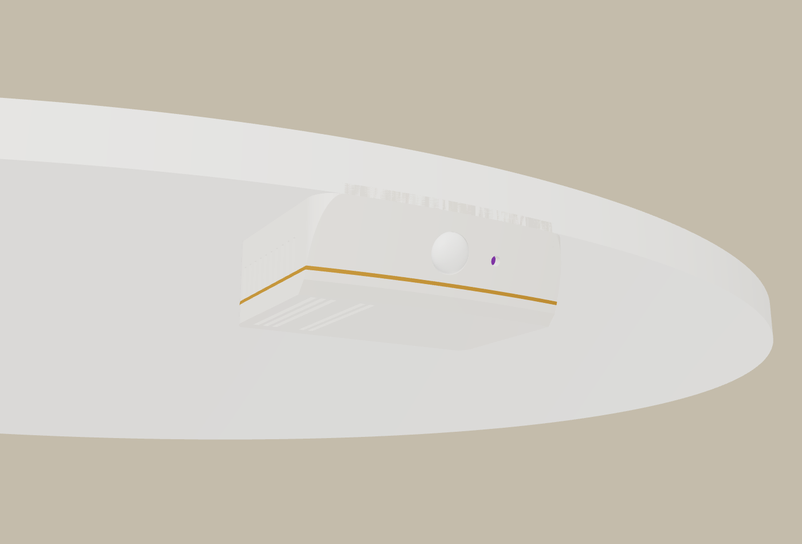
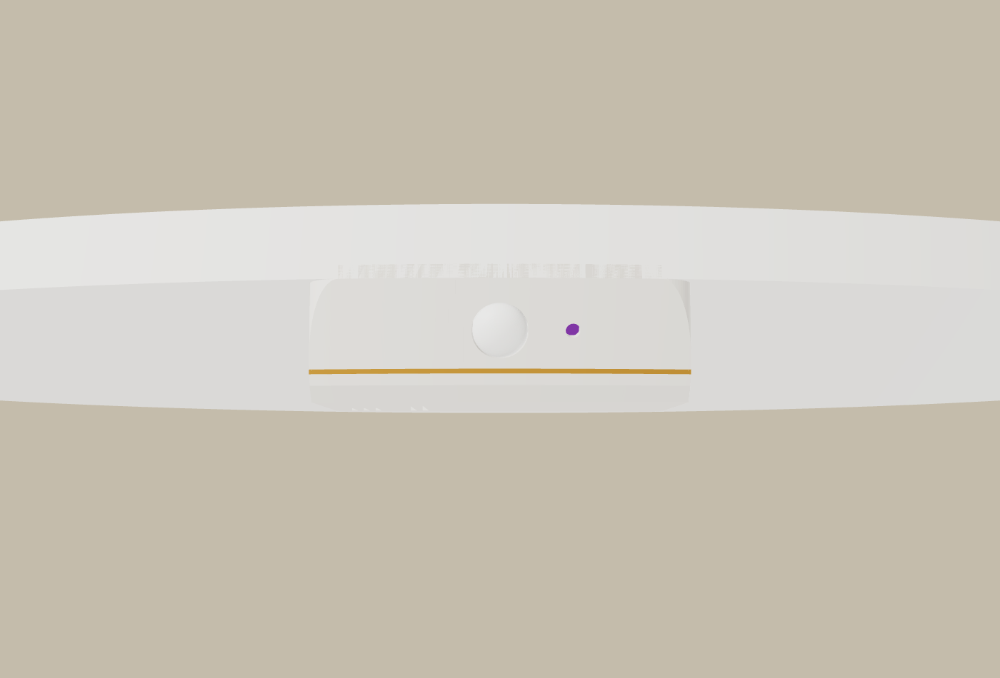
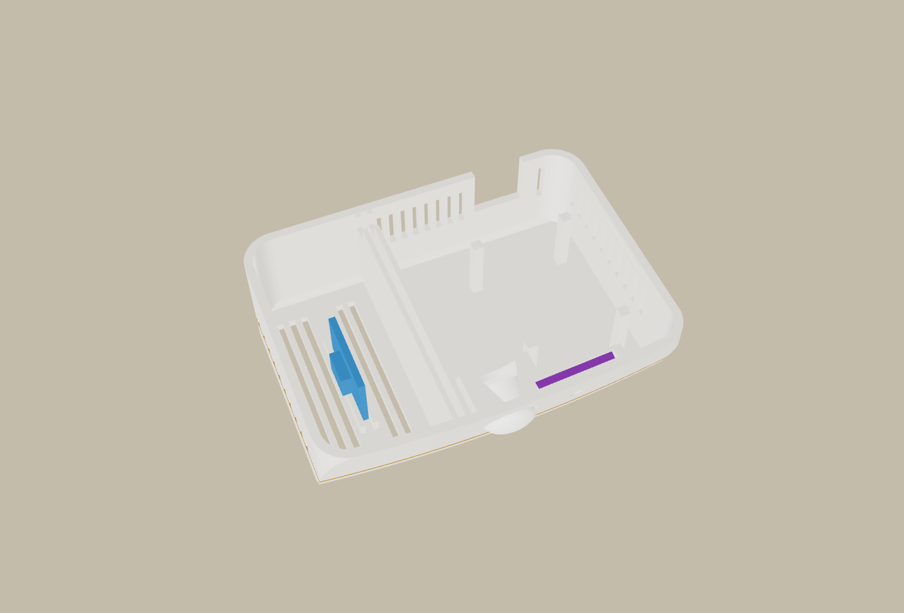
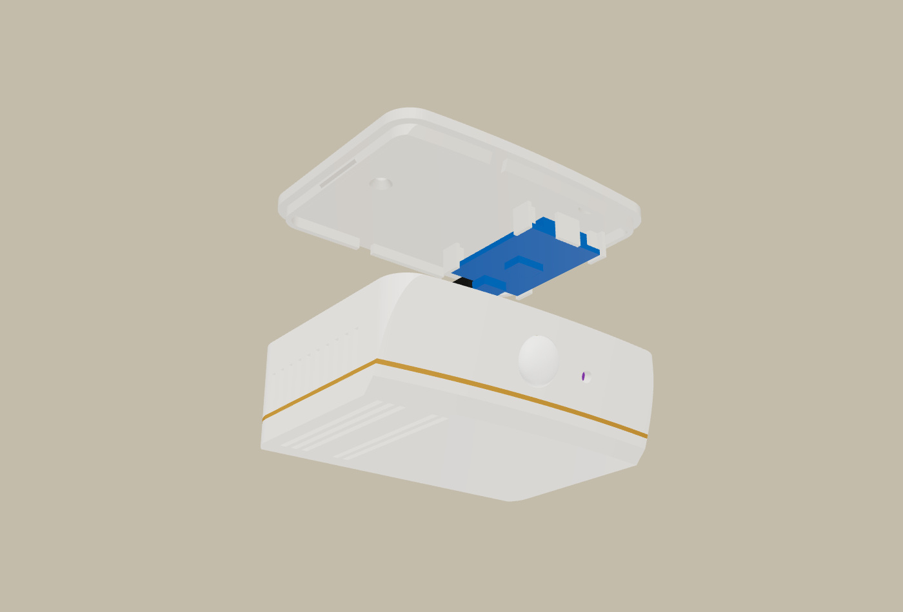
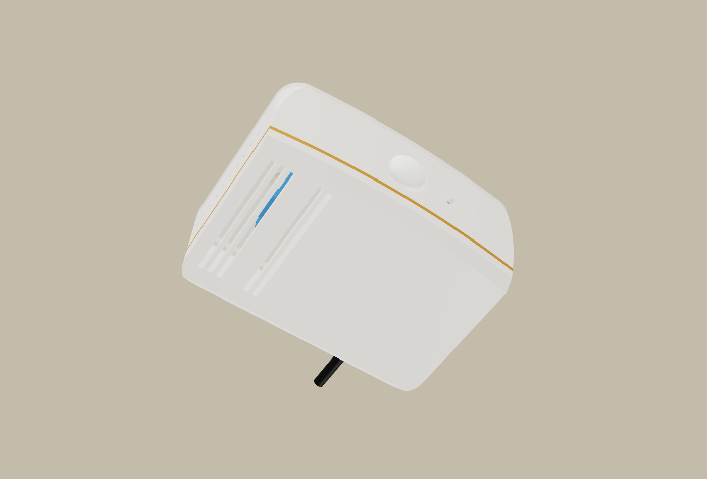

# Skjold Sans Hylle – multisensor under en hylle

Samme innmat som [Skjold Sans](../LES_MEG.md), men laget for å henge under en hylle, for eksempel ved forkanten av en
åpen hylle i et hjørneskap på badet. Den er nesten usynlig der, er skjermet ovenfra, og PIR-en ser ut i rommet.



## Formen

- **En lav list på 84 × 64 × 26 mm.** Flat topp mot hylla og runde hjørner sett ovenfra.
- **Fronten skrår 20° innover nedover,** så PIR-en og lysvinduet ser ut i rommet og litt ned. Sett forfra er det
  bare en ren front med PIR-kuppelen og et lite lysvindu.
- **En tynn gullstripe går rundt nede.** Den printes i samme jobb som kroppen.
- **Fronten og topplata følger hyllas bue** sett ovenfra, så enheten ligger jevnt med en rund hyllekant.
- **Sett den med fronten i flukt med hyllekanten,** eller et par millimeter inn.

### Mål buen på hylla di

Standard er en radius på 350 mm. Slik finner du radiusen på din hylle:

1. Legg en rett linjal langs forkanten, slik at den berører kanten i begge ender. En 30 cm linjal gir L = 300 mm.
2. Mål avstanden s fra linjalen inn til kanten midt på.
3. Regn ut radiusen: **R = L² / (8 · s) + s / 2.**

Eksempel: L = 300 og s = 30 gir R = 390 mm. Er kanten rett (s = 0), setter du R stort, f.eks. 100000.

Endre `hylleR` øverst i `skjold_sans_hylle.scad` og kjør `python3 lag_hylle.py`. Eller send meg målene, så lager
jeg fila.



## Innsiden



- **Sensorkammeret ligger til venstre,** skilt fra resten med dobbel vegg og luftspalte. Det har spalter i bunnen
  som peker rett ned, og i venstre side. Sensorkortet står i et spor i bunnen med sensoren mot sidespaltene.
- **PIR-en sitter midt foran** i en blokk bak fronten, og lyskortet til høyre foran i et spor parallelt med fronten
  (det skyves ned ovenfra).
- **D1 mini ligger under topplata,** med ESP-modulen opp og USB-kontakten bak. Pluggen stikker litt ut bak gjennom
  et spor, og kabelen går langs undersiden av hylla inn mot hjørnet av skapet.
- **Varmen fra ESP-en går ut** gjennom spalter bak og på høyre side, oppe. Den er altså atskilt fra sensoren, som
  får luft nedenfra.

 

## Deler

| Del | Antall | Merknad |
|---|---|---|
| Wemos D1 mini | 1 | ESP-modulen opp mot topplata, USB-kontakten bak |
| AM312 mini-PIR | 1 | trykkes inn i hullet bakfra, en dråpe lim holder den |
| SHT40-modul (anbefalt) eller annen liten sensor | 1 | står i sporet i bunnen av kammeret. Kort inntil ca. 26 × 18 mm |
| BH1750 / TEMT6000 | 1 | i sporet bak lysvinduet. Sporet er 11,5 × 18,5 mm: **mål ditt kort** og endre `lysB`/`lysL` |
| Micro-USB-kabel med rett plugg + 5 V-lader | 1 | pluggen stikker ca. 3 mm ut bak |
| Treskrue 3 × 12 (senkehode) | 2 | topplata under hylla. Eller kraftig dobbeltsidig monteringstape |

## Utskrift (Creality K2)

`skjold-sans-hylle-k2.3mf` har kropp, gullstripe og topplate på én plate. Innstillingene ligger i fila (ingen
støtte, sakte første lag).

- **Kropp:** lys PETG/ASA, bunnen ned. Gullstripa er filament 3 (ett filamentbytte).
- **Topplate:** lys PETG/ASA, siden mot hylla ned.
- Ca. 21 g + 13 g. Bruk PETG eller ASA på bad.

## Montering

1. Lodd ledninger (kobling og fastvare: [`esphome/skjold-sans.yaml`](../../../esphome/skjold-sans.yaml), samme
   som Skjold Sans).
2. Sett D1 mini mellom de fire støttene på topplata, med ESP-modulen mot plata og USB-kontakten bak. Sett i
   USB-pluggen.
3. Sett sensorkortet i sporet i kammeret, PIR-en i hullet og lyskortet i sporet bak lysvinduet. Sensorledningene
   går over skilleveggen bak.
4. Skru topplata under hylla, med forkanten i flukt med hyllekanten.
5. Klikk kroppen opp på topplata, med kabelen i sporet bak. Legg kabelen langs hylla inn mot hjørnet.

## Bygg selv

```bash
python3 lag_hylle.py
```

Kommandoen eksporterer STL-ene, sjekker at delene er tette og ikke kolliderer (kjøpte deler er med), at det ikke er
overheng som trenger støtte, og skriver 3MF-fila. Målene står øverst i `skjold_sans_hylle.scad`.
