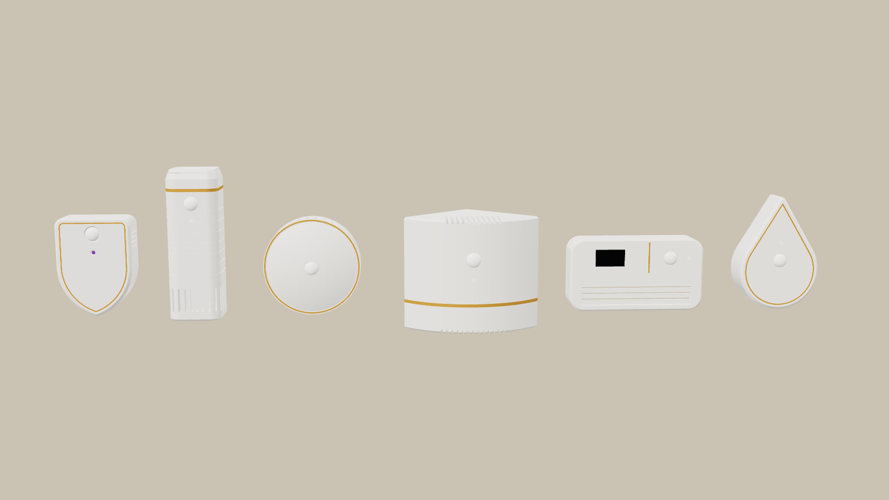
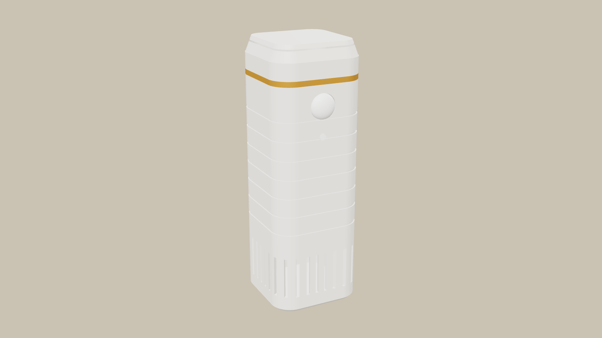
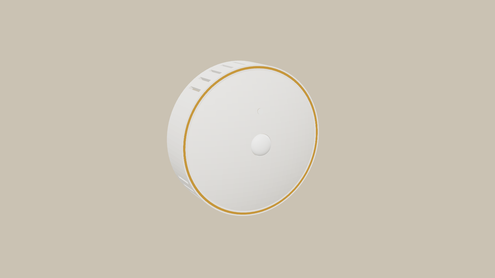
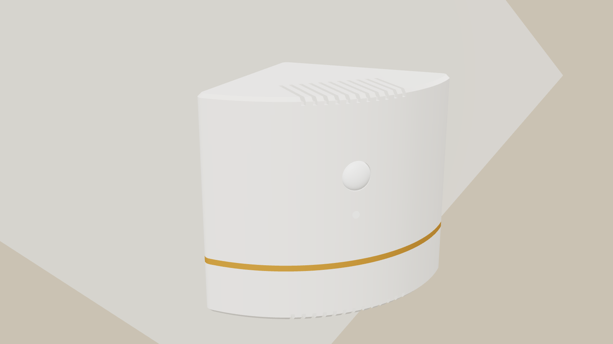
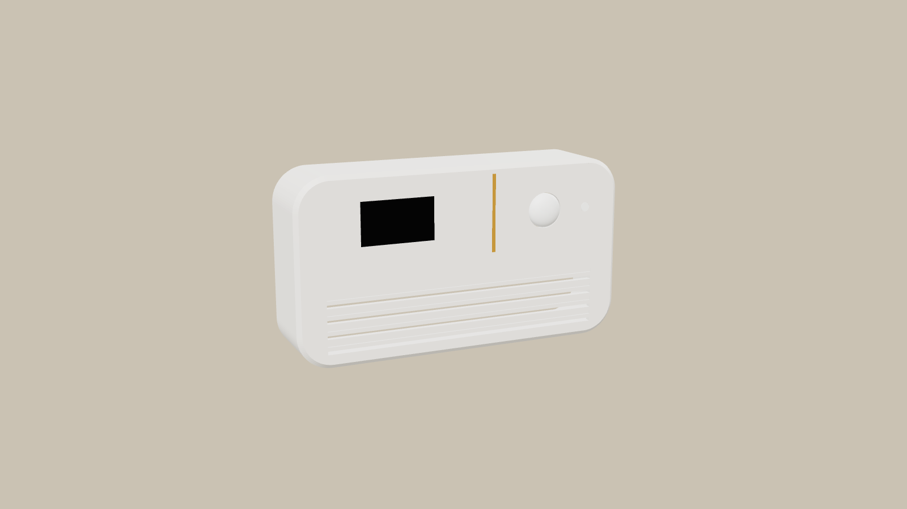
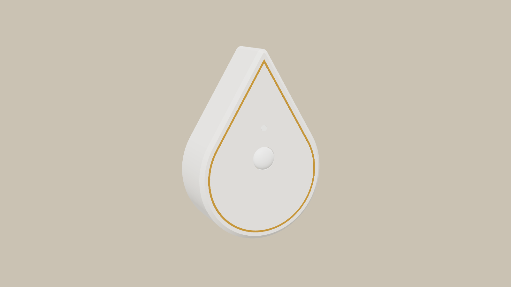

# Skjold Sans – formkonsepter

Fem nye former for Skjold Sans, ved siden av skjoldet (til venstre på bildet). Dette er bare utsiden, for å velge
retning. Alle har plass til samme innmat: D1 mini, AM312 PIR, lyskort og et eget sensorkammer nederst med spalter.

| Konsept | Mål (mm) | Idé |
|---|---|---|
| **Skjold** (nå) | 64 × 86 × 28 | vegg, gullkant, kammer i spissen |
| **Fyr** | 44 × 44 × 128 | høyt tårn for hylle eller vegg. PIR øverst som «lykta» under et gullbånd, fine riller, ringspalter rundt sensorkammeret nede |
| **Linse** | Ø84 × 30 | rund skive med hvelvet front og gullring. PIR i midten, spalter i nedre del av kanten (luft inn) og øvre (varme ut) |
| **Hjørne** | 80 + 80 × 92 | for takhjørnet. Buet front ser hele rommet fra hjørnet, gullbånd, spalter i bunn og topp. God på bad: høyt og unna sprut |
| **Tavle** | 118 × 64 × 26 | liggende panel med 0,96″ OLED som viser temperatur og fukt. PIR, gullstrek, riflet nedre felt som er luftspalter |
| **Dråpe** | 70 × 102 × 28 | dråpe med spissen opp og gullkant. Sensorkammer i den runde bunnen med spalter rett ned, varmen ut ved spissen |

 
 

Formene er tegnet i `konsepter.scad` (`part="fyr_kropp"`, `"linse_gull"` …). Når en form er valgt, tegnes den ferdig
som `skjold_sans.scad`: bakplate med D1-holder, kabelkanal, klikk, kollisjonssjekk og 3MF for K2.
