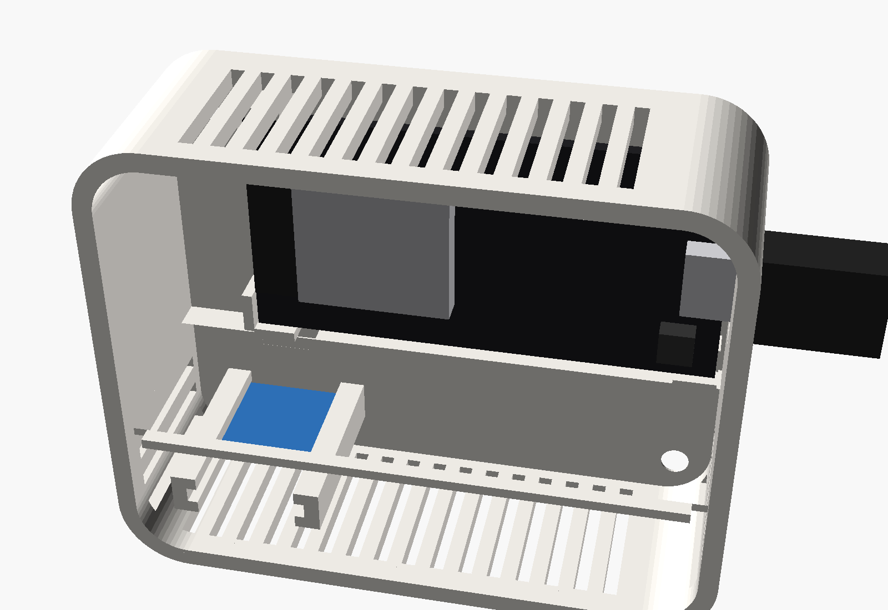

# Skjold Sensor

En liten romsensor for vegg, tak eller bord. Den måler **temperatur og luftfuktighet**, og kan også måle **lys (lux)**
og se **bevegelse (PIR)**. Inni sitter enten en **ESP32-WROOM DevKit** eller en **Wemos D1 mini (ESP8266)** med
ESPHome, så den dukker opp i Home Assistant av seg selv.


Bilder: [skrått, lys](render/01_skra_lys.png) · [ovenfra, lys](render/02_ovenfra_lys.png) ·
[eksplodert, lys](render/03_eksplodert_lys.png) · [skrått, mørk](render/04_skra_mork.png) ·
[ovenfra, mørk](render/05_ovenfra_mork.png) · [eksplodert, mørk](render/06_eksplodert_mork.png) ·
[forfra](render/07_forfra_lys.png) · [D1 mini-utgaven](render/08_d1mini_skra_lys.png) ·
[på bordstativet](render/09_stativ_lys.png) · [inni](render/10_inni_lys.png)

Status: **ikke printet, bygget eller testet på maskinvare.** Modellen er sjekket med `lag_sensor.py` (tette STL-er,
ingen kollisjoner med de kjøpte delene, ingen overheng som trenger støtte). Begge ESPHome-filene validerer med
`esphome config`. Målene på kjøpte moduler varierer mellom leverandører, så mål dine før du printer (se
[Mål før print](#mål-før-print)).

Skjold Sans ([`../sans`](../sans/LES_MEG.md)) er en skjoldformet multisensor med D1 mini, laget for bad. Skjold
Sensor er den enkle, rektangulære boksen. Den finnes for både ESP32 og D1 mini, med eller uten PIR og lysvindu, og
med bordstativ.

## Mål og varianter

| | ESP32-WROOM DevKit | Wemos D1 mini |
|---|---|---|
| Ytre mål (B × H × D) | 70 × 56 × 28 mm | 54 × 56 × 28 mm |
| Filament (bunn + lokk) | ca. 30 + 16 g | ca. 25 + 13 g |
| ESPHome | [`esphome/skjold-sensor.yaml`](../../esphome/skjold-sensor.yaml) | [`esphome/skjold-sensor-d1mini.yaml`](../../esphome/skjold-sensor-d1mini.yaml) |

Lokket finnes i fire utgaver for hvert kort (`stl/<kort>/`):

| Fil | PIR | Lysvindu | Bruk |
|---|---|---|---|
| `lokk.stl` | ja | ja | alt (standard, ligger i 3MF-fila) |
| `lokk_uten_pir.stl` | nei | ja | uten bevegelse, eller med **LD2410 mmWave** inni (radaren ser gjennom plasten) |
| `lokk_uten_lux.stl` | ja | nei | uten lyssensor |
| `lokk_enkel.stl` | nei | nei | bare temperatur og fukt |

Alle lokkene har statuslyset (3 mm LED). Den kan sløyfes: hullet er lite og ser ut som en prikk.

## Designet

- **Rolig, avrundet boks** (R8 sett forfra) med 1,5 mm fas på forkanten, som de andre Skjold-produktene.
- **Fronten er delt i to av en tynn gullist.** Over lista sitter PIR-kuppelen i midten, statuslyset til venstre og
  lysvinduet til høyre, med SKJOLD i gull under. Under lista er tre vannrette luftespalter foran sensorkammeret.
- **Gullista ligger rett foran den doble skilleveggen** inni. Den viser hvor det varme ESP-rommet slutter og
  sensorkammeret begynner.
- **Mørk variant:** sort kropp og lokk, samme gull. Bare filamentet byttes.

## Innsiden



- **Sensorkammeret ligger nederst, over hele bredden.** Det er skilt fra ESP-rommet med en **dobbel skillevegg**: to
  vegger på 1,2 mm med 1,6 mm luft mellom. En ribbe på lokket går ned i luftspalten og tetter kammeret.
- **Luften går nedenfra og opp.** Romluft kommer inn gjennom spaltene i bunnen, i begge endene og foran, og går rett
  forbi temperatur- og fuktsensoren. Varmen fra ESP-en går ut gjennom spaltene på toppen, altså bort fra sensoren.
  Heng derfor sensoren med spaltene i bunnen ned.
- **Temperatur- og fuktkortet ligger vannrett** midt i kammeret, i to spor. Det skyves inn forfra før lokket settes på.
  Sensorbrikka bør vende ned mot bunnspaltene. Sporene passer kort som er inntil 13,6 mm brede (`sensW`) og
  10–20 mm lange.
- **Ledningene fra sensorkortet** går under skilleveggen gjennom en åpning på 8 × 3,5 mm ved sensoren. Tett den
  gjerne med litt Blu Tack, så varm luft ikke siver ned i kammeret.
- **ESP-kortet ligger flatt** på fire hjørnestøtter, med USB-enden inn mot høyre vegg. To pinner på lokket holder den
  andre enden nede. USB-kabelen går ut i høyre side.
- **PIR-en (AM312)** sitter i et C-formet rør på lokket. Kuppelen stikker ut gjennom hullet i fronten.
- **Lyssensoren (GY-302)** skrus med to M2,5-skruer mot en blokk bak lysvinduet. BH1750-brikka ser ut gjennom en
  kanal på 2,5 × 5 mm.

## Referansen: HA_Sensor_V2

Sensor er bygget på en eksisterende boks (`HA_Sensor_V2.stl`: boks på 60 × 42 × 25 mm med 2 mm vegger, 3 mm lokk, tre deler: boks, lokk og en
skilleplate på 55,6 × 22,8 × 1,6 mm). Hullene i den er riktige for sensorene, så de er overført direkte. Målt i
STL-fila:

| Hull i referansen | Mål | Passer til | I Skjold Sensor |
|---|---|---|---|
| Rundt hull i lokket | Ø12,2 gjennom, 45° fas ut til Ø14,6. 3 mm lokk | **AM312** mini-PIR (kuppel ca. Ø12) | samme hull og fas |
| Rør i boksen under PIR-hullet | Ø10,5 innvendig, ca. Ø13 utvendig, 23 mm høyt, C-form med spalte | AM312-kroppen (ca. Ø10) | samme rør, men på lokket (9 mm) |
| Rektangulært vindu i lokket | 2,5 × 5 mm gjennom, fas ut til 8,9 × 11,4 mm; kanal 2,5 × 5 mm gjennom en 4,2 mm blokk | **BH1750** (GY-302) | samme kanal og blokk, fas 8,5 × 11 (45°) |
| Skruetapp ved vinduet | Ø2,7 pilot, 4,2 mm fra vinduets senter | det ene festehullet på GY-302 (Ø3) | to tapper ±4,45 mm, Ø2,2 for M2,5 |
| Åpning i endeveggen | 12 × 7 mm, 3,9–10,9 mm over bunnen | micro-USB-plugg til **D1 mini** | 12 × 8 (ESP32) / 12 × 7,5 (D1 mini) |
| Kloss inni (10 × 3 × 7 mm) + rom på ca. 34 mm til USB-veggen | – | D1 mini (34,2 × 25,6 mm) | hjørnestøtter for begge kortene |
| Eget kammer langs den ene langsiden (56 × 8,9 × 23 mm) bak en løs skilleplate (1,6 mm i spor på 1,8 mm, kabelhakk ca. 15 mm) | vindu 17,5 × 14,6 mm, tre spalter 2,5 × 14,6 mm og én 2,5 × 16,6 mm i endeveggen | temperatur/fukt-modul (SHT3x/BME280/AHT20, ca. 10–16 mm) | eget kammer nederst bak dobbel skillevegg |
| Senkede hull i bunnen | Ø3,7 gjennom, Ø5,7 senk | M3 bakfra inn i lokkets tapper (Ø2,7) | samme prinsipp, 2 × M3 × 12 |

Referansen har ikke plass til en ESP32 DevKit (51–55 mm lang). Derfor er Skjold Sensor 70 mm bred i ESP32-utgaven.

## Deler

Typiske priser på AliExpress (2026), inkl. frakt til Norge.

| Del (AliExpress-søk) | Antall | Ca. pris | Merknad |
|---|---|---|---|
| **ESP32 DevKit V1 / ESP32-WROOM-32 DevKitC** (30 eller 38 pinner) | 1 | 40–60 kr | *eller* D1 mini under. Uten stiftlister, eller med dem fjernet |
| **Wemos D1 mini** (ESP8266, CH340) | 1 | 25–40 kr | *eller* ESP32 over |
| **SHT40 module** (I²C, ca. 10 × 10–13 mm) | 1 | 25–45 kr | anbefalt: ±0,2 °C, ±1,8 %RH |
| *alternativ:* **SHT31-D module** (GY-SHT31-D) | 1 | 30–50 kr | samme kobling, `sht3xd` i YAML |
| *alternativ:* **AHT20 + BMP280** kombikort | 1 | 15–25 kr | gir også lufttrykk. Mindre nøyaktig fukt |
| **BH1750 GY-302** | 1 | 10–20 kr | valgfritt (lux) |
| **AM312 mini PIR** | 1 | 10–20 kr | valgfritt (bevegelse). Passer hullet |
| *alternativ:* **HLK-LD2410C** mmWave | 1 | 30–50 kr | ser også folk som sitter stille. Bruk `lokk_uten_pir` |
| LED 3 mm (hvit eller blå) + motstand 330 Ω | 1 | 2–5 kr | valgfritt statuslys |
| Senkeskrue **M3 × 12**, selvgjengende for plast (eller vanlig M3 i Ø2,7-hull) | 2 | – | lokket, bakfra |
| Selvgjengende skrue **M2,5 × 6** | 2 | – | GY-302 |
| Silikonledning 26–28 AWG | ca. 1 m | 15–30 kr | |
| Micro-USB- eller USB-C-kabel + 5 V-lader (1 A) | 1 | – | pluggen kan være inntil 11 × 7,5 mm |
| *bordstativ:* skrue **M3 × 8** med flatt hode + 2 gummiføtter Ø10 mm | 2 + 2 | – | |

Totalt ca. **100–200 kr** med alle sensorene.

**HC-SR501 passer ikke i hullet.** Kuppelen er Ø23 mm og kortet 32 × 24 mm. Den virker med samme fastvare (OUT til
samme pinne, VCC til 5 V), men trenger et større hull. Bruk heller AM312 eller LD2410. **DHT22 anbefales ikke.** Den
er tregere og mindre nøyaktig enn SHT40, og den driver over tid.

## Kobling

Alle sensorene får 3,3 V. Lys- og fuktsensoren deler I²C-bussen.

| Fra | ESP32 DevKit | Wemos D1 mini |
|---|---|---|
| SHT40 / SHT31 / AHT20 SDA · BH1750 SDA | GPIO21 | D2 (GPIO4) |
| SHT40 / SHT31 / AHT20 SCL · BH1750 SCL | GPIO22 | D1 (GPIO5) |
| BH1750 ADDR | GND (adresse 0x23) | G (0x23) |
| AM312 OUT (eller LD2410 OUT / HC-SR501 OUT) | GPIO27 | D5 (GPIO14) |
| VCC på alle sensorene | 3V3 (LD2410 og HC-SR501: VIN 5 V) | 3V3 (LD2410 og HC-SR501: 5V) |
| GND på alle | GND | G |
| Statuslys (3 mm LED) | GPIO2 → 330 Ω → LED → GND | 3V3 → 330 Ω → LED → D4 (GPIO2), aktiv lav |

Statuslyset blinker bare ved feil (ingen Wi-Fi, en sensor som ikke svarer), og er ellers av. Da lyser det ikke inn i
lyssensoren. GPIO2/D4 er også den blå LED-en på kortet. På ESP32 er GPIO2 en oppstartspinne, men en LED til GND er
trygg, og kortet har den samme koblingen selv. På D1 mini må D4 være høy ved oppstart, og det er den med LED-en koblet
fra 3V3 som over.

## Fastvare (ESPHome)

```bash
esphome run esphome/skjold-sensor.yaml          # ESP32 DevKit
esphome run esphome/skjold-sensor-d1mini.yaml   # Wemos D1 mini
```

Første gang kan du også bruke https://web.esphome.io i Chrome (USB). Wi-Fi settes med Improv eller via
tilgangspunktet «Skjold Sensor». `secrets.yaml` trenger `wifi_ssid`, `wifi_password` og `skjold_sensor_api_key`
(32 tilfeldige byte i base64, f.eks. `openssl rand -base64 32`). Har du flere sensorer, gir du hver sitt navn under
`substitutions` (`name: skjold-sensor-stue`, `friendly_name: Skjold Sensor stue`).

Entiteter i Home Assistant: **Temperatur**, **Luftfuktighet**, **Duggpunkt**, **Lys** (lx), **Bevegelse**
(bevegelse), **Status**, **Wi-Fi-signal**, **Oppetid** og knappen **Start på nytt**.

- Uten lyssensor eller PIR: kommenter ut `bh1750`- eller `Bevegelse`-blokken. Ellers blinker statuslyset fordi en
  sensor ikke svarer.
- SHT31 eller AHT20 + BMP280: bytt til den kommenterte blokken i YAML-fila.
- `temp_offset` (standard −0,3 °C): juster mot et kjent termometer etter en time i drift.
- `bevegelse_av` (standard 30 s): hvor lenge «Bevegelse» står på etter siste utløsning.

## Print (Creality K2)

`skjold-sensor-esp32-k2.3mf` og `skjold-sensor-d1mini-k2.3mf` har bunn, lokk med gullist og bordstativ på én plate.
Filament 1 = lys (bunn, lokk), 2 = sort (stativ), 3 = gull (gullist og SKJOLD). Andre lokk ligger som STL i
`stl/<kort>/`.

- **PETG** (eller ASA), 0,2 mm lag, 3 vegger, 15 % fyll, **ingen støtte** (støtte er slått av i 3MF-fila).
  PLA går fint i stue og soverom, men ikke i sola i et vindu eller på bad.
- **Bunn:** baksiden ned. Taket over nøkkelhullslommene er en bro på 8 mm, og over USB-åpningen 12 mm.
- **Lokk:** forsiden ned. Gullista og SKJOLD er 0,6 mm dype, så det blir ett filamentbytte i de første lagene. Med
  én farge blir de stående som spor.
- **Stativ:** ligger på siden.
- Mørk variant: bytt filament 1 og 2.

## Montering

1. **Lodd ledninger** (ca. 8–10 cm) direkte i hullene på sensorene og ESP-kortet. Bruk ikke stiftlister, da blir det
   for trangt. Se [Kobling](#kobling).
2. **Temperatur- og fuktkortet:** skyv det inn i sporene i sensorkammeret forfra, med sensorbrikka ned. Før
   ledningene under skilleveggen og opp i ESP-rommet. Tett åpningen med litt Blu Tack.
3. **ESP-kortet:** legg det på hjørnestøttene med USB-enden mot åpningen i høyre vegg.
4. **Lokket:** trykk AM312 inn i røret bakfra (kuppelen ut). Skru GY-302 mot lysblokka med to M2,5 × 6, med
   BH1750-brikka over kanalen. Trykk LED-en inn i holderen og lim den med en dråpe lim.
5. Sett lokket på (ribba går ned i luftspalten i skilleveggen) og skru det fast bakfra med 2 × M3 × 12 senkeskruer.
6. **Vegg:** sett to skruer i veggen med **40 mm** (ESP32) eller **26 mm** (D1 mini) avstand, vannrett, med ca. 1,8 mm
   luft under hodet (hodet høyst 2,2 mm høyt og Ø7,5). Heng sensoren på nøkkelhullene og trekk den ned. Spaltene i bunnen skal vende ned.
   **Tak:** det samme, men PIR-en ser da rett ned, og luften i kammeret byttes litt saktere.
   **Bord:** skru 2 × M3 × 8 inn i stativet, med ca. 1,8 mm under hodet, og heng sensoren på dem. Den står 4 mm over
   foten, så bunnspaltene får luft.

**Plassering:** ca. 1,5 m over gulvet på en innervegg, ikke i sol, over en ovn eller rett ved en dør. PIR-en ser ca.
5 m og ca. 100°. Lysvinduet må ikke dekkes til.

## Mål før print

Alle mål står øverst i `skjold_sensor.scad`:

- `bL`/`bW`: ESP-kortets lengde og bredde. ESP32 DevKit V1 (30 pinner) er 51,5 × 28,3 mm, DevKitC (38 pinner) er
  54,4 × 27,9 mm, og D1 mini er 34,2 × 25,6 mm. Standard er 55,0 × 28,6 og 34,6 × 26,0.
- `sensW`: bredden på temperatur- og fuktkortet (standard 13,6 mm).
- `luxHull`: avstanden fra BH1750-brikka til festehullene på ditt GY-302-kort (standard 4,45 mm, fra referansen).
  **Usikkert:** kort fra ulike leverandører kan ha brikka litt forskjøvet. Sjekk at brikka havner rett bak kanalen.
- `pirHull`/`pirRorD`: AM312-kuppelen og -kroppen (standard Ø12,2 og Ø10,5, fra referansen).

## Bygg selv

```bash
python3 lag_sensor.py          # STL-er for alle varianter, kontroll og 3MF
python3 lag_sensor.py bilder   # også bildene i render/ (bruker xvfb-run om det ikke er noen skjerm)
```

Kontrollen sjekker at delene er tette, at ingen deler kolliderer i montert stilling (med kort, PIR, GY-302,
sensorkort, LED, USB-plugg og stativ), at ingen flater trenger støtte i utskriftsretningen, og at alt får plass på
K2-plata.

## Lisens

Maskinvaren i denne mappen er lisensiert under **CC BY-NC-SA 4.0**, se [LISENS-MASKINVARE.md](../../LISENS-MASKINVARE.md).
