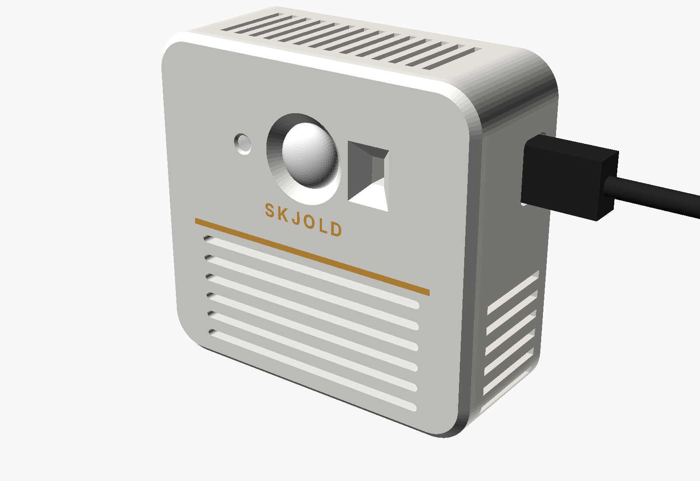
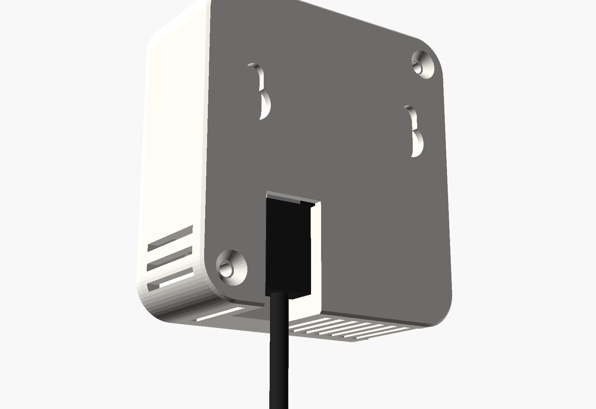
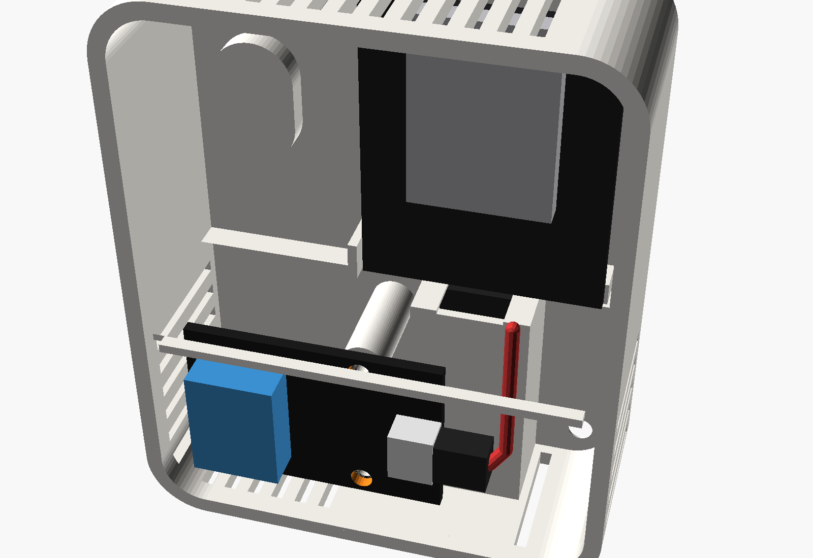
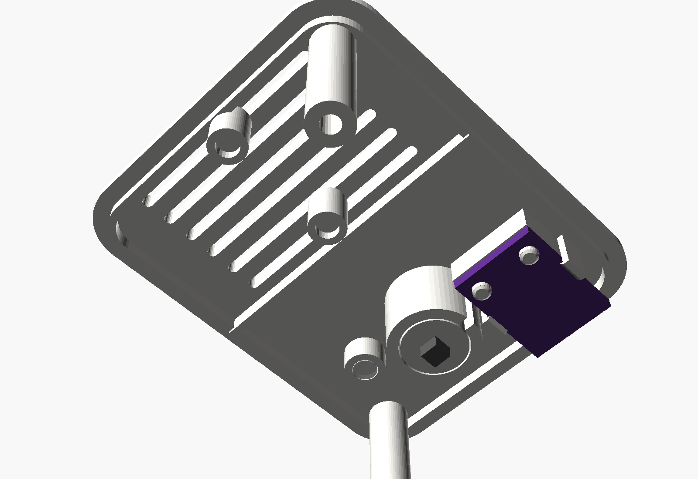
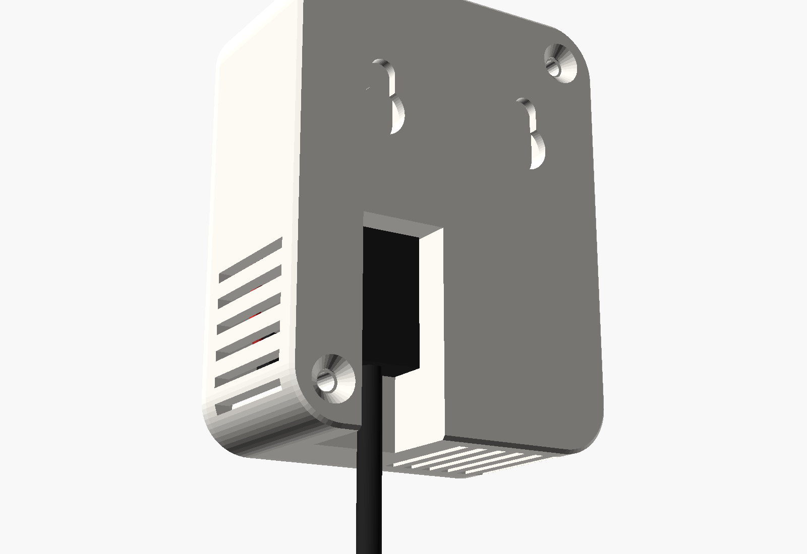
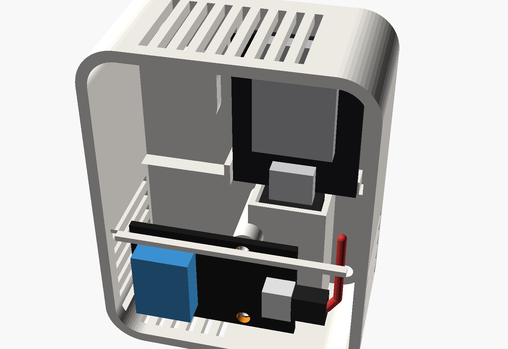

# Skjold Sensor

En liten romsensor for vegg, tak eller bord. Den måler **temperatur og luftfuktighet**, og kan også måle **lys (lux)**
og se **bevegelse (PIR)**. Inni sitter en **ESP32-WROOM DevKit**, en **Wemos D1 mini (ESP8266)** eller en
**ESP32 D1 mini** (MH-ET LIVE MiniKit o.l.) med ESPHome, så den dukker opp i Home Assistant av seg selv. I
ESP32 D1 mini-utgaven, og i utgaven for Wemos D1 mini med USB-C (`d1mini_bak`), går USB-kabelen ut **bak, nederst**,
rett ned langs veggen.

Standard temperatur- og fuktsensor er en vanlig **DHT11-modul** (sort kort 35 × 23 mm med PH2.0-kontakt). Den er
billig og enkel å koble, men unøyaktig (±2 °C, ±5 %RH). **SHT40 er oppgraderingen**, og kabinettet finnes i en
lavere utgave for den (`th = "sht40"`).



Bilder: [skrått, lys](render/01_skra_lys.png) · [ovenfra, lys](render/02_ovenfra_lys.png) ·
[eksplodert, lys](render/03_eksplodert_lys.png) · [skrått, mørk](render/04_skra_mork.png) ·
[ovenfra, mørk](render/05_ovenfra_mork.png) · [eksplodert, mørk](render/06_eksplodert_mork.png) ·
[forfra](render/07_forfra_lys.png) · [D1 mini-utgaven](render/08_d1mini_skra_lys.png) ·
[på bordstativet](render/09_stativ_lys.png) · [inni](render/10_inni_lys.png) ·
[ESP32 D1 mini, skrått](render/11_esp32d1_skra_lys.png) · [ESP32 D1 mini, bakfra](render/12_esp32d1_bak_lys.png) ·
[ESP32 D1 mini, inni](render/13_esp32d1_inni_lys.png) · [ESP32 D1 mini på stativet](render/14_esp32d1_stativ_lys.png) ·
[D1 mini USB-C med USB bak, skrått](render/15_d1mini_bak_skra_lys.png) · [bakfra](render/16_d1mini_bak_bak_lys.png) ·
[inni](render/17_d1mini_bak_inni_lys.png) · [på stativet](render/18_d1mini_bak_stativ_lys.png)

Status: **ikke printet, bygget eller testet på maskinvare.** Modellen er sjekket med `lag_sensor.py` (tette STL-er,
ingen kollisjoner med de kjøpte delene, ingen overheng som trenger støtte). Begge ESPHome-filene validerer med
`esphome config`, men er ikke kompilert. Målene på kjøpte moduler varierer mellom leverandører, så mål dine før du printer (se
[Mål før print](#mål-før-print)).

Skjold Sans ([`../sans`](../sans/LES_MEG.md)) er en skjoldformet multisensor med D1 mini, laget for bad. Skjold
Sensor er den enkle, rektangulære boksen. Den finnes for ESP32 DevKit, D1 mini og ESP32 D1 mini, med eller uten PIR
og lysvindu, og med bordstativ.

## Innstillinger og diagnostikk

Disse kan endres uten å flashe på nytt, fra **Homey** (enhetens innstillinger), **Home Assistant** (Skjold-integrasjonen,
under Konfigurasjon på Skjold Sensor-enheten) eller sensorens egen nettside. De huskes etter strømbrudd.

| Innstilling | Standard | Hva |
|---|---|---|
| Oppdateringsintervall | 30 s (5–600) | Hvor ofte temperatur, fukt og lys måles |
| Bevegelse av etter | 30 s (1–600) | Nedkjøling: hvor lenge bevegelse står på etter siste bevegelse PIR-en så |
| Tilstedeværelse av etter | 10 min (1–240) | Hvor lenge tilstedeværelse står på etter at bevegelse gikk av |
| Status-LED | på | Den blå LED-en på D1 mini / ESP32 blinker når sensoren mangler Wi-Fi. Av = lyser aldri |

Diagnostikk (bare lesing): IP-adresse, MAC-adresse, Wi-Fi-nett, tilgangspunkt, Wi-Fi-signal, oppetid,
ESPHome-versjon og (ESP32) brikketemperatur.

## Mål og varianter

| | ESP32-WROOM DevKit | Wemos D1 mini | ESP32 D1 mini | Wemos D1 mini USB-C, USB bak |
|---|---|---|---|---|
| `kort` i `skjold_sensor.scad` | `"esp32"` | `"d1mini"` | `"esp32d1"` | `"d1mini_bak"` |
| Ytre mål (B × H × D), DHT11-modul (standard) | 70 × 66 × 28 mm | 54 × 66 × 28 mm | 62 × 76 × 28 mm | 54 × 70 × 30 mm |
| Ytre mål med SHT40 (`th = "sht40"`, `stl/<kort>/sht40/`) | 70 × 56 × 28 mm | 54 × 56 × 28 mm | 62 × 66 × 28 mm | 54 × 60 × 30 mm |
| USB-kabelen | ut i høyre side | ut i høyre side | **ut bak, nederst** (kanal i baksiden) | **ut bak, nederst** (kanal i baksiden) |
| Filament (bunn + lokk) | ca. 33 + 18 g | ca. 28 + 15 g | ca. 34 + 19 g | ca. 31 + 16 g |
| 3MF (Creality K2) | `skjold-sensor-esp32-k2.3mf` | `skjold-sensor-d1mini-k2.3mf` | `skjold-sensor-esp32d1-k2.3mf` | `skjold-sensor-d1mini-usbbak-k2.3mf` |
| ESPHome | [`esphome/skjold-sensor.yaml`](../../esphome/skjold-sensor.yaml) | [`esphome/skjold-sensor-d1mini.yaml`](../../esphome/skjold-sensor-d1mini.yaml) | samme som ESP32 DevKit: [`esphome/skjold-sensor.yaml`](../../esphome/skjold-sensor.yaml) | samme som D1 mini: [`esphome/skjold-sensor-d1mini.yaml`](../../esphome/skjold-sensor-d1mini.yaml) |

Lokket finnes i fire utgaver for hvert kort (`stl/<kort>/`):

| Fil | PIR | Lysvindu | Bruk |
|---|---|---|---|
| `lokk.stl` | ja | ja | alt (standard, ligger i 3MF-fila) |
| `lokk_uten_pir.stl` | nei | ja | uten bevegelse, eller med **LD2410 mmWave** inni (radaren ser gjennom plasten) |
| `lokk_uten_lux.stl` | ja | nei | uten lyssensor |
| `lokk_enkel.stl` | nei | nei | bare temperatur og fukt |

Alle lokkene har statuslyset (3 mm LED). Den kan sløyfes: hullet er lite og ser ut som en prikk.

3MF-filene og STL-ene rett i `stl/<kort>/` er for DHT11-modulen. For SHT40 (eller SHT31 / AHT20) ligger bunn, lokk,
gullist og stativ i `stl/<kort>/sht40/`. Der er sensorkammeret 10 mm lavere, ellers er alt likt.

## Designet

- **Rolig, avrundet boks** (R8 sett forfra) med 1,5 mm fas på forkanten, som de andre Skjold-produktene.
- **Fronten er delt i to av en tynn gullist.** Over lista sitter PIR-kuppelen i midten, statuslyset til venstre og
  lysvinduet til høyre, med SKJOLD i gull under. Under lista er seks vannrette luftespalter foran sensorkammeret (tre med
  SHT40).
- **Gullista ligger rett foran den doble skilleveggen** inni. Den viser hvor det varme ESP-rommet slutter og
  sensorkammeret begynner.
- **Mørk variant:** sort kropp og lokk, samme gull. Bare filamentet byttes.

## Innsiden


- **Sensorkammeret ligger nederst, over hele bredden.** Det er skilt fra ESP-rommet med en **dobbel skillevegg**: to
  vegger på 1,2 mm med 1,6 mm luft mellom. En ribbe på lokket går ned i luftspalten og tetter kammeret.
- **Luften går nedenfra og opp.** Romluft kommer inn gjennom spaltene i bunnen, i begge endene og foran, og går rett
  forbi temperatur- og fuktsensoren. Varmen fra ESP-en går ut gjennom spaltene på toppen, altså bort fra sensoren.
  Heng derfor sensoren med spaltene i bunnen ned.
- **DHT11-modulen står parallelt med veggen, helt fram i kammeret**, med det blå DHT11-gitteret 1 mm bak de seks
  spaltene i lokket. Romluften kommer nedenfra og fra endene og går rett forbi gitteret og ut foran.
  - **Ingen skruer:** kortet trykkes forfra inn på to styrepinner (Ø2,75 mm, i festehullene Ø3) på to tapper fra
    bakveggen.
  - Når lokket settes på, presser to hylser på lokket kortet mot tappene, med 0,1 mm klaring. Kortet kan da ikke
    flytte seg mer enn 0,3 mm noen vei.
  - Loddingen bak kortet har 13 mm klaring til bakveggen.
  - Vil du heller skru: `dhtFeste = "skrue"` gir de gamle tappene for 2 × M2,5 × 8.
- **PH2.0-kontakten** peker mot høyre. Pluggen har plass med ca. 9 mm fritt foran kontakten (12 mm til veggen på
  D1 mini). Kabelen bøyes opp og går gjennom et hull på 6 × 6 mm i skilleveggen til ESP-rommet. Tett hullet gjerne
  med litt Blu Tack, så varm luft ikke siver ned i kammeret. Du kan også lodde ledninger på stiftraden ved siden av.
  Dupont-plugger passer bare hvis stiftene peker mot høyre, ikke fram mot lokket.
- **SHT40-utgaven** (`th = "sht40"`): kortet ligger vannrett midt i kammeret, i to spor, og skyves inn forfra.
  Sensorbrikka bør vende ned mot bunnspaltene. Sporene passer kort som er inntil 13,6 mm brede (`sensW`) og
  10–20 mm lange. Ledningene går under skilleveggen gjennom en åpning på 8 × 3,5 mm.
- **ESP-kortet ligger flatt** på fire hjørnestøtter, med USB-enden inn mot høyre vegg. To pinner på lokket holder den
  andre enden nede. USB-kabelen går ut i høyre side.
- **ESP32 D1 mini-utgaven** er annerledes, se under.

### ESP32 D1 mini: USB ut bak, nederst

 

- **Kortet står på høykant** til høyre i ESP-rommet, med USB-enden ned mot skilleveggen og WROOM-modulen fram. Lomma
  er 40,4 × 32,4 mm, så kort på 39–40 × 31–32 mm passer. Det ligger på fire hjørnestøtter 6,4 mm fra baksiden, med
  plass til USB-brikka under. To pinner på lokket holder den øvre enden nede.
- **Tett rundt kontakten:** kanalen slutter ved munningen på micro-USB-kontakten med en tett vegg. Den har bare et hakk
  på 8,6 × 3,4 mm rundt kontakthuset, og en tunge på lokket fyller resten over kontakten og kortkanten. Spaltene inn
  til elektronikken er på høyst 0,3 mm.
- **USB-kanalen** er en lukket kanal i baksiden, 13 mm bred og 12,5 mm dyp. Den går fra underkanten, gjennom
  sensorkammeret og skilleveggen, og opp til kontakten. Kanalen er **åpen mot veggen og nedover**, men lukket mot
  sensorkammeret, så kammeret holdes rent.
- **Pluggen skyves opp i kanalen nedenfra**, også mens sensoren henger på veggen. Kabelen går rett ned langs veggen
  bak sensoren. Pluggen kan være **inntil 13 × 12 mm** i tverrsnitt og **inntil ca. 31 mm** lang (fra munningen; ca.
  21 mm i SHT40-utgaven). Det
  passer vanlige rette micro-USB- og USB-C-plugger. Kontakten kan sitte under kortet (micro-USB på MH-ET LIVE MiniKit)
  eller oppå (enkelte USB-C-utgaver), for kanalen tar begge.
- **Nøkkelhullene** sitter høyere opp (40 mm avstand, 56 mm over underkanten; 46 mm med SHT40) og er godt klar av kanalen.
- **På bordstativet** bøyes kabelen bakover under sensoren, gjennom et hakk i ryggen og i et spor i foten
  ([bilde](render/14_esp32d1_stativ_lys.png)). Det trengs en myk kabel, for bøyen er krapp.
- **PIR-en (AM312)** sitter i et C-formet rør på lokket.
  - Kuppelen er senket 1,5 mm (`pirSenk`), så den bare stikker ca. 1 mm ut av fronten (før 2,5 mm).
  - Kuppelkanten (Ø12) ligger på et sete i røret, så AM312 havner alltid like dypt.
  - Hullet har en 45° fas fra kuppelens ekvator ut til Ø16,8 mm i fronten. Fra sensorens midte er synsfeltet ca.
    150° fritt, godt over AM312s ca. 100°.
- **Lyssensoren (GY-302) uten skruer:** kortet trykkes inn på to styrepinner på lysblokka bak lysvinduet.
  - To klikkarmer på lokket griper bak kortet, så det ikke faller ut når lokket snus.
  - Klaringen er 0,1 mm mot armene og 0,25 mm i hullene.
  - BH1750-brikka ser ut gjennom en kanal på 2,5 × 5 mm.
  - Ta det ut ved å bøye armene litt ut.
  - Skruer i stedet: `luxFeste = "skrue"` (2 × M2,5 × 6).



### Wemos D1 mini med USB-C: USB ut bak, nederst

 

Den samme løsningen som ESP32 D1 mini, for en vanlig Wemos D1 mini med USB-C. Kortet er 34,2 × 25,6 mm, med
ESP-12F og USB-C på samme side og CH340 under.

- **Kortet står på høykant** til høyre i ESP-rommet. USB-C-enden vender ned og antenneenden (ESP-12F) opp, bort fra
  sensorkammeret. Komponentsiden med ESP-12F og USB-C vender fram. Kortet ligger 6,6 mm fra baksiden, så CH340 under
  kortet går 0,4 mm klar av den høyre nøkkelhullsputa.
- **Kortet sitter fast:**
  - Lomma er 34,5 × 25,9 mm, bare 0,3 mm større enn kortet (34,2 × 25,6 × ca. 1,0 mm).
  - Kortet ligger mellom kanter på begge sider, en stopp i hver ende og fire hjørnestøtter bak. Det skyves rett inn
    forfra.
  - Når lokket er på, holder to pinner den øvre enden og en tunge den nedre. Tunga presser på USB-C-kontakten og har
    0,1–0,15 mm klaring.
  - Kortet kan altså ikke flytte seg mer enn 0,3 mm noen vei.
- **Trykket fra pluggen tas av boksen.** Når du skyver USB-C-pluggen opp, presses kortet mot stoppene øverst. Når du
  drar den ut, holdes kortet av stoppene nederst og veggen rundt kontakten. Kortet henger aldri i loddingen, og pinnene
  på lokket tar ingen kraft.
- **Tett rundt kontakten.** Kanalen slutter ved kontaktens munning med en tett vegg. Den har bare et hakk på 9,5 × 3,8 mm
  rundt USB-C-huset (som stikker 1 mm ut over kortkanten). Tunga på lokket fyller hakket over kontakten. Innsiden av
  boksen er lukket mot kanalen, med spalter på høyst 0,3 mm rundt kontakten.
- **USB-kanalen** er 13,5 mm bred og 13,2 mm dyp fra veggen. Den går fra underkanten opp til kontakten og er åpen mot
  veggen og nedover. Midt i USB-C-kontakten er 9,2 mm fra veggen.
  - **Pluggen kan være inntil ca. 13 × 8 mm** i tverrsnitt og **inntil ca. 31 mm** lang fra munningen. Vanlige rette
    USB-C-plugger er ca. 12,5 × 7 × 15–25 mm.
  - Pluggen skyves opp nedenfra, også mens sensoren henger på veggen. Kabelen går rett ned langs veggen bak sensoren.
- **Boksen er 54 × 70 × 30 mm**, mot 54 × 66 × 28 mm for vanlig D1 mini:
  - 4 mm høyere, fordi kortet (35 mm) står på høykant over sensorkammeret.
  - 2 mm dypere, så loddingen bak DHT11-modulen går 1,9 mm klar av taket over USB-kanalen.
- **DHT11-modulen** sitter som i de andre utgavene, på styrepinner uten skruer. Den høyre tappen står delvis på taket
  over USB-kanalen. Velger du skruer (`dhtFeste = "skrue"`), er hullene bare 4,4 mm dype: bruk 2 × M2,5 × 6.
- **GY-302 (lys) snus 180°**, slik at kortet henger ned fra brikka og går klar av pinnene på lokket.
- **Nøkkelhullene** har 26 mm avstand, 53,5 mm over underkanten. Det er ca. 10 mm over toppen av USB-kanalen.
- **Bordstativet** har hakk og spor for kabelen som for ESP32 D1 mini ([bilde](render/18_d1mini_bak_stativ_lys.png)).

## Referansen: HA_Sensor_V2

Sensor er bygget på en eksisterende boks (`HA_Sensor_V2.stl`: boks på 60 × 42 × 25 mm med 2 mm vegger, 3 mm lokk, tre deler: boks, lokk og en
skilleplate på 55,6 × 22,8 × 1,6 mm). Hullene i den er riktige for sensorene, så de er overført direkte. Målt i
STL-fila:

| Hull i referansen | Mål | Passer til | I Skjold Sensor |
|---|---|---|---|
| Rundt hull i lokket | Ø12,2 gjennom, 45° fas ut til Ø14,6. 3 mm lokk | **AM312** mini-PIR (kuppel ca. Ø12) | samme hull, kuppelen senket 1,5 mm og fasen ut til Ø16,8 |
| Rør i boksen under PIR-hullet | Ø10,5 innvendig, ca. Ø13 utvendig, 23 mm høyt, C-form med spalte | AM312-kroppen (ca. Ø10) | samme rør, men på lokket (9 mm) |
| Rektangulært vindu i lokket | 2,5 × 5 mm gjennom, fas ut til 8,9 × 11,4 mm; kanal 2,5 × 5 mm gjennom en 4,2 mm blokk | **BH1750** (GY-302) | samme kanal og blokk, fas 8,5 × 11 (45°) |
| Skruetapp ved vinduet | Ø2,7 pilot, 4,2 mm fra vinduets senter | det ene festehullet på GY-302 (Ø3) | to tapper ±4,45 mm, Ø2,2 for M2,5 |
| Åpning i endeveggen | 12 × 7 mm, 3,9–10,9 mm over bunnen | micro-USB-plugg til **D1 mini** | 12 × 8 (ESP32) / 12 × 7,5 (D1 mini) |
| Kloss inni (10 × 3 × 7 mm) + rom på ca. 34 mm til USB-veggen | – | D1 mini (34,2 × 25,6 mm) | hjørnestøtter for begge kortene |
| Eget kammer langs den ene langsiden (56 × 8,9 × 23 mm) bak en løs skilleplate (1,6 mm i spor på 1,8 mm, kabelhakk ca. 15 mm) | vindu 17,5 × 14,6 mm, tre spalter 2,5 × 14,6 mm og én 2,5 × 16,6 mm i endeveggen | temperatur/fukt-modul (SHT3x/BME280/AHT20, ca. 10–16 mm) | eget kammer nederst bak dobbel skillevegg |
| Senkede hull i bunnen | Ø3,7 gjennom, Ø5,7 senk | M3 bakfra inn i lokkets tapper (Ø2,7) | samme prinsipp, 2 × M3 × 12 |

Referansen har ikke plass til en ESP32 DevKit (51–55 mm lang). Derfor er Skjold Sensor 70 mm bred i ESP32-utgaven.

## Deler

Typiske priser på AliExpress (2026), inkl. frakt til Norge.

| Del (AliExpress-søk) | Antall | Ca. pris | Merknad |
|---|---|---|---|
| **ESP32 DevKit V1 / ESP32-WROOM-32 DevKitC** (30 eller 38 pinner) | 1 | 40–60 kr | *eller* D1 mini under. Uten stiftlister, eller med dem fjernet |
| **Wemos D1 mini** (ESP8266, CH340) | 1 | 25–40 kr | *eller* ESP32 over |
| **Wemos D1 mini USB-C** (ESP8266, ESP-12F, 34,2 × 25,6 mm, én rad med 8 pinner på hver side) | 1 | 25–40 kr | med USB ut bak (`kort = "d1mini_bak"`). Uten stiftlister |
| **ESP32 D1 mini** / **MH-ET LIVE MiniKit** (ESP32-WROOM-32, 39 × 31,4 mm, to rader på hver side) | 1 | 40–60 kr | *eller* de to over. USB ut bak (`kort = "esp32d1"`). Uten stiftlister |
| **DHT11 Temperature Humidity Sensor Module 3.3V/5V** (EC Buying o.l.: sort kort 35 × 23 mm, PH2.0 3-pin G/V/D, stiftrad, PWR-LED, to Ø3-hull) | 1 | 15–30 kr | **standard.** ±2 °C, ±5 %RH. Kabel med PH2.0-plugg følger ofte med |
| *bare med skruefeste:* selvgjengende skrue **M2,5 × 8** | 2 | – | DHT11-modulen (`dhtFeste = "skrue"`). Standard er uten skruer |
| *oppgradering:* **SHT40 module** (I²C, ca. 10 × 10–13 mm) | 1 | 25–45 kr | ±0,2 °C, ±1,8 %RH. Bygg kabinettet med `th = "sht40"` |
| *alternativ:* **SHT31-D module** (GY-SHT31-D) | 1 | 30–50 kr | samme kobling, `sht3xd` i YAML |
| *alternativ:* **AHT20 + BMP280** kombikort | 1 | 15–25 kr | gir også lufttrykk. Mindre nøyaktig fukt |
| **BH1750 GY-302** | 1 | 10–20 kr | valgfritt (lux) |
| **AM312 mini PIR** | 1 | 10–20 kr | valgfritt (bevegelse). Passer hullet |
| *alternativ:* **HLK-LD2410C** mmWave | 1 | 30–50 kr | ser også folk som sitter stille. Bruk `lokk_uten_pir` |
| LED 3 mm (hvit eller blå) + motstand 330 Ω | 1 | 2–5 kr | valgfritt statuslys |
| Senkeskrue **M3 × 12**, selvgjengende for plast (eller vanlig M3 i Ø2,7-hull) | 2 | – | lokket, bakfra |
| *bare med skruefeste:* selvgjengende skrue **M2,5 × 6** | 2 | – | GY-302 (`luxFeste = "skrue"`). Standard er uten skruer |
| Silikonledning 26–28 AWG | ca. 1 m | 15–30 kr | |
| Micro-USB- eller USB-C-kabel + 5 V-lader (1 A) | 1 | – | pluggen kan være inntil 11 × 7,5 mm (ESP32 D1 mini: 13 × 12 mm, inntil ca. 31 mm lang, rett plugg) |
| *bordstativ:* skrue **M3 × 8** med flatt hode + 2 gummiføtter Ø10 mm | 2 + 2 | – | |

Totalt ca. **100–200 kr** med alle sensorene.

**HC-SR501 passer ikke i hullet.** Kuppelen er Ø23 mm og kortet 32 × 24 mm. Den virker med samme fastvare (OUT til
samme pinne, VCC til 5 V), men trenger et større hull. Bruk heller AM312 eller LD2410.

**DHT11 er det enkle valget, SHT40 er oppgraderingen.** DHT11 måler ±2 °C og ±5 %RH, med 1 °C og 1 % oppløsning.
Den måler bare 20–90 %RH, og den tåler ikke å bli lest oftere enn ca. hvert 2. sekund (fastvaren leser hvert
30. sekund). Fint for å se trender i et rom, men ikke til bad eller presis styring. SHT40 er ti ganger mer nøyaktig, tåler
kondens og koster omtrent det samme. DHT22 anbefales ikke: den er tregere enn SHT40 og driver over tid.

## Kobling

Alle sensorene får 3,3 V. DHT11-modulen bruker én datapinne (enkeltbuss). Lyssensoren (og SHT40, om du bruker den)
går på I²C-bussen.

| Fra | ESP32 DevKit | Wemos D1 mini (også USB-C med USB bak) | ESP32 D1 mini (pinne på kortet) |
|---|---|---|---|
| DHT11-modul, PH2.0 **D** (data) | GPIO26 | D6 (GPIO12) | **IO26**: ytre rad på RST-siden, 3. pinne fra enden uten USB (der D1 mini har D0) |
| DHT11-modul, PH2.0 **V** (VCC) | 3V3 | 3V3 | **3V3**: ytre rad på RST-siden, 8. pinne |
| DHT11-modul, PH2.0 **G** (GND) | GND | G | **GND**: se under |
| SHT40 / SHT31 / AHT20 SDA · BH1750 SDA | GPIO21 | D2 (GPIO4) | **IO21**: ytre rad på TXD-siden, 4. pinne fra enden uten USB (der D1 mini har D2) |
| SHT40 / SHT31 / AHT20 SCL · BH1750 SCL | GPIO22 | D1 (GPIO5) | **IO22**: ytre rad på TXD-siden, 3. pinne (der D1 mini har D1) |
| BH1750 ADDR | GND (adresse 0x23) | G (0x23) | GND |
| AM312 OUT (eller LD2410 OUT / HC-SR501 OUT) | GPIO27 | D5 (GPIO14) | **IO27**: indre rad på TXD-siden, 2. pinne |
| VCC på alle sensorene | 3V3 (LD2410 og HC-SR501: VIN 5 V) | 3V3 (LD2410 og HC-SR501: 5V) | **3V3**: ytre rad på RST-siden, 8. pinne (LD2410 / HC-SR501: **VCC** (5 V), ytre rad på TXD-siden, 8. pinne) |
| GND på alle | GND | G | **GND**: ytre rad på TXD-siden, 7. pinne, eller 1. pinne i begge indre rader |
| Statuslys (3 mm LED) | GPIO2 → 330 Ω → LED → GND | 3V3 → 330 Ω → LED → D4 (GPIO2), aktiv lav | **IO2** → 330 Ω → LED → GND. IO2 er indre rad på TXD-siden, 8. pinne |

**Wemos D1 mini med USB-C (USB bak)** bruker `skjold-sensor-d1mini.yaml` uten endringer:

| Signal | Pinne | Hvor på kortet (talt fra USB-enden, komponentsiden fram) |
|---|---|---|
| DHT11 D | D6 (GPIO12) | raden med 3V3, 4. pinne (3V3, D8, D7, **D6**, D5, D0, A0, RST) |
| PIR | D5 (GPIO14) | raden med 3V3, 5. pinne |
| SDA / SCL | D2 / D1 | raden med 5V, 5. og 6. pinne (5V, G, D4, D3, **D2**, **D1**, RX, TX) |
| Statuslys | D4 (GPIO2) | raden med 5V, 3. pinne |
| 3V3 / G | 3V3 / G | 1. pinne i raden med 3V3 / 2. pinne i raden med 5V |

**ESP32 D1 mini bruker de samme GPIO-ene som ESP32 DevKit**, så samme fastvare (`skjold-sensor.yaml`, `board:
esp32dev`) virker på begge. Alle fem pinnene (IO26, IO21, IO22, IO27, IO2) finnes på pinneradene, og IO2 er også den blå
LED-en på kortet. Pinneplasseringen over gjelder MH-ET LIVE MiniKit, talt fra enden uten USB (antenneenden), med
WROOM-modulen opp. De ytre radene er D1 mini-kompatible. **Kloner kan ha en annen rekkefølge, så sjekk alltid
silketrykket på ditt kort.**

Statuslyset blinker bare ved feil (ingen Wi-Fi, en sensor som ikke svarer), og er ellers av. Da lyser det ikke inn i
lyssensoren. GPIO2/D4 er også den blå LED-en på kortet. På ESP32 er GPIO2 en oppstartspinne, men en LED til GND er
trygg, og kortet har den samme koblingen selv. På D1 mini må D4 være høy ved oppstart, og det er den med LED-en koblet
fra 3V3 som over.

## Fastvare (ESPHome)

```bash
esphome run esphome/skjold-sensor.yaml          # ESP32 DevKit og ESP32 D1 mini
esphome run esphome/skjold-sensor-d1mini.yaml   # Wemos D1 mini
```

Første gang kan du også bruke https://web.esphome.io i Chrome (USB). Wi-Fi settes med Improv eller via
tilgangspunktet «Skjold Sensor». `secrets.yaml` trenger `wifi_ssid`, `wifi_password` og `skjold_sensor_api_key`
(32 tilfeldige byte i base64, f.eks. `openssl rand -base64 32`). Har du flere sensorer, gir du hver sitt navn under
`substitutions` (`name: skjold-sensor-stue`, `friendly_name: Skjold Sensor stue`).

Entiteter i Home Assistant: **Temperatur**, **Luftfuktighet**, **Duggpunkt**, **Lys** (lx), **Bevegelse**
(bevegelse), **Status**, **Wi-Fi-signal**, **Oppetid** og knappen **Start på nytt**.

- Uten lyssensor eller PIR: kommenter ut `bh1750`- eller `Bevegelse`-blokken. Ellers blinker statuslyset fordi en
  sensor ikke svarer.
- **DHT11 (standard)** leses med `platform: dht`, `model: DHT11` på GPIO26 (ESP32) eller D6 (D1 mini), hvert
  30. sekund. Pinnen får intern pull-up i tillegg til modulens egen. Vi antar at modulen har 10 kΩ, slik de fleste har;
  det er ikke sjekket.
- SHT40, SHT31 eller AHT20 + BMP280: kommenter ut `dht`-blokken og bruk den kommenterte blokken i YAML-fila. Duggpunkt
  virker med alle, siden de bruker de samme id-ene (`temp`, `fukt`).
- `temp_offset` (standard 0 °C): juster mot et kjent termometer etter en time i drift.
- `bevegelse_av` (standard 30 s): hvor lenge «Bevegelse» står på etter siste utløsning.

### Utledede sensorer

Fastvaren regner ut flere verdier fra de fysiske sensorene. De vises i Home Assistant (ESPHome) og i Homey-appen:

| Entitet | Regnes fra | Hva |
|---|---|---|
| Duggpunkt | temperatur + fukt | Temperaturen der det blir kondens |
| Føles som | temperatur + fukt | Varmeindeks. Under ca. 27 °C er den lik temperaturen |
| Absolutt fuktighet | temperatur + fukt | Gram vann per m³ luft. Fint til å avgjøre om lufting hjelper |
| Komfort | temperatur + fukt | Kaldt (under 18 °C), Varmt (over 26 °C), Tørt (under 30 %), Fuktig (over 60 %) eller Behagelig |
| Høy fuktighet | fukt | På over `fukt_hoy` (70 %), av under 65 % |
| Lysnivå | lys | Mørkt (under 10 lux), Dempet, Lyst eller Sollys (over 1000 lux) |
| Mørkt | lys | På under `mork_lux` (10 lux), av over 15 lux |
| Tilstedeværelse | bevegelse | Står på i `tilstede_av` (10 min) etter siste bevegelse. Bedre enn Bevegelse til lys som skal være på mens noen er i rommet |
| Bevegelser | bevegelse | Antall utløsninger siden oppstart. Bruk statistikken i HA for per time eller per dag |
| Minutter siden bevegelse | bevegelse | 0 mens det er bevegelse |

Grensene står øverst i ESPHome-fila under `substitutions` og kan endres når du bygger selv.

## Print (Creality K2)

Velg 3MF-fila etter kortet (alle er for DHT11-modulen; for SHT40, bruk STL-ene i `stl/<kort>/sht40/`): `skjold-sensor-esp32-k2.3mf` (ESP32 DevKit), `skjold-sensor-d1mini-k2.3mf` (Wemos D1 mini)
`skjold-sensor-esp32d1-k2.3mf` (ESP32 D1 mini, USB ut bak) eller `skjold-sensor-d1mini-usbbak-k2.3mf` (Wemos D1 mini
med USB-C, USB ut bak). Hver har bunn, lokk med gullist og bordstativ på én
plate.
Filament 1 = lys (bunn, lokk), 2 = sort (stativ), 3 = gull (gullist og SKJOLD). Andre lokk ligger som STL i
`stl/<kort>/`.

- **PETG** (eller ASA), 0,2 mm lag, 3 vegger, 15 % fyll, **ingen støtte** (støtte er slått av i 3MF-fila).
  PLA går fint i stue og soverom, men ikke i sola i et vindu eller på bad.
- **Bunn:** baksiden ned. Taket over nøkkelhullslommene er en bro på 8 mm, og over USB-åpningen 12 mm. På ESP32 D1
  mini er taket over USB-kanalen en bro på 13 mm, 12,5 mm over plata.
- **Lokk:** forsiden ned. Gullista og SKJOLD er 0,6 mm dype, så det blir ett filamentbytte i de første lagene. Med
  én farge blir de stående som spor.
- **Stativ:** ligger på siden.
- Mørk variant: bytt filament 1 og 2.

## Montering

1. **Lodd ledninger** (ca. 8–10 cm) direkte i hullene på sensorene og ESP-kortet. Bruk ikke stiftlister, da blir det
   for trangt. Se [Kobling](#kobling).
2. **DHT11-modulen:** sett PH2.0-kabelen i og før kabelen opp gjennom hullet i skilleveggen. Trykk så kortet forfra inn
   på de to styrepinnene, med DHT11-gitteret fram. Ingen skruer: lokket låser kortet. Tett hullet med litt Blu Tack.
   (SHT40: skyv kortet inn i sporene forfra med sensorbrikka ned, og før ledningene under skilleveggen.)
3. **ESP-kortet:** legg det på hjørnestøttene med USB-enden mot åpningen i høyre vegg. ESP32 D1 mini: legg det på
   høykant med USB-enden ned, rett over USB-kanalen, og WROOM-modulen fram. D1 mini med USB bak: på høykant med
   USB-C ned og ESP-12F fram og opp:
   - Skyv kortet rett inn forfra mellom kantene og stoppene, slik at USB-C-huset går ned i hakket i veggen nederst.
   - Kortet skal ligge flatt på de fire hjørnestøttene. Det skal ikke kunne skyves opp eller ned.
   - Lokket låser det: pinnene holder den øvre enden og tunga den nedre.
   - Sett i USB-C-kabelen nedenfra først når lokket er skrudd på. Trykket tas av stoppene øverst i lomma.
   - GY-302 snus her, så den henger ned.
4. **Lokket** (legg det med forsiden ned):
   - Trykk AM312 inn i røret bakfra til kuppelkanten ligger på setet.
   - Trykk GY-302 inn på de to styrepinnene på lysblokka, med BH1750-brikka mot kanalen, til klikkarmene smetter over
     kortkanten.
   - Trykk LED-en inn i holderen og lim den med en dråpe lim.
5. Sett lokket på (ribba går ned i luftspalten i skilleveggen) og skru det fast bakfra med 2 × M3 × 12 senkeskruer.
6. **Vegg:** sett to skruer i veggen med **40 mm** (ESP32 DevKit og ESP32 D1 mini) eller **26 mm** (D1 mini) avstand, vannrett, med ca. 1,8 mm
   luft under hodet (hodet høyst 2,2 mm høyt og Ø7,5). Heng sensoren på nøkkelhullene og trekk den ned. Spaltene i bunnen skal vende ned.
   ESP32 D1 mini og D1 mini med USB bak: skyv USB-pluggen opp i kanalen nedenfra når sensoren henger, og la kabelen gå
   rett ned.
   **Tak:** det samme, men PIR-en ser da rett ned, og luften i kammeret byttes litt saktere.
   **Bord:** skru 2 × M3 × 8 inn i stativet, med ca. 1,8 mm under hodet, og heng sensoren på dem. Den står 4 mm over
   foten, så bunnspaltene får luft.

**Plassering:** ca. 1,5 m over gulvet på en innervegg, ikke i sol, over en ovn eller rett ved en dør. PIR-en ser ca.
5 m og ca. 100°. Lysvinduet må ikke dekkes til.

## Mål før print

Alle mål står øverst i `skjold_sensor.scad`:

- `bL`/`bW`: ESP-kortets lengde og bredde. ESP32 DevKit V1 (30 pinner) er 51,5 × 28,3 mm, DevKitC (38 pinner) er
  54,4 × 27,9 mm, og D1 mini er 34,2 × 25,6 mm. Standard er 55,0 × 28,6 og 34,6 × 26,0.
- `vL`/`vB`: lomma for ESP32 D1 mini (standard 40,4 × 32,4 mm; MH-ET LIVE MiniKit er 39,0 × 31,4 mm) og for D1 mini
  med USB bak (34,5 × 25,9 mm; kortet er 34,2 × 25,6 mm). `vT`: kortets tykkelse (D1 mini 1,0 mm, **mål ditt kort**).
  `kontB`/`kontH`/`kontUt`: USB-kontakthuset (USB-C 8,9 × 3,2 mm, stikker 1 mm ut over kortkanten). `pluggB`/`pluggH`/`pluggL`: USB-pluggen i sjekken.
  `kanB`/`kanZ`: USB-kanalens bredde og dybde (standard 13 × 12,5 mm). Mål pluggen på kabelen din.
- `dhtHullX`/`dhtHullA`/`dhtHullD`: DHT11-modulens festehull. Avstanden fra venstre kortkant, avstanden mellom hullene
  og Ø (standard 24, 18,5 og 3 mm). **Usikkert:** anslått fra et produktbilde. Mål ditt kort. `dhtL`/`dhtB`:
  kortet (35 × 23 mm).
- `th`: `"dht11mod"` (standard) eller `"sht40"`. `sensW`: bredden på SHT40-kortet (standard 13,6 mm).
- `luxHull`: avstanden fra BH1750-brikka til festehullene på ditt GY-302-kort (standard 4,45 mm, fra referansen).
  **Usikkert:** kort fra ulike leverandører kan ha brikka litt forskjøvet. Sjekk at brikka havner rett bak kanalen.
- `pirHull`/`pirRorD`: AM312-kuppelen og -kroppen (standard Ø12,2 og Ø10,5, fra referansen). `pirSenk`: hvor mye
  kuppelen er senket inn i lokket (standard 1,5 mm).
- `dhtFeste` (`"pinne"` / `"skrue"`), `luxFeste` (`"klikk"` / `"skrue"`). `luxKort`/`luxHullD`: GY-302-kortet
  (13,9 × 18,5 × 1,6 mm, hull Ø3). `styreD`: styrepinnene (Ø2,75). **Mål kortene dine.** Klikkarmene trenger
  kortets bredde ± 0,15 mm.

## Bygg selv

```bash
python3 lag_sensor.py          # STL-er for alle varianter, kontroll og 3MF
python3 lag_sensor.py bilder   # også bildene i render/ (starter en egen Xvfb om det ikke er noen skjerm)
python3 lag_sensor.py bilder 11 12   # bare bildene som begynner med 11 og 12
```

Kontrollen sjekker at delene er tette, at ingen deler kolliderer i montert stilling (med kort, PIR, GY-302,
sensorkort, LED, USB-plugg og stativ), at DHT11- og GY-302-kortet sitter uten skruer med høyst 0,3 mm klaring i alle
retninger, at ingen flater trenger støtte i utskriftsretningen, og at alt får plass på K2-plata.

## Lisens

Maskinvaren i denne mappen er lisensiert under **CC BY-NC-SA 4.0**, se [LISENS-MASKINVARE.md](../../LISENS-MASKINVARE.md).
