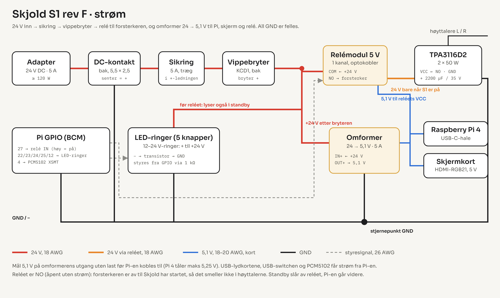

# Skjold S1 rev F – strøm: fra 24 V inn til bryter, omformer og forsterker

Skjemaet ligger også som [SVG](strom_rev_f.svg). Pinnene er de samme som i `pi/config/s1f_pins.yaml`, og logikken (relé,
LED-ringer, standby) står i [pi/S1F.md](../../pi/S1F.md).

## Hvordan det henger sammen

1. **24 V-adapteren** går inn i DC-kontakten bak.
2. **Sikringen** (5 A) sitter i +-ledningen rett etter DC-kontakten, før alt annet.
3. **Vippebryteren (KCD1)** bryter + og slår hele S1 av og på.
4. **Etter bryteren deler +24 V seg i tre:**
   - til **relémodulen** (COM). Reléet slipper 24 V videre til **forsterkeren** (NO → TPA3116 VCC) bare når S1 er på. I standby er forsterkeren uten strøm, mens Pi-en og skjermen går videre.
   - til **omformeren** 24 → 5,1 V, som gir strøm til Raspberry Pi 4, skjermkortet og relémodulen.
   - til **LED-ringene** i knappene (+). De styres på minussiden med en transistor per ring.
5. **All GND er felles.** Samle dem i ett stjernepunkt ved omformerens IN− og forsterkerens GND.
6. **Støy fra omformeren.** En billig 24 → 5 V-omformer kan gi skurring i høyttalerne mens musikken spiller (testet på
   S1: skurringen forsvant med Pi-en på egen 5,1 V-lader). Velg en omformer med god filtrering, eller gi Pi-en egen
   5,1 V / 3 A-strømforsyning. Lydkortet (PCM5102) får **3,3 V fra pinne 1**, ikke 5 V: Pi-ens 3,3 V-regulator er
   renere. Signal-GND til forsterkeren tas fra **G ved L/R** på lydkortet, ikke fra GND på pinnerekka.

Reléet er NO (åpent uten strøm). Forsterkeren får derfor ikke strøm før Skjold har startet og slår reléet på (GPIO27 høy),
så det smeller ikke i høyttalerne når du slår på bryteren.

## Deler

| Del | Hva | Merk |
|---|---|---|
| Adapter | 24 V DC, minst 5 A (120 W), plugg 5,5 × 2,5 mm | 2 × 50 W trenger opptil ca. 4,5 A på toppene. En 24 V 3 A-adapter går for vanlig lytting, men kutter ved høyt volum med 4 Ω |
| DC-kontakt | Panelkontakt 5,5 × 2,5 mm (DC-099 eller DC-022B) | Senterpinnen er + |
| Sikring | Bladsikringsholder med 18 AWG-ledning og 5 A sikring, eller 5 × 20 mm-holder med 5 A træg | Rett etter DC-kontakten |
| Vippebryter | KCD1-101 (2 pinner), 6 A | I +-ledningen |
| Relémodul | 5 V, 1 kanal, med optokobler, kontakt 10 A / 30 V DC (SRD-05VDC-SL-C) | IN fra GPIO27, VCC/GND fra 5,1 V |
| Forsterker | TPA3116D2 2 × 50 W | VCC fra reléets NO |
| Kondensator | 2200 µF / 35 V elektrolytt | Rett på forsterkerens VCC/GND-terminaler, stripen til GND |
| Omformer | 24 → 5 V, minst 5 A. Ferdig modul («DC-DC step down 24V to 5V 5A») eller XL4015 / XL4016 justert til 5,1 V | LM2596 (3 A) er for liten til Pi 4 med skjerm og USB-lydkort |
| Pi-strøm | USB-C-hale med skrueklemme eller loddeputer («USB-C male DIY cable») | Anbefalt: Pi-ens egen sikring og spenningsvakt er med. 5 V på GPIO pinne 2 og 6 går også, men da uten vern |
| Skjermkort | HDMI-RGB21 (4,58″, 960 × 320) | 5 V-inngang, ofte micro-USB eller to loddeputer |
| LED-transistorer | 5 × S8050 (NPN) eller AO3400 (N-MOSFET), 5 × 1 kΩ | Én per LED-ring |
| Ledning | 18 AWG rød/sort til 24 V, 18–20 AWG til 5 V, 26 AWG til signaler | Kort på 5 V-siden, så spenningen ikke faller |
| Små ting | Flatstifthylser 4,8 mm til KCD1, krympestrømpe, kabelstrips med klebefot, Wago 221 eller loddeskjøt til stjernepunktet | |

## Koblinger

### 24 V (18 AWG)

| Fra | Til |
|---|---|
| DC-kontakt senter (+) | Sikringsholder inn |
| Sikringsholder ut | KCD1 pinne 1 |
| KCD1 pinne 2 | Fordeling «+24 V etter bryteren» (Wago eller loddeskjøt): |
| → | Relémodul **COM** |
| → | Omformer **IN+** |
| → | LED-ringenes **+**, alle fem samlet i én ledning |
| Relémodul **NO** | TPA3116 **VCC** (+ 2200 µF over VCC/GND) |
| DC-kontakt hylse (−) | Stjernepunkt GND |
| Stjernepunkt GND | TPA3116 **GND**, omformer **IN−** |

### 5,1 V (18–20 AWG, så korte som mulig)

| Fra omformer OUT+ / OUT− | Til |
|---|---|
| | Raspberry Pi 4: USB-C-hale (eller GPIO pinne 2 = 5 V og pinne 6 = GND) |
| | Skjermkortet HDMI-RGB21: 5 V-inngang |
| | Relémodul **VCC** / **GND** (la jumperen VCC–JD-VCC stå på) |

USB-lydkortene (UCA202), USB-switchen og PCM5102 får strøm fra Pi-en (USB-portene og 5 V/3V3-pinnene) og trenger
ingen egne ledninger fra omformeren.

### Styring fra Pi-en (26 AWG)

| GPIO (BCM) | Fysisk pinne | Til |
|---|---|---|
| 27 | 13 | Relémodul **IN** (høy = forsterker på) |
| 22 / 23 / 24 / 25 / 3 | 15 / 16 / 18 / 22 / 5 | 1 kΩ → basis (S8050) eller gate (AO3400) på LED-transistoren for BT, AUX, RADIO, USB og power |
| 4 | 7 | Ledig (XSMT er fast høy på lydkortet) |
| GND | 6, 9, 14 … | Relémodul GND, transistorenes emitter/source |

LED-ring: **+** til +24 V, **−** til transistorens kollektor/drain, emitter/source til GND. Ringene for 12–24 V har
motstand innebygd. Har du 5 V-ringer, ta + fra 5,1 V i stedet.

## Rekkefølge

1. **Lodd og krymp alle 24 V-ledninger før adapteren kobles til.** 24 V er ufarlig å ta på, men en kortslutning gir mange ampere og smelter tynne ledninger.
2. Koble DC-kontakt → sikring → KCD1 → omformer IN+/IN−. Ikke noe annet ennå.
3. Slå på og **juster omformeren til 5,1 V uten last**. Pi 4 tåler maks 5,25 V. Slå av.
4. Koble 5,1 V til relémodulen og skjermkortet, deretter Pi-en. Slå på: Pi-en og skjermen skal starte, mens forsterkeren ennå ikke har strøm.
5. Koble relémodulen (COM/NO) og forsterkeren, med kondensatoren på forsterkerens terminaler. Koble høyttalerne.
6. Koble LED-ringene og transistorene.
7. Slå på. Når Skjold har startet, klikker reléet og forsterkeren får strøm. Et kort trykk på power (standby) skal få reléet til å klikke av igjen.

## Feilsøking

| Symptom | Sjekk |
|---|---|
| Pi-en starter på nytt under høyt volum | Spenningen faller: mål på Pi-en under last (minst 4,9 V). Kortere eller tykkere 5 V-ledning, eller større omformer |
| Ingen lyd, men skjermen virker | Klikker reléet når S1 starter? Mål 24 V på forsterkerens VCC. GPIO27 og reléets IN/VCC/GND |
| Smell i høyttalerne ved påslag | Reléet er koblet på NC i stedet for NO |
| Sikringen går | Kortslutning på 24 V-siden, eller kondensatoren er snudd (stripen skal til GND) |
| Brumming | GND samlet i ett punkt? Lydkablenes skjerm bare i den ene enden. Se USB-isolator i byggeveiledningen |
| LED-ring lyser hele tiden | Transistoren er koblet feil (C/E byttet), eller ringen går rett til GND |
