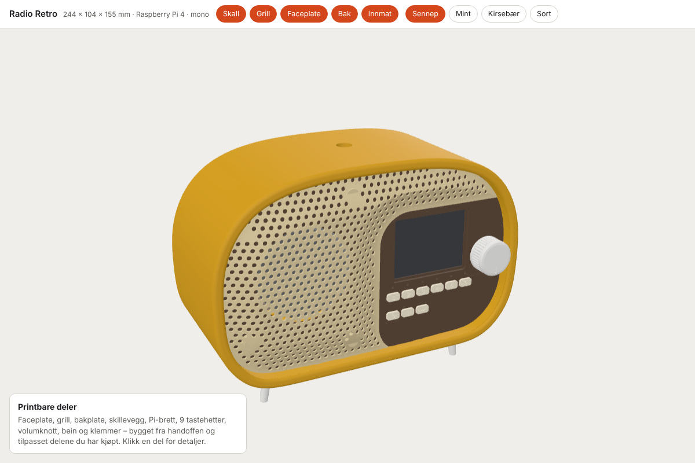

# Radio Retro (mono, Raspberry Pi 4)

Nettradio/høyttaler i retro-skall: Raspberry Pi 4 → 3,5 mm → PAM8406 → én 3" høyttaler. Samme programvare som pultforsterkeren (AirPlay 2, Bluetooth, Squeezelite/Music Assistant, HA/Homey) i testmodus `KI_AMP_OUT=headphones`.

Interaktiv modell: `3d/index.html` (åpnes via `python3 -m http.server` i `radio/3d`). Kilden er `build_radio.py` – alle mål som avhenger av delene står samlet øverst under «DELER», så faceplaten kan justeres etter at du har målt skjermkortet.

## Printbare deler (`stl/`)

| Fil | Antall | Materiale / innstillinger | Merknad |
|---|---|---|---|
| `faceplate.stl` | 1 | PLA/PETG, 0,2 mm, 4 vegger | Forsiden ned. Lomme for akryl 64 × 50 × 2, magnetlommer, graverte etiketter |
| `grill.stl` | 1 | PLA, 0,16 mm | Kuppelen opp, **trestøtte** under kuppelen |
| `bakplate.stl` | 1 | PLA/PETG | Utsiden (med tekst) ned |
| `skillevegg.stl` | 1 | PLA | Flat |
| `pi_brett.stl` | 1 | PETG (varme fra Pi) | Står på leppen, ingen støtte |
| `tast_1…6`, `tast_source`, `tast_forrige`, `tast_neste` | 9 | PLA, 0,12 mm | Forsiden ned. Fyll graveringen med maling, eller fargebytt på 0,5 mm |
| `volumknott.stl` | 1 | PETG, 100 % fyll | Toppen ned. Hull Ø5,85 trykkes på Plum-akselen |
| `bein_x4.stl` | 4 | PETG, sølv/grå | Foten ned. M3-varmeinnsats i toppen |
| `tft_klemme_x4.stl` | 4 | PLA | Holder TFT-kortet (M2,5 × 6) |
| `hoyttaler_klemme_x4.stl` | 4 | PLA | Holder høyttalerrammen (M3 × 6 selvgjengende) |

## Mål som er tilpasset delene

- **Taster** står med 12,7 mm avstand (5 hull på hullkortet), lysprikkene 7,62 mm over favorittene (3 hull) og nederste rad 15,24 mm under (6 hull). Alt treffer 2,54 mm-rasteret.
- **Brytere 6 × 6 × 7 mm** (Vertical-settet). Hullkortet sitter på fire 12 mm stolper bak faceplaten. Andre bryterhøyder: endre `SW_H` og bygg på nytt.
- **Lysprikk:** 3 mm LED på hullkortet, hylse bak faceplaten, **2 mm akrylstav ca. 6,5 mm lang** i hullet (puss enden matt).
- **TFT 2,8" (rødt kort 86 × 50):** glasset ligger i en ramme bak vinduet, pinneraden mot **venstre**. Skilleveggen er flyttet 8,8 mm mot venstre (x −4…−1,6) så kortet får plass. Mål glasset ditt (bredde, høyde, tykkelse og hvor det sitter på kortet) og juster `GLASS` / `TFT_PCB` før du printer faceplaten.
- **EC11:** Ø7,4 hull, ring bak mot vridning. Mutter og skive fra pakken foran, under knotten.
- **Høyttaler AUIN 78 mm kvadratisk:** Ø72 hull, fire styrelister midt på hver side, fire klemmer på diagonalene.
- **Raspberry Pi 4** ligger på brettet i bunnen med jack, USB-C og HDMI mot fronten (pluggene går inn under hullkortet), USB/Ethernet mot høyre.
- **PAM8406** festes med VHB-tape på skilleveggen (høyre side). Høyttaleren går gjennom Ø10-hullet.
- **Bakplate:** KCD1 (x 44), DC 5,5 × 2,1 for 5 V 5 A (x 22), USB-C-panel (x 6). Poler, INT/EXT og AUX inn er tatt bort.

## Montering, kort

1. Lim magnetene i faceplate og grill (sjekk polariteten mot hverandre først).
2. Akryl i lommen forfra (dråpe UV-lim eller dobbeltsidig tape i hjørnene). TFT-glasset ned i rammen bak, fire klemmer.
3. Tastehettene inn bakfra, akrylstavene i hullene, så hullkortet med brytere og LED på stolpene.
4. EC11 med mutter, knotten på. Høyttaleren mot styrelistene, fire klemmer.
5. Faceplaten inn i skallet (12 mm inn fra fronten), skillevegg, Pi-brett med Pi og PAM8406, bakplate med 4 × M3 i ringen. POWER-knappen i hullet på toppen. Beina under.

## Kobling (Pi 4, BCM)

| Del | GPIO |
|---|---|
| TFT (SPI0) | MOSI 10, SCLK 11, CS 8, DC 25, RST 24, LED (bakgrunnslys) 18 |
| Favoritt 1–6 | 5, 6, 13, 19, 26, 16 |
| SOURCE / ◀◀ / ▶▶ | 20, 21, 12 |
| EC11 A / B / trykk | 17, 27, 22 |
| LED 1–6 (330 Ω) | 0, 1, 7, 9, 14, 15 |
| POWER-knapp / LED-ring (2N2222A) | 3 (vekker også Pi-en fra halt) / 23 |
| Lyd | 3,5 mm tupp (venstre) → PAM8406 LIN, hylse → GND. Høyttaler på LOUT+ / LOUT− (aldri GND) |

Programvaren for skjermen og tastene (ST7789/ILI9341-UI fra handoffen, mono-miks, favoritter) kommer i neste runde.
