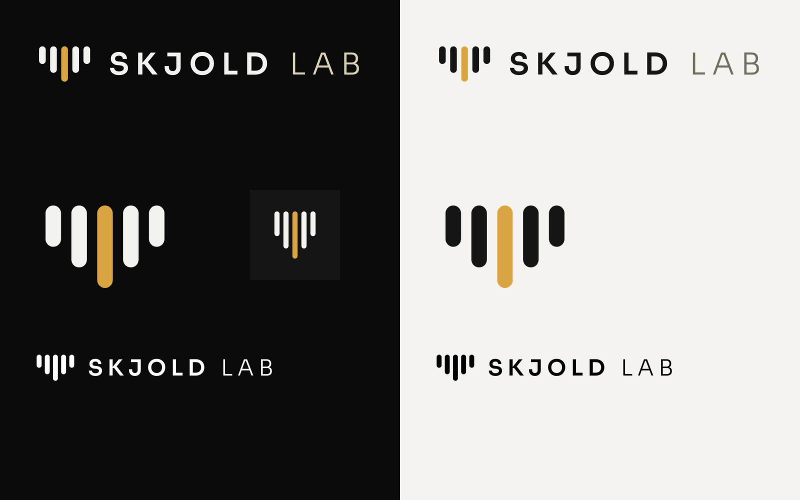

# Skjold Lab-logoen

Logoen består av **merket** (fem stolper som henger fra en felles topp og danner et skjold, den midterste i gull) og **ordmerket** «SKJOLD LAB» i Sora (SKJOLD i SemiBold, LAB i Light). Teksten er gjort om til former, så du trenger ikke skrifttypen installert.

## Filene

| Fil | Bruk |
|---|---|
| `skjold-lab-logo-mork-bakgrunn` | Hovedlogoen. På mørk bakgrunn (som nettsiden og appen) |
| `skjold-lab-logo-lys-bakgrunn` | På hvit eller lys bakgrunn |
| `skjold-lab-logo-hvit` / `-svart` | Én farge: på bilder, gravering, laserkutt, stempel, faks og 3D-print i én farge |
| `skjold-merke-*` | Bare merket. Der det er lite plass: profilbilde, favicon, på produktet, i lister |
| `skjold-app-ikon` | Kvadratisk ikon (1024, 512 og 180 px) til app, nettside (apple-touch-icon) og sosiale medier |

`svg/` er vektor (skaleres uten tap, bruk den når det går). `png/` har gjennomsiktig bakgrunn: `-100h`/`-400h` er høyden i piksler for logoen, `-64`/`-256`/`-1024` for merket.

## Regler

- **Luft rundt:** minst bredden av to stolper på alle sider. Ikke legg tekst eller andre logoer tettere.
- **Minste størrelse:** logoen minst 24 px (6 mm) høy, merket minst 16 px (4 mm). Mindre enn det: bruk bare merket.
- **Ikke endre:** ikke strekk, roter, legg skygge på eller bytt farge på deler av logoen. Den midterste stolpen er alltid gull (eller samme farge som resten i én-farge-versjonene).
- **Bakgrunn:** bruk versjonen som passer bakgrunnen. På bilder: hvit eller svart, der kontrasten er god.

## Farger

| Navn | Hex | Brukes til |
|---|---|---|
| Gull | `#D9A441` | Midtstolpen, aksenter |
| Lys | `#F2F2EE` | Stolper og SKJOLD på mørk bakgrunn |
| Khaki | `#D8CFB4` | LAB på mørk bakgrunn |
| Mørk | `#151516` | Bakgrunn, og stolper/SKJOLD på lys bakgrunn |
| Grå | `#6E6A5E` | LAB på lys bakgrunn |

## Skrift

Sora (SemiBold til SKJOLD, Light til LAB, Regular til tekst), IBM Plex Mono til små etiketter. Begge er gratis (SIL Open Font License) fra Google Fonts.

© Sebastian Kristo Jemtland. Skjold og Skjold Lab-logoen er beskyttet. Bruk den til å vise at noe er Skjold eller virker med Skjold, ikke som din egen.
