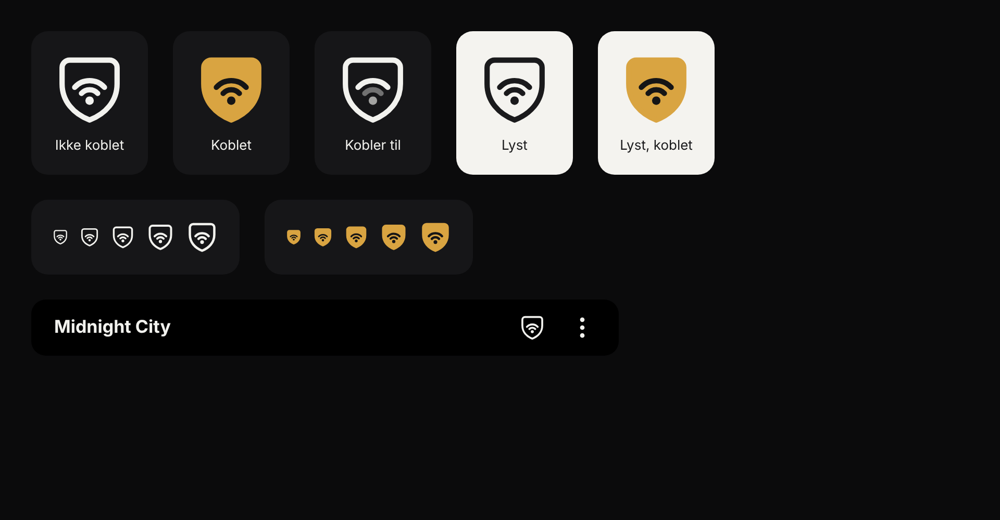

# Skjold Cast-ikonet

Cast-knappen for å spille på en Skjold-enhet, på samme sted som Chromecast- og AirPlay-knappene i en musikkapp. Et skjold med et trådløst signal inni.

| Fil | Tilstand |
|---|---|
| `skjold-cast.svg` | Ikke koblet. Følger tekstfargen (`currentColor`), så den virker i lyst og mørkt tema |
| `skjold-cast-kobler.svg` | Kobler til: buene blinker etter tur (SVG-animasjon) |
| `skjold-cast-koblet.svg` | Koblet: skjoldet fylt med gull (#d9a441), signalet mørkt |

Rutenett 24 × 24, strek 1,7 med runde ender. Leses godt ned til 16 px. Bruk samme størrelse som de andre knappene i verktøylinjen (vanligvis 24 px).

Et alternativ med Skjold-stolpene og lydbuer ligger i `../spill-pa-skjold/`.
