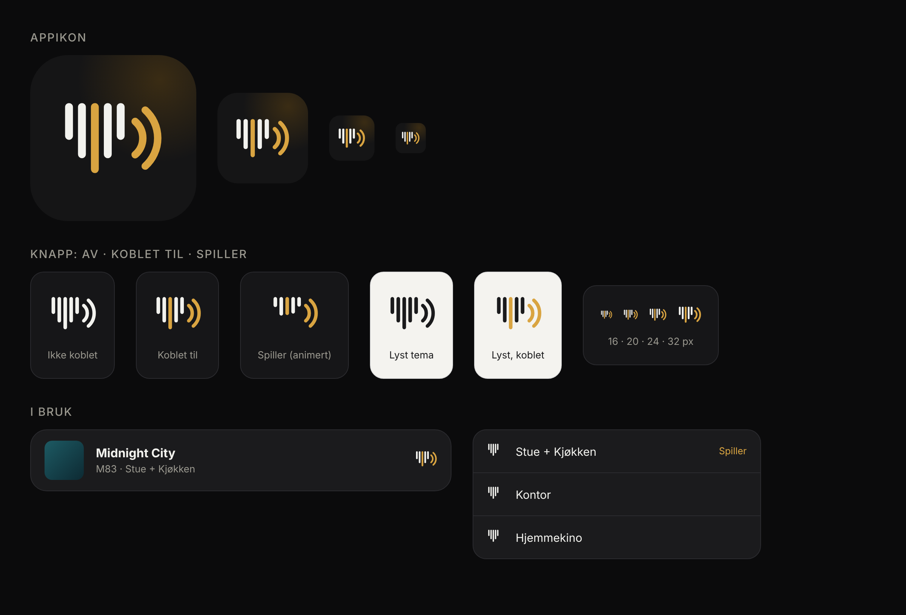

# «Spill på Skjold»-ikonet

Til musikkapper som spiller på Skjold-enheter. Skjold-merket (fem stolper som danner et skjold, midtstolpen i gull) med to lydbuer som går ut fra det.

| Fil | Bruk |
|---|---|
| `spill-pa-skjold.svg` | Knappen, ikke koblet. Følger tekstfargen (`currentColor`), så den virker i lyst og mørkt tema |
| `spill-pa-skjold-aktiv.svg` | Koblet til en Skjold: midtstolpen og buene i gull (#d9a441) |
| `spill-pa-skjold-spiller.svg` | Spiller: stolpene beveger seg som en equalizer (SVG-animasjon) |
| `skjold-merke.svg` | Bare merket, f.eks. foran hver Skjold-enhet i en liste |
| `spill-pa-skjold-app.svg`, `spill-pa-skjold-app-1024.png` | Appikon (1024 × 1024, uten gjennomsiktighet – iOS runder hjørnene selv) |

Rutenett 24 × 24. Leses godt ned til 16 px. Stolpene er 1,8 brede med 1,15 mellomrom og høyder 8,4 / 12,6 / 16 / 12,6 / 8,4 (samme forhold som Skjold-logoen). Buene har strek 1,7 med runde ender.

Lisens som resten av designet (CC BY-NC-SA 4.0). Skjold-navnet og merket er beskyttet; bruk dem til apper som virker med Skjold.
