# Skjold-appen i Xcode (SwiftUI): byggeoppgave for Claude

**Regel:** Appen skal være **piksel-identisk** med designfilen `Skjold App v2.dc.html` og skjermbildene i `skjermer/`. Samme størrelser (pt), avstander, radier, farger, skrifter, ikoner, tekster og rekkefølge. Ikke bruk standardutseendet til SwiftUI (`List`, `Form`, `NavigationStack`-tittel, `TabView`-linje, `.borderedProminent`) der det endrer utseendet. Tegn komponentene selv. Ved tvil gjelder designfilen.

## Slik leser du designet
- **Designfilen** `Skjold App v2.dc.html`: åpne den i Safari. Malen (HTML med inline `style`) gir eksakte mål. Logikken (`class Component` nederst) gir tilstand og oppførsel. 1 CSS-px = 1 pt.
- **Skjermbildene** i `skjermer/` er tatt i 3x. Telefonrammen er 370 × 780 pt (1110 × 2340 px), og skjermen inni er 350 × 760 pt, med 10 pt kant rundt. Del på 3 for å få pt.
- **Tilstand:** Vil du se en skjerm live, åpne designfilen og kjør `window.__skjoldApp.setState({...})` i konsollen. Verdiene står i tabellen under.
- **Innstillingsmodellen** er `skjold_settings.js`. Den inneholder kategorier, felt, radiokatalog, logoer og kanalbilder. Lag den som Swift-modeller (`Codable`) med samme id-er.

## Oppsett i Xcode
- iOS 17+, SwiftUI, `@Observable`-modeller. Bare mørk modus (`.preferredColorScheme(.dark)`).
- **Fonter:**
  - Last ned Sora (300/400/600) og IBM Plex Mono (400/500) fra Google Fonts.
  - Legg TTF-ene i prosjektet og list dem under `UIAppFonts` i Info.plist.
  - Lag `Font.sora(_ size:, _ weight:)` og `Font.plexMono(_ size:)`. **Aldri systemfont.**
- **Info.plist:**
  - `NSLocalNetworkUsageDescription` = «Skjold finner forsterkere på nettverket ditt.»
  - `NSBonjourServices` = `_skjold._tcp`
  - `NSCameraUsageDescription` = «Skann QR-koden på forsterkeren.»
- **Finne enheter:** `NWBrowser(for: .bonjour(type: "_skjold._tcp", domain: nil))`
- **QR:** `DataScannerViewController` (VisionKit). Rammen og skannelinjen tegnes oppå slik designet viser.
- **Safe area:**
  - Rotvisningen tegner bakgrunnen `#0b0b0c` med `.ignoresSafeArea()`.
  - Innholdet respekterer safe area på toppen.
  - Fanelinjen ligger i bunnen med bakgrunn helt ned til kanten. Ingen ekstra avstand under.

## Design-tokens
```swift
extension Color {
  static let bg      = Color(hex: 0x0b0b0c)  // bakgrunn
  static let card    = Color(hex: 0x141415)  // kort
  static let card2   = Color(hex: 0x1b1b1c)  // knapp/felt
  static let line    = Color(hex: 0x242426)  // kant kort
  static let line2   = Color(hex: 0x2e2e30)  // kant knapp/felt
  static let ink     = Color(hex: 0xf2f2ee)  // tekst
  static let ink2    = Color(hex: 0xc9c9c4)  // sekundær tekst
  static let muted   = Color(hex: 0x8b8b86)  // dempet tekst
  static let accent  = Color(hex: 0xd9a441)  // gull, knapper
  static let accent2 = Color(hex: 0xf0c46a)  // gull, tekst/ikon
  static let selBg   = Color(hex: 0x1c170d)  // valgt kort, bakgrunn
  static let selLine = Color(hex: 0x5a4420)  // valgt ikonramme
  static let ok      = Color(hex: 0x6fcf7f)  // tilkoblet-prikk
  static let live    = Color(hex: 0xe05a4a)  // DIREKTE / feil
  static let off     = Color(hex: 0x3a3a37)  // inaktiv
}
```
- **Radier:** kort 14, knapp 14, felt 12, små fliser 8, piller 999 (Capsule), telefonramme 52/44 (bare i mock).
- **Tekst (pt):** 12 og 13 er mest brukt.
  - Tittel H1: 28/600
  - Seksjonstittel: 17/600
  - Kort-tittel: 15/600
  - Brødtekst: 13–14
  - Under-tekst: 11–12
  - Etiketter i IBM Plex Mono: 9–10, sperring 0,12em (`.tracking(1.2)` ved 10 pt)
- **Marger:** 20 pt sider på hovedskjermer. Mellomrom mellom seksjoner 18–22. Mellomrom i lister 8–12.
- **Valgt-tilstand** (gjelder alle valgbare kort): kant `accent`, bakgrunn `selBg`, tekst `accent2`. Ellers kant `line2`, bakgrunn `card`, tekst `ink`.
- **Fanelinje:**
  - 4 faner: Hjem · Lyd · Rom · Innstillinger. Høyde 70 + safe area.
  - Bakgrunn `rgba(18,18,19,0.94)` med `.ultraThinMaterial` under, og topplinje `#232325`.
  - Aktiv fane: ikon i pille 30 pt høy, med etikett 10,5 pt.

## Skjermer
For hver skjerm: bildet, tilstanden i designfilen og hva som må være med. Alle tekster skal være nøyaktig som i bildet.

### Start og oppsett
| | Skjerm | Tilstand | Må ha |
|---|---|---|---|
| 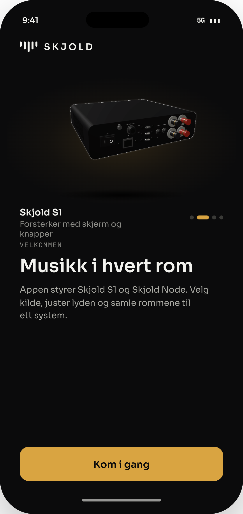 | **01 Velkomst** | `welcome:true` | Intro-animasjon først (4,7 s, se `introView()`). Deretter render av S1 og Node som ruller sakte på sort bakgrunn, og «Kom i gang» synlig uten å rulle. |
| 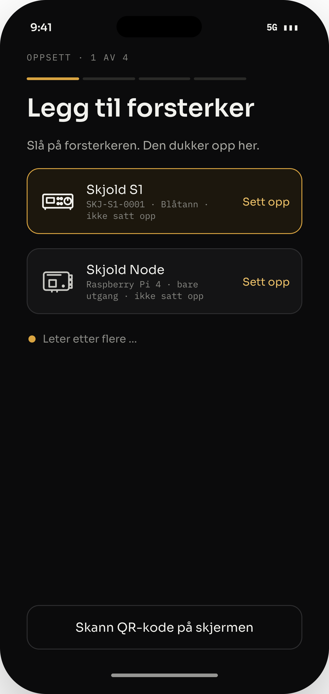 | **02 Finn forsterker** | `mode:'onboard', ob:0` | «OPPSETT · 1 AV 4» + 4-delt fremdriftslinje. Funne enheter som kort, der den første er valgt. Pulserende prikk + «Leter etter flere …». «Skann QR-kode på skjermen» nederst. |
| 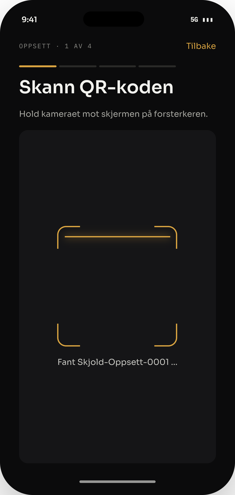 | **03 QR** | `ob:0, scan:true` | Kamera med gullramme og skannelinje som går opp og ned. |
| 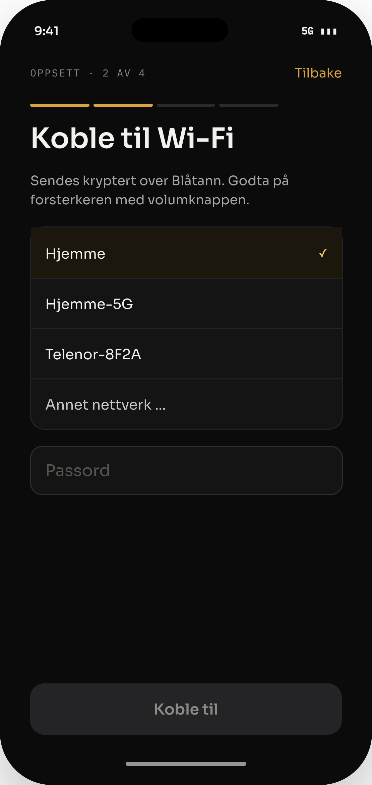 | **04 Wi-Fi** | `ob:1` | Liste med signal og lås. Valgt nett har gullkant. Passordfelt. «Annet nettverk …» nederst i listen. |
| 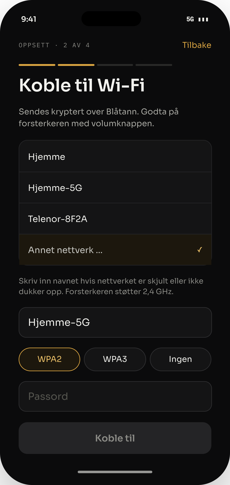 | **05 Annet nettverk** | `ob:1, net:'man'` | Felt for SSID, valg av sikkerhet (WPA2 / WPA3 / Ingen) og passord (skjules ved «Ingen»). |
| 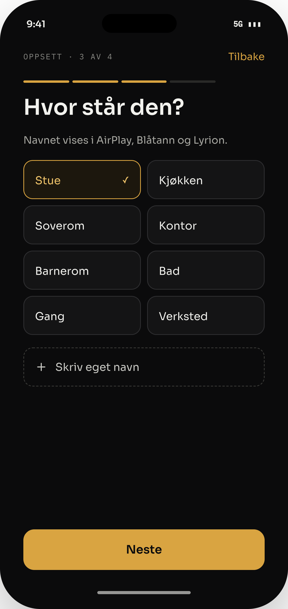 | **06 Rom** | `ob:2` | Rutenett med rom + «Skriv eget navn», som åpner et tekstfelt. |
| 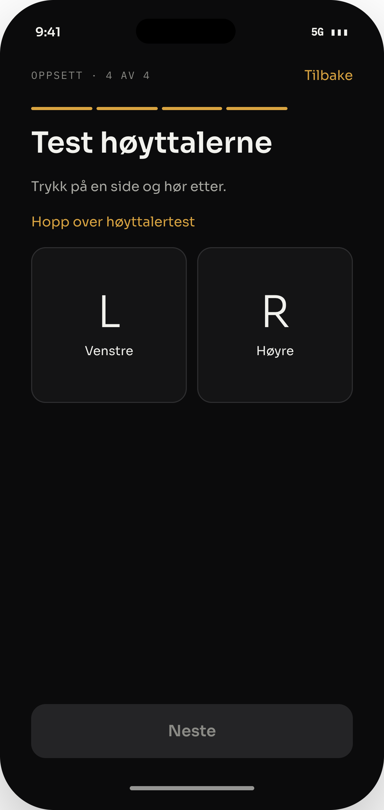 | **07 Test høyttalere** | `ob:3` | Knappene L og R spiller testtone. Haken settes når begge er testet. |
| 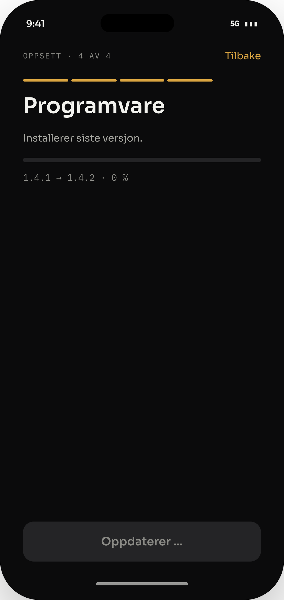 | **08 Programvare** | `ob:4` | Sjekker og installerer oppdatering, med fremdrift og logg. |

### Hovedappen
| | Skjerm | Tilstand | Må ha |
|---|---|---|---|
| 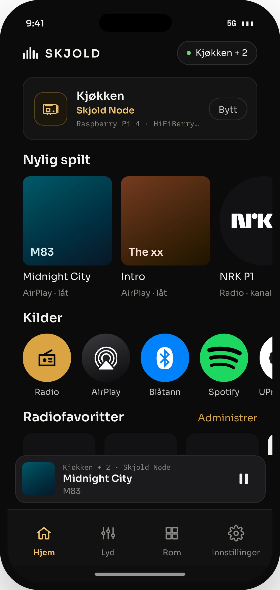 | **09 Hjem** | `mode:'app', tab:0` | Logo + pille med rom. Romkort med «Bytt». Nylig spilt. Kilder som runde, **fulle logoer** (Spotify, YouTube Music, Navidrome, AirPlay, UPnP/DLNA, Chromecast) og ikoner for Radio, Blåtann og AUX. Radiofavoritter + «Administrer». Minispiller over fanelinjen. |
| 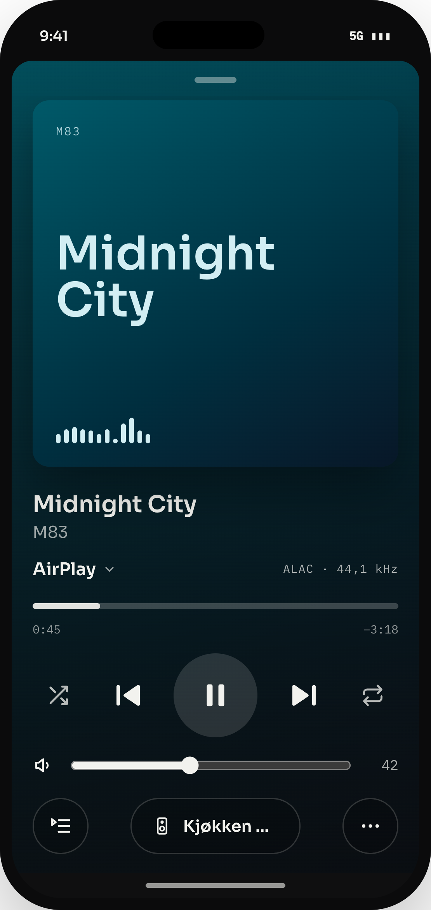 | **10 Fullskjermspiller** | `full:true` | Åpnes fra minispilleren og dras ned for å lukke. Cover, tittel, fremdrift, ⏮ ▶ ⏭, volum, kildevelger og kø-knapp. |
| 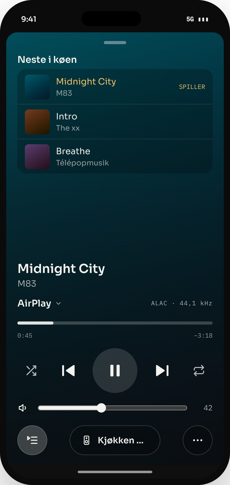 | **11 Kø** | `full:true, queueOpen:true` | Køliste over spilleren, der låten som spilles er markert. |
| 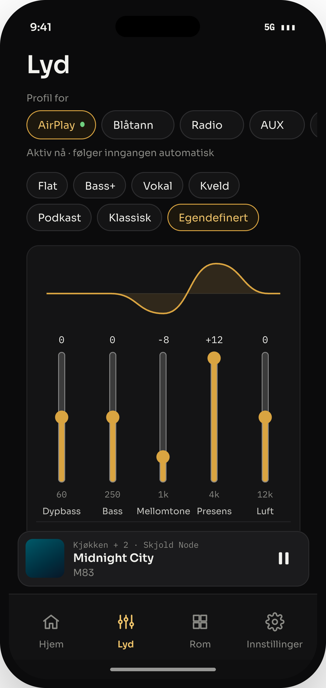 | **12 Lyd** | `tab:1` | EQ per kilde (AirPlay, BT, radio, AUX, hodetelefoner). Forhåndsinnstillinger og 5 bånd med forklaring. Bass, diskant, balanse og loudness. |
| 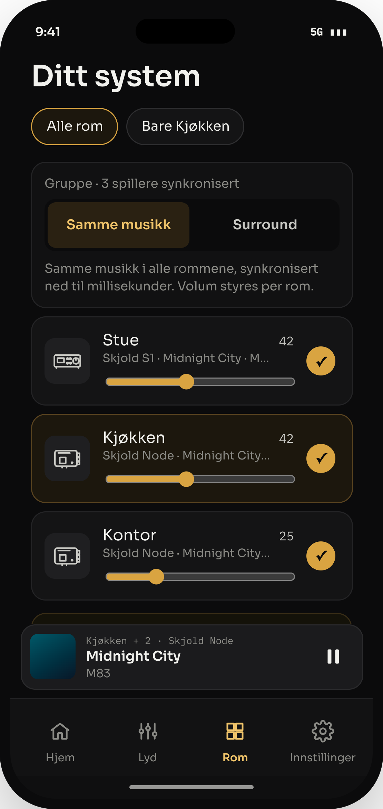 | **13 Rom** | `tab:2` | «Ditt system»: grupper («Alle rom» / «Bare …»), romkort med volum og rolle. Legg til enhet. |
| 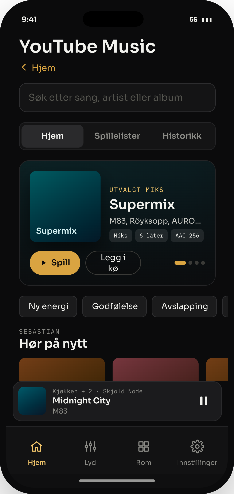 | **14 YouTube Music** | `tab:0, sub:'lib', lib:'ytm'` | Søk, faner, toppmiks, hyller og spillelister (`libVals()`). Åpnes fra Kilder. |
| 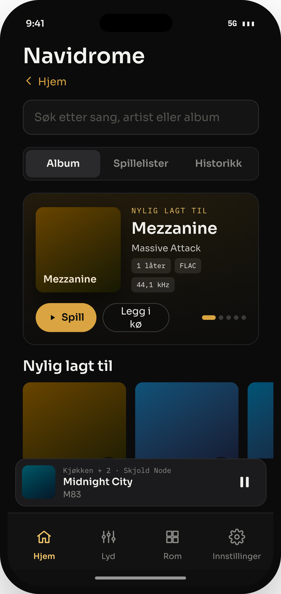 | **15 Navidrome** | `tab:0, sub:'lib', lib:'nd'` | Samme oppsett med album og historikk. |
| 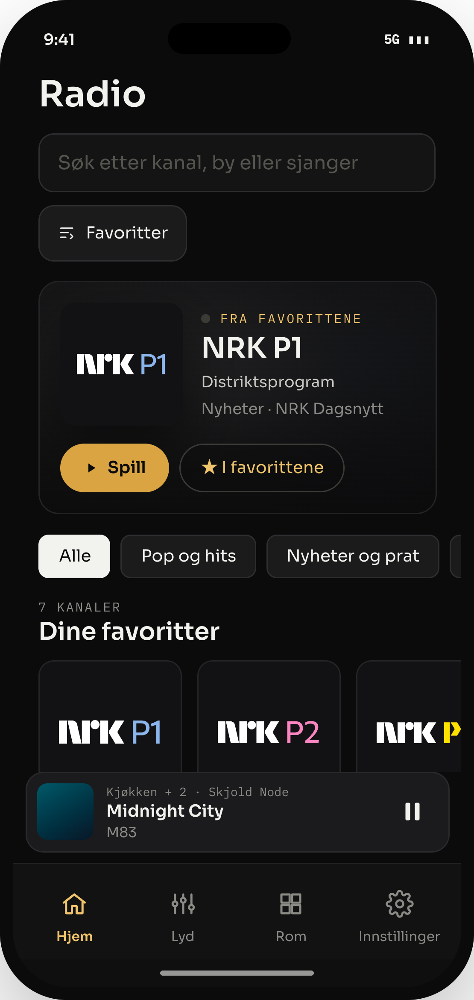 | **16 Radio** | `tab:0, sub:'radio'` | Søk + «Favoritter». Toppkort med kanalen som spiller (uskarpt fargelys). Sjangerfiltre. Hyller: Dine favoritter, Populære i Norge og sjangre. |
| 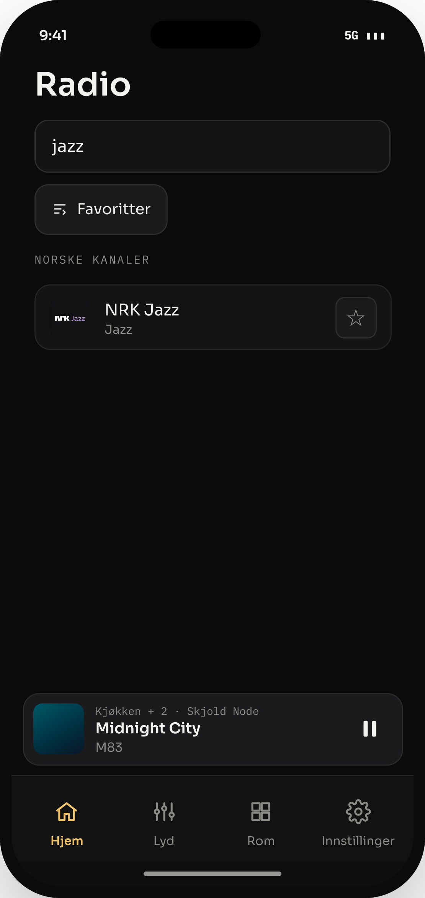 | **17 Radio, søk** | `sub:'radio', q:'jazz'` | Norske kanaler først, så Radio Browser (`https://de1.api.radio-browser.info/json/stations/search`). ★/☆ på hver rad. |
| 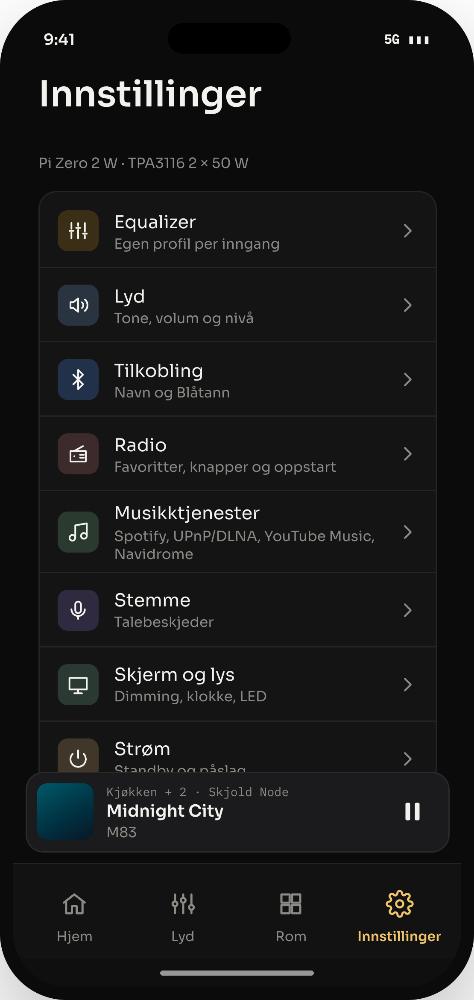 | **18 Innstillinger** | `tab:3` | Kategorier med ikonflis 32 pt, tittel 14 og undertekst 11. Kategoriene kommer fra `catsFor(type)`. |
| 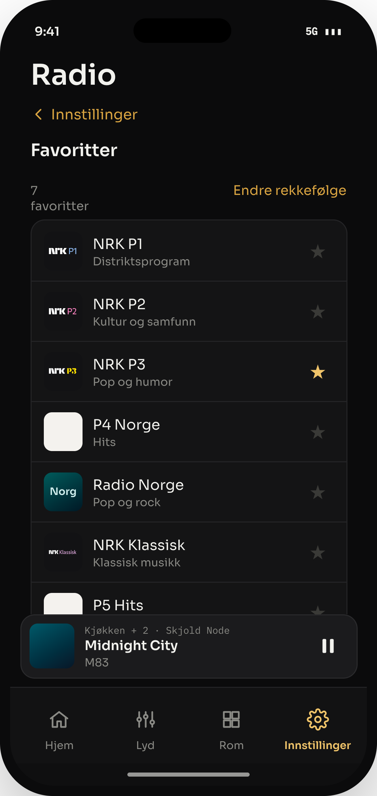 | **19 Innst. → Radio** | `tab:3, setCat:3` | Favoritter øverst: inntil 50, endre rekkefølge, søk og legg til, og **legg til strøm-URL**. Under: knapper og oppstart. |
| 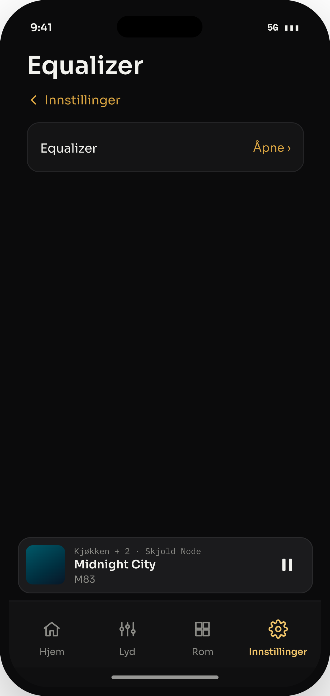 | **20 Innst. → Equalizer** | `tab:3, setCat:0` | Egen profil per inngang. |

## Komponenter (lag disse først)
`SKCard`, `SKSelectCard`, `SKButton` (primær gull / sekundær), `SKField`, `SKChip`, `SKSectionHeader`, `SKSourceLogo`, `SKRadioTile`, `SKMiniPlayer`, `SKTabBar`, `SKProgressSteps`, `SKToggle`, `SKSlider`, `SKSheet` (dra ned for å lukke). Mål og farger leses fra malen i designfilen.

## Data og API
- Lokalt REST- og WebSocket-API på enheten: `http://<navn>.local/api/...`. Webgrensesnittet og appen bruker samme API (se `../../README.md`, punkt 3).
- Logoer: se `BRAND` i `skjold_settings.js`. Kanalbilder: `art()`.

## Ferdig når
1. Alle 20 skjermene finnes og fungerer med samme oppførsel som i designfilen.
2. For hver skjerm: ta et skjermbilde i simulatoren (iPhone 15 Pro). Legg det ved siden av bildet i `skjermer/` og sammenlign elementene i pt. Bredden er 393 mot 350 pt, så elementene strekkes i bredden, men alle faste mål skal være like.
3. Skriv avvik i `AVVIK.md` og rett dem til listen er tom.
